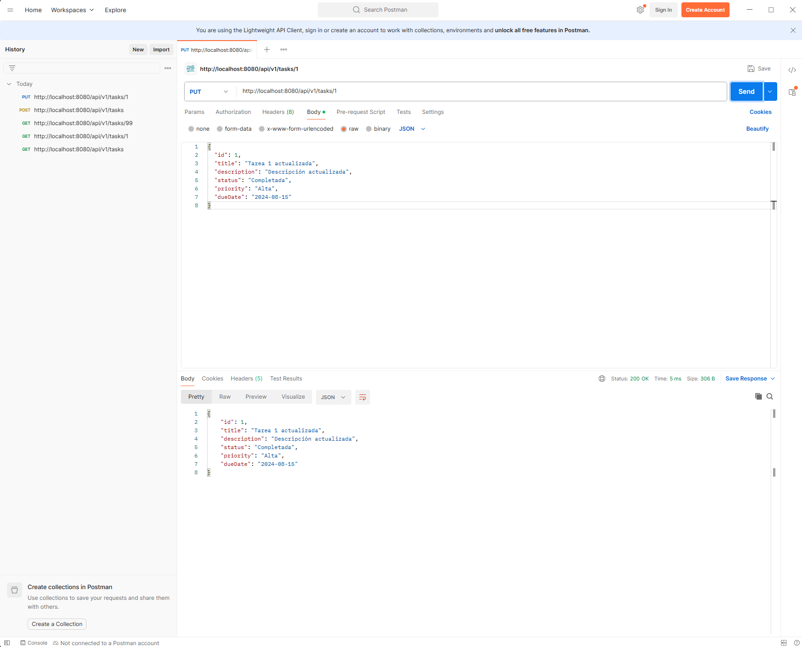
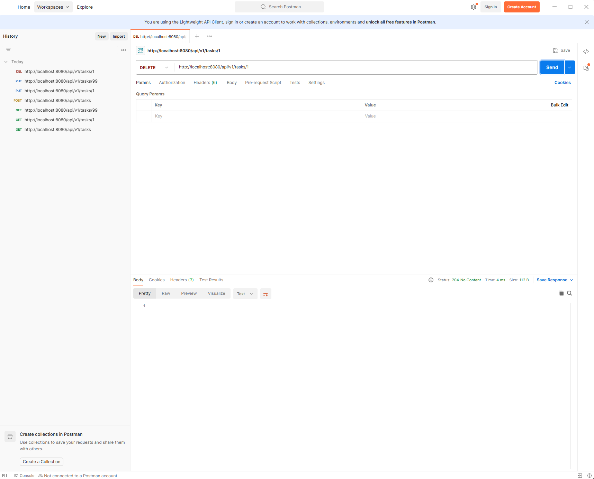
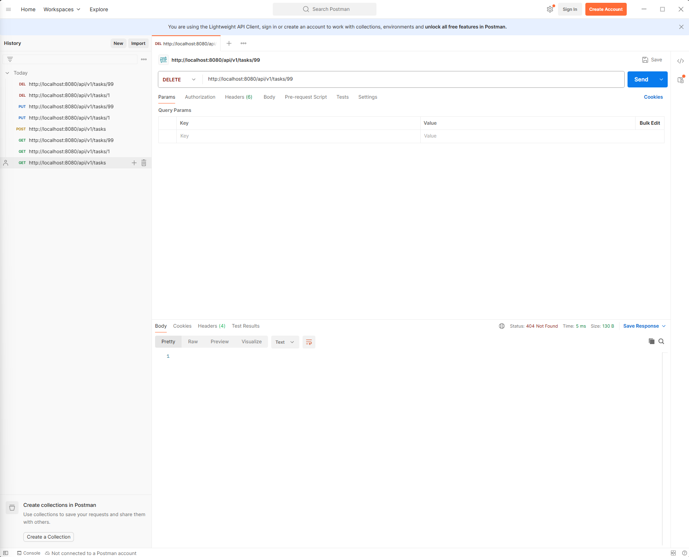

Paso 1 - Preparación (ASK):

Pregunta 1:

¿Qué es un Rest Controller en Spring Boot, cuál es su responsabilidad dentro de una aplicación y qué diferencia hay entre un Controller normal y un Rest Controller?

Respuesta:

¿Qué es un RestController?
Un REST Controller en Spring Boot es una clase que expone endpoints HTTP para que otras aplicaciones o clientes puedan comunicarse con la aplicación mediante una API REST.

Se identifica normalmente con:

@RestController
@RequestMapping("/api/tasks")
public class TaskController {
    // endpoints
}

Responsabilidades
Un RestController suele encargarse de:

Recibir peticiones HTTP (GET, POST, PUT, DELETE).
Obtener parámetros y datos del cuerpo de la petición.
Validar la entrada recibida.
Invocar la lógica de negocio de los servicios.
Devolver respuestas HTTP, normalmente en formato JSON.
Utilizar códigos de estado adecuados, como 200, 201, 400 o 404.
No debería contener directamente toda la lógica de negocio; esa responsabilidad corresponde normalmente a la capa de servicios.

Diferencia entre @Controller y @RestController
@Controller: se utiliza principalmente en aplicaciones MVC. Sus métodos suelen devolver el nombre de una vista HTML.
@RestController: se utiliza para crear APIs REST. Sus métodos devuelven directamente datos en el cuerpo de la respuesta, normalmente JSON.
@RestController equivale conceptualmente a:

@Controller
@ResponseBody

Por ejemplo:

@RestController
public class HelloController {

    @GetMapping("/hello")
    public String hello() {
        return "Hola";
    }
}

La respuesta será directamente "Hola" en el cuerpo HTTP, en lugar de intentar buscar una vista llamada Hola.

--------------------------------------------------------------------------------------------------------------------------

Pregunta 2:

¿Cómo se estructura una respuesta HTTP en una API REST? Dime qué función tienen el código de estado y cúales hay y explícame las cabeceras y el cuerpo de la respueta.

Respuesta:

Una respuesta HTTP está formada principalmente por:

Código de estado
Cabeceras
Cuerpo de la respuesta
Ejemplo:

HTTP/1.1 200 OK
Content-Type: application/json

{
  "id": 1,
  "title": "Comprar leche"
}

Código de estado
Indica el resultado de la petición realizada por el cliente.

1xx — Informativos: la petición continúa procesándose.
2xx — Éxito:
200 OK: petición procesada correctamente.
201 Created: recurso creado correctamente.
204 No Content: operación correcta, sin contenido que devolver.
3xx — Redirección: el cliente debe realizar alguna acción adicional.
4xx — Error del cliente:
400 Bad Request: petición incorrecta o datos inválidos.
401 Unauthorized: falta autenticación.
403 Forbidden: no se tienen permisos suficientes.
404 Not Found: recurso no encontrado.
5xx — Error del servidor:
500 Internal Server Error: error inesperado en el servidor.
503 Service Unavailable: servicio temporalmente no disponible.
Cabeceras
Las cabeceras proporcionan información adicional sobre la respuesta. Algunos ejemplos son:

Content-Type: indica el formato del cuerpo, por ejemplo application/json.
Content-Length: indica el tamaño de la respuesta.
Location: indica la ubicación de un recurso recién creado.
Cache-Control: define cómo se puede almacenar la respuesta en caché.
Authorization: puede contener información de autenticación, aunque normalmente se utiliza en la petición.
Cuerpo de la respuesta
El cuerpo contiene los datos que devuelve el servidor. En una API REST suele utilizarse formato JSON, aunque también pueden utilizarse XML u otros formatos.

Por ejemplo:

{
  "id": 1,
  "description": "Completar el proyecto",
  "completed": false
}

En Spring Boot se puede controlar la respuesta completa utilizando ResponseEntity:

return ResponseEntity
        .status(HttpStatus.CREATED)
        .body(task);

En este caso, se devuelve el código 201, las cabeceras correspondientes y el objeto task en el cuerpo de la respuesta.

--------------------------------------------------------------------------------------------------------------------------

Pregunta 3:

¿Cómo se versionan las URIs de una API REST? Dime todo sobre las URIs, buenas prácticas, ventajas, casos de uso, etc.

Respuesta:

¿Qué es una URI?
Una URI (Uniform Resource Identifier) identifica un recurso dentro de una API REST.

Ejemplo:

https://api.ejemplo.com/api/v1/tasks/15

Sus partes principales son:

https: protocolo.
api.ejemplo.com: dominio.
/api/v1: ruta base y versión de la API.
/tasks: colección de recursos.
/15: identificador de un recurso concreto.
Una URI debe identificar recursos, no acciones. Las acciones se expresan mediante los métodos HTTP:

Método	Operación
GET	Consultar
POST	Crear
PUT	Reemplazar o actualizar
PATCH	Actualizar parcialmente
DELETE	Eliminar

Ejemplos:

GET    /api/v1/tasks
GET    /api/v1/tasks/15
POST   /api/v1/tasks
PUT    /api/v1/tasks/15
PATCH  /api/v1/tasks/15
DELETE /api/v1/tasks/15

¿Por qué versionar una API?
La versionación permite modificar una API sin romper los clientes que utilizan una versión anterior.

Por ejemplo, si la respuesta de una tarea cambia de:

{
  "title": "Comprar leche"
}

a:

{
  "name": "Comprar leche",
  "completed": false
}

los clientes antiguos podrían dejar de funcionar. Una nueva versión permite mantener ambas estructuras durante un periodo de transición.

Principales estrategias de versionado
1. Versión en la URI
Es la estrategia más habitual:

/api/v1/tasks
/api/v2/tasks

En Spring Boot:

@RequestMapping("/api/v1/tasks")
public class TaskController {
    // endpoints de la versión 1
}

Ventajas:

Es sencilla y fácil de entender.
Resulta visible en la documentación y en las URLs.
Facilita mantener varias versiones simultáneamente.
Es fácil de probar desde un navegador o herramientas como Postman.
Desventajas:

La URI cambia al cambiar la versión.
Puede generar duplicación de controladores o lógica.
La URI representa también información sobre la evolución de la API.
2. Versión mediante cabeceras
La versión se indica mediante una cabecera personalizada:

GET /api/tasks
Accept-Version: 2

Ventajas:

Mantiene estables las URIs.
Separa la identificación del recurso de su representación.
Desventajas:

Es menos visible.
Puede ser más difícil de probar y documentar.
El cliente debe conocer y enviar correctamente la cabecera.
3. Versionado mediante Accept
Se utiliza negociación de contenido:

GET /api/tasks
Accept: application/vnd.ejemplo.v2+json

Ventajas:

Es una solución más alineada con HTTP.
Permite solicitar diferentes representaciones del mismo recurso.
Desventajas:

Es más compleja.
Requiere mayor configuración y conocimiento por parte de los clientes.
4. Versión mediante parámetros de consulta

/api/tasks?version=2

Es sencilla, pero suele utilizarse menos porque la versión forma parte de la API y no de los criterios de filtrado del recurso.

Buenas prácticas para diseñar URIs
Usar sustantivos y no verbos:

/api/v1/tasks

Mejor que:

/api/v1/getTasks

Utilizar nombres en plural para las colecciones:

/api/v1/tasks/15

Mantener una nomenclatura coherente.
Utilizar minúsculas y guiones si fueran necesarios:

/api/v1/task-lists

Evitar URIs excesivamente profundas.
Utilizar parámetros de consulta para filtrar, ordenar o paginar:

/api/v1/tasks?completed=false&page=0&size=20

No incluir información sensible en las URIs.
Evitar que las URIs dependan de detalles internos de la base de datos.
Documentar las versiones disponibles.
Mantener una versión antigua durante un periodo de compatibilidad.
Informar de la retirada de una versión mediante documentación o cabeceras como Deprecation.
Recomendación habitual
Para la mayoría de proyectos, una opción clara es versionar mediante la URI:

/api/v1/tasks
/api/v2/tasks

Normalmente se incrementa la versión principal cuando existen cambios incompatibles. Los cambios compatibles, como añadir campos opcionales, no siempre requieren crear una nueva versión.

--------------------------------------------------------------------------------------------------------------------------

Paso 2 - Diseño previo:

¿Qué clase vas a crear y qué responsabilidad tiene?

La clase será TaskController y su responsabilidad será la de gestionar las peticiones HTTP relacionadas con las tareas de la app exponiendo los endpoints Rest necesarios para poder hacer el CRUD (leer, consultar, actualizar y borrar).

¿Qué endpoints vas a implementar? Para cada uno indica: método HTTP, URI y qué debe devolver.

Método HTTP      URI                     Descripción                         Respuesta

GET              /api/v1/tasks           obtener todas las tareas.           200 ok + lista de tareas
GET              /api/v1/tasks/{id}      obtener una tarea por ID.           200 ok + tarea / 404 si no existe
POST             /api/v1/tasks           crear una tarea.                    201 + tarea creada
PUT              /api/v1/tasks/{id}      actualizar una tarea.               200 + tarea actualizada / 404 si no existe
DELETE           /api/v1/tasks/{id}      eliminar una tarea.                 204 sin contenido / 404 si no existe

--------------------------------------------------------------------------------------------------------------------------

Paso 3 - Implementación (autocompletado)

// Crear el modelo Task con los atributos: id, title, description, status, priority, dueDate, incluir sus tipos de datos más adecuados, añadir constructor vacío y por parámetros, añadir getters y setters

public class Task {
    private int id;
    private String title;
    private String description;
    private String status;
    private String priority;
    private java.time.LocalDate dueDate;

    // Constructor vacío
    public Task() {
    }

    // Constructor por parámetros
    public Task(int id, String title, String description, String status, String priority, java.time.LocalDate dueDate) {
        this.id = id;
        this.title = title;
        this.description = description;
        this.status = status;
        this.priority = priority;
        this.dueDate = dueDate;
    }

    // Getters y Setters
    public int getId() {
        return id;
    }

    public void setId(int id) {
        this.id = id;
    }

    public String getTitle() {
        return title;
    }

    public void setTitle(String title) {
        this.title = title;
    }

    public String getDescription() {
        return description;
    }

    public void setDescription(String description) {
        this.description = description;
    }

    public String getStatus() {
        return status;
    }

    public void setStatus(String status) {
        this.status = status;
    }

    public String getPriority() {
        return priority;
    }

    public void setPriority(String priority) {
        this.priority = priority;
    }

    public java.time.LocalDate getDueDate() {
        return dueDate;
    }

    public void setDueDate(java.time.LocalDate dueDate) {
        this.dueDate = dueDate;
    }
}

Añadir tareas precargadas en la lista mediante autocompletado:

// Añadir 2 tareas de ejemplo al ArrayList para poder probar los endpoints -> generado con IA

    static {
        tasks.add(new Task(1, "Tarea 1", "Descripción de la tarea 1", "Pendiente", "Alta", java.time.LocalDate.of(2024, 6, 30)));
        tasks.add(new Task(2, "Tarea 2", "Descripción de la tarea 2", "En progreso", "Media", java.time.LocalDate.of(2024, 7, 15)));
    }

-------------------------------------------------------------------------------------------------------------------------
Primer comentario:

// El Rest Controller debe implementar el endpoint GET para obtener todas las tareas, utilizar ResponseEntity

@GetMapping("/tasks")
    public ResponseEntity<Iterable<Task>> getAllTasks() {
        // Implementar la lógica para obtener todas las tareas
        return ResponseEntity.ok().build();

Incidencia: Se quita ("/tasks") porque lo ha puesto mal la ruta porque se ha comido api/v1/ y es más fácil quitarlo que quitarlo del RequestMapping y luego incluir aquí el api/v1/
Incidencia: Se cambia el return para que devuelva las tasks.

-------------------------------------------------------------------------------------------------------------------------
Segundo comentario:

// El Rest Controller debe implementar el endpoint Get para obtener una tarea por ID, utilizar ResponseEntity

@GetMapping("/tasks/{id}") (esto es lo que devolvía originalmente el autocompletado, se cambia por ("/{id}"))
    public ResponseEntity<Task> getTaskById(int id) {
        // Implementar la lógica para obtener una tarea por ID
        return ResponseEntity.ok().build();
    }

Incidencia: Se quita ("/tasks") porque lo ha puesto mal la ruta porque se ha comido api/v1/ y es más fácil quitarlo que quitarlo del RequestMapping y luego incluir aquí el api/v1/, se añade ("/{id}") para que se combine.
Incidencia: Se pone también @PathVariable en int id porque no lo había puesto para decirle que lo coja de la url.
Incidencia: Al pinchar para poner la lógica y recorrer los tasks aparece sola con el autocompletado.
Incidencia: El autocompletado dejaba ResponseEntity.ok().build() si no encontraba la tarea, esto daría un 200. Se cambia por ResponseEntity.notFound().build() para que dé un 404 cuando la tarea no existe.

-------------------------------------------------------------------------------------------------------------------------
Tercer comentario:

// El Rest Controller debe implementar el endpoint POST para crear una tarea, utilizar ResponseEntity

@PostMapping("/tasks")
    public ResponseEntity<Task> createTask(Task task) {
        // Implementar la lógica para crear una tarea
        return ResponseEntity.ok().build();
    }

Incidencia: Se quita ("/tasks") porque lo ha puesto mal la ruta porque se ha comido api/v1/ y es más fácil quitarlo que quitarlo del RequestMapping y luego incluir aquí el api/v1/
Incidencia: Se pone también @RequestBody en Task task para decirle que lo coja del cuerpo de la petición.
Incidencia: No pone automático el import del @RequestBody, se pone manual.
Incidencia: Al pinchar en la lógica el autocompletado pone tasks.add(task);
Incidencia: Se cambia el return para que en vez de 200 devuelva 201 + tarea creada.

-------------------------------------------------------------------------------------------------------------------------
Cuarto comentario:

// El Rest Controller debe implementar el endpoint PUT para actualizar una tarea por ID, utilizar ResponseEntity

@PutMapping("/tasks/{id}") (esto es lo que devolvía originalmente el autocompletado, se cambia por ("/{id}"))
    public ResponseEntity<Task> updateTask(int id, Task task) {
        // Implementar la lógica para actualizar una tarea por ID
        return ResponseEntity.ok().build();
    }

Incidencia: Se quita ("/tasks") porque lo ha puesto mal la ruta porque se ha comido api/v1/ y es más fácil quitarlo que quitarlo del RequestMapping y luego incluir aquí el api/v1/, se añade ("/{id}") para que se combine.
Incidencia: Se ponen también @PathVariable en int id y @RequestBody en Task task para decirle que lo coja del cuerpo de la petición, aquí al empezar a escribir sí que lo puso sólo el autocompletado.
Incidencia: Al pinchar para poner la lógica y recorrer los tasks aparece sola con el autocompletado.
Incidencia: El autocompletado dejaba ResponseEntity.ok().build() si no encuentra la tarea, lo que da un 200. Se cambia por ResponseEntity.notFound().build() para que de un 404 cuando la tarea que se quiera actualizar no existe.

-------------------------------------------------------------------------------------------------------------------------
Quinto comentario:

// El Rest Controller debe implementar el endpoint DELETE para eliminar una tarea por ID, utilizar ResponseEntity

@DeleteMapping("/tasks/{id}") (esto es lo que devolvía originalmente el autocompletado, se cambia por ("/{id}"))
    public ResponseEntity<Void> deleteTask(int id) {
        // Implementar la lógica para eliminar una tarea por ID
        return ResponseEntity.ok().build();
    }

Incidencia: El autocompletado no añade automático el import de @DeteleMapping -> se corrige manual.
Incidencia: Se quita ("/tasks") porque lo ha puesto mal la ruta porque se ha comido api/v1/ y es más fácil quitarlo que quitarlo del RequestMapping y luego incluir aquí el api/v1/, se añade ("/{id}") para que se combine.
Incidencia: Se pone @PathVariable en int id para decirle que lo coja de la url.
Incidencia: Se añaden manualmente también las anotaciones de la clase:
                @RestController
                @RequestMapping ("/api/v1/tasks")
Incidencia: Al pinchar para poner la lógica el autocompletado da esto:

   for (Task task : tasks) {
            if (task.getId() == id) {
                tasks.remove(task);
                return ResponseEntity.ok().build();
            }
        }
pero no vale porque sería un 200 y tiene que ser 204 sin contenido, se pone así:

    for (int i = 0; i < tasks.size(); i++) {
            if (tasks.get(i).getId() == id) {
                tasks.remove(i);
                return ResponseEntity.noContent().build();
            }
        }

return ResponseEntity.notFound().build();

porque así sí devuelve un 204 de sin contenido.

--------------------------------------------------------------------------------------------------------------------------
Paso 4 – Comprensión del código (Ask):

Pregunta 1:

¿Qué hace @RequestMapping("/api/v1/tasks") a nivel de clase? ¿Qué ocurriría si lo eliminas?

Respuesta:

@RequestMapping("/api/v1/tasks") define una ruta base común para todos los endpoints de TaskController.

Por tanto, las rutas de los métodos se combinan así:

@GetMapping → GET /api/v1/tasks
@GetMapping("/{id}") → GET /api/v1/tasks/{id}
@PostMapping → POST /api/v1/tasks
@PutMapping("/{id}") → PUT /api/v1/tasks/{id}
@DeleteMapping("/{id}") → DELETE /api/v1/tasks/{id}
Si se elimina, las rutas perderían ese prefijo:

GET /
GET /{id}
POST /
PUT /{id}
DELETE /{id}
Esto haría que los endpoints quedasen expuestos en la raíz de la aplicación, provocando posibles conflictos con otros controladores y perdiendo la organización y versionado de la API.

--------------------------------------------------------------------------------------------------------------------------
Pregunta 2:

¿Qué diferencia hay entre @GetMapping y @GetMapping("/{id}")?

Respuesta:

La diferencia está en la ruta que atiende cada método:

@GetMapping
No añade ninguna ruta adicional a la definida en la clase:

@GetMapping
public ResponseEntity<Iterable<Task>> getAllTasks() {
    // ...
}

Como la clase tiene @RequestMapping("/api/v1/tasks"), responde a:

GET /api/v1/tasks

Se utiliza para obtener la colección completa de tareas.

@GetMapping("/{id}")
Añade /{id} a la ruta base:

@GetMapping("/{id}")
public ResponseEntity<Task> getTaskById(@PathVariable int id) {
    // ...
}

Responde a:

GET /api/v1/tasks/5

El valor 5 se recoge mediante @PathVariable int id y permite buscar una tarea concreta.

En resumen:

GET /api/v1/tasks → obtiene todas las tareas.
GET /api/v1/tasks/5 → obtiene la tarea cuyo identificador es 5.

--------------------------------------------------------------------------------------------------------------------------
Pregunta 3:

¿Qué hace @PathVariable y qué pasaría si no lo incluyes en el método GET/tasks/{id}?

Respuesta:

@PathVariable vincula una variable de la URI con un parámetro del método.

En este caso:

@GetMapping("/{id}")
public ResponseEntity<Task> getTaskById(@PathVariable int id) {
    // ...
}

La petición:

GET /api/v1/tasks/5

hace que id tome el valor 5.

Si eliminas @PathVariable:

@GetMapping("/{id}")
public ResponseEntity<Task> getTaskById(int id) {
    // ...
}

Spring ya no sabrá que id debe obtenerse de la ruta. Normalmente intentará obtenerlo de otro lugar, como un parámetro de consulta, y la petición /api/v1/tasks/5 fallará, habitualmente con un 400 Bad Request.

También puede escribirse de forma explícita:

public ResponseEntity<Task> getTaskById(@PathVariable("id") int id)

En resumen, @PathVariable es necesario para extraer el identificador incluido en la URI.

--------------------------------------------------------------------------------------------------------------------------
Pregunta 4:

¿Por qué el método POST devuelve ResponseEntity.status(HttpStatus.CREATED) y no ResponseEntity.ok()?

Respuesta:

El método POST devuelve:

ResponseEntity.status(HttpStatus.CREATED).body(task)

porque POST /api/v1/tasks crea una nueva tarea. El código 201 Created indica explícitamente que el recurso se ha creado correctamente.

ResponseEntity.ok() devolvería 200 OK, que significa que la petición se procesó correctamente, pero no comunica de forma tan precisa que se creó un recurso nuevo.

También podría incluirse la ubicación del recurso creado mediante la cabecera Location, por ejemplo:

HTTP/1.1 201 Created
Location: /api/v1/tasks/1

En resumen:

201 Created: recomendado cuando un POST crea un recurso.
200 OK: válido si la operación tiene éxito, pero es menos específico.
204 No Content: éxito sin devolver contenido.

--------------------------------------------------------------------------------------------------------------------------
Pregunta 5:

¿Qué hace @RequestBody y qué ocurre si envías un JSON mal formado sin él?

Respuesta:

@RequestBody indica a Spring que debe leer el cuerpo de la petición y convertir el JSON recibido en un objeto Java.

En tu código:

@PostMapping
public ResponseEntity<Task> createTask(@RequestBody Task task) {
    // ...
}

Un JSON como este se convierte en un objeto Task:

{
  "id": 1,
  "title": "Comprar leche"
}

Si el JSON está mal formado, Spring no puede deserializarlo y normalmente devuelve:

400 Bad Request

Si eliminas @RequestBody, Spring no tratará el contenido como JSON del cuerpo. Intentará resolver Task como un modelo mediante parámetros de la petición, por lo que el JSON puede ignorarse y sus propiedades quedarían con valores null o predeterminados. Además, un JSON mal formado normalmente no produciría el error de conversión esperado, porque Spring no estaría intentando interpretarlo como cuerpo JSON.

-------------------------------------------------------------------------------------------------------------------------
Paso 5 – Validación en Postman:

Get -> Recuperar todas las tareas

Get por Id -> Recuperar 1 tarea por su Id

Get por Id -> Tarea inexistente

Post -> Enviar una tarea

Put -> Cambiar algo en una tarea

Put -> Cambiar algo en tarea inexistente

Delete -> Borrar una tarea

Delete -> Borrar una tarea inexistente

---------------------------------------------------------------------------------------------------------------------------

Reflexión:

Pregunta 1:

¿Qué responsabilidades tiene el Controller y cuáles NO debe tener?

Respuesta:

Es el punto de entrada de las peticiones HTTP, obtiene los parámetros y los datos del cuerpo de la petición y conecta con el service.
Lo que no debe de tener es la lógica de negocio ni el acceso a BBDD.

Pregunta 2:

¿Qué problema tiene tener los datos en una lista dentro del Controller? ¿Qué pasaría si reinicias la aplicación?

Respuesta:

El problema es que se pierden los datos al reiniciar y lo que pasaría es eso, que se pierden porque no hay persistencia.

Pregunta 3:

¿Qué mejorarías en el diseño actual pensando en los ejercicios siguientes?

Respuesta:

Sustituir la lista del Controller por una BBDD H2 para que no se pierdan los datos.