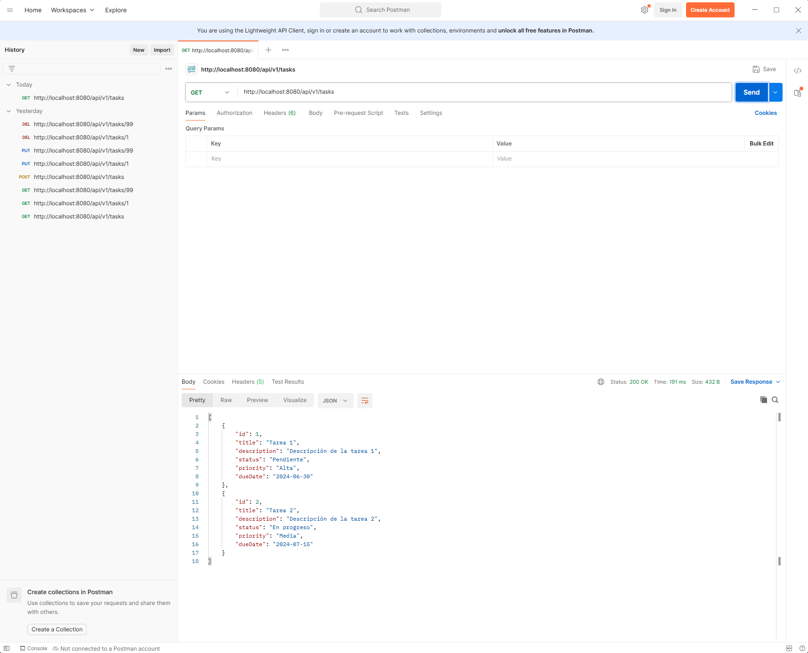
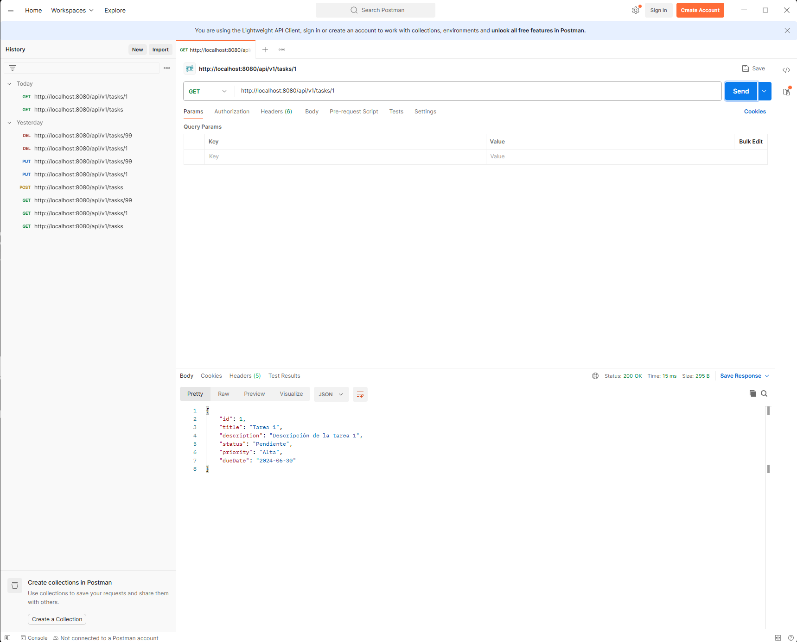
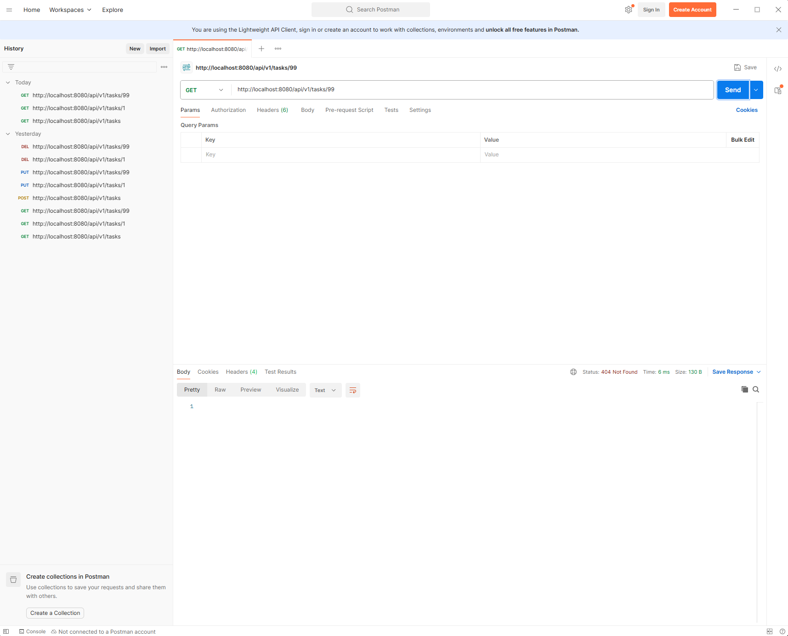
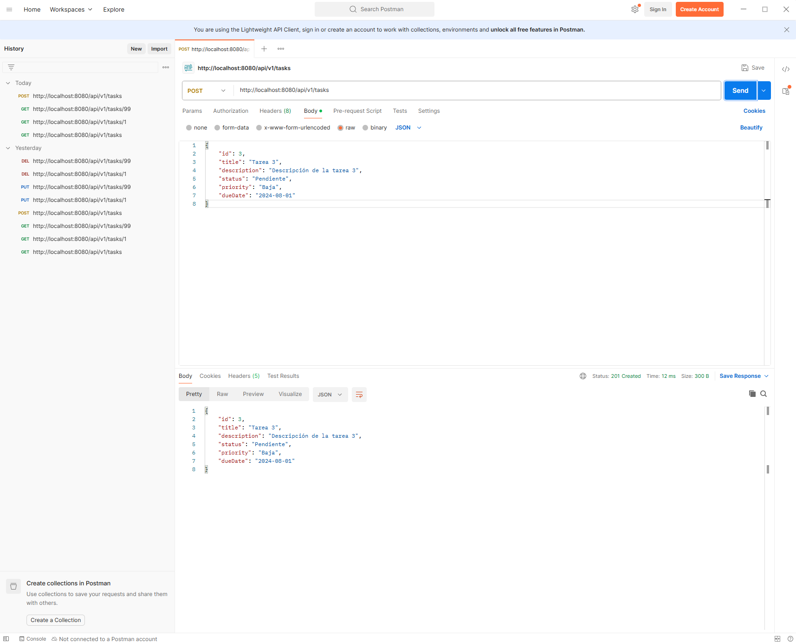
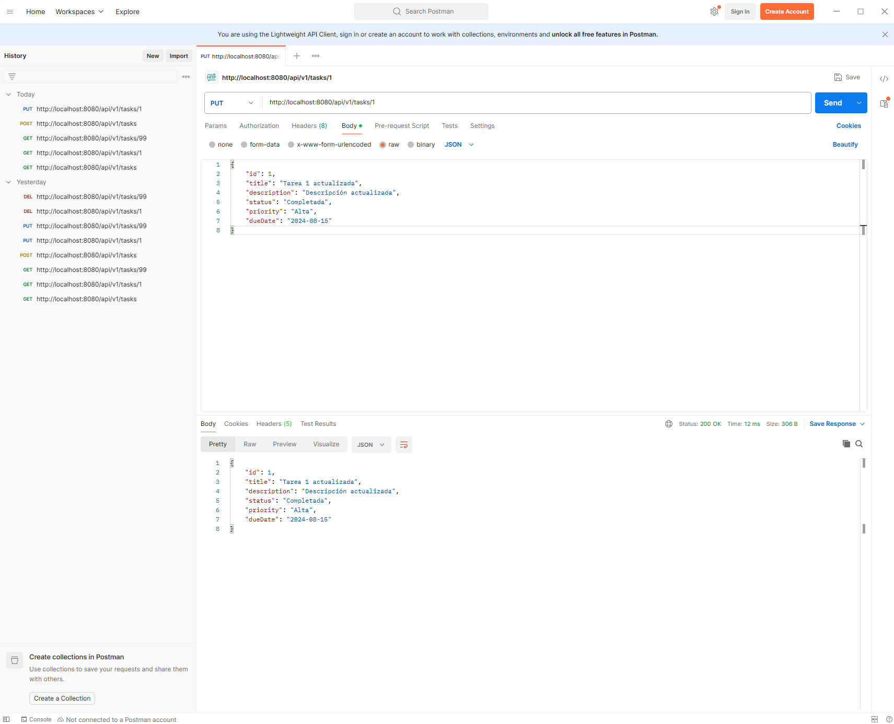
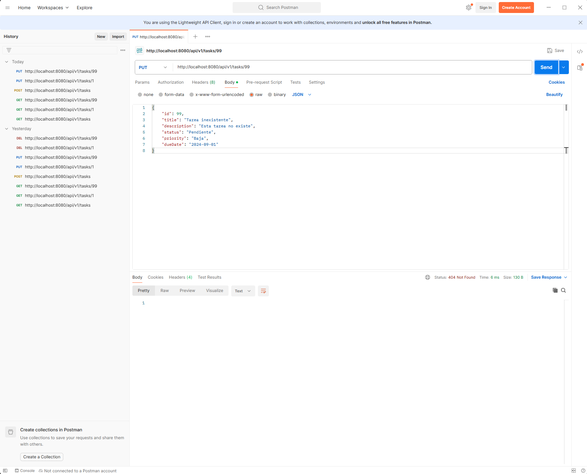
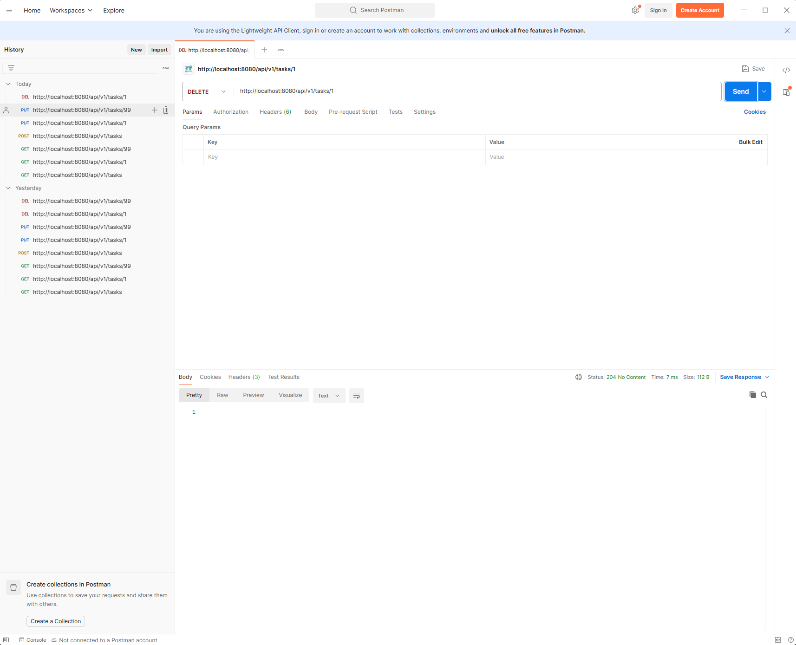
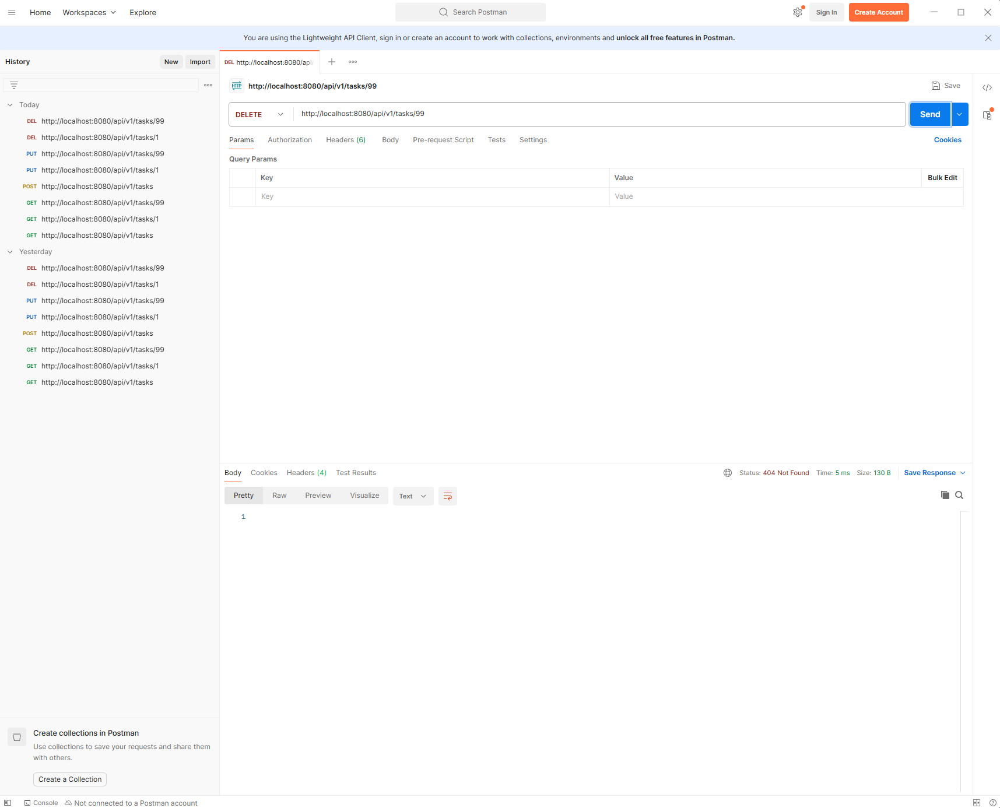

Paso 1 - Preparación (Ask): 
 
Pregunta: 
 
¿Qué es un Service y para qué sirve en Spring Boot? 
 
Respuesta: 
 
En Spring Boot, un Service es una clase que contiene la lógica de negocio de la aplicación. 
 
Sirve para: 
 
Coordinar operaciones entre controladores y repositorios. 
Aplicar reglas de negocio. 
Mantener los controladores simples. 
Reutilizar lógica desde distintos puntos de la aplicación. 
Gestionar transacciones cuando es necesario. 
Se identifica normalmente con @Service: 
 
package com.ejemplo.taskmanager.service; 
 
import org.springframework.stereotype.Service; 
 
@Service 
public class TareaService { 

    public String obtenerMensaje() {
        return "Servicio de tareas activo";
    }
} 
 
El flujo habitual es: 
 
Controller → Service → Repository → Base de datos 
 
El Controller recibe la petición, el Service ejecuta la lógica y el Repository accede a los datos. 
 
---
 
Pregunta: 
 
¿Qué diferencia hay entre lo que hace un Controller y lo que hace un Service? 
 
Respuesta: 
 
Un Controller y un Service tienen responsabilidades diferentes: 
 
Componente	Responsabilidad 
Controller	Recibir peticiones HTTP, validar datos básicos y devolver respuestas 
Service	Ejecutar la lógica de negocio y coordinar operaciones 
El flujo habitual es: 
 
Cliente → Controller → Service → Repository 
 
Ejemplo: 
 
@RestController 
@RequestMapping("/tareas") 
public class TareaController { 
 
    private final TareaService tareaService; 
 
    public TareaController(TareaService tareaService) { 
        this.tareaService = tareaService; 
    } 
 
    @GetMapping("/{id}") 
    public Tarea obtener(@PathVariable Long id) { 
        return tareaService.obtenerPorId(id); 
    } 
} 
 
El Controller no debería contener reglas como comprobar permisos, calcular datos o decidir cómo guardar una tarea. Esa lógica debe estar en el Service.

---
 
Pregunta: 
 
¿Cómo se inyecta un Service en un Controller y por qué se hace así? 
 
Respuesta: 
 
Un Service se inyecta en un Controller mediante inyección de dependencias, normalmente usando el constructor. 
 
@RestController 
@RequestMapping("/tareas") 
public class TareaController { 
 
    private final TareaService tareaService; 
 
    public TareaController(TareaService tareaService) { 
        this.tareaService = tareaService; 
    } 
 
    @GetMapping 
    public List<Tarea> listar() { 
        return tareaService.listar(); 
    } 
} 
 
Spring detecta @Service, crea una instancia de TareaService y la proporciona automáticamente al construir TareaController. 
 
Se hace así porque: 
 
Evita crear objetos manualmente con new. 
Reduce el acoplamiento entre clases. 
Facilita las pruebas unitarias mediante mocks. 
Hace explícitas las dependencias del controlador. 
Permite que Spring gestione el ciclo de vida de los objetos. 
La inyección por constructor suele ser preferible a @Autowired directamente sobre un atributo.

---
 
Paso 2 – Diseño previo: 
 
Pregunta: 
 
¿Qué clases e interfaces vas a crear y qué responsabilidad tiene cada una? 
 
Respuesta: 
 
Voy a crear: 
TaskService: será la interfaz y definirá las operaciones que se pueden hacer con las tareas. 
TaskServiceImpl: implementará la interfaz y tendrá la lógica de negocio que ahora mismo está en el Controller. 
TaskController: ya existe y será modificado para encargarse de recibir las peticiones HTTP, llamar al Service y devolver la respuesta. 
 
---
 
Pregunta: 
 
¿Qué métodos tendrá la interfaz TaskService? 
 
Respuesta: 
 
Tendrá estos 5 métodos: 
findAll 
findById 
create 
update 
delete

---
 
Pregunta: 
 
¿Qué lógica vas a mover del Controller al Service? 
 
Respuesta: 
 
Voy a mover al Service la lógica que actualmente busca, crea, modifica y elimina tareas de la lista tasks. 
El Controller se quedará solamente con la gestión de las peticiones HTTP y delegará estas operaciones en el Service.

---
 
Pregunta: 
 
¿Qué comentario exacto escribirás para que el autocompletado lo genere? 
 
Respuesta: 
 
// Crear la interfaz TaskService con los métodos findAll, findById, create, update y delete para la lógica de negocio de las tareas.

---
 
Paso 3 - Implementación (autocompletado): 
 
Creación de TaskService.java: 
 
// Crear la interfaz TaskService que tenga los métodos findAll, findById, create, update y delete para la lógica de negocio de las tareas. ->generado con IA 
 
public interface TaskService { 
    Iterable<Task> findAll(); 
    Task findById(Long id); -> esto lo puso mal, se cambia por int id 
    Task create(Task task); 
    Task update(Long id, Task task); -> esto lo puso mal, se cambia por int id 
    void delete(Long id); -> esto lo puso mal, se cambia por int id 
} 
 
Incidencia: Se cambian los tipos Long por id que es el que se usa porque los ha puesto mal.

---
 
Creación de TraskSeriveImpl.java: 
 
No se emplea ningún comentario para la implementación de los métodos porque al poner "implements" para traer la interfaz el autocompletado me lo puso todo él sólo de una. 
 
public class TaskServiceImpl implements TaskService { 
    // Implementación de los métodos de la interfaz TaskService 
     
    (este comentario le escribió la IA pero como he explicado antes no lo marco como generado por IA porque el que se marca es el prompt a modo de comentario que es el que da lugar a él) 
     
    @Override 
    public Iterable<Task> findAll() { 
        // Lógica para obtener todas las tareas 
         
        (los comentarios que pone la IA no he puesto lo de "generado por IA porque lo pone arriba en el comentario que se usa de prompt y los genera) 
         
        return null; // Reemplazar con la implementación real 
    } 
 
    @Override 
    public Task findById(int id) { 
        // Lógica para encontrar una tarea por su ID 
        return null; // Reemplazar con la implementación real 
    } 
 
    @Override 
    public Task create(Task task) { 
        // Lógica para crear una nueva tarea 
        return null; // Reemplazar con la implementación real 
    } 
 
    @Override 
    public Task update(int id, Task task) { 
        // Lógica para actualizar una tarea existente 
        return null; // Reemplazar con la implementación real 
    } 
 
    @Override 
    public void delete(int id) { 
        // Lógica para eliminar una tarea por su ID 
        // Reemplazar con la implementación real 
    } 
 
}

---
 
Creación de la lógica en el Service: 
 
Primero se crea un duplicado de la lista y las tareas de TaskController para cogerla de ahí con los métodos porque sino tiraría de la otra. 
 
    // Crea una lista igual que en el controlador para simular la persistencia de datos y añade 2 tareas de ejemplo 
    // al ArrayList usando el constructor de la clase Task para poder probar los endpoints -> generado con IA 
    private static final List<Task> tasks = new ArrayList<>(); 
    static { 
        tasks.add(new Task(1, "Tarea 1", "Descripción de la tarea 1", "Pendiente", "Alta", java.time.LocalDate.of(2024, 6, 30))); 
        tasks.add(new Task(2, "Tarea 2", "Descripción de la tarea 2", "En progreso", "Media", java.time.LocalDate.of(2024, 7, 15))); 
    }

---
 
Se crea la inyección por constructor de TaskServiceImpl a través de la interfaz TaskService mediante autocompletado: 
 
// Crea una inyección de dependencias para el service, usa la interfaz TaskService y la clase TaskServiceImpl, y utiliza el service para implementar los endpoints del controlador -> generado con IA 
public class TaskController { 
 
    private final TaskService taskService; 
 
    public TaskController(TaskService taskService) { 
        this.taskService = taskService; 
    }

---
 
Se comentan la lista estática y las tareas de prueba de TaskController: 
 
   // private static final List<Task> tasks = new ArrayList<>(); // -> medio generado con IA porque ya había escrito hasta List 
 
    // Añadir 2 tareas de ejemplo al ArrayList para poder probar los endpoints -> generado con IA 
   /* static { 
        tasks.add(new Task(1, "Tarea 1", "Descripción de la tarea 1", "Pendiente", "Alta", java.time.LocalDate.of(2024, 6, 30))); 
        tasks.add(new Task(2, "Tarea 2", "Descripción de la tarea 2", "En progreso", "Media", java.time.LocalDate.of(2024, 7, 15))); 
    }*/

---

Se comentan los métodos que había en TaskController (no lo pego aquí porque son muchas líneas y es sólo comentar)
---
 
Método findAll: 
 
   // Implementación de los métodos de la interfaz TaskService(estos comentarios no los borro porque dijiste que teníamos que dejar todos, no se marca como generado por IA porque le escribe la propia IA y es consecuencia del prompt que se usó para generarlo que sí está marcado como generado por IA) 
    @Override 
    public Iterable<Task> findAll() { 
        // Lógica para encontrar una tarea por su ID (estos comentarios no los borro porque dijiste que teníamos que dejar todos, no se marca como generado por IA porque le escribe la propia IA y es consecuencia del prompt que se usó para generarlo que sí está marcado como generado por IA) 
        // Obtener todas las tareas y devolverlas como un Iterable<Task> -> generado con IA 
            return tasks; // Reemplazar con la implementación real 
    }

---
 
Método findById: 
 
    @Override 
    public Task findById(int id) { 
        // Lógica para encontrar una tarea por su ID 
        // Buscar la tarea en la lista de tareas por su ID y devolverla -> generado con IA 
        for (Task task : tasks) { 
            if (task.getId() == id) { 
                return task; // Reemplazar con la implementación real 
            } 
        } 
        return null; // Reemplazar con la implementación real 
    }

---
 
Método create: 
 
    @Override 
    public Task create(Task task) { 
        // Lógica para crear una nueva tarea 
        // Añadir la tarea nueva a la lista de tareas y devolverla en el return -> generado con IA 
        tasks.add(task); 
        return task; // Reemplazar con la implementación real 
    }

---
 
Método update 
 
    @Override 
    public Task update(int id, Task task) { 
        // Lógica para actualizar una tarea existente 
        // Buscar la tarea en la lista de tareas por su ID y actualizar sus campos con los valores del objeto task -> generado con IA 
        for (Task existingTask : tasks) { 
            if (existingTask.getId() == id) { 
                existingTask.setTitle(task.getTitle()); 
                existingTask.setDescription(task.getDescription()); 
                existingTask.setStatus(task.getStatus()); 
                existingTask.setPriority(task.getPriority()); 
                existingTask.setDueDate(task.getDueDate()); 
                return existingTask; // Reemplazar con la implementación real 
            } 
        } 
        return null; // Reemplazar con la implementación real 
    }

---
 
Método delete: 
 
    @Override
    public void delete(int id) {
        // Lógica para eliminar una tarea por su ID
        // Eliminar una tarea de la lista de tareas por su ID, comprobar antes si la tarea existe y si no existe lanzar una excepción -> generado con IA
        Task taskToDelete = findById(id);
        if (taskToDelete != null) {
            tasks.remove(taskToDelete);
        } else {
            throw new IllegalArgumentException("La tarea con ID " + id + " no existe.");
        }        
      
    }

    Aquí he tenido que meter una excepción para que se pueda comprobar de alguna forma el 404 de que no exista la task porque sino habría tenido que quitar el void y en el pdf pone que no se puede cambiar la lógica.

---
 
Se borra lo que se había comentado en TaskController (no lo pego aquí porque no hay nada que pegar, es sólo borrar)

---
 
Se crean los métodos para traer la lógica desde el Service: 
 
    // Traer los métodos findAll, findById, create, update y delete, del service para implementar los endpoints del controlador -> generado con IA 
    @GetMapping 
    public ResponseEntity<Iterable<Task>> getAllTasks() { 
        Iterable<Task> tasks = taskService.findAll(); 
        return new ResponseEntity<>(tasks, HttpStatus.OK); 
    } 
 
    @GetMapping("/{id}") 
    public ResponseEntity<Task> getTaskById(@PathVariable int id) { 
        Task task = taskService.findById(id); 
        if (task != null) { 
            return new ResponseEntity<>(task, HttpStatus.OK); 
        } else { 
            return new ResponseEntity<>(HttpStatus.NOT_FOUND); 
        } 
    } 
 
    @PostMapping 
    public ResponseEntity<Task> createTask(@RequestBody Task task) { 
        Task createdTask = taskService.create(task); 
        return new ResponseEntity<>(createdTask, HttpStatus.CREATED); 
    } 
 
    @PutMapping("/{id}") 
    public ResponseEntity<Task> updateTask(@PathVariable int id, @RequestBody Task task) { 
        Task updatedTask = taskService.update(id, task); 
        if (updatedTask != null) { 
            return new ResponseEntity<>(updatedTask, HttpStatus.OK); 
        } else { 
            return new ResponseEntity<>(HttpStatus.NOT_FOUND); 
        } 
    } 
 
    @DeleteMapping("/{id}") 
    public ResponseEntity<Void> deleteTask(@PathVariable int id) { 
        try { 
            taskService.delete(id); 
            return new ResponseEntity<>(HttpStatus.NO_CONTENT); 
        } catch (IllegalArgumentException e) { 
            return new ResponseEntity<>(HttpStatus.NOT_FOUND); 
        } 
    }

---
 
Paso 4 - Comprensión del código (Ask): 
 
Pregunta: 
 
¿Qué hace la anotación @Service? ¿Qué pasaría si la eliminas? 
 
Respuesta: 

@Service indica a Spring que TaskServiceImpl es un componente de la capa de servicio y que debe registrarlo como un bean dentro del contexto de la aplicación. 
 
Gracias a ella, Spring puede: 
 
Crear automáticamente una instancia de TaskServiceImpl. 
Gestionar su ciclo de vida. 
Inyectarla en un Controller u otra clase mediante @Autowired o inyección por constructor. 
Aplicar funcionalidades como transacciones o aspectos. 
Si eliminas @Service, Spring no registrará esta clase automáticamente. Por tanto, al intentar inyectarla, la aplicación normalmente fallará al arrancar con un error similar a NoSuchBeanDefinitionException. Solo funcionaría si se crease manualmente la instancia, perdiendo la gestión automática de Spring.

---
 
Pregunta: 
 
¿Por qué se inyecta TaskService po rconstructor en lugar de usar @Autowired directamente en el campo? 
Respuesta: 
 
Se inyecta TaskService mediante el constructor porque es una dependencia obligatoria del Controller: 
 
Permite declarar el campo como final. 
Garantiza que el Controller siempre se cree con un servicio válido. 
Facilita las pruebas unitarias, pasando un servicio simulado (mock). 
Hace más visibles las dependencias de la clase. 
Evita el acoplamiento y las limitaciones de @Autowired directamente en campos. 
Si falta el bean, la aplicación falla al arrancar inmediatamente. 
 
Ejemplo: 
 
private final TaskService taskService; 
 
public TaskController(TaskService taskService) { 
    this.taskService = taskService; 
} 
 
En Spring moderno, si existe un único constructor, no es necesario añadir @Autowired.

---
 
Pregunta: 
 
¿Qué ventaja tiene que TaskController dependa de la interfaz TaskService y no de TaskServiceImpl? 
 
Respuesta: 
 
La ventaja es que TaskController depende de una abstracción y no de una implementación concreta: 
 
Reduce el acoplamiento entre las capas. 
Permite cambiar TaskServiceImpl por otra implementación sin modificar el Controller. 
Facilita las pruebas unitarias usando un mock o servicio simulado. 
Aplica el principio de inversión de dependencias. 
Permite tener varias implementaciones, por ejemplo una con lista en memoria y otra con base de datos. 
Así, el Controller solo conoce las operaciones definidas en TaskService, no cómo están implementadas.

---
 
Pregunta: (esto es anterior al cambio a excepción personalizada) 
 
¿Qué tipo de excepción se lanza cuando no se encuentra una tarea? ¿Dónde se captura esa excepción ahora mismo? 
Respuesta: 
 
En TaskServiceImpl, el método delete(int id) lanza una excepción: 
 
throw new IllegalArgumentException("La tarea con ID " + id + " no existe."); 
 
Por tanto, es una IllegalArgumentException. 
 
Sin embargo, findById() y update() no lanzan excepciones cuando no encuentran la tarea: devuelven null. 
 
Actualmente, la excepción de delete() no se captura dentro del servicio. Se propaga hacia el Controller y, si este tampoco la captura, Spring normalmente devolverá un HTTP 500 Internal Server Error. Lo adecuado sería gestionarla con un manejador global, por ejemplo mediante @ControllerAdvice, y devolver 404 Not Found.

---

 
Pregunta: (esto es posterior al cambio a excepción personalizada) 
 
¿Qué tipo de excepción se lanza cuando no se encuentra una tarea? ¿Dónde se captura esa excepción ahora mismo? 
Respuesta: 
 
En TaskServiceImpl, el método delete(int id) lanza una excepción personalizada: 
 
throw new TaskNotFoundException("La tarea con ID " + id + " no existe."); 
 
Por tanto, se lanza una TaskNotFoundException, que hereda de RuntimeException. 
 
Actualmente se captura en el método deleteTask de TaskController, mediante un bloque try-catch. Cuando se captura, se devuelve una respuesta HTTP 404 NOT_FOUND. 
 
Los métodos findById() y update() todavía devuelven null si no encuentran la tarea, en lugar de lanzar esta excepción.

---
 
Incidencia: 
(aunque ASK insinúe que les hace falta la excepción personalizada a los métodos findById y update no es así porque ya tienen forma de hacer llegar la info al controller porque esos no son void)

---
 
Pregunta: 
 
¿Qué pasaría si hubiera dos implementaciones de TaskService en el proyecto? ¿Cómo sabría Spring cuál inyectar? 
Respuesta: 
 
Si existieran dos implementaciones de TaskService, ambas anotadas con @Service, Spring encontraría dos beans candidatos y no sabría cuál inyectar. La aplicación fallaría al arrancar con una excepción similar a: 
 
NoUniqueBeanDefinitionException 
 
Se puede indicar cuál usar de varias formas: 
 
Con @Primary, marcando una implementación como predeterminada. 
Con @Qualifier, especificando el nombre del bean. 
Usando perfiles con @Profile, activando solo una implementación según el entorno. 
Por ejemplo: 
 
public TaskController(@Qualifier("taskServiceImpl") TaskService taskService) { 
    this.taskService = taskService; 
} 
 
Así, el Controller sigue dependiendo de la interfaz, pero Spring selecciona explícitamente la implementación indicada.

---
 
Paso 5 - Validación en Postman: 

Get -> Recuperar todas las tareas 
 
 
 
Get por Id -> Recuperar 1 tarea por su Id 
 
 
 
Get por Id -> Tarea inexistente 
 
 
 
Post -> Enviar una tarea 
 
 
 
Put -> Cambiar algo en una tarea 
 
 
 
Put -> Cambiar algo en tarea inexistente 
 
 
 
Delete -> Borrar una tarea 
 
 
 
Delete -> Borrar una tarea inexistente 
 

---
 
Reflexión: 
 
Pregunta: 
 
¿Qué problema concreto resuelve separar el Controller del Service? 
 
Respuesta: 
 
Evita mezclar las peticiones HTTP con la lógica de negocio, así es más fácil de leer, es más fácil de mantener, más fácil realizar pruebas y encontrar fallos y se puede reutilizar la lógica 
 
¿Dónde se está capturando ahora mismo la excepción de "tarea no encontrada"? ¿Te parece el lugar correcto? 
 
Respuesta: 
 
Se captura en el método deleteTask del Controller con un try catch. 
No, creo que lo mejor sería una excepción personalizada. -> De hecho, lo voy a cambiar y lo haré así 
 
Pregunta: 
 
¿Qué ocurriría si en el futuro necesitas una segunda implementación de TaskService (por ejemplo, una que lea de base de datos)? 
 
Respuesta: 
 
Se podría hacer a través de la interfaz poniendo @Qualifier para saber cuál usar.

---
 
Otros: 
 
Transformación de la excepción de tarea no encontrada en excepción personalizada: 
 
Primero se crea el paquete exceptions y se añade un comentario para que lo haga el autocompletado: 
 
package com.accenture.taskmanager.exceptions; 
 
// Crear una excepción personalizada TaskNotFoundException para indicar que una tarea no existe -> generado con IA 
public class TaskNotFoundException extends RuntimeException { 
 
    public TaskNotFoundException(String message) { 
        super(message); 
    } 
 
} 
 
Luego se añade otro comentario en TaskServiceImpl en el método delete para que autocompletar cambie la excepción y ponga esta y se actualiza el javadoc: 
 
    /** 
     * Elimina una tarea por su identificador. 
     * 
     * @param id identificador de la tarea que se desea eliminar. 
     * @throws TaskNotFoundException si no existe una tarea con el identificador 
     *                               indicado. 
     */ 
    @Override 
    public void delete(int id) { 
        // Lógica para eliminar una tarea por su ID 
        // Eliminar una tarea de la lista de tareas por su ID, comprobar antes si la 
        // tarea existe y si no existe lanzar una excepción -> generado con IA 
        // Cambia la excepción lanzada a TaskNotFoundException para indicar que la tarea 
        // no existe 
        Task taskToDelete = findById(id); 
        if (taskToDelete != null) { 
            tasks.remove(taskToDelete); 
        } else { 
            throw new TaskNotFoundException("La tarea con ID " + id + " no existe."); 
        } 
 
    } 
 
Luego se modifica el catch del deleteTask del TaskController con autocompletar para que use la excepción personalizada. 
En este el javadoc me le dió automático el cambio el autocompletar. 
 
    /** 
     * Elimina una tarea mediante su identificador. 
     * 
     * @param id identificador de la tarea que se desea eliminar. 
     * @throws TaskNotFoundException si no existe una tarea con el identificador 
     *                               indicado. 
     * @return respuesta HTTP con estado 204 NO_CONTENT si se elimina correctamente, 
     *         o estado 404 NOT_FOUND si la tarea no existe. 
     */ 
    // modifica el método deleteTask para que capture la excepción TaskNotFoundException y devuelva un estado 404 NOT_FOUND en lugar de IllegalArgumentException -> generado con IA 
    @DeleteMapping("/{id}") 
    public ResponseEntity<Void> deleteTask(@PathVariable int id) { 
        try { 
            taskService.delete(id); 
            return new ResponseEntity<>(HttpStatus.NO_CONTENT); 
        } catch (TaskNotFoundException e) { 
            return new ResponseEntity<>(HttpStatus.NOT_FOUND); 
        } 
    }