Parte 1 - Ejercicio de creación de los DTOs y transformación de datos<br>
<br>
Paso 1 – Problema: exponer entidades directamente<br>
<br>
Pregunta:<br>
<br>
¿Qué problemas tiene exponer directamente la entidad JPA Task en una API REST, en lugar de utilizar DTOs? ¿Cómo acopla esto el modelo de base de datos al contrato de la API?
<br>
Respuesta:<br>
<br>
Exponer directamente una entidad JPA como Task desde un controlador REST parece sencillo:

```
@GetMapping("/{id}")
public Task findById(@PathVariable Long id) {
    return taskService.findById(id);
}
```

Pero hace que la API dependa directamente del modelo de persistencia.<br>
<br>
Problemas principales<br>
1. Acoplamiento entre base de datos y API<br>
La entidad Task.java contiene detalles relacionados con la persistencia:

```
@Entity
@Table(name = "task")
public class Task {
    private Long id;
    private String title;
    private TaskStatus status;
    private TaskPriority priority;
    private LocalDate dueDate;
    private LocalDateTime createdAt;
    private Long categoryId;
}
```

Si se cambia la entidad por motivos de base de datos, también puede cambiar automáticamente el JSON de la API.<br>
<br>
Por ejemplo:<br>
<br>
renombrar dueDate puede cambiar el campo JSON dueDate;<br>
añadir createdAt puede exponerlo sin haberlo previsto;<br>
cambiar un enum puede modificar los valores que reciben los clientes;<br>
sustituir categoryId por una relación Category category puede cambiar completamente la estructura JSON.<br>
Así, una modificación interna termina siendo un cambio del contrato público.<br>
<br>
2. Exposición de campos internos<br>
La entidad puede contener campos que no deberían formar parte de la respuesta:<br>
<br>
identificadores internos;<br>
fechas de auditoría;<br>
información técnica;<br>
relaciones JPA;<br>
campos utilizados solo por Hibernate;<br>
datos sensibles.<br>
Por ejemplo, no siempre se desea que el cliente pueda modificar:

```
id
createdAt
```

Sin embargo, si se utiliza la misma entidad como cuerpo de entrada, esos campos podrían llegar en una petición JSON.<br>
<br>
3. Problemas de seguridad en las peticiones<br>
Si el controlador recibe directamente:

```
@PostMapping
public Task create(@RequestBody Task task) {
    return taskService.create(task);
}
```

el cliente puede intentar enviar propiedades que no debería controlar:

```
{
  "id": 999,
  "title": "Tarea",
  "createdAt": "2020-01-01T00:00:00",
  "categoryId": 42
}
```

Aunque después Hibernate o la lógica de negocio rechacen algunos valores, aceptar directamente la entidad amplía innecesariamente la superficie de entrada.<br>
<br>
Es más seguro definir un DTO específico:

```
public record CreateTaskRequest(
    String title,
    String description,
    TaskStatus status,
    TaskPriority priority,
    LocalDate dueDate,
    Long categoryId
) {
}
```

Y otro DTO para actualizar:

```
public record UpdateTaskRequest(
    String title,
    String description,
    TaskStatus status,
    TaskPriority priority,
    LocalDate dueDate,
    Long categoryId
) {
}
```

4. Relaciones bidireccionales y ciclos JSON<br>
Si Task tuviera una relación con Category:

```
@ManyToOne
private Category category;
```

y Category tuviera:

```
@OneToMany(mappedBy = "category")
private List<Task> tasks;
```

Jackson podría recorrer:

```
Task → Category → tasks → Task → Category → ...
```

Esto puede producir recursión infinita, errores de serialización o respuestas enormes.<br>
<br>
Además, acceder a relaciones LAZY durante la serialización puede provocar:

```
LazyInitializationException
```

Los DTOs permiten decidir explícitamente qué parte de la relación se expone.<br>
<br>
5. Respuestas demasiado grandes<br>
La entidad puede contener relaciones que no son necesarias para cada endpoint. Devolverlas directamente puede provocar:<br>
<br>
más consultas SQL;<br>
problemas N+1;<br>
mayor consumo de memoria;<br>
respuestas JSON innecesariamente grandes.<br>
Un DTO puede devolver solo lo necesario:

```
public record TaskResponse(
    Long id,
    String title,
    TaskStatus status,
    TaskPriority priority,
    LocalDate dueDate,
    Long categoryId
) {
}
```

6. El contrato de la API queda ligado a JPA<br>
Las anotaciones de persistencia y las de serialización terminan mezclándose en la misma clase:

```
@Entity
@Table(name = "task")
@JsonIgnore
```

Esto significa que una entidad diseñada para Hibernate también debe satisfacer las necesidades de Jackson y de los clientes REST.<br>
<br>
La entidad cambia por razones de persistencia; el DTO cambia por razones del contrato de la API. Son responsabilidades distintas.<br>
<br>
¿Qué significa exactamente “acoplar el modelo de base de datos”?<br>
No significa que el JSON copie literalmente todas las tablas, sino que el modelo expuesto por la API queda condicionado por el modelo interno de persistencia.<br>
<br>
Por ejemplo, si se modela Task con una relación:

```
@ManyToMany
private Set<Tag> tags;
```

el JSON podría pasar de:

```
{
  "id": 1,
  "title": "Aprender JPA",
  "categoryId": 2
}
```

a algo como:

```
{
  "id": 1,
  "title": "Aprender JPA",
  "category": {
    "id": 2,
    "name": "Java"
  },
  "tags": [
    {
      "id": 5,
      "name": "JPA"
    }
  ]
}
```

Ese cambio no debería ser una consecuencia accidental de haber reorganizado las entidades. Si se devuelve un DTO, la representación pública puede mantenerse estable aunque internamente cambien las relaciones.<br>
<br>
Ventajas de los DTOs<br>
Con DTOs se separan las responsabilidades:

```
Entidad JPA → persistencia y base de datos
DTO         → contrato HTTP/JSON
```

Esto permite:<br>
<br>
controlar exactamente los campos de entrada y salida;<br>
ocultar propiedades internas;<br>
evitar ciclos de serialización;<br>
evitar exponer relaciones innecesarias;<br>
validar cada tipo de operación;<br>
cambiar el modelo JPA sin romper automáticamente la API;<br>
crear respuestas resumidas o específicas por endpoint.<br>
Ejemplo:

```
public record TaskResponse(
    Long id,
    String title,
    String status,
    String priority,
    LocalDate dueDate
) {
}
```

El servicio o un mapper transforma la entidad:

```
public TaskResponse toResponse(Task task) {
    return new TaskResponse(
        task.getId(),
        task.getTitle(),
        task.getStatus().name(),
        task.getPriority().name(),
        task.getDueDate()
    );
}
```

Resumen<br>
Exponer Task directamente:<br>
<br>
mezcla persistencia y API;<br>
expone campos que quizá deberían ser internos;<br>
permite una entrada demasiado amplia;<br>
puede causar ciclos JSON y problemas con relaciones LAZY;<br>
puede provocar respuestas grandes y consultas innecesarias;<br>
hace que cambios del modelo JPA rompan el contrato REST.<br>
Los DTOs actúan como una frontera estable entre la base de datos y la API. Por eso, aunque devolver directamente la entidad sea aceptable en un ejercicio sencillo, en una API mantenible suele ser preferible utilizar DTOs de entrada y salida separados.

---
<br>
Pregunta:<br>
<br>
¿Qué problemas puede causar devolver directamente un Page<Task> de Spring Data y por qué sería conveniente sustituirlo por una estructura de respuesta propia?
<br>
Respuesta:<br>
<br>
Devolver directamente:

```
@GetMapping
public Page<Task> findAll(Pageable pageable) {
    return taskService.findAll(pageable);
}
```

es práctico, pero mezcla dos detalles internos de la aplicación con el contrato público de la API:<br>
<br>
Page, PageImpl y Spring Data.<br>
La entidad JPA Task.<br>
Problemas de devolver directamente Page<Task><br>
1. El JSON queda ligado a Spring Data<br>
La estructura serializada de Page puede incluir propiedades como:

```
{
  "content": [],
  "pageable": {
    "pageNumber": 0,
    "pageSize": 10,
    "offset": 0,
    "paged": true,
    "unpaged": false
  },
  "totalElements": 37,
  "totalPages": 4,
  "last": false,
  "size": 10,
  "number": 0,
  "sort": {
    "sorted": true,
    "unsorted": false,
    "empty": false
  },
  "numberOfElements": 10,
  "first": true,
  "empty": false
}
```

Los detalles de pageable y sort no siempre son necesarios para el cliente y pueden variar entre versiones de Spring Data o configuraciones de Jackson.<br>
<br>
Si la API publica esa estructura, cualquier cambio de versión puede afectar a los clientes.<br>
<br>
2. Expone directamente la entidad JPA<br>
El contenido es una lista de Task:

```
{
  "content": [
    {
      "id": 1,
      "title": "Preparar informe",
      "status": "IN_PROGRESS",
      "priority": "HIGH",
      "createdAt": "2026-10-24T17:00:00"
    }
  ]
}
```

Eso puede exponer:<br>
<br>
campos internos;<br>
fechas de auditoría;<br>
identificadores que no deberían ser públicos;<br>
propiedades que el cliente no necesita;<br>
futuras relaciones JPA.<br>
Si Task cambia por motivos de persistencia, el JSON puede cambiar accidentalmente. Esta es la misma clase de acoplamiento descrita en NOTAS-05-creacion-de-los-dtos.md.<br>
<br>
3. Problemas con relaciones JPA<br>
Si Task incorpora relaciones:

```
@ManyToOne
private Category category;

@ManyToMany
private Set<Tag> tags;
```

al serializar directamente las entidades pueden aparecer:<br>
<br>
ciclos infinitos entre relaciones bidireccionales;<br>
LazyInitializationException;<br>
respuestas excesivamente grandes;<br>
consultas adicionales;<br>
problema N+1.<br>
Un DTO permite decidir si se devuelve solo categoryId, una categoría resumida o ninguna categoría.<br>
<br>
4. El contrato de paginación no está bajo control propio<br>
La API puede querer exponer solo:

```
{
  "items": [],
  "page": 0,
  "size": 10,
  "total": 37,
  "pages": 4
}
```

Pero Page<Task> puede incluir información técnica que no forma parte del contrato deseado:

```
"pageable": {
  "offset": 0,
  "paged": true,
  "unpaged": false
}
```

Además, cambiar el nombre de content por items, o añadir enlaces, filtros o información de navegación, resulta más difícil si se depende directamente de la serialización de Page.<br>
<br>
5. Dificulta la evolución de la API<br>
Una respuesta propia puede mantenerse estable aunque cambien:<br>
<br>
Spring Data;<br>
Hibernate;<br>
la entidad Task;<br>
los nombres internos de propiedades;<br>
la estrategia de paginación;<br>
la forma de obtener los datos.<br>
La API deja de depender de la representación interna de Spring Data.<br>
<br>
Estructura de respuesta propia<br>
Se pueden definir DTOs separados para el elemento y la página:

```
public record TaskResponse(
    Long id,
    String title,
    TaskStatus status,
    TaskPriority priority,
    LocalDate dueDate
) {
}
```
```
public record PageResponse<T>(
    List<T> items,
    int page,
    int size,
    long totalElements,
    int totalPages,
    boolean first,
    boolean last
) {
}
```

Después se transforma el Page<Task>:

```
public PageResponse<TaskResponse> toResponse(Page<Task> page) {
    List<TaskResponse> items = page.getContent()
        .stream()
        .map(this::toTaskResponse)
        .toList();

    return new PageResponse<>(
        items,
        page.getNumber(),
        page.getSize(),
        page.getTotalElements(),
        page.getTotalPages(),
        page.isFirst(),
        page.isLast()
    );
}
```

La respuesta queda bajo control de la aplicación:

```
{
  "items": [
    {
      "id": 1,
      "title": "Preparar informe",
      "status": "IN_PROGRESS",
      "priority": "HIGH",
      "dueDate": "2026-10-30"
    }
  ],
  "page": 0,
  "size": 10,
  "totalElements": 37,
  "totalPages": 4,
  "first": true,
  "last": false
}
```

Ventajas<br>
Una estructura propia permite:<br>
<br>
elegir el nombre de content, por ejemplo items;<br>
ocultar propiedades de Task;<br>
transformar la entidad en un DTO;<br>
añadir o quitar metadatos sin depender de Spring Data;<br>
mantener estable el contrato JSON;<br>
evitar ciclos de serialización;<br>
adaptar la respuesta a las necesidades concretas del cliente;<br>
cambiar internamente de Page a Slice o a otro mecanismo sin romper necesariamente la API.<br>
Importante: no elimina la consulta de conteo<br>
Sustituir Page<Task> por una respuesta propia no cambia automáticamente la forma de consultar la base de datos. Si internamente se sigue utilizando:

```
Page<Task> page = taskRepository.findAll(pageable);
```

Spring Data seguirá ejecutando normalmente:<br>
<br>
la consulta paginada;<br>
la consulta COUNT para calcular el total.<br>
La ventaja del DTO está principalmente en el contrato JSON, la separación de responsabilidades y el control de los datos expuestos.<br>
<br>
En resumen, Page<Task> es cómodo dentro de la aplicación, pero una respuesta propia evita exponer detalles de Spring Data y entidades JPA. Una práctica habitual es usar Page<Task> internamente y convertirlo a PageResponse<TaskResponse> antes de devolverlo desde el controlador.
---
<br>
Pregunta:<br>
<br>
¿Por qué fue necesario añadir @JsonIgnore en las relaciones de Task con Category y Tag? ¿Qué problemas de serialización se intentaban evitar y qué limitaciones tiene esta solución?<br>
<br>
Respuesta:<br>
<br>
En este proyecto, @JsonIgnore se añadió en las colecciones inversas:<br>
<br>
Category.tasks en Category.java.<br>
Tag.tasks en Tag.java.<br>
Las relaciones del lado de Task están en Task.java:

```
@ManyToOne(fetch = FetchType.LAZY)
@JoinColumn(name = "category_id")
private Category category;

@ManyToMany(fetch = FetchType.LAZY, ...)
private List<Tag> tags;
```

¿Qué problema se quería evitar?<br>
Las relaciones son bidireccionales:

```
Task → Category → tasks → Task → Category → ...
```

y:

```
Task → Tag → tasks → Task → Tag → ...
```

Si Jackson serializa directamente una entidad Task, podría seguir indefinidamente esas referencias circulares:

```
{
  "id": 1,
  "category": {
    "id": 2,
    "tasks": [
      {
        "id": 1,
        "category": {
          "id": 2,
          "tasks": [
            "..."
          ]
        }
      }
    ]
  }
}
```

Esto puede producir:

```
JsonMappingException: Infinite recursion
```

o una respuesta JSON enorme. Lo mismo ocurriría con Task.tags y Tag.tasks.<br>
<br>
Con @JsonIgnore:

```
@JsonIgnore
@OneToMany(mappedBy = "category")
private List<Task> tasks;
```

Jackson no incluye tasks al serializar una Category.<br>
<br>
Y con:

```
@JsonIgnore
@ManyToMany(mappedBy = "tags")
private List<Task> tasks;
```


Jackson no incluye tasks al serializar un Tag.<br>
<br>
Así, una tarea podría incluir su categoría y sus etiquetas, pero esas entidades no vuelven a incluir la lista de tareas:

```
{
  "id": 1,
  "title": "Aprender JPA",
  "category": {
    "id": 2,
    "name": "Java"
  },
  "tags": [
    {
      "id": 5,
      "name": "JPA"
    }
  ]
}
```

La dirección inversa queda cortada:

```
Task → Category
      └── tasks: ignorado

Task → Tag
      └── tasks: ignorado
```

¿Por qué es una solución limitada?<br>
1. Oculta completamente la relación inversa<br>
Si un endpoint quiere devolver una categoría con sus tareas, @JsonIgnore lo impide:

```
{
  "id": 2,
  "name": "Java"
}
```

No se obtiene:

```
{
  "id": 2,
  "name": "Java",
  "tasks": [...]
}
```

La propiedad se ignora globalmente, independientemente del endpoint que genere la respuesta.<br>
<br>
2. No permite distintos formatos según el caso de uso<br>
Un endpoint podría necesitar:<br>
<br>
una tarea con categoryId;<br>
una tarea con una categoría resumida;<br>
una categoría con sus tareas;<br>
una etiqueta sin sus tareas;<br>
una etiqueta con un resumen de las tareas.<br>
@JsonIgnore solo permite ocultar siempre esa propiedad. No ofrece un control preciso por endpoint.<br>
<br>
3. Mezcla persistencia y presentación<br>
Category y Tag son entidades JPA, pero ahora también contienen reglas específicas de serialización Jackson:

```
@Entity
@JsonIgnore
```

Esto acopla el modelo de persistencia al formato JSON. Si mañana la API necesita otra representación, habrá que modificar las entidades JPA.<br>
<br>
4. No resuelve por sí sola LAZY ni el problema N+1<br>
@JsonIgnore evita que Jackson recorra esa propiedad concreta, pero no corrige todas las cargas innecesarias.<br>
<br>
Todavía pueden existir:<br>
<br>
consultas N+1;<br>
relaciones LAZY accedidas antes de serializar;<br>
consultas adicionales para category o tags;<br>
respuestas demasiado grandes por otras propiedades.<br>
Tampoco garantiza que desaparezca LazyInitializationException si otra relación que sí se serializa está cerrada al comenzar la serialización.<br>
<br>
5. Puede afectar también a la deserialización<br>
Dependiendo de la configuración de Jackson, una propiedad marcada con @JsonIgnore puede ignorarse también al recibir JSON. Por tanto, no es solo una decisión de salida; puede modificar qué datos acepta la API.<br>
<br>
Solución más robusta: DTOs<br>
Una solución más mantenible consiste en no serializar directamente las entidades JPA, sino transformarlas a DTOs específicos:

```
public record TaskResponse(
    Long id,
    String title,
    Long categoryId,
    List<Long> tagIds
) {
}
```

Y para una categoría:

```
public record CategoryResponse(
    Long id,
    String name,
    String description
) {
}
```

Cada endpoint decide qué información exponer sin crear ciclos ni depender de las anotaciones de Jackson de las entidades.<br>
<br>
En resumen, @JsonIgnore evita la recursión infinita al cortar la navegación Category → tasks y Tag → tasks. Es un parche rápido y válido para este ejercicio, pero oculta la relación de forma global y mezcla el modelo JPA con el contrato JSON. Para una API evolutiva, los DTOs ofrecen un control mucho mayor.

---
<br>
Paso 2 - Preparación (Ask)<br>
<br>
Pregunta:<br>
<br>
¿Qué es un DTO y qué ventajas tiene frente a exponer directamente una entidad JPA?<br>
<br>
Respuesta:<br>
<br>
18:14
Un DTO (Data Transfer Object) es un objeto diseñado específicamente para transportar datos entre capas de una aplicación, especialmente entre el backend y una API REST.<br>
<br>
No representa necesariamente una tabla ni una entidad de la base de datos. Representa la información que la API necesita recibir o devolver.<br>
<br>
Ejemplo<br>
La entidad JPA puede contener detalles de persistencia:

```
@Entity
public class Task {
    private Long id;
    private String title;
    private String description;
    private TaskStatus status;
    private TaskPriority priority;
    private LocalDate dueDate;
    private LocalDateTime createdAt;
    private Category category;
    private List<Tag> tags;
}
```

Pero la respuesta pública podría utilizar un DTO más controlado:

```
public record TaskResponse(
    Long id,
    String title,
    TaskStatus status,
    TaskPriority priority,
    LocalDate dueDate
) {
}
```

El DTO expone solo los campos que el cliente necesita.<br>
<br>
DTO de entrada y DTO de salida<br>
Es recomendable utilizar objetos distintos según la dirección de los datos.<br>
<br>
DTO para crear

```
public record CreateTaskRequest(
    String title,
    String description,
    TaskStatus status,
    TaskPriority priority,
    LocalDate dueDate,
    Long categoryId
) {
}
```

DTO para actualizar

```
public record UpdateTaskRequest(
    String title,
    String description,
    TaskStatus status,
    TaskPriority priority,
    LocalDate dueDate,
    Long categoryId
) {
}
```

DTO para responder

```
public record TaskResponse(
    Long id,
    String title,
    String description,
    TaskStatus status,
    TaskPriority priority,
    LocalDate dueDate,
    LocalDateTime createdAt
) {
}
```

Así el cliente no puede intentar asignar directamente campos que controla el servidor, como:<br>
<br>
id;<br>
createdAt;<br>
relaciones completas;<br>
datos internos.<br>
Ventajas frente a exponer una entidad JPA<br>
1. Desacopla la API del modelo de persistencia<br>
La entidad JPA puede cambiar por motivos internos:

```
@Column(name = "created_at")
private LocalDateTime createdAt;
```

o una relación puede pasar de:

```
private Long categoryId;
```

a:

```
private Category category;
```

Eso no debería obligar a cambiar automáticamente el JSON público.<br>
<br>
Con DTOs:

```
Entidad JPA → base de datos
DTO          → contrato REST
```

Cada modelo evoluciona de forma independiente.<br>
<br>
2. Controla qué campos se exponen<br>
Una entidad puede tener campos que la API no debe devolver. El DTO permite una lista explícita de propiedades públicas.<br>
<br>
También evita que se expongan accidentalmente:<br>
<br>
información técnica;<br>
datos de auditoría;<br>
relaciones completas;<br>
campos sensibles;<br>
propiedades usadas solo por Hibernate.<br>
3. Mejora la seguridad de entrada<br>
No es recomendable recibir directamente una entidad:

```
@PostMapping
public Task create(@RequestBody Task task) {
    return taskService.create(task);
}
```

El cliente podría enviar:

```
{
  "id": 999,
  "title": "Tarea",
  "createdAt": "2020-01-01T00:00:00",
  "category": {
    "id": 42
  }
}
```

Con un DTO de creación, el formato aceptado queda limitado:

```
@PostMapping
public TaskResponse create(
    @RequestBody CreateTaskRequest request
) {
    // Convertir request a Task dentro del servicio
}
```

El servidor decide qué valores puede establecer.<br>
<br>
4. Evita ciclos JSON<br>
Las relaciones bidireccionales pueden crear ciclos:

```
Task → Category → tasks → Task → ...
Task → Tag → tasks → Task → ...
```

Si se serializan directamente, pueden aparecer:<br>
<br>
recursión infinita;<br>
JsonMappingException;<br>
respuestas enormes;<br>
consultas adicionales.<br>
Un DTO puede incluir solo identificadores o representaciones resumidas:

```
public record TaskResponse(
    Long id,
    String title,
    Long categoryId,
    List<Long> tagIds
) {
}
```

5. Reduce problemas con LAZY<br>
Al devolver entidades JPA directamente, Jackson puede intentar acceder a una relación LAZY cuando el contexto de persistencia ya está cerrado:

```
LazyInitializationException
```

Si el DTO se construye dentro de una transacción y solo copia los datos necesarios, se evita que el serializador navegue libremente por el grafo JPA.<br>
<br>
6. Evita respuestas innecesariamente grandes<br>
Una entidad puede tener muchas relaciones o campos que no hacen falta en todos los endpoints. Un DTO permite crear representaciones diferentes:

```
public record TaskSummary(
    Long id,
    String title,
    TaskStatus status
) {
}
```

y:

```
public record TaskDetails(
    Long id,
    String title,
    String description,
    TaskStatus status,
    TaskPriority priority,
    LocalDate dueDate,
    Long categoryId,
    List<Long> tagIds
) {
}
```

7. Permite adaptar nombres y formatos<br>
El DTO puede presentar un contrato distinto del modelo interno:

```
public record TaskResponse(
    Long id,
    String taskTitle,
    String status,
    String dueDate
) {
}
```

La entidad puede conservar title, TaskStatus y LocalDate, mientras la API utiliza otros nombres o formatos.<br>
<br>
8. Facilita validaciones distintas<br>
Los requisitos para crear y actualizar pueden ser diferentes:

```
public record CreateTaskRequest(
    @NotBlank String title,
    @NotNull TaskStatus status
) {
}
```

El DTO de salida no necesita esas validaciones de entrada.<br>
<br>
Transformación entre entidad y DTO<br>
La conversión puede hacerse manualmente:

```
public TaskResponse toResponse(Task task) {
    return new TaskResponse(
        task.getId(),
        task.getTitle(),
        task.getDescription(),
        task.getStatus(),
        task.getPriority(),
        task.getDueDate(),
        task.getCreatedAt()
    );
}
```

Y para crear una entidad:

```
public Task toEntity(CreateTaskRequest request) {
    Task task = new Task();
    task.setTitle(request.title());
    task.setDescription(request.description());
    task.setStatus(request.status());
    task.setPriority(request.priority());
    task.setDueDate(request.dueDate());
    return task;
}
```

La conversión puede vivir en:

un mapper;
el Service;
una clase dedicada;
MapStruct u otra herramienta de mapeo.
Desventajas
Los DTOs también añaden trabajo:

más clases;
conversiones entre DTO y entidad;
posible código repetitivo;
necesidad de mantener los mapeos.
Aun así, en APIs públicas o aplicaciones que van a evolucionar, el desacoplamiento suele compensar ese coste.

Resumen


<br>
En resumen, un DTO es una frontera entre la aplicación y sus consumidores. Permite cambiar las entidades JPA, proteger campos internos, evitar problemas de serialización y diseñar respuestas REST estables sin exponer directamente el modelo de persistencia.

---
<br>
Pregunta:<br>
<br>
¿Dónde debe hacerse la transformación entre Entity y DTO y por qué?
<br>
Respuesta:<br>
<br>

---
<br>
¿Qué diferencia hay entre TaskRequestDTO, TaskResponseDTO y PagedResponseDTO<T>?
<br>
Respuesta:<br>
<br>
La transformación entre Entity y DTO debe hacerse normalmente en un mapper o en una clase específica de conversión, situada entre el Service y la capa web. En proyectos pequeños puede estar dentro del Service, pero conviene evitar que el Controller haga esa tarea.<br>
<br>
La separación sería:

```
Controller
    ↓ recibe o devuelve DTOs
Service
    ↓ aplica la lógica de negocio
Mapper
    ↕ convierte Entity ↔ DTO
Repository
    ↓ persiste entidades JPA
Base de datos
```

Conversión de entrada<br>
Cuando llega una petición para crear o actualizar una tarea:

```
JSON → CreateTaskRequest → Task → Repository
```

Por ejemplo:

```
public Task toEntity(CreateTaskRequest request) {
    Task task = new Task();
    task.setTitle(request.title());
    task.setDescription(request.description());
    task.setStatus(request.status());
    task.setPriority(request.priority());
    task.setDueDate(request.dueDate());
    return task;
}
```

El DTO controla los campos que el cliente puede enviar. El cliente no puede establecer directamente propiedades como id o createdAt si no están incluidas en el DTO.<br>
<br>
Conversión de salida<br>
Cuando se obtiene una entidad:

```
Repository → Task → TaskResponse → JSON
```

Por ejemplo:

```
public TaskResponse toResponse(Task task) {
    return new TaskResponse(
        task.getId(),
        task.getTitle(),
        task.getStatus(),
        task.getPriority(),
        task.getDueDate()
    );
}
```

El Controller devuelve TaskResponse, no la entidad JPA:

```
@GetMapping("/{id}")
public ResponseEntity<TaskResponse> getTaskById(@PathVariable Long id) {
    Task task = taskService.findById(id);
    return ResponseEntity.ok(taskMapper.toResponse(task));
}
```

¿Por qué no hacerlo en el Controller?<br>
El Controller debería ocuparse principalmente de:<br>
<br>
recibir la petición HTTP;<br>
convertir parámetros básicos;<br>
llamar al Service;<br>
devolver la respuesta.<br>
Si contiene conversiones complejas, termina mezclando:

```
HTTP + mapeo + lógica de negocio + detalles de persistencia
```

Además, si varios endpoints necesitan transformar Task, se duplicaría código:

```
taskMapper.toResponse(task)
```

Un mapper centraliza esa conversión y mantiene los controladores más sencillos.<br>
<br>
¿Por qué no hacerlo en el Repository?<br>
El Repository debe encargarse del acceso a datos y devolver entidades o proyecciones de persistencia. No debería conocer:<br>
<br>
el formato JSON;<br>
los nombres del contrato REST;<br>
qué campos puede recibir el cliente;<br>
las necesidades concretas de cada endpoint.<br>
Si el Repository devolviera DTOs de la API directamente, quedaría acoplado a la capa web.<br>
<br>
¿Por qué no dejarlo todo en el Service?<br>
El Service es un lugar aceptable en aplicaciones pequeñas:

```
public TaskResponse findById(Long id) {
    Task task = taskRepository.findById(id).orElseThrow();
    return toResponse(task);
}
```

Pero si el proyecto crece, el Service puede terminar mezclando:<br>
<br>
lógica de negocio;<br>
transacciones;<br>
acceso al repositorio;<br>
conversiones Entity/DTO.<br>
Por eso es más limpio extraer un mapper:

```
@Component
public class TaskMapper {

    public TaskResponse toResponse(Task task) {
        return new TaskResponse(
            task.getId(),
            task.getTitle(),
            task.getStatus(),
            task.getPriority(),
            task.getDueDate()
        );
    }

    public Task toEntity(CreateTaskRequest request) {
        Task task = new Task();
        task.setTitle(request.title());
        task.setDescription(request.description());
        task.setStatus(request.status());
        task.setPriority(request.priority());
        task.setDueDate(request.dueDate());
        return task;
    }
}
```

Paginación<br>
Si el repositorio devuelve:

```
Page<Task>
```

el Service puede convertir el contenido sin exponer las entidades:

```
public Page<TaskResponse> findAll(Pageable pageable) {
    return taskRepository.findAll(pageable)
        .map(taskMapper::toResponse);
}
```

Page.map(...) conserva los metadatos de paginación y transforma cada Task en TaskResponse.<br>
<br>
Si además se quiere un contrato propio:

```
public PageResponse<TaskResponse> toPageResponse(Page<Task> page) {
    return new PageResponse<>(
        page.getContent().stream()
            .map(this::toResponse)
            .toList(),
        page.getNumber(),
        page.getSize(),
        page.getTotalElements(),
        page.getTotalPages(),
        page.isFirst(),
        page.isLast()
    );
}
```

Aplicado al estado actual<br>
Actualmente TaskController.java devuelve directamente Page<Task>, y también devuelve Task en los endpoints de consulta, creación y actualización.<br>
<br>
Eso funciona, pero mantiene la API acoplada a la entidad JPA. Una evolución más limpia sería:

```
Controller recibe CreateTaskRequest
Controller recibe UpdateTaskRequest
Service trabaja con Task
Mapper convierte Task ↔ DTO
Controller devuelve TaskResponse o PageResponse<TaskResponse>
```

Regla práctica<br>
Controller: trabaja con DTOs.<br>
Service: trabaja con entidades y lógica de negocio.<br>
Mapper: convierte entre ambos modelos.<br>
Repository: trabaja con entidades JPA o proyecciones de datos.<br>
La razón principal es mantener separadas las responsabilidades: la entidad representa la persistencia y el DTO representa el contrato de la API.

---
<br>
Paso 3 - Diseño previo<br>
<br>
1.TaskRequestDTO<br>
<br>
Campos que envía el cliente al crear o actualizar una tarea:<br>
<br>
-title: String<br>
-description: String<br>
-status: TaskStatus<br>
-priority: TaskPriority<br>
-dueDate: LocalDate<br>
<br>
2.TaskResponseDTO<br>
<br>
Campos que devuelve la API:<br>
<br>
-id: Long<br>
-title: String<br>
-description: String<br>
-status: TaskStatus<br>
-priority: TaskPriority<br>
-dueDate: LocalDate<br>
-createdAt: LocalDateTime<br>
<br>
createdAt` es de solo lectura y no se incluye en la petición.<br>
<br>
3.PagedResponseDTO<T><br>
<br>
DTO genérico para las respuestas paginadas:<br>
<br>
-content: List<T><br>
-pageNumber: int<br>
-pageSize: int<br>
-totalElements: long<br>
-totalPages: int<br>
-last: boolean<br>
<br>
Nota: No se añaden todavía anotaciones de validación Bean Validation.

---
<br>
Paso 4 - Implementación (autocompletado)<br>
<br>
TaskRequestDTO<br>
<br>
Comentario:<br>
<br>
// Crea la clase TaskRequestDTO para recibir los datos enviados por el cliente al crear o actualizar una tarea. Incluye los campos title (String), description (String), status (TaskStatus), priority (TaskPriority) y dueDate (LocalDate), con sus getters y setters, constructor vacío y constructor con todos los campos. Añade Javadoc de clase y de todos los métodos. No añadas validaciones. — generado por IA<br>
<br>
Resultado:

```
package com.accenture.taskmanager.dto;

import java.time.LocalDate;

import com.accenture.taskmanager.enums.TaskPriority;
import com.accenture.taskmanager.enums.TaskStatus;

/**
 * Data Transfer Object for Task requests.
 * This class is used to receive data from the client when creating or updating
 * a task.
 * 
 * @author Javier Roldán
 * @version 1.0
 */
// Crea la clase TaskRequestDTO para recibir los datos enviados por el cliente
// al crear o actualizar una tarea. Incluye los campos title (String),
// description (String), status (TaskStatus), priority (TaskPriority) y dueDate
// (LocalDate), con sus getters y setters, constructor vacío y constructor con
// todos los campos. Añade Javadoc de clase y de todos los métodos. No añadas
// validaciones. — generado por IA
public class TaskRequestDTO {

    private String title;
    private String description;
    private TaskStatus status;
    private TaskPriority priority;
    private LocalDate dueDate;

    /**
     * Default constructor.
     */
    public TaskRequestDTO() {
    }

    /**
     * Constructor with all fields.
     *
     * @param title       the title of the task
     * @param description the description of the task
     * @param status      the status of the task
     * @param priority    the priority of the task
     * @param dueDate     the due date of the task
     */
    public TaskRequestDTO(String title, String description, TaskStatus status, TaskPriority priority,
            LocalDate dueDate) {
        this.title = title;
        this.description = description;
        this.status = status;
        this.priority = priority;
        this.dueDate = dueDate;
    }

    /**
     * Gets the title of the task.
     *
     * @return the title of the task
     */
    public String getTitle() {
        return title;
    }

    /**
     * Sets the title of the task.
     *
     * @param title the title to set
     */
    public void setTitle(String title) {
        this.title = title;
    }

    /**
     * Gets the description of the task.
     *
     * @return the description of the task
     */
    public String getDescription() {
        return description;
    }

    /**
     * Sets the description of the task.
     *
     * @param description the description to set
     */
    public void setDescription(String description) {
        this.description = description;
    }

    /**
     * Gets the status of the task.
     *
     * @return the status of the task
     */
    public TaskStatus getStatus() {
        return status;
    }

    /**
     * Sets the status of the task.
     *
     * @param status the status to set
     */
    public void setStatus(TaskStatus status) {
        this.status = status;
    }

    /**
     * Gets the priority of the task.
     *
     * @return the priority of the task
     */
    public TaskPriority getPriority() {
        return priority;
    }

    /**
     * Sets the priority of the task.
     *
     * @param priority the priority to set
     */
    public void setPriority(TaskPriority priority) {
        this.priority = priority;
    }

    /**
     * Gets the due date of the task.
     *
     * @return the due date of the task
     */
    public LocalDate getDueDate() {
        return dueDate;
    }

    /**
     * Sets the due date of the task.
     *
     * @param dueDate the due date to set
     */
    public void setDueDate(LocalDate dueDate) {
        this.dueDate = dueDate;
    }
}
```

---
<br>
TaskResponseDTO<br>
<br>
Comentario:<br>
<br>
//Crea la clase TaskResponseDTO para devolver los datos de una tarea al cliente. Incluye los campos id (Long), title (String), description (String), status (TaskStatus), priority (TaskPriority), dueDate (LocalDate) y createdAt (LocalDateTime). Añade getters, setters, constructor vacío y constructor con todos los campos. Incluye Javadoc de clase y todos los métodos. No añadas validaciones. — generado por IA<br>
<br>
Resultado:

```
package com.accenture.taskmanager.dto;

import java.time.LocalDate;
import java.time.LocalDateTime;

import com.accenture.taskmanager.enums.TaskPriority;
import com.accenture.taskmanager.enums.TaskStatus;

/**
 * Data Transfer Object for Task responses.
 * This class is used to send data to the client when retrieving a task.
 * 
 * @author Javier Roldán
 * @version 1.0
 */
//Crea la clase TaskResponseDTO para devolver los datos de una tarea al cliente. Incluye los campos id (Long), title (String), description (String), status (TaskStatus), priority (TaskPriority), dueDate (LocalDate) y createdAt (LocalDateTime). Añade getters, setters, constructor vacío y constructor con todos los campos. Incluye Javadoc de clase y todos los métodos. No añadas validaciones. — generado por IA
public class TaskResponseDTO {

    private Long id;
    private String title;
    private String description;
    private TaskStatus status;
    private TaskPriority priority;
    private LocalDate dueDate;
    private LocalDateTime createdAt;

    /**
     * Default constructor.
     */
    public TaskResponseDTO() {
    }

    /**
     * Constructor with all fields.
     *
     * @param id          the ID of the task
     * @param title       the title of the task
     * @param description the description of the task
     * @param status      the status of the task
     * @param priority    the priority of the task
     * @param dueDate     the due date of the task
     * @param createdAt   the creation date and time of the task
     */
    public TaskResponseDTO(Long id, String title, String description, TaskStatus status, TaskPriority priority,
            LocalDate dueDate, LocalDateTime createdAt) {
        this.id = id;
        this.title = title;
        this.description = description;
        this.status = status;
        this.priority = priority;
        this.dueDate = dueDate;
        this.createdAt = createdAt;
    }

    /**
     * Gets the ID of the task.
     *
     * @return the ID of the task
     */
    public Long getId() {
        return id;
    }

    /**
     * Sets the ID of the task.
     *
     * @param id the ID to set
     */
    public void setId(Long id) {
        this.id = id;
    }

    /**
     * Gets the title of the task.
     *
     * @return the title of the task
     */
    public String getTitle() {
        return title;
    }

    /**
     * Sets the title of the task.
     *
     * @param title the title to set
     */
    public void setTitle(String title) {
        this.title = title;
    }

    /**
     * Gets the description of the task.
     *
     * @return the description of the task
     */
    public String getDescription() {
        return description;
    }

    /**
     * Sets the description of the task.
     *
     * @param description the description to set
     */
    public void setDescription(String description) {
        this.description = description;
    }

    /**
     * Gets the status of the task.
     *
     * @return the status of the task
     */
    public TaskStatus getStatus() {
        return status;
    }

    /**
     * Sets the status of the task.
     *
     * @param status the status to set
     */
    public void setStatus(TaskStatus status) {
        this.status = status;
    }

    /**
     * Gets the priority of the task.
     *
     * @return the priority of the task
     */
    public TaskPriority getPriority() {
        return priority;
    }

    /**
     * Sets the priority of the task.
     *
     * @param priority the priority to set
     */
    public void setPriority(TaskPriority priority) {
        this.priority = priority;
    }

    /**
     * Gets the due date of the task.
     *
     * @return the due date of the task
     */
    public LocalDate getDueDate() {
        return dueDate;
    }

    /**
     * Sets the due date of the task.
     *
     * @param dueDate the due date to set
     */
    public void setDueDate(LocalDate dueDate) {
        this.dueDate = dueDate;
    }

    /**
     * Gets the creation date and time of the task.
     *
     * @return the creation date and time of the task
     */
    public LocalDateTime getCreatedAt() {
        return createdAt;
    }

    /**
     * Sets the creation date and time of the task.
     *
     * @param createdAt the creation date and time to set
     */
    public void setCreatedAt(LocalDateTime createdAt) {
        this.createdAt = createdAt;
    }
}
```

---
<br>
PagedResponseDTO<br>
<br>
Comentario:<br>
<br>
//Crea la clase genérica PagedResponseDTO<T> para representar respuestas paginadas. Incluye los campos content (List<T>), pageNumber (int), pageSize (int), totalElements (long), totalPages (int) y last (boolean). Añade constructor vacío, constructor con todos los campos, getters, setters e importaciones necesarias. Incluye Javadoc de clase y de todos los métodos. — generado por IA<br>
<br>
Resultado:

```
package com.accenture.taskmanager.dto;

import java.util.List;

/**
 * Data Transfer Object for paginated responses.
 * This class is used to send paginated data to the client.
 * 
 * @author Javier Roldán
 * @version 1.0
 */
//Crea la clase genérica PagedResponseDTO<T> para representar respuestas paginadas. Incluye los campos content (List<T>), pageNumber (int), pageSize (int), totalElements (long), totalPages (int) y last (boolean). Añade constructor vacío, constructor con todos los campos, getters, setters e importaciones necesarias. Incluye Javadoc de clase y de todos los métodos. — generado por IA
public class PagedResponseDTO <T> {

    private List<T> content;
    private int pageNumber;
    private int pageSize;
    private long totalElements;
    private int totalPages;
    private boolean last;

    /**
     * Default constructor.
     */
    public PagedResponseDTO() {
    }

    /**
     * Constructor with all fields.
     *
     * @param content the content of the page
     * @param pageNumber the number of the page
     * @param pageSize the size of the page
     * @param totalElements the total number of elements
     * @param totalPages the total number of pages
     * @param last whether this is the last page
     */
    public PagedResponseDTO(List<T> content, int pageNumber, int pageSize, long totalElements, int totalPages, boolean last) {
        this.content = content;
        this.pageNumber = pageNumber;
        this.pageSize = pageSize;
        this.totalElements = totalElements;
        this.totalPages = totalPages;
        this.last = last;
    }

    /**
     * Gets the content of the page.
     *
     * @return the content of the page
     */
    public List<T> getContent() {
        return content;
    }

    /**
     * Sets the content of the page.
     *
     * @param content the content to set
     */
    public void setContent(List<T> content) {
        this.content = content;
    }

    /**
     * Gets the number of the page.
     *
     * @return the number of the page
     */
    public int getPageNumber() {
        return pageNumber;
    }

    /**
     * Sets the number of the page.
     *
     * @param pageNumber the number of the page to set
     */
    public void setPageNumber(int pageNumber) {
        this.pageNumber = pageNumber;
    }

    /**
     * Gets the size of the page.
     *
     * @return the size of the page
     */
    public int getPageSize() {
        return pageSize;
    }

    /**
     * Sets the size of the page.
     *
     * @param pageSize the size of the page to set
     */
    public void setPageSize(int pageSize) {
        this.pageSize = pageSize;
    }

    /**
     * Gets the total number of elements.
     *
     * @return the total number of elements
      */
   public long getTotalElements() {
       return totalElements;
   }

   /**
   * Sets the total number of elements.
   *
   * @param totalElements the total number of elements to set
   */
   public void setTotalElements(long totalElements) {
       this.totalElements = totalElements;
   }

   /**
   * Gets the total number of pages.
   *
   * @return the total number of pages
   */
   public int getTotalPages() {
       return totalPages;
   }

   /**
   * Sets the total number of pages.
   *
   * @param totalPages the total number of pages to set
   */
   public void setTotalPages(int totalPages) {
       this.totalPages = totalPages;
   }

   /**
   * Gets whether this is the last page.
   *
   * @return whether this is the last page
   */
   public boolean isLast() {
       return last;
   }

   /**
   * Sets whether this is the last page.
   *
   * @param last whether this is the last page to set
   */
   public void setLast(boolean last) {
       this.last = last;
   }
}
```

---
<br>
TaskMapper<br>
<br>
Comentario para toResponseDTO():<br>
<br>
//Implementa el método toResponseDTO(Task task) para transformar una entidad Task en un TaskResponseDTO, copiando id, title, description, status, priority, dueDate y createdAt. Incluye Javadoc del método. — generado por IA<br>
<br>
Comentario para toEntity():<br>
<br>
//Implementa el método toEntity(TaskRequestDTO dto) para transformar un TaskRequestDTO en una entidad Task, copiando title, description, status, priority y dueDate. Incluye Javadoc del método. — generado por IA<br>
<br>
Resultado toResponseDTO:

``
//Implementa el método toResponseDTO(Task task) para transformar una entidad Task en un TaskResponseDTO, copiando id, title, description, status, priority, dueDate y createdAt. Incluye Javadoc del método. — generado por IA
    public static TaskResponseDTO toResponseDTO(Task task) {
        return new TaskResponseDTO(
            task.getId(),
            task.getTitle(),
            task.getDescription(),
            task.getStatus(),
            task.getPriority(),
            task.getDueDate(),
            task.getCreatedAt()
        );
    }
```

Resultado toEntity():

```
    //Implementa el método toEntity(TaskRequestDTO dto) para transformar un TaskRequestDTO en una entidad Task, copiando title, description, status, priority y dueDate. Incluye Javadoc del método. — generado por IA
    public static Task toEntity(TaskRequestDTO dto) {
        Task task = new Task();
        task.setTitle(dto.getTitle());
        task.setDescription(dto.getDescription());
        task.setStatus(dto.getStatus());
        task.setPriority(dto.getPriority());
        task.setDueDate(dto.getDueDate());
        return task;
    }
    ```

---
<br>
Se eliminan los JsonIgnore temporales que había puesto en Category y Tag

---
<br>
Modificar el TaskService para que use los DTOs:<br>
<br>
Comentario findAll:<br>
<br>
// Adapta findAll para devolver PagedResponseDTO<TaskResponseDTO> en lugar de Page<Task>, manteniendo el parámetro Pageable. — generado por IA<br>
<br>
Resultado:

```
    /**
     * Obtiene todas las tareas con paginación.
     *
     * @param pageable información de paginación y ordenación.
     * @return página de tareas.
     */
    // Adapta findAll para devolver PagedResponseDTO<TaskResponseDTO> en lugar de
    // Page<Task>, manteniendo el parámetro Pageable. — generado por IA
    PagedResponseDTO<TaskResponseDTO> findAll(Pageable pageable);
```

Comentario findById:<br>
<br>
// Adapta findById para devolver TaskResponseDTO en lugar de Task, manteniendo la búsqueda por id. — generado por IA<br>
<br>
Resultado:

```
    /**
     * Obtiene una tarea por su identificador.
     * 
     * @param id identificador de la tarea que se desea obtener.
     * @return la tarea encontrada.
     */
    // Adapta findById para devolver TaskResponseDTO en lugar de Task, manteniendo
    // la búsqueda por id. — generado por IA
    TaskResponseDTO findById(Long id);
```

Comentario create:<br>
<br>
// Adapta create para recibir TaskRequestDTO y devolver TaskResponseDTO. — generado por IA<br>
<br>
Resultado:

```
    /**
     * Crea una nueva tarea.
     * 
     * @param taskRequestDTO datos de la tarea que se desea crear.
     * @return la tarea creada.
     */
    // Adapta create para recibir TaskRequestDTO y devolver TaskResponseDTO. —
    // generado por IA
    TaskResponseDTO create(TaskRequestDTO task);
```

Comentario update:<br>
<br>
// Adapta update para recibir el id y TaskRequestDTO y devolver TaskResponseDTO. — generado por IA<br>
<br>
Resultado:

```
    /**
     * Actualiza una tarea existente.
     * @param id   identificador de la tarea que se desea actualizar.
     * @param taskRequestDTO datos de la tarea que se desea actualizar.
     * @return la tarea actualizada.
     */
    // Adapta update para recibir el id y TaskRequestDTO y devolver TaskResponseDTO.
    // — generado por IA
    TaskResponseDTO update(Long id, TaskRequestDTO task);
```

---
<br>
Modificar el TaskServiceImpl para que use los DTOs:<br>
<br>
Comentario findAll:<br>
<br>
// Adapta findAll para devolver PagedResponseDTO<TaskResponseDTO>, transformando manualmente cada Task de la página con TaskMapper.toResponseDTO y conservando los metadatos de paginación. — generado por IA<br>
<br>
Resultado:

```
    /**
     * Obtiene todas las tareas con paginación.
     *
     * @param pageable información de paginación y ordenación.
     * @return página de tareas.
     */
    // Adapta findAll para devolver PagedResponseDTO<TaskResponseDTO>, transformando
    // manualmente cada Task de la página con TaskMapper.toResponseDTO y conservando
    // los metadatos de paginación. — generado por IA
    @Override
    public PagedResponseDTO<TaskResponseDTO> findAll(Pageable pageable) {
        Page<Task> tasks = taskRepository.findAll(pageable);
        return new PagedResponseDTO<>(
                tasks.getContent().stream()
                        .map(TaskMapper::toResponseDTO)
                        .toList(),
                tasks.getNumber(),
                tasks.getSize(),
                tasks.getTotalElements(),
                tasks.getTotalPages(),
                tasks.isLast());
    }
```

Comentario findById:<br>
<br>
// Adapta findById para devolver TaskResponseDTO, buscando la tarea por id y transformándola con TaskMapper.toResponseDTO. Conserva TaskNotFoundException si no existe. — generado por IA<br>
<br>
Resultado:

```
    /**
     * Busca una tarea por su identificador.
     * 
     * @param id identificador de la tarea que se desea buscar.
     * @return la tarea encontrada.
     * @throws TaskNotFoundException si no existe una tarea con el identificador
     *                               indicado.
     */
    // Adapta findById para devolver TaskResponseDTO, buscando la tarea por id y
    // transformándola con TaskMapper.toResponseDTO. Conserva TaskNotFoundException
    // si no existe. — generado por IA
    @Override
    public TaskResponseDTO findById(Long id) {
        Task task = taskRepository.findById(id)
                .orElseThrow(() -> new TaskNotFoundException(
                        "La tarea con ID " + id + " no existe."));
        return TaskMapper.toResponseDTO(task);
    }
```

Comentario create:<br>
<br>
// Añadir @Transactional a este método de escritura del Service para garantizar que sus operaciones sobre la base de datos se ejecuten dentro de una transacción. — generado por IA<br>
<br>
Resultado:

```
    // Añadir @Transactional a este método de escritura del Service para garantizar
    // que sus operaciones sobre la base de datos se ejecuten dentro de una
    // transacción. — generado por IA
    // actualiza el javadoc
    /**
     * Crea una nueva tarea con los datos proporcionados.
     *
     * @param dto objeto TaskRequestDTO con los datos de la tarea que se desea
     *            crear.
     * @return la tarea creada.
     */
    // Adapta create para recibir TaskRequestDTO, convertirlo a Task con
    // TaskMapper.toEntity, guardarlo con taskRepository y devolver el resultado
    // como TaskResponseDTO. — generado por IA
    @Transactional
    @Override
    public TaskResponseDTO create(TaskRequestDTO dto) {
        Task task = TaskMapper.toEntity(dto);
        Task savedTask = taskRepository.save(task);
        return TaskMapper.toResponseDTO(savedTask);
    }
```

Comentario update:<br>
<br>
// Adapta update para recibir el id y TaskRequestDTO, buscar la tarea existente, actualizar title, description, status, priority y dueDate, conservar createdAt, guardar y devolver TaskResponseDTO mediante TaskMapper. — generado por IA<br>
<br>
Resultado:

```
    // Añadir @Transactional a este método de escritura del Service para garantizar
    // que sus operaciones sobre la base de datos se ejecuten dentro de una
    // transacción. — generado por IA
    // actualiza el javadoc
    /**
     * Actualiza una tarea existente con los datos proporcionados.
     *
     * @param id  identificador de la tarea que se desea actualizar.
     * @param dto objeto TaskRequestDTO con los datos de la tarea que se desea actualizar.
     * @return la tarea actualizada.
     * @throws TaskNotFoundException si no existe una tarea con el identificador
     *                               indicado.
     */
    // Lógica para actualizar una tarea existente
    // Buscar la tarea en la lista de tareas por su ID y actualizar sus campos con
    // los valores del objeto task -> generado con IA
    // Actualizar una tarea existente utilizando taskRepository: buscarla por ID y,
    // si existe, actualizar title, description, status, priority, dueDate y
    // categoryId con los valores recibidos en task, conservando createdAt. Guardar
    // y devolver la tarea actualizada. Si no existe, lanzar TaskNotFoundException.
    // -> generado por IA
    // Adapta update para recibir el id y TaskRequestDTO, buscar la tarea existente,
    // actualizar title, description, status, priority y dueDate, conservar
    // createdAt, guardar y devolver TaskResponseDTO mediante TaskMapper. — generado
    // por IA
    @Transactional
    @Override
    public TaskResponseDTO update(Long id, TaskRequestDTO dto) {
        Task existingTask = taskRepository.findById(id)
                .orElseThrow(() -> new TaskNotFoundException(
                        "La tarea con ID " + id + " no existe."));

        existingTask.setTitle(dto.getTitle());
        existingTask.setDescription(dto.getDescription());
        existingTask.setStatus(dto.getStatus());
        existingTask.setPriority(dto.getPriority());
        existingTask.setDueDate(dto.getDueDate());

        Task updatedTask = taskRepository.save(existingTask);
        return TaskMapper.toResponseDTO(updatedTask);
    }
```

---
<br>
Incidencia:<br>
<br>
Se adapta también delete para que coja Task del taskRepository por el id porque sino no funciona al cambiar los otros<br>
<br>
Comentario:<br>
<br>
//Adapta delete para que busque la entidad Task directamente en taskRepository mediante su id, lance TaskNotFoundException si no existe y elimine la entidad encontrada. No utilices findById del servicio porque ahora devuelve TaskResponseDTO. Mantén @Transactional y la firma void delete(Long id). — generado por IA<br>
<br>
Resultado:

```
    // Añadir @Transactional a este método de escritura del Service para garantizar
    // que sus operaciones sobre la base de datos se ejecuten dentro de una
    // transacción. — generado por IA
    // Lógica para eliminar una tarea por su ID
    // Eliminar una tarea de la lista de tareas por su ID, comprobar antes si la
    // tarea existe y si no existe lanzar una excepción -> generado con IA
    // Cambia la excepción lanzada a TaskNotFoundException para indicar que la tarea
    // no existe
    // Eliminar la tarea utilizando taskRepository: buscarla por ID y comprobar que
    // existe mediante findById. Si no existe, lanzar TaskNotFoundException. Si
    // existe, eliminarla utilizando taskRepository.delete(taskToDelete). ->
    // generado por IA
    // actualiza el javadoc
    //Adapta delete para que busque la entidad Task directamente en taskRepository mediante su id, lance TaskNotFoundException si no existe y elimine la entidad encontrada. No utilices findById del servicio porque ahora devuelve TaskResponseDTO. Mantén @Transactional y la firma void delete(Long id). — generado por IA
    /**
     * Elimina una tarea por su identificador.
     * @param id identificador de la tarea que se desea eliminar.
     * @throws TaskNotFoundException si no existe una tarea con el identificador
     *                               indicado.
     */
    @Transactional
    @Override
    public void delete(Long id) {
        Task taskToDelete = taskRepository.findById(id)
                .orElseThrow(() -> new TaskNotFoundException(
                        "La tarea con ID " + id + " no existe."));
        taskRepository.delete(taskToDelete);
    }
```

---
<br>
Modificar el TaskController para que use los DTOs:<br>
<br>
Comentario getAllTasks:<br>
<br>
//Adapta getAllTasks para devolver ResponseEntity<PagedResponseDTO<TaskResponseDTO>> usando taskService.findAll(pageable), conservando los parámetros de paginación, ordenación y el estado HTTP 200 OK. — generado por IA<br>
<br>
Resultado:

```
    /**
     * Obtiene todas las tareas con paginación y ordenación.
     *
     * @param page número de página (opcional, valor por defecto: 0)
     * @param size tamaño de página (opcional, valor por defecto: 10, máximo: 100)
     * @param sort criterio de ordenación (opcional, valor por defecto: "createdAt,desc")
     * @return respuesta HTTP con la página de tareas y estado 200 OK
     */
    // Adapta getAllTasks para devolver
    // ResponseEntity<PagedResponseDTO<TaskResponseDTO>> usando
    // taskService.findAll(pageable), conservando los parámetros de paginación,
    // ordenación y el estado HTTP 200 OK. — generado por IA
    @GetMapping
    public ResponseEntity<PagedResponseDTO<TaskResponseDTO>> getAllTasks(
            @RequestParam(defaultValue = "0") int page,
            @RequestParam(defaultValue = "10") int size,
            @RequestParam(defaultValue = "createdAt,desc") String sort) {

        size = Math.min(size, 100);
        String[] sortParams = sort.split(",");
        Pageable pageable = PageRequest.of(
                page,
                size,
                Sort.by(Sort.Direction.fromString(sortParams[1]), sortParams[0]));

        PagedResponseDTO<TaskResponseDTO> tasks = taskService.findAll(pageable);
        return new ResponseEntity<>(tasks, HttpStatus.OK);
    }
```

---
<br>
Comentario getTaskById:<br>
<br>
//Adapta getTaskById para devolver ResponseEntity<TaskResponseDTO> usando taskService.findById(id). Conserva la ruta y el estado HTTP 200 OK cuando se encuentra la tarea. — generado por IA<br>
<br>
Resultado:

```
    /**
     * Obtiene una tarea mediante su identificador.
     * 
     * @param id identificador de la tarea que se desea obtener
     * @return respuesta HTTP con la tarea encontrada y estado 200 OK, o estado 404
     *         NOT_FOUND si no existe
     */
    // Adapta getTaskById para devolver ResponseEntity<TaskResponseDTO> usando
    // taskService.findById(id). Conserva la ruta y el estado HTTP 200 OK cuando se
    // encuentra la tarea. — generado por IA
    @GetMapping("/{id}")
    public ResponseEntity<TaskResponseDTO> getTaskById(@PathVariable Long id) {
        TaskResponseDTO task = taskService.findById(id);
        return new ResponseEntity<>(task, HttpStatus.OK);
    }
```

---
<br>
Comentario createTask:<br>
<br>
//Adapta createTask para recibir TaskRequestDTO, llamar a taskService.create y devolver ResponseEntity<TaskResponseDTO> con estado HTTP 201 CREATED. — generado por IA<br>
<br>
Resultado:

```
    /**
     * Crea una nueva tarea.
     * 
     * @param task objeto que contiene los datos de la tarea a crear
     * @return respuesta HTTP con la tarea creada y estado 201 CREATED
     */
    // Adapta createTask para recibir TaskRequestDTO, llamar a taskService.create y
    // devolver ResponseEntity<TaskResponseDTO> con estado HTTP 201 CREATED. —
    // generado por IA
    @PostMapping
    public ResponseEntity<TaskResponseDTO> createTask(@RequestBody TaskRequestDTO task) {
        TaskResponseDTO createdTask = taskService.create(task);
        return new ResponseEntity<>(createdTask, HttpStatus.CREATED);
    }
```

---
Comentario updateTask:<br>
<br>
//Adapta updateTask para recibir TaskRequestDTO, llamar a taskService.update y devolver ResponseEntity<TaskResponseDTO> con estado HTTP 200 OK. — generado por IA<br>
<br>
Resultado:

```
    /**
     * Actualiza una tarea existente.
     *
     * @param id   identificador de la tarea que se desea actualizar
     * @param task objeto que contiene los datos actualizados de la tarea
     * @return respuesta HTTP con la tarea actualizada y estado 200 OK
     */
    // Adapta updateTask para recibir TaskRequestDTO, llamar a taskService.update y
    // devolver ResponseEntity<TaskResponseDTO> con estado HTTP 200 OK. — generado
    // por IA
    @PutMapping("/{id}")
    public ResponseEntity<TaskResponseDTO> updateTask(
            @PathVariable Long id,
            @RequestBody TaskRequestDTO task) {

        TaskResponseDTO updatedTask = taskService.update(id, task);
        return new ResponseEntity<>(updatedTask, HttpStatus.OK);
    }
```

---
<br>
Paso 5 - Comprensión del código (Ask)<br>
<br>
Pregunta:<br>
<br>
Cuando más adelante añadas validaciones de Bean Validation, ¿por qué deberían ir en TaskRequestDTO y no en la entidad Task?<br>
<br>
Respuesta:<br>
<br>
Las validaciones de entrada deberían colocarse normalmente en TaskRequestDTO porque ese objeto representa lo que el cliente puede enviar a la API, mientras que Task representa la entidad persistida y su ciclo de vida en JPA.<br>
<br>
Ejemplo

```
public record TaskRequestDTO(
    @NotBlank
    @Size(max = 150)
    String title,

    @Size(max = 2000)
    String description,

    @NotNull
    TaskStatus status,

    @NotNull
    TaskPriority priority,

    @FutureOrPresent
    LocalDate dueDate,

    Long categoryId
) {
}
```

El controlador puede validar automáticamente el DTO:

```
@PostMapping
public ResponseEntity<TaskResponseDTO> create(
        @Valid @RequestBody TaskRequestDTO request) {
    // ...
}
```

Si title está vacío o status es null, Spring rechaza la petición antes de llegar a la lógica de persistencia.<br>
<br>
¿Por qué no ponerlas directamente en Task?<br>
1. Separa el contrato HTTP del modelo de persistencia<br>
Task está definida como entidad JPA en Task.java. Sus responsabilidades principales son:<br>
<br>
representar una fila persistida;<br>
definir relaciones JPA;<br>
participar en el contexto de persistencia;<br>
mantener su estado durante el ciclo de vida de la aplicación.<br>
El DTO representa:<br>
<br>
los campos permitidos en una petición;<br>
las reglas de entrada de la API;<br>
el formato que acepta el cliente.<br>
Son modelos con responsabilidades distintas.<br>
<br>
2. Crear y actualizar pueden tener reglas diferentes<br>
Al crear una tarea quizá sean obligatorios:

```
@NotBlank
String title;
```

Pero al actualizar parcialmente una tarea, esos mismos campos podrían ser opcionales:

```
public record TaskPatchDTO(
    @Size(max = 150)
    String title,

    TaskStatus status
) {
}
```

Si la validación estuviera solo en Task, sería difícil expresar correctamente las reglas específicas de cada operación.<br>
<br>
También puede haber DTOs diferentes:

```
CreateTaskRequest
UpdateTaskRequest
TaskResponse
```

Cada uno valida y expone únicamente lo que corresponde.<br>
<br>
3. Evita validar campos que controla el servidor<br>
La entidad puede tener propiedades como:

```
id
createdAt
```

En este proyecto, id se genera con @GeneratedValue y createdAt se asigna mediante @PrePersist. El cliente no debería enviarlos ni decidir sus valores.<br>
<br>
Un TaskRequestDTO puede excluirlos completamente. Así no hay que confiar en que una validación de la entidad impida una modificación indebida.<br>
<br>
4. Permite reglas distintas para distintos consumidores<br>
La misma entidad podría utilizarse desde:<br>
<br>
la API REST;<br>
un proceso interno;<br>
una importación;<br>
un test;<br>
un proceso batch.<br>
Las reglas necesarias para una petición HTTP no tienen por qué ser las mismas en todos esos contextos. Poner anotaciones de API en la entidad hace que esas reglas se apliquen globalmente.<br>
<br>
5. Evita mezclar validación con relaciones JPA<br>
Task contiene relaciones con Category y Tag. Una petición puede recibir solo:

```
{
  "categoryId": 2,
  "tagIds": [1, 3]
}
```

El DTO valida esos identificadores. Después el Service busca las entidades relacionadas y construye la asociación.<br>
<br>
No conviene que el cliente envíe directamente objetos JPA completos:

```
{
  "category": {
    "id": 2,
    "tasks": [...]
  }
}
```

porque podría provocar asociaciones inesperadas, ciclos o problemas de persistencia.<br>
<br>
La entidad sí puede tener invariantes propias<br>
Esto no significa que Task nunca deba validarse. Las reglas que deben cumplirse siempre, independientemente de cómo se cree la entidad, pueden pertenecer al dominio o a la entidad.<br>
<br>
Por ejemplo:

```
public void changeDueDate(LocalDate dueDate) {
    if (dueDate != null && dueDate.isBefore(LocalDate.now())) {
        throw new IllegalArgumentException(
            "La fecha de vencimiento no puede estar en el pasado"
        );
    }
    this.dueDate = dueDate;
}
```

La distinción sería:

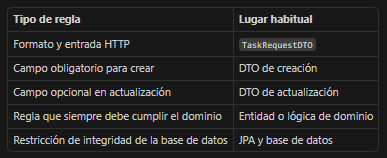
<br>
También pueden usarse anotaciones JPA como @NotNull en la entidad si la regla es realmente universal, pero no deberían sustituir la validación específica de los DTOs.<br>
<br>
Flujo recomendado

```
JSON recibido
    ↓
TaskRequestDTO + @Valid
    ↓
Mapper / Service
    ↓
Task
    ↓
Repository
    ↓
Base de datos
```

Y para la respuesta:

```
Task
    ↓
Mapper
    ↓
TaskResponseDTO
    ↓
JSON
```

En resumen, las validaciones de Bean Validation relacionadas con una petición REST deben ir en TaskRequestDTO porque validan el contrato de entrada y permiten reglas distintas para crear y actualizar. Las invariantes que deben cumplirse siempre pueden mantenerse también en el dominio, pero no conviene usar la entidad JPA como único modelo de validación de la API.

---
<br>
Pregunta:<br>
<br>
¿Qué ventaja tiene tener TaskMapper como clase separada frente a hacer la transformación inline en el Service?<br>
<br>
Respuesta:<br>
<br>
TaskMapper separa la conversión Entity ↔ DTO de la lógica de negocio del Service.<br>
<br>
Ventajas principales:<br>
<br>
Service más limpio: se centra en reglas de negocio y transacciones.<br>
Reutilización: varios servicios o controladores pueden usar el mismo mapeo.<br>
Menos duplicación: la conversión se escribe una sola vez.<br>
Más fácil de probar: el mapper puede probarse de forma independiente.<br>
Menor acoplamiento: los cambios en el formato de la API no contaminan la lógica de persistencia.<br>
Flujo recomendado:

```
Controller → DTO
Service → lógica de negocio
TaskMapper → Entity ↔ DTO
Repository → Entity
```

Para una conversión mínima y puntual, hacerla inline puede ser suficiente. Pero cuando hay varios endpoints o relaciones, una clase como TaskMapper resulta más mantenible.

---
<br>
¿Qué ocurriría si añades un nuevo campo a Task en base de datos? ¿Qué tendrías que cambiar con DTOs y qué tendrías que cambiar sin DTOs?<br>
<br>
Respuesta:<br>
<br>
Si añades un campo, por ejemplo estimatedHours, los cambios serían distintos.<br>
<br>
Con DTOs<br>
Tendrías que actualizar:<br>
<br>
La entidad Task y su mapeo JPA.<br>
El DTO de entrada, solo si el cliente puede enviarlo.<br>
El DTO de salida, solo si quieres mostrarlo.<br>
TaskMapper.<br>
Las migraciones o cambios del esquema de base de datos.<br>
Las pruebas afectadas.<br>
La API no cambia automáticamente: decides explícitamente si el nuevo campo forma parte del contrato.<br>
<br>
Sin DTOs<br>
Si el controlador devuelve directamente Task:

```
public Task getTask(...) { ... }
```

el nuevo campo podría aparecer automáticamente en el JSON. Eso puede cambiar el contrato sin querer.<br>
<br>
Si también recibes directamente Task en @RequestBody, el cliente podría enviar y modificar el nuevo campo inmediatamente, aunque no debiera.<br>
<br>
Además, tendrías que revisar:<br>
<br>
serialización JSON;<br>
relaciones JPA;<br>
validaciones;<br>
lógica de negocio;<br>
posibles ciclos;<br>
clientes que no esperen ese campo.<br>
En resumen:>

```
Con DTOs: cambio controlado y explícito.
Sin DTOs: cambio más rápido, pero acoplamiento y efectos secundarios.
```

Los DTOs requieren más trabajo inicial, pero protegen el contrato de la API frente a cambios internos en Task.

---
<br>
Pregunta:<br>
<br>
¿Por qué TaskResponseDTO incluye createdAt pero TaskRequestDTO no?<br>
<br>
Respuesta:<br>
<br>
Porque createdAt es un dato que genera y controla el servidor, no el cliente.<br>
<br>
En este proyecto, Task.java lo asigna automáticamente mediante @PrePersist:

```
@PrePersist
private void prePersist() {
    if (createdAt == null) {
        createdAt = LocalDateTime.now();
    }
}
```

Por eso:<br>
<br>
TaskRequestDTO no lo incluye: el cliente no debe poder elegir ni modificar la fecha de creación.<br>
TaskResponseDTO sí lo incluye: el cliente puede consultar cuándo se creó la tarea.<br>
Esto evita peticiones como:

```
{
  "title": "Nueva tarea",
  "createdAt": "2020-01-01T00:00:00"
}
```

La separación es:

```
RequestDTO  → datos permitidos que envía el cliente
Entity      → datos persistidos y generados internamente
ResponseDTO → datos que el servidor devuelve
```

Si se incluyera createdAt en el DTO de entrada, el cliente podría falsear auditoría o modificar accidentalmente un dato que debería permanecer inmutable.

---
<br>
Pregunta:<br>
<br>
¿Por qué PagedResponseDTO es genérico (<T>)? ¿Qué ventaja tiene frente a devolver el Page<Task> de Spring Data o a crear un PagedTaskResponseDTO específico?<br>
<br>
Respuesta:<br>
<br>
PagedResponseDTO<T> es genérico porque permite reutilizar la misma estructura de paginación para distintos tipos de elementos:

```
public record PagedResponseDTO<T>(
    List<T> content,
    int page,
    int size,
    long totalElements,
    int totalPages
) {
}
```

Puede utilizarse como:

```
PagedResponseDTO<TaskResponseDTO>
PagedResponseDTO<CategoryResponseDTO>
PagedResponseDTO<TagResponseDTO>
```

Ventajas frente a Page<Task><br>
Page<Task> expone directamente:<br>
<br>
una entidad JPA;<br>
detalles internos de Spring Data;<br>
propiedades como pageable, sort o offset;<br>
un contrato JSON dependiente de la versión de Spring.<br>
Con PagedResponseDTO<T> controlas exactamente qué devuelve la API:

```
{
  "content": [],
  "page": 0,
  "size": 10,
  "totalElements": 37,
  "totalPages": 4
}
```
Ventajas frente a un PagedTaskResponseDTO específico<br>
Una clase como:

```
PagedTaskResponseDTO
```

solo serviría para tareas. Si después necesitas paginar categorías, etiquetas o usuarios, tendrías que crear más clases repetidas.<br>
<br>
Con el genérico reutilizas la misma estructura:

```
PagedResponseDTO<TaskResponseDTO>
PagedResponseDTO<CategoryResponseDTO>
```

En resumen:

```
Page<Task>              → acoplado a Spring Data y a la entidad JPA
PagedTaskResponseDTO    → controlado, pero específico
PagedResponseDTO<T>     → controlado, reutilizable y tipado
```

---
<br>
Pregunta:<br>
<br>
¿Qué problema concreto evita no exponer Task directamente, ahora que Task tiene relaciones con Category y Tag y tuvimos que ocultarlas con @JsonIgnore?<br>
<br>
Respuesta:<br>
<br>
Evita que la API quede expuesta a los problemas del grafo de entidades JPA:

```
Task → Category → tasks → Task → ...
Task → Tag → tasks → Task → ...
```

Sin DTOs, al devolver Task directamente, Jackson podría:<br>
<br>
entrar en ciclos de serialización;<br>
provocar JsonMappingException;<br>
generar JSON enorme;<br>
activar cargas LAZY y producir muchas consultas;<br>
lanzar LazyInitializationException;<br>
exponer relaciones internas.<br>
Por eso se añadió @JsonIgnore en Category.tasks y Tag.tasks, para cortar la recursión. Pero eso obliga a ocultar siempre esas propiedades, incluso cuando algún endpoint sí las necesite.<br>
<br>
Con un DTO, por ejemplo:

```
public record TaskResponseDTO(
    Long id,
    String title,
    Long categoryId,
    List<Long> tagIds
) {
}
```

la respuesta incluye solo lo necesario:

```
{
  "id": 1,
  "title": "Aprender JPA",
  "categoryId": 2,
  "tagIds": [3, 5]
}
```

Así se evita la recursión sin depender de @JsonIgnore y se mantiene separado el modelo JPA del contrato JSON de la API.

---
<br>
Paso 6 – Validación en Postman<br>
<br>
Prueba 1 — GET - Listar todas las tareas con DTOs<br>

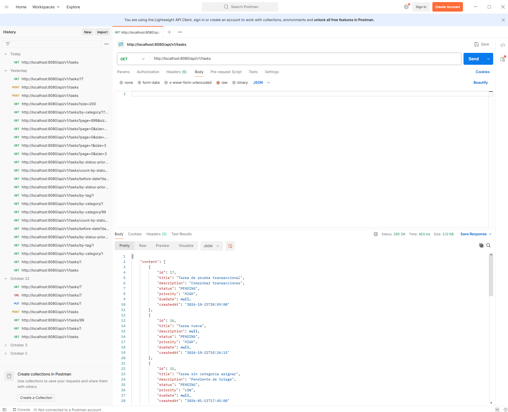

---
<br>
Prueba 2 — GET - Listar tareas paginadas<br>

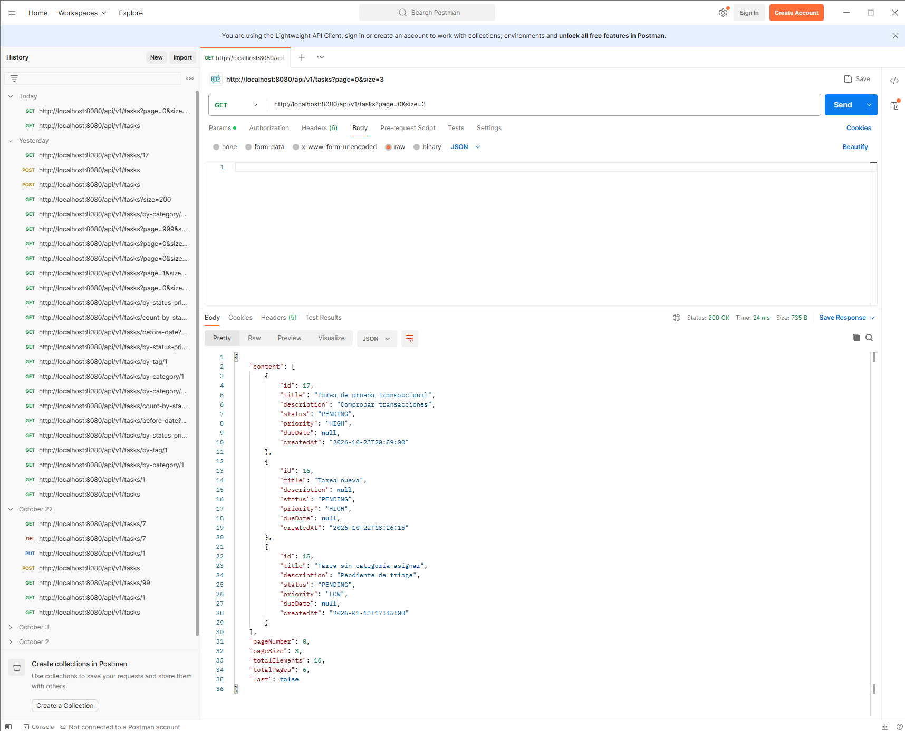

---
<br>
Prueba 3 — GET - Obtener tarea por ID con DTO<br>

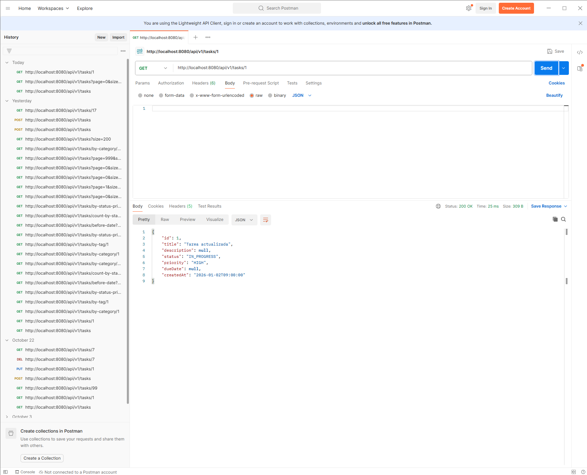

---
<br>
Prueba 4 — GET - Tarea inexistente<br>

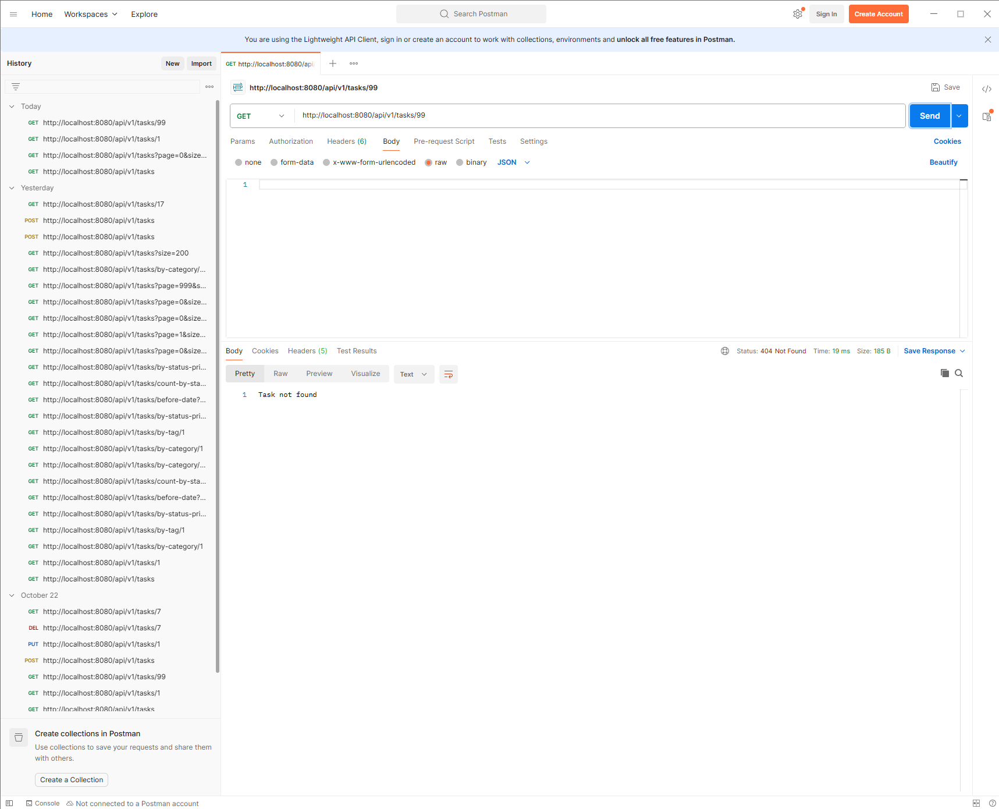

---
<br>
Prueba 5 — POST - Crear tarea con DTO<br>


---
<br>
Prueba 6 — PUT - Actualizar tarea con DTO<br>

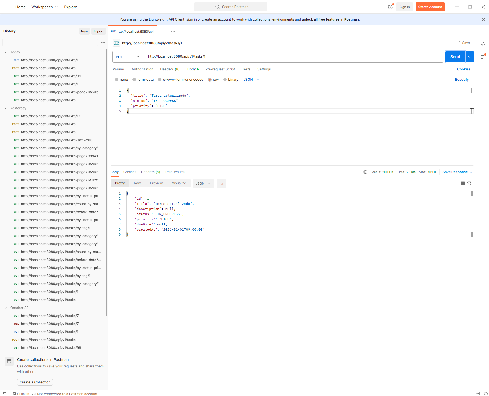

---
<br>
Prueba 7 — DELETE - Eliminar tarea creada<br>

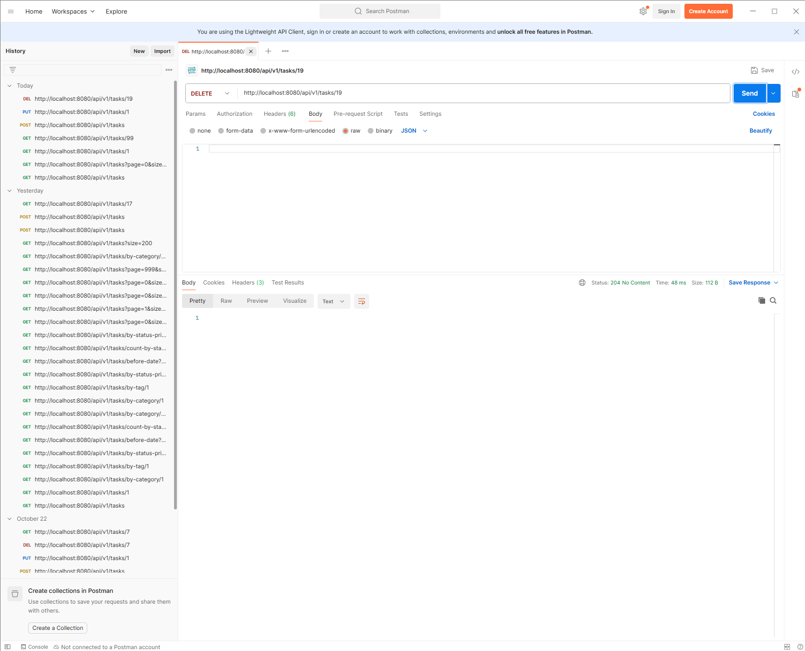

---
<br>
Prueba 8 — GET - Listar tareas por categoría<br>

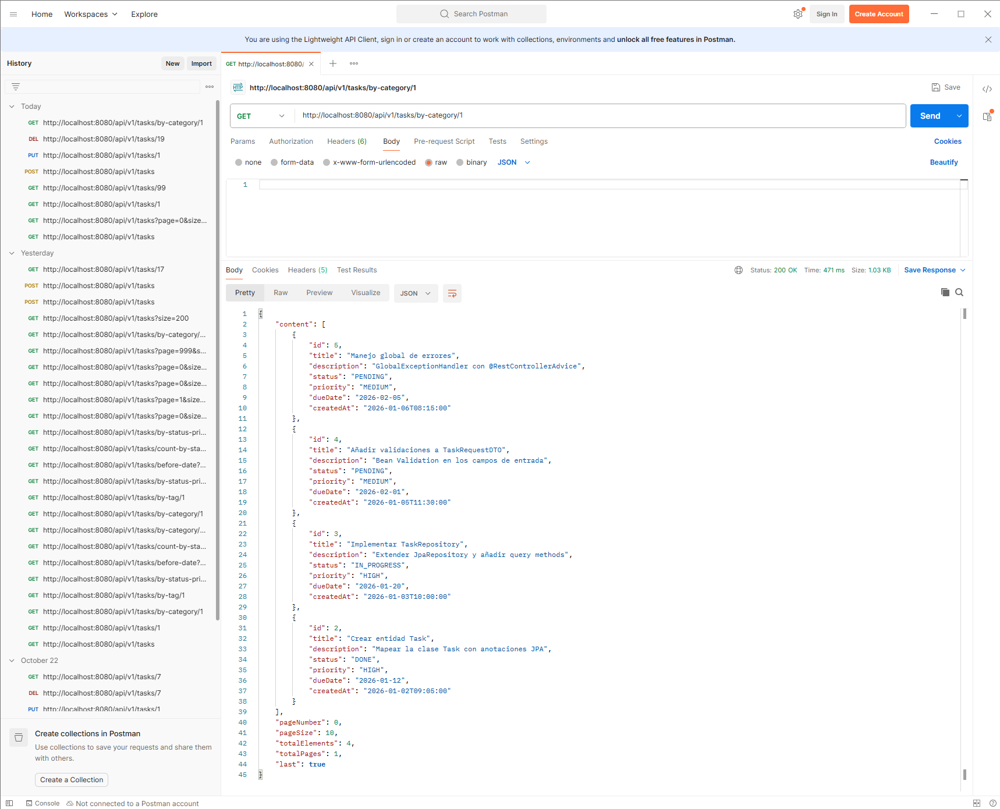

---
<br>
Prueba 9 — GET - Contar tareas por estado<br>

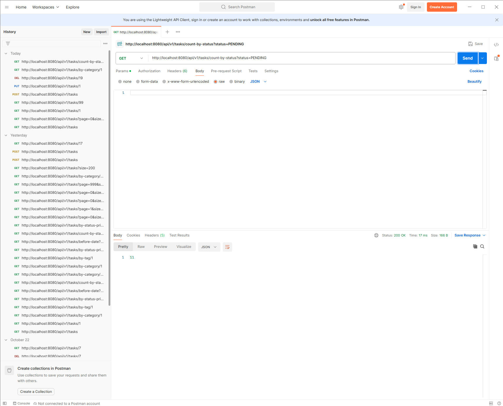

---
<br>
Reflexión:<br>
<br>
Pregunta:<br>
<br>
¿Qué problema concreto habrías tenido en la Parte 2 si no hubieras introducido DTOs ahora?<br>
<br>
Respuesta:<br>
<br>
Habría tenido problemas con las relaciones entre entidades, ya que al devolver directamente las entidades JPA podrían aparecer referencias circulares en el JSON y exponerse datos innecesarios. Además, habría sido más difícil controlar qué información recibe y devuelve la API.<br>
<br>
Pregunta:<br>
<br>
¿Qué ventaja tiene hacer la transformación manualmente frente a usar una librería como MapStruct?<br>
<br>
Respuesta:<br>
<br>
La principal ventaja es que tengo un control total sobre la conversión entre entidades y DTOs, y puedo entender mejor cómo se realiza el mapeo de cada campo.<br>
<br>
Pregunta:<br>
<br>
¿Qué desventaja tiene hacerlo manualmente?<br>
<br>
Respuesta:<br>
<br>
Requiere escribir y mantener más código. Si las entidades o los DTOs cambian, tengo que actualizar las conversiones manualmente, lo que aumenta el riesgo de errores y hace que el mantenimiento sea más costoso.<br>

---
<br>
Parte 2 - Ejercicio para la creación de las Relaciones OneToMany / ManyToOne<br>
<br>
Paso 1 - Preparación (Ask)<br>
<br>
Pregunta:<br>
<br>
En mi proyecto Spring Boot, ¿cómo debo representar la relación @ManyToOne entre Task y Category usando DTOs, de forma que TaskRequestDTO reciba el ID de la categoría y TaskResponseDTO devuelva el nombre de la categoría?<br>
<br>
Respuesta:<br>
<br>
En tu proyecto, la relación debe ocultarse en los DTOs y representarse con datos simples:

```
Request:  categoryId   → el cliente indica qué categoría usar
Entity:   Category     → JPA mantiene la relación
Response: categoryName → la API devuelve un dato legible
```

Actualmente Task ya tiene la relación correctamente mapeada:

```
@ManyToOne(fetch = FetchType.LAZY)
@JoinColumn(name = "category_id")
private Category category;
```

en Task.java.<br>
<br>
1. TaskRequestDTO<br>
Añade el identificador de la categoría:

```
public class TaskRequestDTO {
    private String title;
    private String description;
    private TaskStatus status;
    private TaskPriority priority;
    private LocalDate dueDate;
    private Long categoryId;

    // getters y setters
}
```

El JSON de entrada sería:

```
{
  "title": "Aprender JPA",
  "description": "Estudiar relaciones",
  "status": "PENDING",
  "priority": "HIGH",
  "dueDate": "2026-11-01",
  "categoryId": 2
}
```

No conviene recibir un objeto completo Category, porque el cliente solo debería indicar el ID de una categoría existente.<br>
<br>
2. El Service busca la categoría<br>
El mapper no debería consultar la base de datos. El Service debe resolver el ID:

```
@Transactional
@Override
public TaskResponseDTO create(TaskRequestDTO dto) {
    Task task = TaskMapper.toEntity(dto);

    Category category = categoryRepository.findById(dto.getCategoryId())
        .orElseThrow(() ->
            new CategoryNotFoundException(
                "La categoría no existe: " + dto.getCategoryId()
            ));

    task.setCategory(category);

    Task savedTask = taskRepository.save(task);
    return TaskMapper.toResponseDTO(savedTask);
}
```

Necesitarías inyectar CategoryRepository en TaskServiceImpl.java.<br>
<br>
Esto evita crear una categoría ficticia solo con el ID y permite devolver un error claro si no existe.<br>
<br>
3. TaskResponseDTO<br>
Añade el nombre de la categoría:

```
public class TaskResponseDTO {
    private Long id;
    private String title;
    private String description;
    private TaskStatus status;
    private TaskPriority priority;
    private LocalDate dueDate;
    private LocalDateTime createdAt;
    private String categoryName;

    // getters y setters
}
```

La respuesta sería:

```
{
  "id": 10,
  "title": "Aprender JPA",
  "status": "PENDING",
  "priority": "HIGH",
  "dueDate": "2026-11-01",
  "createdAt": "2026-10-24T22:00:00",
  "categoryName": "Java"
}
```

4. Actualizar TaskMapper<br>
En TaskMapper.java, el mapeo de entrada copia los campos simples, pero no resuelve la categoría:

```
public static Task toEntity(TaskRequestDTO dto) {
    Task task = new Task();
    task.setTitle(dto.getTitle());
    task.setDescription(dto.getDescription());
    task.setStatus(dto.getStatus());
    task.setPriority(dto.getPriority());
    task.setDueDate(dto.getDueDate());
    return task;
}
```

El Service asigna después:

```
task.setCategory(category);
```

El mapeo de salida sí puede leer el nombre:

```
public static TaskResponseDTO toResponseDTO(Task task) {
    String categoryName = task.getCategory() != null
        ? task.getCategory().getName()
        : null;

    return new TaskResponseDTO(
        task.getId(),
        task.getTitle(),
        task.getDescription(),
        task.getStatus(),
        task.getPriority(),
        task.getDueDate(),
        task.getCreatedAt(),
        categoryName
    );
}
```

Resumen

```
TaskRequestDTO.categoryId
        ↓
CategoryRepository.findById(...)
        ↓
task.setCategory(category)
        ↓
TaskResponseDTO.categoryName
```

El RequestDTO recibe el ID porque es suficiente para identificar la categoría; el ResponseDTO devuelve el nombre porque es más útil para el consumidor de la API. La entidad JPA mantiene el objeto Category, pero esa complejidad no se expone directamente en JSON.

---
<br>
Pregunta:<br>
<br>
¿Por qué no debería devolver la entidad Category completa dentro de TaskResponseDTO? ¿Qué problemas podría causar con la serialización JSON y el acoplamiento entre la API y la base de datos?<br>
<br>
Respuesta:<br>
<br>
No conviene incluir la entidad Category completa dentro de TaskResponseDTO porque volverías a exponer parte del modelo JPA y perderías muchas ventajas de los DTOs.<br>
<br>
Problemas de serialización JSON<br>
La relación es bidireccional:

```
Task → Category → tasks → Task → Category → ...
```

Si TaskResponseDTO contiene:

```
private Category category;
```

Jackson podría serializar:

```
{
  "id": 10,
  "title": "Aprender JPA",
  "category": {
    "id": 2,
    "name": "Java",
    "tasks": [
      {
        "id": 10,
        "category": {
          "id": 2,
          "tasks": [
            "..."
          ]
        }
      }
    ]
  }
}
```

Esto puede provocar:<br>
<br>
recursión infinita;<br>
JsonMappingException;<br>
respuestas JSON enormes;<br>
consultas adicionales al acceder a Category.tasks;<br>
LazyInitializationException si la relación lazy se carga cuando la sesión ya está cerrada.<br>
Aunque @JsonIgnore en Category.tasks pueda evitar el ciclo, seguirías dependiendo de anotaciones de serialización colocadas en entidades JPA.<br>
<br>
Acoplamiento con la base de datos<br>
Category no es un simple objeto de respuesta: es una entidad JPA con:<br>
<br>
@Entity;<br>
@Table;<br>
relaciones;<br>
propiedades internas;<br>
comportamiento de persistencia.<br>
Si la API devuelve esa entidad, cualquier cambio interno puede modificar el JSON:<br>
<br>
añadir o quitar campos;<br>
cambiar relaciones;<br>
renombrar propiedades;<br>
modificar la estrategia LAZY/EAGER;<br>
cambiar anotaciones Jackson;<br>
incluir nuevos datos de auditoría.<br>
Así, el esquema interno de persistencia condiciona el contrato público de la API.<br>
<br>
Riesgo de respuestas demasiado grandes<br>
Una categoría puede tener muchas tareas. Devolverla completa desde cada tarea puede repetir datos y generar respuestas innecesariamente grandes:

```
Task → Category → lista de muchas Tasks
```

Además, puede provocar el problema N+1 si Hibernate carga categorías o colecciones una a una.<br>
<br>
Mejor alternativa<br>
En TaskResponseDTO, devuelve solo los datos necesarios:

```
public class TaskResponseDTO {
    private Long id;
    private String title;
    private String categoryName;
}
```

Respuesta:

```
{
  "id": 10,
  "title": "Aprender JPA",
  "categoryName": "Java"
}
```

Si necesitas más información, crea un DTO específico para la categoría:

```
public record CategorySummaryDTO(
    Long id,
    String name
) {
}
```

y úsalo:

```
private CategorySummaryDTO category;
```

Resultado controlado:

```
{
  "id": 10,
  "title": "Aprender JPA",
  "category": {
    "id": 2,
    "name": "Java"
  }
}
```

Ese DTO no contiene tasks, por lo que no puede crear el ciclo.<br>
<br>
En resumen, devolver categoryName o un CategorySummaryDTO mantiene controlado el JSON, evita ciclos y mantiene separada la API del modelo JPA y de la estructura de la base de datos.

---
<br>
Pregunta:<br>
<br>
¿Qué es el problema N+1 al listar tareas incluyendo el nombre de su categoría, por qué puede aparecer con JPA y qué opciones existen para evitarlo?<br>
<br>
Respuesta:<br>
<br>
El problema N+1 ocurre cuando al listar tareas se ejecuta:<br>
<br>
Una consulta para obtener las N tareas.<br>
Una consulta adicional por cada tarea para obtener su categoría.<br>
Si hay 100 tareas, podrían ejecutarse hasta 101 consultas.<br>
<br>
Ejemplo<br>
La consulta inicial:

```
SELECT *
FROM task;
```

Después, al hacer:

```
task.getCategory().getName();
```

para cada tarea:

```
SELECT *
FROM category
WHERE id = ?;
```

El problema aparece normalmente porque la relación está definida como LAZY:

```
@ManyToOne(fetch = FetchType.LAZY)
@JoinColumn(name = "category_id")
private Category category;
```

LAZY no carga la categoría al obtener la tarea. La carga se activa cuando el mapper o el serializador accede a getCategory().getName().<br>
<br>
Si varias tareas comparten categoría, el caché de primer nivel puede evitar algunas consultas, pero sigue existiendo el riesgo de realizar muchas consultas.<br>
<br>
Opciones para evitarlo<br>
1. JOIN FETCH<br>
Definir una consulta que cargue las tareas y sus categorías juntas:

```
@Query("""
    SELECT t
    FROM Task t
    JOIN FETCH t.category
""")
List<Task> findAllWithCategory();
```

SQL aproximado:

```
SELECT t.*, c.*
FROM task t
JOIN category c
    ON t.category_id = c.id;
```

Si se utiliza paginación, hay que tener cuidado con los JOIN FETCH sobre colecciones. Para una relación ManyToOne, como Task.category, suele ser más sencillo.<br>
<br>
2. @EntityGraph<br>
Permite indicar la relación que debe cargarse para un método concreto:

```
@EntityGraph(attributePaths = "category")
Page<Task> findAll(Pageable pageable);
```

Así se mantiene LAZY como estrategia general, pero se carga category cuando esa consulta necesita el nombre.<br>
<br>
3. Proyección o DTO directamente desde JPQL<br>
Si la respuesta solo necesita algunos campos, se puede consultar directamente el DTO:

```
@Query("""
    SELECT new com.accenture.taskmanager.dto.TaskResponseDTO(
        t.id,
        t.title,
        t.description,
        t.status,
        t.priority,
        t.dueDate,
        t.createdAt,
        c.name
    )
    FROM Task t
    LEFT JOIN t.category c
""")
List<TaskResponseDTO> findTaskResponses();
```

Esto evita cargar entidades completas y obtiene el nombre de categoría en la misma consulta.<br>
<br>
4. @BatchSize o carga por lotes<br>
Hibernate puede agrupar la carga de categorías:

```
@ManyToOne(fetch = FetchType.LAZY)
@BatchSize(size = 20)
private Category category;
```

En lugar de una consulta por tarea, puede generar consultas agrupadas:

```
SELECT *
FROM category
WHERE id IN (?, ?, ?, ...);
```

No elimina completamente las consultas adicionales, pero reduce mucho su número.<br>
<br>
¿Basta con cambiar a EAGER?<br>
No necesariamente:

```
@ManyToOne(fetch = FetchType.EAGER)
```

obliga a que la categoría esté disponible, pero Hibernate puede cargarla mediante consultas adicionales y seguir produciendo N+1. EAGER tampoco expresa qué consultas concretas necesita cada caso de uso.<br>
<br>
Por eso suele ser mejor:<br>
<br>
mantener la relación LAZY;<br>
usar JOIN FETCH, @EntityGraph o una proyección en la consulta que lista tareas;<br>
convertir las entidades a DTO dentro de una transacción o mediante una consulta que ya devuelva los datos necesarios.<br>
En este proyecto, si TaskResponseDTO necesita categoryName, la opción más controlable suele ser una consulta con JOIN o una proyección DTO, en lugar de devolver directamente la entidad Task y dejar que Jackson acceda a la relación.

---
<br>
Paso 2 - Diseño previo<br>
<br>
Pregunta:<br>
1.¿Qué campos tendrán CategoryRequestDTO y CategoryResponseDTO?<br>
<br>
Respuesta:<br>
<br>
-CategoryRequestDTO: name y description, para recibir los datos de una categoría.<br>
-CategoryResponseDTO: id, name y description, para devolver la categoría con su identificador.<br>
<br>
Pregunta:<br>
<br>
2.¿Qué campos nuevos necesitan TaskRequestDTO y TaskResponseDTO?<br>
<br>
Respuesta:<br>
<br>
-TaskRequestDTO: añadir categoryId, para indicar a qué categoría pertenece la tarea.<br>
-TaskResponseDTO: añadir categoryName, para mostrar el nombre de la categoría sin devolver la entidad Category completa.<br>
<br>
Pregunta:<br>
<br>
3.¿Dónde y cómo vas a resolver el categoryId y qué ocurrirá si no existe?<br>
<br>
Respuesta:<br>
<br>
La resolución se hará en la capa de servicio (TaskServiceImpl), utilizando CategoryRepository para buscar la categoría por su ID. Si no existe, se lanzará una excepción de categoría no encontrada y se devolverá un error HTTP 404.<br>
<br>
Pregunta:<br>
<br>
4.¿Qué endpoints necesitas para gestionar categorías?<br>
<br>
Respuesta:<br>
<br>
-GET /api/v1/categories: listar categorías.<br>
-GET /api/v1/categories/{id}: consultar una categoría por ID.<br>
-POST /api/v1/categories: crear una categoría.<br>
-PUT /api/v1/categories/{id}: actualizar una categoría.<br>
-DELETE /api/v1/categories/{id}: eliminar una categoría.<br>
<br>
Pregunta:<br>
<br>
5.¿Qué comentario exacto escribirás para que el autocompletado lo genere?<br>
<br>
Respuesta:<br>
<br>
Crear los DTOs CategoryRequestDTO y CategoryResponseDTO, añadir categoryId a TaskRequestDTO y categoryName a TaskResponseDTO, implementar el mapeo entre entidades y DTOs, resolver categoryId mediante CategoryRepository en la capa de servicio y gestionar el error cuando la categoría no exista. Implementar los endpoints CRUD de categorías en las capas de servicio y controlador. Mantener el estilo, la estructura y el Javadoc del proyecto, sin modificar funcionalidades ajenas a este cambio.

---
<br>
Paso 3 – Implementación (autocompletado)<br>
<br>
CategoryRequestDTO<br>
<br>
Comentario:<br>
<br>
// Crear CategoryRequestDTO para recibir los datos de una categoría, con los campos name y description, sus getters y setters, y Javadoc de clase y métodos. Mantener el estilo de los DTOs existentes. — generado por IA<br>
<br>
Resultado:

```
package com.accenture.taskmanager.dto;

/**
 * DTO para la solicitud de creación o actualización de una categoría.
 * Contiene los campos necesarios para representar una categoría, incluyendo su nombre y descripción.
 * 
 * @author Javier Roldán
 * @version 1.0
 */
// Crear CategoryRequestDTO para recibir los datos de una categoría, con los campos name y description, sus getters y setters, y Javadoc de clase y métodos. Mantener el estilo de los DTOs existentes. — generado por IA
public class CategoryRequestDTO {

    private String name;
    private String description;

    /**
     * Obtiene el nombre de la categoría.
     *
     * @return el nombre de la categoría
     */
    public String getName() {
        return name;
    }

    /**
     * Establece el nombre de la categoría.
     *
     * @param name el nombre de la categoría
     */
    public void setName(String name) {
        this.name = name;
    }

    /**
     * Obtiene la descripción de la categoría.
     *
     * @return la descripción de la categoría
     */
    public String getDescription() {
        return description;
    }

    /**
     * Establece la descripción de la categoría.
     *
     * @param description la descripción de la categoría
     */
    public void setDescription(String description) {
        this.description = description;
    }
}

```

---
<br>
CategoryResponseDTO<br>
<br>
Comentario:<br>
<br>
// Crear CategoryResponseDTO para devolver los datos de una categoría, con los campos id (Long), name y description (String), sus getters y setters, y Javadoc de clase y métodos. Mantener el estilo de los DTOs existentes. — generado por IA<br>
<br>
Resultado:

```
package com.accenture.taskmanager.dto;

/**
 * DTO para la respuesta de una categoría.
 * Contiene los campos necesarios para representar una categoría, incluyendo su ID, nombre y descripción.
 * 
 * @author Javier Roldán
 * @version 1.0
 */
// Crear CategoryResponseDTO para devolver los datos de una categoría, con los campos id (Long), name y description (String), sus getters y setters, y Javadoc de clase y métodos. Mantener el estilo de los DTOs existentes. — generado por IA
public class CategoryResponseDTO {

    private Long id;
    private String name;
    private String description;

    /**
     * Obtiene el ID de la categoría.
     *
     * @return el ID de la categoría
     */
    public Long getId() {
        return id;
    }

    /**
     * Establece el ID de la categoría.
     *
     * @param id el ID de la categoría
     */
    public void setId(Long id) {
        this.id = id;
    }

    /**
     * Obtiene el nombre de la categoría.
     *
     * @return el nombre de la categoría
     */
    public String getName() {
        return name;
    }

    /**
     * Establece el nombre de la categoría.
     *
     * @param name el nombre de la categoría
     */
    public void setName(String name) {
        this.name = name;
    }

    /**
     * Obtiene la descripción de la categoría.
     *
     * @return la descripción de la categoría
     */
    public String getDescription() {
        return description;
    }

    /**
     * Establece la descripción de la categoría.
     *
     * @param description la descripción de la categoría
     */
    public void setDescription(String description) {
        this.description = description;
    }
}

```

---
<br>
CategoryMapper<br>
<br>
Comentario:<br>
<br>
// Crear CategoryMapper para convertir entre la entidad Category y CategoryRequestDTO/CategoryResponseDTO. Implementar métodos estáticos toResponseDTO(Category category) y toEntity(CategoryRequestDTO dto), copiando id, name y description cuando corresponda. Gestionar valores null y añadir Javadoc. Mantener el estilo de TaskMapper. — generado por IA<br>
<br>
Resultado:

```
package com.accenture.taskmanager.mapper;

import com.accenture.taskmanager.dto.CategoryRequestDTO;
import com.accenture.taskmanager.dto.CategoryResponseDTO;
import com.accenture.taskmanager.model.Category;

//javadoc
/**
 * Clase de mapeo para convertir entre la entidad Category y los DTOs CategoryRequestDTO y CategoryResponseDTO.
 * Proporciona métodos estáticos para realizar las conversiones necesarias.
 * 
 * @author Javier Roldán
 * @version 1.0
 */
// Crear CategoryMapper para convertir entre la entidad Category y CategoryRequestDTO/CategoryResponseDTO. Implementar métodos estáticos toResponseDTO(Category category) y toEntity(CategoryRequestDTO dto), copiando id, name y description cuando corresponda. Gestionar valores null y añadir Javadoc. Mantener el estilo de TaskMapper. — generado por IA
public class CategoryMapper {

    /**
     * Convierte una entidad Category a un DTO de respuesta CategoryResponseDTO.
     *
     * @param category la entidad Category a convertir
     * @return el DTO de respuesta CategoryResponseDTO correspondiente
     */
    public static CategoryResponseDTO toResponseDTO(Category category) {
        if (category == null) {
            return null;
        }
        CategoryResponseDTO dto = new CategoryResponseDTO();
        dto.setId(category.getId());
        dto.setName(category.getName());
        dto.setDescription(category.getDescription());
        return dto;
    }

    /**
     * Convierte un DTO de solicitud CategoryRequestDTO a una entidad Category.
     *
     * @param dto el DTO de solicitud CategoryRequestDTO a convertir
     * @return la entidad Category correspondiente
     */
    public static Category toEntity(CategoryRequestDTO dto) {
        if (dto == null) {
            return null;
        }
        Category category = new Category();
        category.setName(dto.getName());
        category.setDescription(dto.getDescription());
        return category;
    }
}
```

---
<br>
Añadir categoryId a TaskRequestDTO<br>
<br>
Comentario:<br>
<br>
    // Añadir el campo categoryId de tipo Long a TaskRequestDTO para indicar la categoría de la tarea. Debe ser opcional, permitiendo crear tareas sin categoría. Añadir su getter, setter y Javadoc, sin modificar los campos existentes. — generado por IA<br>
<br>
Resultado:

```
    // Añadir el campo categoryId de tipo Long a TaskRequestDTO para indicar la categoría de la tarea. Debe ser opcional, permitiendo crear tareas sin categoría. Añadir su getter, setter y Javadoc, sin modificar los campos existentes. — generado por IA
    private Long categoryId;

    /**
     * Gets the category ID of the task.
     *
     * @return the category ID of the task
     */
    public Long getCategoryId() {
        return categoryId;
    }

    /**
     * Sets the category ID of the task.
     *
     * @param categoryId the category ID to set
     */
    public void setCategoryId(Long categoryId) {
        this.categoryId = categoryId;
    }
```

---
<br>
Añadir categoryName a TaskRenponseDTO<br>
<br>
Comentario:<br>
<br>
// Añadir el campo categoryName de tipo String a TaskResponseDTO para devolver el nombre de la categoría asociada a la tarea, sin exponer la entidad Category completa. La categoría puede ser null. Añadir getter, setter y Javadoc, sin modificar los campos existentes. — generado por IA<br>
<br>
Resultado:

```
    // Añadir el campo categoryName de tipo String a TaskResponseDTO para devolver el nombre de la categoría asociada a la tarea, sin exponer la entidad Category completa. La categoría puede ser null. Añadir getter, setter y Javadoc, sin modificar los campos existentes. — generado por IA
    private String categoryName;

    /**
     * Gets the name of the category associated with the task.
     *
     * @return the name of the category associated with the task
     */
    public String getCategoryName() {
        return categoryName;
    }

    /**
     * Sets the name of the category associated with the task.
     *
     * @param categoryName the name of the category to set
     */
    public void setCategoryName(String categoryName) {
        this.categoryName = categoryName;
    }
```

---
<br>
Adaptar TaskMapper comentando toResponseDTO, rellenar categoryName con un comentario y luego borrar toResponseDTO<br>
<br>
Comentario:<br>
<br>
// Completa el método toResponseDTO(Task task) creando un único TaskResponseDTO con los campos id, title, description, status, priority, dueDate y createdAt. Después, asigna categoryName usando el nombre de la categoría asociada a task, comprobando que task.getCategory() no sea null. Devuelve el mismo DTO al que has asignado categoryName. No expongas la entidad Category completa. Mantén el estilo y el Javadoc existentes. — generado por IA
<br>
Resultado:

```
    // Completa el método toResponseDTO(Task task) creando un único TaskResponseDTO con los campos id, title, description, status, priority, dueDate y createdAt. Después, asigna categoryName usando el nombre de la categoría asociada a task, comprobando que task.getCategory() no sea null. Devuelve el mismo DTO al que has asignado categoryName. No expongas la entidad Category completa. Mantén el estilo y el Javadoc existentes. — generado por IA
    /**
     * Converts a Task entity to a TaskResponseDTO.
     *
     * @param task the Task entity to convert
     * @return the corresponding TaskResponseDTO
     */
    public static TaskResponseDTO toResponseDTO(Task task) {
        TaskResponseDTO dto = new TaskResponseDTO();
        dto.setId(task.getId());
        dto.setTitle(task.getTitle());
        dto.setDescription(task.getDescription());
        dto.setStatus(task.getStatus());
        dto.setPriority(task.getPriority());
        dto.setDueDate(task.getDueDate());
        dto.setCreatedAt(task.getCreatedAt());

        if (task.getCategory() != null) {
            dto.setCategoryName(task.getCategory().getName());
        }

        return dto;
    }
```

NOTA: se elimina el método anterior pero se dejan los comentarios como pide el pdf.

---
<br>
CategoryRepository<br>
<br>
Comentario:<br>
<br>
// Crear CategoryRepository como interfaz que extienda JpaRepository<Category, Long>, siguiendo el estilo de TaskRepository. Añadir los imports necesarios y Javadoc. — generado por IA<br>
<br>
Resultado:

```
package com.accenture.taskmanager.repository;

// Crear CategoryRepository como interfaz que extienda JpaRepository<Category, Long>, siguiendo el estilo de TaskRepository. Añadir los imports necesarios y Javadoc. — generado por IA

import org.springframework.data.jpa.repository.JpaRepository;
import org.springframework.stereotype.Repository;

import com.accenture.taskmanager.model.Category;

/**
 * Repositorio para la entidad Category.
 * Proporciona métodos para realizar operaciones CRUD en la base de datos relacionadas con las categorías.
 * Extiende JpaRepository para heredar métodos de acceso a datos.
 * 
 * @author Javier Roldán
 * @version 1.0
 */
@Repository
public interface CategoryRepository extends JpaRepository<Category, Long> {
}
```

---
<br>
CategoryService<br>
<br>
Comentario:<br>
<br>
// Crear la interfaz CategoryService con los métodos CRUD básicos para categorías: listar todas, buscar por id, crear, actualizar y eliminar. Utilizar CategoryRequestDTO y CategoryResponseDTO como objetos de entrada y salida, siguiendo el estilo de TaskService. Añadir Javadoc. — generado por IA<br>
<br>
Resultado:

```
package com.accenture.taskmanager.service.interfaces;

import java.util.List;

import com.accenture.taskmanager.dto.CategoryRequestDTO;
import com.accenture.taskmanager.dto.CategoryResponseDTO;

/**
 * Interfaz que define los métodos de servicio para la entidad Category.
 * Proporciona operaciones CRUD (Create, Read, Update, Delete) para las categorías.
 * Utiliza CategoryRequestDTO para recibir datos de entrada y CategoryResponseDTO para devolver datos de salida.
 * 
 * @author Javier Roldán
 * @version 1.0
 */
// Crear la interfaz CategoryService con los métodos CRUD básicos para categorías: listar todas, buscar por id, crear, actualizar y eliminar. Utilizar CategoryRequestDTO y CategoryResponseDTO como objetos de entrada y salida, siguiendo el estilo de TaskService. Añadir Javadoc. — generado por IA
public interface CategoryService {
    /**
     * Lista todas las categorías disponibles.
     *
     * @return una lista de CategoryResponseDTO que representa todas las categorías
     */
    List<CategoryResponseDTO> listCategories();

    /**
     * Busca una categoría por su ID.
     *
     * @param id el ID de la categoría a buscar
     * @return un CategoryResponseDTO que representa la categoría encontrada, o null si no se encuentra
     */
    CategoryResponseDTO findCategoryById(Long id);

    /**
     * Crea una nueva categoría.
     *
     * @param categoryRequestDTO los datos de la nueva categoría
     * @return un CategoryResponseDTO que representa la categoría creada
     */
    CategoryResponseDTO createCategory(CategoryRequestDTO categoryRequestDTO);

    /**
     * Actualiza una categoría existente.
     *
     * @param id el ID de la categoría a actualizar
     * @param categoryRequestDTO los nuevos datos de la categoría
     * @return un CategoryResponseDTO que representa la categoría actualizada
     */
    CategoryResponseDTO updateCategory(Long id, CategoryRequestDTO categoryRequestDTO);

    /**
     * Elimina una categoría por su ID.
     *
     * @param id el ID de la categoría a eliminar
     */
    void deleteCategory(Long id);

}
```

---
<br>
CategoryServiceImpl<br>
<br>
Comentario:<br>
<br>
// Crear CategoryServiceImpl en el paquete com.accenture.taskmanager.service.impl e implementar CategoryService. Inyectar CategoryRepository, utilizar los métodos estáticos de CategoryMapper y completar las cinco operaciones CRUD definidas en CategoryService. Mapear las entidades y DTOs correctamente, actualizar name y description, y gestionar las categorías inexistentes con una excepción coherente con el proyecto. Añadir los imports necesarios y Javadoc, manteniendo el estilo existente. — generado por IA<br>
<br>
Resultado:

```
package com.accenture.taskmanager.service;

import java.util.List;

import java.util.stream.Collectors;

import org.springframework.stereotype.Service;

import com.accenture.taskmanager.exceptions.CategoryNotFoundException;

import com.accenture.taskmanager.model.Category;
import com.accenture.taskmanager.mapper.CategoryMapper;

import com.accenture.taskmanager.dto.CategoryRequestDTO;
import com.accenture.taskmanager.dto.CategoryResponseDTO;
import com.accenture.taskmanager.repository.CategoryRepository;
import com.accenture.taskmanager.service.interfaces.CategoryService;

// Crear CategoryServiceImpl en el paquete com.accenture.taskmanager.service.impl e implementar CategoryService. Inyectar CategoryRepository, utilizar los métodos estáticos de CategoryMapper y completar las cinco operaciones CRUD definidas en CategoryService. Mapear las entidades y DTOs correctamente, actualizar name y description, y gestionar las categorías inexistentes con una excepción coherente con el proyecto. Añadir los imports necesarios y Javadoc, manteniendo el estilo existente. — generado por IA
@Service
public class CategoryServiceImpl implements CategoryService {
    private final CategoryRepository categoryRepository;

    public CategoryServiceImpl(CategoryRepository categoryRepository) {
        this.categoryRepository = categoryRepository;
    }

    @Override
    public List<CategoryResponseDTO> listCategories() {
        return categoryRepository.findAll().stream()
                .map(CategoryMapper::toResponseDTO)
                .collect(Collectors.toList());
    }

    // mete aquí la excepción personalizada de categoría no encontrada, en lugar de RuntimeException. — generado por IA
    @Override
    public CategoryResponseDTO findCategoryById(Long id) {
        Category category = categoryRepository.findById(id)
                .orElseThrow(() -> new CategoryNotFoundException("Category not found with id: " + id));
        return CategoryMapper.toResponseDTO(category);
    }

    @Override
    public CategoryResponseDTO createCategory(CategoryRequestDTO categoryRequestDTO) {
        Category category = CategoryMapper.toEntity(categoryRequestDTO);
        category = categoryRepository.save(category);
        return CategoryMapper.toResponseDTO(category);
    }

    //usa la excepción personalizada de categoría no encontrada en lugar de RuntimeException. — generado por IA
    @Override
    public CategoryResponseDTO updateCategory(Long id, CategoryRequestDTO categoryRequestDTO) {
        Category existingCategory = categoryRepository.findById(id)
                .orElseThrow(() -> new CategoryNotFoundException("Category not found with id: " + id));
        existingCategory.setName(categoryRequestDTO.getName());
        existingCategory.setDescription(categoryRequestDTO.getDescription());
        categoryRepository.save(existingCategory);
        return CategoryMapper.toResponseDTO(existingCategory);
    }

    // Comprueba que la categoría existe antes de eliminarla; si no, lanza una
    // excepción. — generado por IA
    //usa la excepción personalizada de categoría no encontrada en lugar de RuntimeException. — generado por IA
    @Override
    public void deleteCategory(Long id) {
        if (!categoryRepository.existsById(id)) {
            throw new CategoryNotFoundException("Category not found with id: " + id);
        }
        categoryRepository.deleteById(id);
    }
}
```

INCIDENCIA:<br>
<br>
Se crea una excepción personalizada para categoría no encontrada:<br>
<br>
Comentario:
<br>
// Crear la excepción personalizada CategoryNotFoundException para indicar que una categoría no existe. Debe extender RuntimeException, incluir un constructor que reciba un mensaje y llamar a super(message). Añadir Javadoc siguiendo el estilo de TaskNotFoundException. — generado por IA
<br>
Resultado:

```
package com.accenture.taskmanager.exceptions;

// Crear la excepción personalizada CategoryNotFoundException para indicar que una categoría no existe. Debe extender RuntimeException, incluir un constructor que reciba un mensaje y llamar a super(message). Añadir Javadoc siguiendo el estilo de TaskNotFoundException. — generado por IA
public class CategoryNotFoundException extends RuntimeException {

    /**
     * Constructor de la excepción CategoryNotFoundException.
     *
     * @param message el mensaje de error que describe la excepción
     */
    public CategoryNotFoundException(String message) {
        super(message);
    }
}
```

---
<br>
CategoryController<br>
<br>
Comentarios:<br>
<br>
// Crear un controlador REST para gestionar las categorías bajo /api/v1/categories. Inyectar CategoryService mediante constructor y definir los cinco endpoints CRUD: listar categorías (GET), buscar por ID (GET /{id}), crear (POST), actualizar (PUT /{id}) y eliminar (DELETE /{id}). Utilizar CategoryRequestDTO para las peticiones y CategoryResponseDTO para las respuestas, devolver los códigos HTTP adecuados y mantener el estilo del proyecto. — generado por IA<br>
<br>
    // Crear un endpoint GET /{id} para buscar una categoría por su ID. Utilizar CategoryService.findCategoryById(id) y devolver un CategoryResponseDTO. Recibir el ID mediante @PathVariable y añadir los imports necesarios y Javadoc. — generado por IA<br>
<br>
    // Crear un endpoint POST para crear una categoría. Recibir CategoryRequestDTO mediante @RequestBody, llamar a CategoryService.createCategory() y devolver el CategoryResponseDTO creado con HTTP 201 Created. Añadir los imports necesarios y Javadoc. — generado por IA<br>
<br>
    // Crear un endpoint PUT /{id} para actualizar una categoría. Recibir el ID mediante @PathVariable y CategoryRequestDTO mediante @RequestBody. Llamar a CategoryService.updateCategory(id, categoryRequestDTO) y devolver el CategoryResponseDTO actualizado. Añadir los imports necesarios y Javadoc. — generado por IA<br>
<br>
    // Crear un endpoint DELETE /{id} para eliminar una categoría. Recibir el ID mediante @PathVariable, llamar a CategoryService.deleteCategory(id) y devolver HTTP 204 No Content. Añadir los imports necesarios y Javadoc. — generado por IA<br>
<br>
Resultado:

```
package com.accenture.taskmanager.controller;

import java.util.List;

import org.springframework.web.bind.annotation.DeleteMapping;
import org.springframework.web.bind.annotation.GetMapping;
import org.springframework.web.bind.annotation.PathVariable;
import org.springframework.web.bind.annotation.PostMapping;
import org.springframework.web.bind.annotation.PutMapping;
import org.springframework.web.bind.annotation.RequestBody;
import org.springframework.web.bind.annotation.RequestMapping;
import org.springframework.web.bind.annotation.RestController;

import org.springframework.http.HttpStatus;
import org.springframework.web.bind.annotation.ResponseStatus;

import com.accenture.taskmanager.dto.CategoryRequestDTO;
import com.accenture.taskmanager.dto.CategoryResponseDTO;
import com.accenture.taskmanager.service.interfaces.CategoryService;

// Crear un controlador REST para gestionar las categorías bajo /api/v1/categories. Inyectar CategoryService mediante constructor y definir los cinco endpoints CRUD: listar categorías (GET), buscar por ID (GET /{id}), crear (POST), actualizar (PUT /{id}) y eliminar (DELETE /{id}). Utilizar CategoryRequestDTO para las peticiones y CategoryResponseDTO para las respuestas, devolver los códigos HTTP adecuados y mantener el estilo del proyecto. — generado por IA
@RestController 
@RequestMapping ("/api/v1/categories")
public class CategoryController {

    private final CategoryService categoryService;

    public CategoryController(CategoryService categoryService) {
        this.categoryService = categoryService;
    }
    
    // Crear un endpoint GET para listar todas las categorías. Utilizar CategoryService.listCategories() y devolver una lista de CategoryResponseDTO con HTTP 200. Añadir los imports necesarios y Javadoc. — generado por IA
    @GetMapping
    public List<CategoryResponseDTO> listCategories() {
        return categoryService.listCategories();
    }
    
    // Crear un endpoint GET /{id} para buscar una categoría por su ID. Utilizar CategoryService.findCategoryById(id) y devolver un CategoryResponseDTO. Recibir el ID mediante @PathVariable y añadir los imports necesarios y Javadoc. — generado por IA
    @GetMapping("/{id}")
    public CategoryResponseDTO findCategoryById(@PathVariable Long id) {
        return categoryService.findCategoryById(id);
    }

    // Crear un endpoint POST para crear una categoría. Recibir CategoryRequestDTO mediante @RequestBody, llamar a CategoryService.createCategory() y devolver el CategoryResponseDTO creado con HTTP 201 Created. Añadir los imports necesarios y Javadoc. — generado por IA
    @ResponseStatus(HttpStatus.CREATED)
    @PostMapping
    public CategoryResponseDTO createCategory(@RequestBody CategoryRequestDTO categoryRequestDTO) {
        return categoryService.createCategory(categoryRequestDTO);
    }

    // Crear un endpoint PUT /{id} para actualizar una categoría. Recibir el ID mediante @PathVariable y CategoryRequestDTO mediante @RequestBody. Llamar a CategoryService.updateCategory(id, categoryRequestDTO) y devolver el CategoryResponseDTO actualizado. Añadir los imports necesarios y Javadoc. — generado por IA
    @PutMapping("/{id}")
    public CategoryResponseDTO updateCategory(@PathVariable Long id, @RequestBody CategoryRequestDTO categoryRequestDTO) {
        return categoryService.updateCategory(id, categoryRequestDTO);
    }

    // Crear un endpoint DELETE /{id} para eliminar una categoría. Recibir el ID mediante @PathVariable, llamar a CategoryService.deleteCategory(id) y devolver HTTP 204 No Content. Añadir los imports necesarios y Javadoc. — generado por IA
    @ResponseStatus(HttpStatus.NO_CONTENT)
    @DeleteMapping("/{id}")
    public void deleteCategory(@PathVariable Long id) {
        categoryService.deleteCategory(id);
    }
}
```

---
<br>
Modificar TaskServiceImpl:<br>
<br>
Comentarios:<br>
<br>
// Añadir CategoryRepository como dependencia mediante inyección por constructor, manteniendo TaskRepository. Actualizar el constructor para recibir e inicializar ambos repositorios. Añadir los imports necesarios y conservar el estilo existente. — generado por IA<br>
<br>
// Actualizar el constructor para recibir TaskRepository y CategoryRepository e inicializar ambos atributos con this. Mantener la inyección por constructor y añadir el parámetro de cada repositorio. — generado por IA<br>
<br>
// Modificar create para resolver dto.getCategoryId() mediante CategoryRepository. Si categoryId es null, crear la tarea sin categoría. Si contiene un ID, buscar la categoría y asignarla a la tarea. Si no existe, lanzar CategoryNotFoundException indicando el ID. Mantener el guardado y la respuesta mediante TaskMapper. — generado por IA<br>
<br>
// Actualizar la categoría de la tarea usando dto.getCategoryId() y CategoryRepository. Si categoryId es null, dejar la tarea sin categoría. Si contiene un ID, buscar la categoría y asignarla a existingTask. Si no existe, lanzar CategoryNotFoundException indicando el ID. Mantener el resto de campos y el guardado existentes. — generado por IA<br>
<br>
Resultado:

```
package com.accenture.taskmanager.service;

import org.springframework.stereotype.Service;

import java.util.List;
import com.accenture.taskmanager.model.Category;

import org.springframework.data.domain.Page;
import org.springframework.data.domain.Pageable;

import com.accenture.taskmanager.dto.PagedResponseDTO;
import com.accenture.taskmanager.dto.TaskRequestDTO;
import com.accenture.taskmanager.dto.TaskResponseDTO;
import com.accenture.taskmanager.enums.TaskPriority;
import com.accenture.taskmanager.enums.TaskStatus;
import com.accenture.taskmanager.exceptions.CategoryNotFoundException;
import com.accenture.taskmanager.exceptions.TaskNotFoundException;
import com.accenture.taskmanager.mapper.TaskMapper;
import com.accenture.taskmanager.model.Task;
import com.accenture.taskmanager.repository.TaskRepository;
import com.accenture.taskmanager.service.interfaces.TaskService;

import com.accenture.taskmanager.repository.CategoryRepository;

import jakarta.transaction.Transactional;

/**
 * Implementación del servicio encargado de gestionar la lógica de negocio
 * relacionada con las tareas.
 *
 * <p>
 * Esta clase implementa las operaciones definidas en la interfaz
 * {@link TaskService} y utiliza {@link TaskRepository} para acceder
 * a las tareas almacenadas en la base de datos.
 * </p>
 *
 * @author Javier Roldán
 * @version 1.0
 */
@Service
public class TaskServiceImpl implements TaskService {

    // Crea una lista igual que en el controlador para simular la persistencia de
    // datos y añade 2 tareas de ejemplo
    // al ArrayList usando el constructor de la clase Task para poder probar los
    // endpoints -> generado con IA
    // Actualiza las tareas de ejemplo para adaptarlas al nuevo constructor de Task,
    // Para los valores de status, consulta directamente el archivo
    // src/main/java/com/accenture/taskmanager/enums/TaskStatus.java y utiliza
    // exactamente
    // los nombres de los enums declarados allí, sin traducirlos ni inventarlos.
    // Para los valores de priority, consulta directamente el archivo
    // src/main/java/com/accenture/taskmanager/enums/TaskPriority.java y utiliza
    // exactamente
    // los nombres de los enums declarados allí, sin traducirlos ni inventarlos.
    // Añade también los valores correspondientes a createdAt y categoryId, no
    // pongas PENDIENTE, ni ALTA, ni EN_PROGRESO ni MEDIA.
    // —> generado con IA (sería el comentario genérico para que actualizara pero
    // con los null en campos nuevos ya no aplica)
    // Sustituir la lista estática por una dependencia de TaskRepository inyectada
    // mediante constructor. -> generado por IA
    /**
     * Repositorio de tareas utilizado para acceder a los datos almacenados en la
     * base de datos.
     */
    private final TaskRepository taskRepository;
    // private static final List<Task> tasks = new ArrayList<>();

    // Crear el constructor que reciba TaskRepository y lo asigne al atributo
    // taskRepository. -> generado por IA
    /**
     * Crea un nuevo servicio de tareas con el repositorio proporcionado.
     * @param taskRepository repositorio de tareas a utilizar.
     */
    // Actualizar el constructor para recibir TaskRepository y CategoryRepository e inicializar ambos atributos con this. Mantener la inyección por constructor y añadir el parámetro de cada repositorio. — generado por IA
    public TaskServiceImpl(TaskRepository taskRepository, CategoryRepository categoryRepository) {
        this.taskRepository = taskRepository;
        this.categoryRepository = categoryRepository;
    }

    // Añadir CategoryRepository como dependencia mediante inyección por constructor, manteniendo TaskRepository. Actualizar el constructor para recibir e inicializar ambos repositorios. Añadir los imports necesarios y conservar el estilo existente. — generado por IA
    private final CategoryRepository categoryRepository;

    // static {
    // tasks.add(new Task(1L, "Tarea 1", "Descripción de la tarea 1",
    // // esto no lo he sacado a constantes porque has dicho que no toquemos nada de
    // aquí pero sí que me acuerdo eh?
    // TaskStatus.PENDING, TaskPriority.LOW,
    // java.time.LocalDate.of(2024, 6, 30), null, null));

    // tasks.add(new Task(2L, "Tarea 2", "Descripción de la tarea 2",
    // TaskStatus.IN_PROGRESS, TaskPriority.HIGH,
    // java.time.LocalDate.of(2024, 7, 15), null, null));
    // }

    /**
     * Obtiene todas las tareas con paginación.
     *
     * @param pageable información de paginación y ordenación.
     * @return página de tareas.
     */
    // Adapta findAll para devolver PagedResponseDTO<TaskResponseDTO>, transformando
    // manualmente cada Task de la página con TaskMapper.toResponseDTO y conservando
    // los metadatos de paginación. — generado por IA
    @Override
    public PagedResponseDTO<TaskResponseDTO> findAll(Pageable pageable) {
        Page<Task> tasks = taskRepository.findAll(pageable);
        return new PagedResponseDTO<>(
                tasks.getContent().stream()
                        .map(TaskMapper::toResponseDTO)
                        .toList(),
                tasks.getNumber(),
                tasks.getSize(),
                tasks.getTotalElements(),
                tasks.getTotalPages(),
                tasks.isLast());
    }

    // actualiza el javadoc
    /**
     * Busca una tarea por su identificador.
     * 
     * @param id identificador de la tarea que se desea buscar.
     * @return la tarea encontrada.
     * @throws TaskNotFoundException si no existe una tarea con el identificador
     *                               indicado.
     */
    // Adapta findById para devolver TaskResponseDTO, buscando la tarea por id y
    // transformándola con TaskMapper.toResponseDTO. Conserva TaskNotFoundException
    // si no existe. — generado por IA
    @Override
    public TaskResponseDTO findById(Long id) {
        Task task = taskRepository.findById(id)
                .orElseThrow(() -> new TaskNotFoundException(
                        "La tarea con ID " + id + " no existe."));
        return TaskMapper.toResponseDTO(task);
    }

    // Añadir @Transactional a este método de escritura del Service para garantizar
    // que sus operaciones sobre la base de datos se ejecuten dentro de una
    // transacción. — generado por IA
    // actualiza el javadoc
    /**
     * Crea una nueva tarea con los datos proporcionados.
     *
     * @param dto objeto TaskRequestDTO con los datos de la tarea que se desea
     *            crear.
     * @return la tarea creada.
     */
    // Adapta create para recibir TaskRequestDTO, convertirlo a Task con
    // TaskMapper.toEntity, guardarlo con taskRepository y devolver el resultado
    // como TaskResponseDTO. — generado por IA
    // Modificar create para resolver dto.getCategoryId() mediante CategoryRepository. Si categoryId es null, crear la tarea sin categoría. Si contiene un ID, buscar la categoría y asignarla a la tarea. Si no existe, lanzar CategoryNotFoundException indicando el ID. Mantener el guardado y la respuesta mediante TaskMapper. — generado por IA
    @Transactional
    @Override
    public TaskResponseDTO create(TaskRequestDTO dto) {
        Task task = TaskMapper.toEntity(dto);
        if (dto.getCategoryId() != null) {
            Category category = categoryRepository.findById(dto.getCategoryId())
                    .orElseThrow(() -> new CategoryNotFoundException(
                            "La categoría con ID " + dto.getCategoryId() + " no existe."));
            task.setCategory(category);
        }
        Task savedTask = taskRepository.save(task);
        return TaskMapper.toResponseDTO(savedTask);
    }

    // Añadir @Transactional a este método de escritura del Service para garantizar
    // que sus operaciones sobre la base de datos se ejecuten dentro de una
    // transacción. — generado por IA
    // actualiza el javadoc
    /**
     * Actualiza una tarea existente con los datos proporcionados.
     *
     * @param id  identificador de la tarea que se desea actualizar.
     * @param dto objeto TaskRequestDTO con los datos de la tarea que se desea
     *            actualizar.
     * @return la tarea actualizada.
     * @throws TaskNotFoundException si no existe una tarea con el identificador
     *                               indicado.
     */
    // Lógica para actualizar una tarea existente
    // Buscar la tarea en la lista de tareas por su ID y actualizar sus campos con
    // los valores del objeto task -> generado con IA
    // Actualizar una tarea existente utilizando taskRepository: buscarla por ID y,
    // si existe, actualizar title, description, status, priority, dueDate y
    // categoryId con los valores recibidos en task, conservando createdAt. Guardar
    // y devolver la tarea actualizada. Si no existe, lanzar TaskNotFoundException.
    // -> generado por IA
    // Adapta update para recibir el id y TaskRequestDTO, buscar la tarea existente,
    // actualizar title, description, status, priority y dueDate, conservar
    // createdAt, guardar y devolver TaskResponseDTO mediante TaskMapper. — generado
    // por IA
    // Actualizar la categoría de la tarea usando dto.getCategoryId() y CategoryRepository. Si categoryId es null, dejar la tarea sin categoría. Si contiene un ID, buscar la categoría y asignarla a existingTask. Si no existe, lanzar CategoryNotFoundException indicando el ID. Mantener el resto de campos y el guardado existentes. — generado por IA
    @Transactional
    @Override
    public TaskResponseDTO update(Long id, TaskRequestDTO dto) {
        Task existingTask = taskRepository.findById(id)
                .orElseThrow(() -> new TaskNotFoundException(
                        "La tarea con ID " + id + " no existe."));

        existingTask.setTitle(dto.getTitle());
        existingTask.setDescription(dto.getDescription());
        existingTask.setStatus(dto.getStatus());
        existingTask.setPriority(dto.getPriority());
        existingTask.setDueDate(dto.getDueDate());

        if (dto.getCategoryId() != null) {
            Category category = categoryRepository.findById(dto.getCategoryId())
                    .orElseThrow(() -> new CategoryNotFoundException(
                            "La categoría con ID " + dto.getCategoryId() + " no existe."));
            existingTask.setCategory(category);
        } else {
            existingTask.setCategory(null);
        }

        Task updatedTask = taskRepository.save(existingTask);
        return TaskMapper.toResponseDTO(updatedTask);
    }

    // Añadir @Transactional a este método de escritura del Service para garantizar
    // que sus operaciones sobre la base de datos se ejecuten dentro de una
    // transacción. — generado por IA
    // Lógica para eliminar una tarea por su ID
    // Eliminar una tarea de la lista de tareas por su ID, comprobar antes si la
    // tarea existe y si no existe lanzar una excepción -> generado con IA
    // Cambia la excepción lanzada a TaskNotFoundException para indicar que la tarea
    // no existe
    // Eliminar la tarea utilizando taskRepository: buscarla por ID y comprobar que
    // existe mediante findById. Si no existe, lanzar TaskNotFoundException. Si
    // existe, eliminarla utilizando taskRepository.delete(taskToDelete). ->
    // generado por IA
    // actualiza el javadoc
    // Adapta delete para que busque la entidad Task directamente en taskRepository
    // mediante su id, lance TaskNotFoundException si no existe y elimine la entidad
    // encontrada. No utilices findById del servicio porque ahora devuelve
    // TaskResponseDTO. Mantén @Transactional y la firma void delete(Long id). —
    // generado por IA
    /**
     * Elimina una tarea por su identificador.
     * 
     * @param id identificador de la tarea que se desea eliminar.
     * @throws TaskNotFoundException si no existe una tarea con el identificador
     *                               indicado.
     */
    @Transactional
    @Override
    public void delete(Long id) {
        Task taskToDelete = taskRepository.findById(id)
                .orElseThrow(() -> new TaskNotFoundException(
                        "La tarea con ID " + id + " no existe."));
        taskRepository.delete(taskToDelete);
    }

    // pon los métodos que faltan de la interfaz TaskService, que son findByStatus y
    // findByPriority, implementados con taskRepository. -> generado por IA
    // Corregir la implementación para que coincida con la interfaz TaskService: el
    // método findByStatus debe recibir un String status, devolver Iterable<Task> y
    // utilizar taskRepository.findByStatus(status) para obtener las tareas. ->
    // generado por IA
    // Corregir la implementación para que coincida con la interfaz TaskService: el
    // método findByPriority debe recibir un String priority, devolver
    // Iterable<Task> y utilizar taskRepository.findByPriority(priority) para
    // obtener las tareas. -> generado por IA
    // Corregir findByPriority para que coincida con la firma real de
    // TaskRepository.findByPriority. Revisar el tipo de parámetro que espera el
    // repositorio y adaptar la implementación manteniendo la firma String priority
    // exigida por TaskService. -> generado por IA
    // corrige los métodos para que utilicen los tipos correctos que son enums en
    // status y priority como en la interfaz. -> generado por IA
    // Adaptar los métodos de listado para aceptar Pageable, delegar la paginación
    // al Repository y devolver Page<Task>, conservando la lógica existente. —>
    // generado por IA
    /**
     * Busca tareas por su estado.
     *
     * @param status estado por el que se desea filtrar.
     * @return tareas que coinciden con el estado indicado.
     */
    @Override
    public Iterable<Task> findByStatus(TaskStatus status) {
        return taskRepository.findByStatus(status);
    }

    /**
     * Busca tareas por su prioridad.
     *
     * @param priority prioridad por la que se desea filtrar.
     * @return tareas que coinciden con la prioridad indicada.
     */
    @Override
    public Iterable<Task> findByPriority(TaskPriority priority) {
        return taskRepository.findByPriority(priority);
    }

    /**
     * Busca tareas por el identificador de su categoría, con paginación.
     *
     * @param categoryId identificador de la categoría.
     * @param pageable   información de paginación y ordenación.
     * @return respuesta paginada con los DTO de las tareas de la categoría.
     */
    // Adapta findByCategoryId para devolver PagedResponseDTO<TaskResponseDTO>,
    // usando TaskMapper para convertir las tareas y conservando los metadatos
    // de paginación. — generado por IA
    @Override
    public PagedResponseDTO<TaskResponseDTO> findByCategoryId(Long categoryId, Pageable pageable) {
        Page<Task> tasks = taskRepository.findByCategoryId(categoryId, pageable);

        List<TaskResponseDTO> content = tasks.getContent()
                .stream()
                .map(TaskMapper::toResponseDTO)
                .toList();

        return new PagedResponseDTO<>(
                content,
                tasks.getNumber(),
                tasks.getSize(),
                tasks.getTotalElements(),
                tasks.getTotalPages(),
                tasks.isLast());
    }

    /**
     * Busca tareas por el identificador de su etiqueta, con paginación.
     *
     * @param tagId    identificador de la etiqueta.
     * @param pageable información de paginación y ordenación.
     * @return página de tareas que contienen la etiqueta indicada.
     */
    @Override
    public Page<Task> findByTagId(Long tagId, Pageable pageable) {
        return taskRepository.findByTagId(tagId, pageable);
    }

    // Implementar findByStatusAndPriority convirtiendo los parámetros String a sus
    // enums TaskStatus y TaskPriority y delegando la búsqueda en TaskRepository. —
    // generado por IA
    // Añadir los métodos de servicio para las cinco consultas, delegando en
    // TaskRepository y devolviendo los resultados correspondientes, sin añadir
    // lógica de negocio innecesaria. — generado por IA
    /**
     * Busca tareas por su estado y prioridad, con paginación.
     *
     * @param status   estado por el que se desea filtrar.
     * @param priority prioridad por el que se desea filtrar.
     * @param pageable información de paginación y ordenación.
     * @return página de tareas que coinciden con el estado y prioridad indicados.
     */
    @Override
    public Page<Task> findByStatusAndPriority(
            String status, String priority, Pageable pageable) {
        TaskStatus taskStatus = TaskStatus.valueOf(status);
        TaskPriority taskPriority = TaskPriority.valueOf(priority);
        return taskRepository.findByStatusAndPriority(
                taskStatus, taskPriority, pageable);
    }

    /**
     * Busca tareas cuya fecha de vencimiento sea anterior a la fecha indicada.
     *
     * @param date fecha límite para filtrar las tareas.
     * @return tareas cuya fecha de vencimiento es anterior a la fecha indicada.
     */
    @Override
    public Iterable<Task> findByDueDateBefore(java.time.LocalDate date) {
        return taskRepository.findByDueDateBefore(date);
    }

    /**
     * Obtiene el conteo de tareas por su estado.
     *
     * @param status estado por el que se desea contar las tareas.
     * @return número de tareas que coinciden con el estado indicado.
     */
    @Override
    public long getCountByStatus(TaskStatus status) {
        return taskRepository.countByStatus(status);
    }

}
```

---
<br>
Se incluye en el properties: spring.web.error.include-message=always

---
<br>
Paso 4 - Comprensión del código (Ask)<br>
<br>
Pregunta:<br>
<br>
¿Por qué TaskRequestDTO lleva categoryId y TaskResponseDTO lleva categoryName, en vez de la entidad Category completa?<br>
<br>
Respuesta:<br>
Porque cada DTO cumple una función distinta:<br>
<br>
TaskRequestDTO representa los datos que el cliente puede enviar.<br>
TaskResponseDTO representa los datos que la API decide devolver.<br>
TaskRequestDTO lleva categoryId<br>
El cliente solo necesita indicar qué categoría quiere asociar:

```
{
  "title": "Estudiar JPA",
  "categoryId": 2
}
```

El Service recibe ese ID, busca la categoría en la base de datos y valida que exista:

```
Category category = categoryRepository.findById(dto.getCategoryId())
    .orElseThrow(() -> new CategoryNotFoundException(...));

task.setCategory(category);
```

Así el cliente no puede enviar una entidad Category completa con campos o relaciones que no debería controlar.<br>
<br>
TaskResponseDTO lleva categoryName<br>
Para mostrar la tarea, normalmente es más útil devolver información legible:

```
{
  "id": 10,
  "title": "Estudiar JPA",
  "categoryName": "Java"
}
```

El nombre se obtiene mediante:

```
task.getCategory().getName()
```

en el mapper, sin exponer la entidad JPA completa.<br>
<br>
¿Qué problemas evita no incluir Category?<br>
Evita:<br>
<br>
ciclos JSON: Task → Category → tasks → Task;<br>
respuestas demasiado grandes;<br>
cargas LAZY inesperadas;<br>
consultas N+1;<br>
exposición de campos internos;<br>
acoplar la API a la estructura JPA y de la base de datos.<br>
La relación sigue existiendo internamente en Task.java, pero la API solo expone los datos necesarios.<br>
<br>
En resumen:

```
Request:  categoryId   → identifica la categoría que se quiere asociar
Entity:   Category     → representa la relación JPA
Response: categoryName → muestra información útil al cliente
```

Es una separación más segura y flexible que recibir o devolver la entidad Category completa.

---
<br>
Pregunta:<br>
<br>
¿Qué problema ocurriría si intentaras serializar directamente la entidad Category con su lista de tareas en un endpoint REST? ¿Qué papel tenía el @JsonIgnore provisional?<br>
<br>
Respuesta:<br>
<br>
Si devolvieras directamente Category con su lista tasks:

```
@GetMapping("/{id}")
public Category getCategory(@PathVariable Long id) {
    return categoryRepository.findById(id).orElseThrow();
}
```

Jackson intentaría serializar:

```
Category → tasks → Task → category → tasks → ...
```

Como la relación es bidireccional, podría provocar:<br>
<br>
recursión infinita;<br>
JsonMappingException;<br>
una respuesta JSON enorme;<br>
carga de relaciones LAZY;<br>
muchas consultas SQL o problema N+1;<br>
LazyInitializationException si la sesión ya está cerrada.<br>
El @JsonIgnore provisional se colocaba en Category.tasks:

```
@JsonIgnore
@OneToMany(mappedBy = "category")
private List<Task> tasks;
```

Así Jackson serializaba la categoría, pero ignoraba su lista de tareas y cortaba el ciclo:

```
{
  "id": 2,
  "name": "Java",
  "description": "..."
}
```

Era una solución rápida para evitar la recursión, pero limitada porque:<br>
<br>
oculta siempre las tareas, incluso cuando un endpoint sí las necesita;<br>
mezcla anotaciones de JSON con la entidad JPA;<br>
no resuelve por completo los problemas de LAZY o N+1;<br>
mantiene la API acoplada al modelo de persistencia.<br>
La solución más flexible es devolver un CategoryResponseDTO con los campos necesarios, o un DTO resumido de las tareas, en lugar de serializar directamente la entidad completa.

---
<br>
Pregunta:<br>
<br>
¿Qué es LazyInitializationException y en qué situación podría aparecer al rellenar categoryName desde la relación LAZY?<br>
<br>
Respuesta:<br>
<br>
LazyInitializationException aparece cuando se intenta acceder a una relación configurada como LAZY después de que se haya cerrado el contexto de persistencia de JPA —normalmente la Session de Hibernate.<br>
<br>
La relación de Task está definida así en Task.java:

```
@ManyToOne(fetch = FetchType.LAZY)
@JoinColumn(name = "category_id")
private Category category;
```

Al consultar una tarea, Hibernate puede cargar solo Task y dejar category como un proxy. Si después el mapper intenta:

```
String categoryName = task.getCategory().getName();
```

pero la sesión ya está cerrada, Hibernate no puede cargar la categoría y lanza:

```
org.hibernate.LazyInitializationException:
could not initialize proxy - no Session
```

Por ejemplo, el problema podría aparecer en TaskMapper.java si el mapeo se ejecuta fuera de una transacción activa.<br>
<br>
Formas de evitarlo<br>
1. Mapear dentro de una transacción

```
@Transactional(readOnly = true)
public TaskResponseDTO findById(Long id) {
    Task task = taskRepository.findById(id)
        .orElseThrow();

    return TaskMapper.toResponseDTO(task);
}
```

La relación se carga mientras la sesión está abierta.<br>
<br>
2. Cargar la relación explícitamente<br>
Con JOIN FETCH:

```
@Query("""
    SELECT t
    FROM Task t
    LEFT JOIN FETCH t.category
    WHERE t.id = :id
""")
Optional<Task> findByIdWithCategory(@Param("id") Long id);
```

O con @EntityGraph:

```
@EntityGraph(attributePaths = "category")
Optional<Task> findWithCategoryById(Long id);
```

3. Proyectar directamente el nombre<br>
También se puede consultar directamente los datos del DTO:

```
SELECT new ...TaskResponseDTO(
    t.id, t.title, t.description, t.status,
    t.priority, t.dueDate, t.createdAt, c.name
)
FROM Task t
LEFT JOIN t.category c
```

Así no se depende de inicializar el proxy durante la serialización.<br>
<br>
FetchType.EAGER podría evitar este caso concreto, pero no es la solución recomendada: puede cargar categorías innecesariamente y provocar consultas adicionales o problemas N+1. Lo habitual es mantener LAZY y solicitar category explícitamente en las consultas que necesitan categoryName.

---
<br>
Pregunta:<br>
<br>
¿Por qué el categoryId se resuelve en el Service y no en el Mapper?<br>
<br>
Respuesta:<br>
<br>
categoryId se resuelve en el Service porque convertir un ID en una entidad requiere consultar la base de datos y aplicar reglas de negocio. El Mapper debería limitarse a copiar datos, no a acceder a repositorios.<br>
<br>
Responsabilidades separadas<br>
Mapper<br>
Transforma datos simples:

```
public static Task toEntity(TaskRequestDTO dto) {
    Task task = new Task();
    task.setTitle(dto.getTitle());
    task.setDescription(dto.getDescription());
    task.setStatus(dto.getStatus());
    task.setPriority(dto.getPriority());
    task.setDueDate(dto.getDueDate());
    return task;
}
```

No debería hacer esto:

```
categoryRepository.findById(dto.getCategoryId());
```

Service<br>
Resuelve la relación y valida que exista:

```
@Transactional
public TaskResponseDTO create(TaskRequestDTO dto) {
    Task task = TaskMapper.toEntity(dto);

    Category category = categoryRepository.findById(dto.getCategoryId())
        .orElseThrow(() ->
            new CategoryNotFoundException(
                "La categoría no existe: " + dto.getCategoryId()
            ));

    task.setCategory(category);

    return TaskMapper.toResponseDTO(taskRepository.save(task));
}
```

¿Por qué es mejor así?<br>
El Service controla la lógica de negocio.<br>
Puede lanzar un error claro si la categoría no existe.<br>
El Mapper queda reutilizable y fácil de probar.<br>
Se evita acoplar el Mapper a CategoryRepository y a la base de datos.<br>
La operación completa puede ejecutarse dentro de una misma transacción.<br>
El Service puede decidir si la categoría se crea, se reutiliza o debe rechazarse.<br>
En resumen:

```
Mapper  → convierte DTO y entidad
Service → consulta Category, valida y asigna la relación
```

El Mapper no debe “adivinar” ni cargar entidades; el Service es quien coordina el caso de uso.

---
<br>
Pregunta:<br>
<br>
Al listar tareas con su categoryName, ¿qué consultas SQL adicionales puede generar la relación LAZY (problema N+1)? ¿Cómo se podría evitar?<br>
<br>
Respuesta:<br>
<br>
Al listar tareas, la consulta inicial puede ser:

```
SELECT
    t.id,
    t.title,
    t.category_id
FROM task t
LIMIT 10 OFFSET 0;
```

Después, al construir categoryName:

```
task.getCategory().getName()
```

Hibernate inicializa la relación LAZY y puede ejecutar una consulta adicional por cada categoría que necesite:

```
SELECT c.id, c.name
FROM category c
WHERE c.id = ?;
```

Con 10 tareas podrían ejecutarse:

```
1 consulta para las tareas
+ hasta 10 consultas para categorías
= hasta 11 consultas
```

Si varias tareas comparten la misma categoría, el caché de primer nivel puede evitar consultas repetidas. Aun así, el patrón sigue siendo N+1.<br>
<br>
Formas de evitarlo<br>
1. JOIN FETCH

```
@Query("""
    SELECT t
    FROM Task t
    LEFT JOIN FETCH t.category
""")
Page<Task> findAllWithCategory(Pageable pageable);
```

Para paginación, hay que comprobar el SQL generado y el comportamiento de la versión de Hibernate. En una relación ManyToOne suele ser viable, aunque una proyección suele dar más control.<br>
<br>
2. @EntityGraph

```
@EntityGraph(attributePaths = "category")
Page<Task> findAll(Pageable pageable);
```

Indica que category debe cargarse en esa consulta concreta, manteniendo LAZY como comportamiento general.<br>
<br>
3. Proyección directa a DTO<br>
Si solo se necesitan los campos de la respuesta:

```
@Query("""
    SELECT new com.accenture.taskmanager.dto.TaskResponseDTO(
        t.id,
        t.title,
        t.description,
        t.status,
        t.priority,
        t.dueDate,
        t.createdAt,
        c.name
    )
    FROM Task t
    LEFT JOIN t.category c
""")
List<TaskResponseDTO> findTaskResponses();
```

Hibernate puede generar un único JOIN:

```
SELECT
    t.id,
    t.title,
    t.description,
    t.status,
    t.priority,
    t.due_date,
    t.created_at,
    c.name
FROM task t
LEFT JOIN category c
    ON t.category_id = c.id;
```

4. Carga por lotes<br>
Con @BatchSize, Hibernate agrupa varias categorías:

```
@ManyToOne(fetch = FetchType.LAZY)
@BatchSize(size = 20)
private Category category;
```

En lugar de muchas consultas individuales:

```
SELECT ...
FROM category
WHERE id = ?;
```

puede usar consultas agrupadas:

```
SELECT ...
FROM category
WHERE id IN (?, ?, ?, ...);
```

Recomendación<br>
Mantén la relación LAZY y carga category explícitamente en las consultas que necesiten categoryName, preferiblemente mediante JOIN FETCH, @EntityGraph o una proyección DTO. No conviene cambiarla a EAGER como solución general, porque podría cargar categorías innecesariamente y seguir produciendo N+1 en otros casos.

---
<br>
Paso 5 - Validación en Postman<br>
<br>
GET — Listar categorías<br>

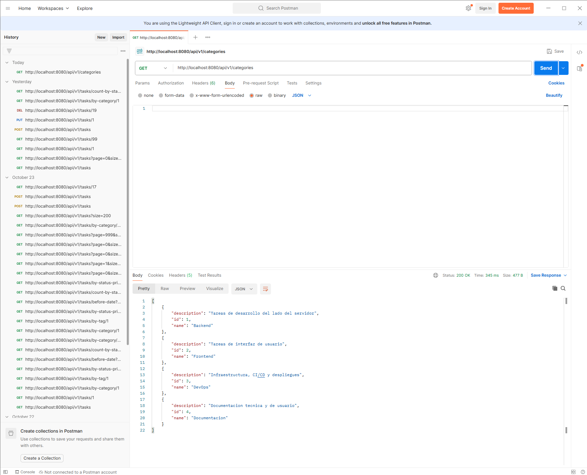
<br>
GET - Buscar categoría por ID<br>

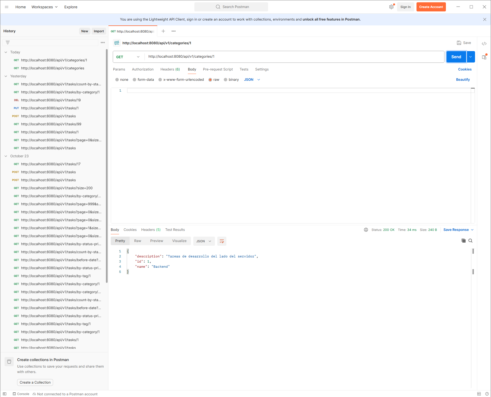

GET - Consultar tarea con categoryName<br>

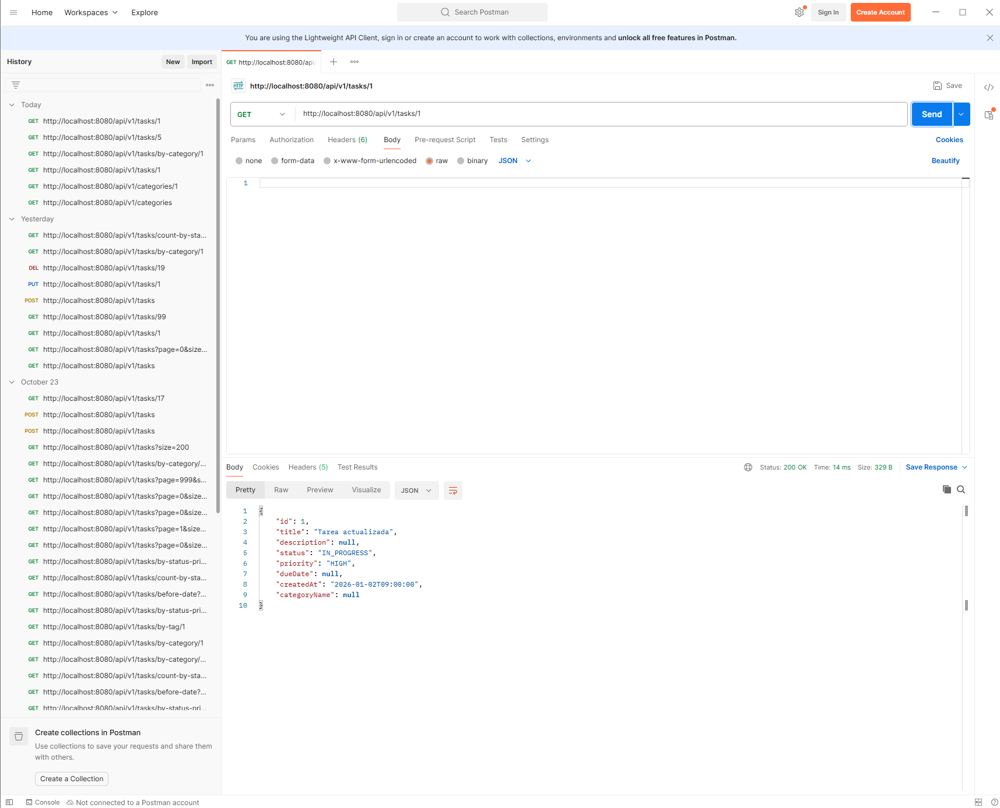

Nota: como no hay ninguna con el id1 lo repito con el id5:

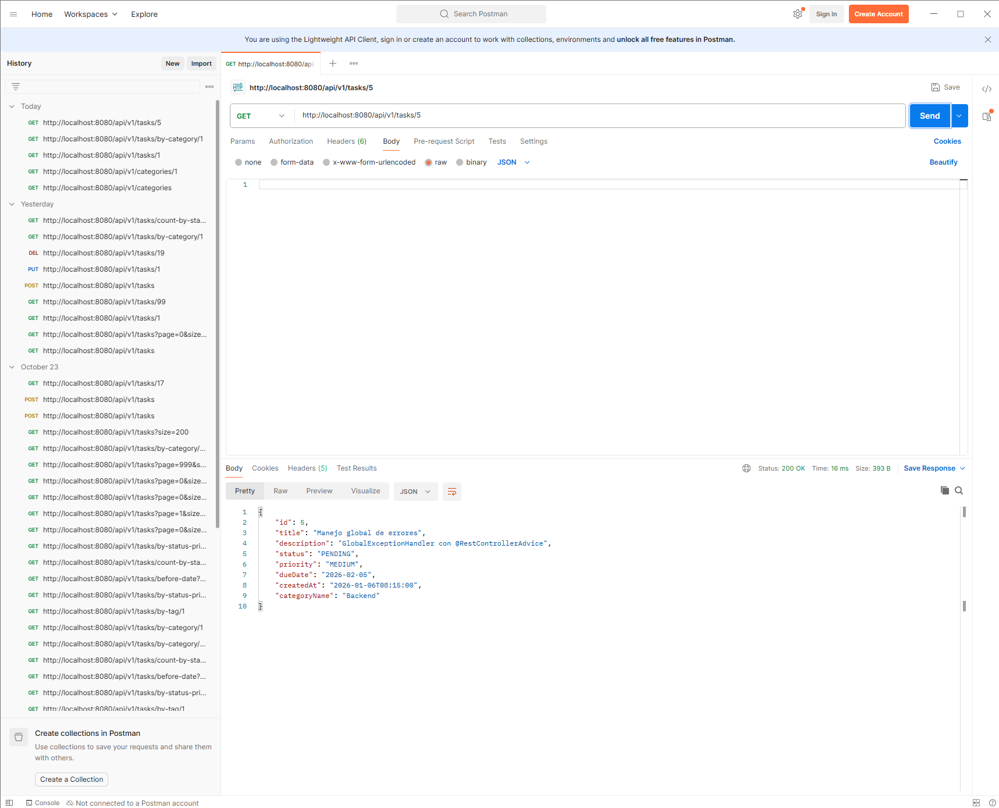

POST - Crear tarea con categoría<br>


Comprobación:

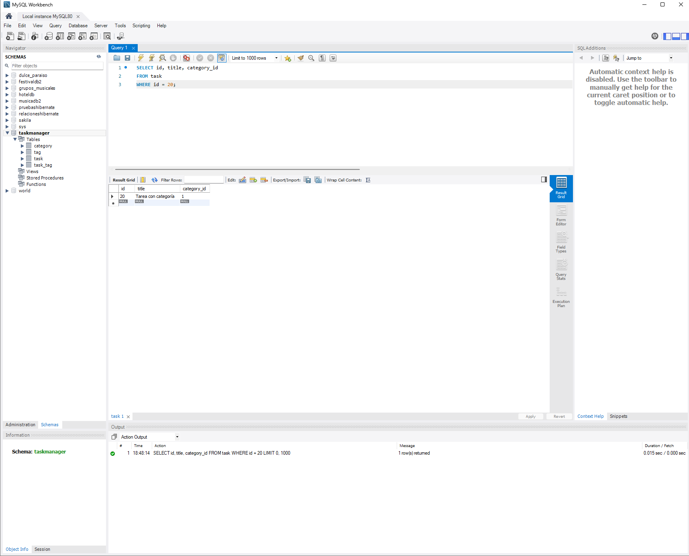

POST - Crear tarea sin categoría<br>

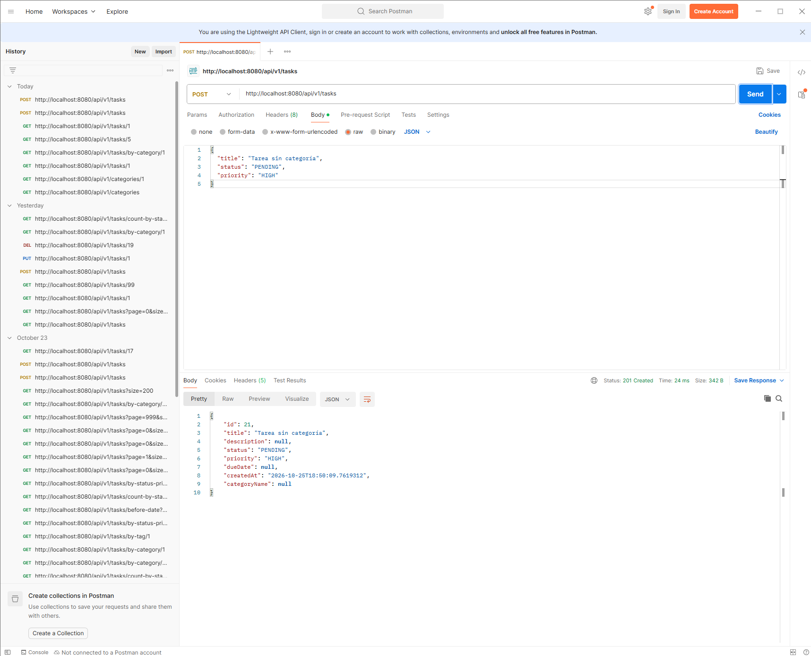

POST - Error por categoría inexistente<br>

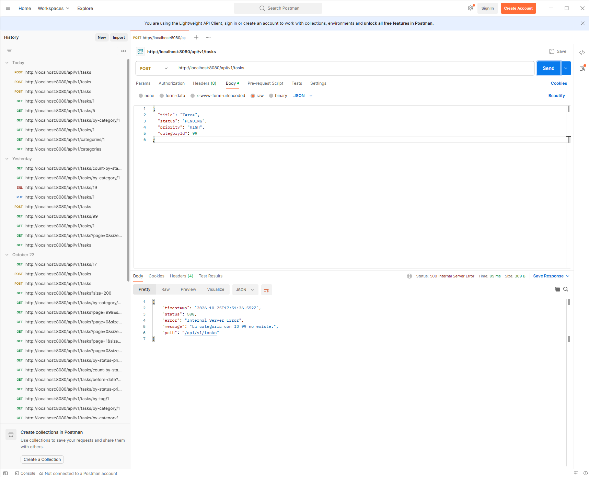

GET - Listar tareas paginadas con categoría

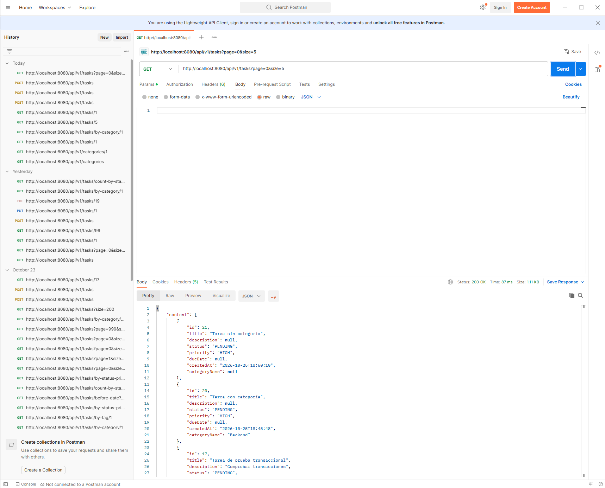

---
<br>
Reflexión:<br>
<br>
Pregunta:<br>
<br>
¿Qué problemas habrías tenido en este ejercicio si no hubieras introducido DTOs en la Parte 1?
<br>
Respuesta:<br>
<br>
Sin los DTOs, habría expuesto directamente las entidades de la base de datos, lo que dificultaría controlar los datos que recibe y devuelve la API. Además, gestionar la relación entre tareas y categorías sería más complejo y podría provocar problemas al serializar las entidades.<br>
<br>
Pregunta:<br>
<br>
¿Por qué es importante que la categoría sea opcional al crear una tarea?<br>
<br>
Respuesta:<br>
<br>
Porque permite crear tareas sin necesidad de asignarles una categoría desde el principio. Esto aporta flexibilidad y permite organizar las tareas más adelante, sin obligar al usuario a elegir una categoría.<br>
<br>
Pregunta:<br>
<br>
3. ¿Qué pasaría si intentaras eliminar una categoría que tiene tareas asignadas? ¿Cómo lo gestionarías?<br>
<br>
Respuesta:<br>
<br>
Si existen tareas asociadas a esa categoría, la eliminación podría fallar por la restricción de clave foránea de la base de datos. Lo gestionaría comprobando si tiene tareas asignadas y, si es así, impediría la eliminación e informaría al usuario. Otra opción sería permitir reasignar las tareas a otra categoría antes de eliminarla.

---
<br>
Parte 3 - Ejercicio para la creación de las Relaciones ManyToMany<br>
<br>
Paso 1  Preparación (Ask)<br>
<br>
Pregunta:<br>
<br>
¿Qué campos tendrán TagRequestDTO y TagResponseDTO?<br>
<br>
Respuesta:<br>
<br>
En este proyecto, los DTOs de Tag deberían ser simples y no incluir la relación completa con Task.<br>
<br>
TagRequestDTO<br>
Para crear o modificar una etiqueta, normalmente basta con:

```
public class TagRequestDTO {
    private String name;

    // constructor, getter y setter
}
```

JSON:

```
{
  "name": "Spring"
}
```

No debería incluir:<br>
<br>
id, porque lo genera la base de datos;<br>
tasks, porque la relación se gestiona aparte y no conviene recibir entidades completas.<br>
TagResponseDTO<br>
Para devolver una etiqueta:

```
public class TagResponseDTO {
    private Long id;
    private String name;

    // constructor, getters y setters
}
```

JSON:

```
{
  "id": 1,
  "name": "Spring"
}
```

Así se evita serializar la relación bidireccional:

```
Tag → tasks → tags → tasks → ...
```

Si algún endpoint necesitara informar las tareas asociadas, sería preferible añadir datos controlados, por ejemplo:

```
public class TagResponseDTO {
    private Long id;
    private String name;
    private List<Long> taskIds;
}
```

o crear una respuesta detallada específica. No conviene incluir directamente List<Task> porque volvería a acoplar el contrato REST a las entidades JPA y podría causar ciclos JSON, cargas LAZY y respuestas demasiado grandes.<br>
<br>
Pregunta:<br>
<br>
¿Qué campos nuevos necesitan TaskRequestDTO y TaskResponseDTO?<br>
<br>
Respuesta:<br>
<br>
Como Task ahora tiene relaciones con Category y Tag, los DTOs necesitan representar esas relaciones con datos simples, no con entidades JPA completas.<br>
<br>
TaskRequestDTO<br>
Añadiría:

```
private Long categoryId;
private List<Long> tagIds;
```

Quedaría conceptualmente:

```
public class TaskRequestDTO {
    private String title;
    private String description;
    private TaskStatus status;
    private TaskPriority priority;
    private LocalDate dueDate;
    private Long categoryId;
    private List<Long> tagIds;
}
```

Ejemplo JSON:

```
{
  "title": "Estudiar JPA",
  "description": "Repasar relaciones",
  "status": "PENDING",
  "priority": "HIGH",
  "dueDate": "2026-11-01",
  "categoryId": 2,
  "tagIds": [1, 3]
}
```

El Service debe resolver esos identificadores:

```
categoryId → Category
tagIds     → List<Tag>
```

y después asignarlos a Task.<br>
<br>
La categoría puede ser opcional, por lo que categoryId podría ser null. Los tagIds pueden ser una lista vacía.<br>
<br>
TaskResponseDTO<br>
Añadiría:

```
private String categoryName;
private List<String> tagNames;
```

Quedaría conceptualmente:

```
public class TaskResponseDTO {
    private Long id;
    private String title;
    private String description;
    private TaskStatus status;
    private TaskPriority priority;
    private LocalDate dueDate;
    private LocalDateTime createdAt;
    private String categoryName;
    private List<String> tagNames;
}
```

Ejemplo JSON:

```
{
  "id": 10,
  "title": "Estudiar JPA",
  "status": "PENDING",
  "priority": "HIGH",
  "dueDate": "2026-11-01",
  "createdAt": "2026-10-25T20:00:00",
  "categoryName": "Java",
  "tagNames": ["Spring", "JPA"]
}
```

Así:

```
Request:  categoryId, tagIds
Response: categoryName, tagNames
```

No se incluyen Category, Tag, List<Task> ni List<Task> dentro de Tag, evitando ciclos JSON, cargas LAZY inesperadas y acoplamiento con las entidades JPA.<br>
<br>
Pregunta:<br>
<br>
¿En qué capa se resolverán los tagIds y qué ocurrirá si alguno no existe?<br>
<br>
Respuesta:<br>
<br>
Los tagIds se resolverán en la capa Service, no en el Controller ni en el Mapper.<br>
<br>
Flujo

```
TaskRequestDTO.tagIds
        ↓
Service consulta TagRepository
        ↓
List<Tag>
        ↓
task.setTags(tags)
        ↓
TaskRepository.save(task)
```

Ejemplo:

```
List<Long> tagIds = dto.getTagIds();

List<Tag> tags = tagRepository.findAllById(tagIds);

if (tags.size() != tagIds.size()) {
    throw new TagNotFoundException(
        "Uno o más tags no existen"
    );
}

task.setTags(tags);
```

El Mapper solo convierte los campos simples del DTO. No debería consultar la base de datos.<br>
<br>
¿Qué ocurre si falta algún tag?<br>
No conviene ignorarlo silenciosamente. Si el cliente envía:

```
{
  "tagIds": [1, 3, 99]
}
```

y el tag 99 no existe, el Service debería rechazar la operación, normalmente con una excepción de negocio que el controlador global convierta en:

```
HTTP 404 Not Found
```

o 400 Bad Request, según el contrato de la API.<br>
<br>
La operación debe ser transaccional para que no se guarde la tarea parcialmente:

```
@Transactional
public TaskResponseDTO create(TaskRequestDTO dto) {
    Task task = TaskMapper.toEntity(dto);

    List<Tag> tags = tagRepository.findAllById(dto.getTagIds());

    if (tags.size() != dto.getTagIds().size()) {
        throw new TagNotFoundException("Algún tag no existe");
    }

    task.setTags(tags);
    return TaskMapper.toResponseDTO(taskRepository.save(task));
}
```

En resumen: el Service resuelve y valida los tagIds; si alguno no existe, debe fallar explícitamente y no crear ni actualizar la tarea con una relación incompleta.<br>
<br>
Pregunta:<br>
<br>
Al actualizar una tarea, ¿se reemplazará la lista completa de etiquetas o se añadirán y quitarán individualmente?<br>
<br>
Respuesta:<br>
<br>
Depende de la semántica del endpoint, pero lo más claro sería:<br>
<br>
PUT: reemplazar la lista completa<br>
Si el cliente envía:

```
{
  "title": "Estudiar JPA",
  "tagIds": [1, 3]
}
```

la tarea debe terminar asociada exactamente a las etiquetas 1 y 3:<br>
<br>
se añade la relación con las nuevas;<br>
se eliminan las relaciones que ya no aparecen;<br>
no se eliminan las entidades Tag, solo las filas de task_tag.

```
task.setTags(tags);
taskRepository.save(task);
```

Con @ManyToMany, Hibernate actualizará la tabla intermedia:

```
DELETE FROM task_tag WHERE task_id = ?;
INSERT INTO task_tag (task_id, tag_id) VALUES (?, ?);
```

El detalle exacto puede variar, pero el resultado será la sustitución de las asociaciones.<br>
<br>
Operaciones individuales<br>
Si se quiere añadir o quitar etiquetas sin reemplazar todas, es mejor definir endpoints explícitos, por ejemplo:

```
POST   /tasks/{taskId}/tags/{tagId}
DELETE /tasks/{taskId}/tags/{tagId}
```

o utilizar un PATCH con una operación específica:

```
{
  "addTagIds": [4],
  "removeTagIds": [1]
}
```

Así se expresa claramente que solo se modifican algunas asociaciones.<br>
<br>
Recomendación<br>
PUT con tagIds: reemplazar la colección completa.<br>
PATCH o endpoints específicos: añadir y quitar individualmente.<br>
tagIds ausente en un PATCH: no modificar las etiquetas.<br>
tagIds: [] en un PUT: eliminar todas las asociaciones, pero no las etiquetas de la tabla tag.<br>
La operación debe resolverse en el Service, validar que todos los IDs existan y ejecutarse dentro de una transacción. CascadeType.REMOVE no debe utilizarse para esta relación, porque quitar una asociación no debe borrar la entidad Tag.<br>
<br>
Pregunta:<br>
<br>
¿Qué endpoints necesitamos para gestionar las etiquetas?<br>
<br>
Respuesta:<br>
<br>
Para gestionar las etiquetas necesitaríamos dos grupos de endpoints: CRUD de Tag y gestión de la relación entre tareas y etiquetas.<br>
<br>
CRUD de etiquetas

```
GET    /api/v1/tags
GET    /api/v1/tags/{id}
POST   /api/v1/tags
PUT    /api/v1/tags/{id}
DELETE /api/v1/tags/{id}
```

Ejemplo para crear:

```
POST /api/v1/tags
Content-Type: application/json
```
```
{
  "name": "Spring"
}
```

El cuerpo usaría TagRequestDTO y la respuesta TagResponseDTO.<br>
<br>
Gestionar etiquetas de una tarea<br>
Si PUT /api/v1/tasks/{id} recibe la lista completa tagIds, puede reemplazar todas las asociaciones:

```
PUT /api/v1/tasks/{taskId}
```
```
{
  "tagIds": [1, 3, 5]
}
```

También pueden existir endpoints específicos para modificar individualmente la relación:

```
POST   /api/v1/tasks/{taskId}/tags/{tagId}
DELETE /api/v1/tasks/{taskId}/tags/{tagId}
GET    /api/v1/tasks/{taskId}/tags
```

Estos significan:<br>
<br>
POST: añade una etiqueta a la tarea;<br>
DELETE: quita la asociación, pero no elimina el Tag;<br>
GET: devuelve las etiquetas asociadas a la tarea.<br>
Consultar tareas por etiqueta

```
GET /api/v1/tags/{tagId}/tasks
```

También podría ser:

```
GET /api/v1/tasks?tagId=3
```

Para listados grandes, conviene aceptar paginación:

```
GET /api/v1/tags/3/tasks?page=0&size=10
```

Resumen

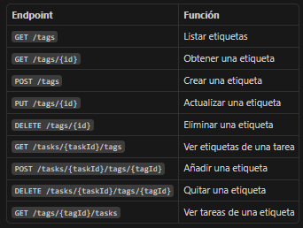
<br>
La eliminación de una etiqueta debería comprobar si está asociada a tareas. Y al quitar una asociación solo debe eliminarse la fila correspondiente de task_tag, nunca la entidad Tag compartida.

---
<br>
Paso 2 - Diseño previo<br>
<br>
Pregunta:<br>
<br>
¿Qué campos tendrán TagRequestDTO y TagResponseDTO?<br>
<br>
Respuesta:<br>
TagRequestDTO: name y description.<br>
<br>
TagResponseDTO: id, name y description.<br>
<br>
Pregunta:<br>
<br>
¿Qué campos nuevos necesitan TaskRequestDTO y TaskResponseDTO?<br>
<br>
TaskRequestDTO: una lista de identificadores List<Long> tagIds para indicar las etiquetas que se quieren asignar a la tarea.<br>
<br>
TaskResponseDTO: una lista de TagResponseDTO para devolver las etiquetas asociadas a la tarea.<br>
<br>
Pregunta:<br>
<br>
¿Dónde y cómo vas a resolver los tagIds (qué capa, qué Repository) y qué ocurrirá si alguno no existe?<br>
<br>
Respuesta:<br>
<br>
Se resolverán en la capa Service mediante TagRepository. Se buscará cada etiqueta por su ID y, si alguna no existe, se lanzará una excepción indicando el identificador que no se ha encontrado.<br>
<br>
Pregunta:<br>
<br>
Al actualizar una tarea, ¿reemplazarás la lista completa de tags o añadirás/quitarás tags individualmente?<br>
<br>
Respuesta:<br>
<br>
Se reemplazará la lista completa de etiquetas por la recibida en tagIds. Así, las etiquetas que no estén en la petición dejarán de estar asociadas a la tarea.<br>
<br>
Pregunta:<br>
<br>
¿Qué endpoints se necesitan para gestionar las etiquetas?<br>
<br>
Respuesta:<br>
<br>
GET /api/v1/tags: listar etiquetas.<br>
<br>
GET /api/v1/tags/{id}: consultar una etiqueta.<br>
<br>
POST /api/v1/tags: crear una etiqueta.<br>
<br>
PUT /api/v1/tags/{id}: actualizar una etiqueta.<br>
<br>
DELETE /api/v1/tags/{id}: eliminar una etiqueta.<br>
<br>
Pregunta:<br>
<br>
¿Qué comentario exacto escribirás para que el autocompletado lo genere?<br>
<br>
Respuesta:<br>
<br>
// Crear TagRequestDTO y TagResponseDTO con sus campos, constructores, getters, setters y Javadoc. Después, crear TagMapper con métodos estáticos para convertir entre Tag y sus DTOs, comprobando valores null y manteniendo el estilo del proyecto. — generado por IA

---
<br>
Paso 3 - Implementación (autocompletado)<br>
<br>
TagRequestDTO<br>
<br>
Comentario:<br>
<br>
// Crear TagRequestDTO con los campos name y description, sus getters y setters, y Javadoc a nivel de clase y de todos los métodos. Mantener el estilo de los DTOs existentes del proyecto. — generado por IA<br>
<br>
Resultado:

```
package com.accenture.taskmanager.dto;

/**
 * DTO para la solicitud de creación o actualización de una etiqueta (Tag).
 * Contiene los campos necesarios para representar una etiqueta.
 */
// Crear TagRequestDTO con el campo name, su getter y setter, y Javadoc a nivel de clase y de todos los métodos. Mantener el estilo de los DTOs existentes del proyecto. — generado por IA
public class TagRequestDTO {

    private String name;

    /**
     * Obtiene el nombre de la etiqueta.
     *
     * @return el nombre de la etiqueta
     */
    public String getName() {
        return name;
    }

    /**
     * Establece el nombre de la etiqueta.
     *
     * @param name el nombre de la etiqueta
     */
    public void setName(String name) {
        this.name = name;
    }
}
```

---
<br>
TagResponseDTO<br>
<br>
Comentario:<br>
<br>
// Crear TagResponseDTO con los campos id (Long), name (String) y description (String), sus getters y setters, y Javadoc a nivel de clase y de todos los métodos. Mantener el estilo de los DTOs existentes del proyecto. — generado por IA<br>
<br>
Resultado:

```
package com.accenture.taskmanager.dto;

/**
 * DTO para la respuesta de una etiqueta (Tag).
 * Contiene el identificador y el nombre de la etiqueta.
 */
// Crear TagResponseDTO con los campos id (Long) y name (String), sus getters y setters, y Javadoc a nivel de clase y de todos los métodos. Mantener el estilo de los DTOs existentes del proyecto. — generado por IA
public class TagResponseDTO {

    private Long id;
    private String name;

    /**
     * Obtiene el ID de la etiqueta.
     *
     * @return el ID de la etiqueta
     */
    public Long getId() {
        return id;
    }

    /**
     * Establece el ID de la etiqueta.
     *
     * @param id el ID de la etiqueta
     */
    public void setId(Long id) {
        this.id = id;
    }

    /**
     * Obtiene el nombre de la etiqueta.
     *
     * @return el nombre de la etiqueta
     */
    public String getName() {
        return name;
    }

    /**
     * Establece el nombre de la etiqueta.
     *
     * @param name el nombre de la etiqueta
     */
    public void setName(String name) {
        this.name = name;
    }
}
```

---
<br>
TagMapper<br>
<br>
Comentario:<br>
<br>
// Crear TagMapper con métodos estáticos y Javadoc para convertir de Tag a TagResponseDTO y de TagRequestDTO a Tag, copiando los campos id, name y description cuando corresponda. Comprobar valores null y mantener el estilo de los mappers existentes del proyecto. — generado por IA<br>
<br>
Resultado:

```

```

---
<br>
Añadir tagIds a TaskRequestDTO y tags a TaskResponseDTO:<br>
<br>
Comentario:<br>
<br>
<br>
<br>
Resultado:

```
package com.accenture.taskmanager.mapper;

import com.accenture.taskmanager.dto.TagRequestDTO;
import com.accenture.taskmanager.dto.TagResponseDTO;
import com.accenture.taskmanager.model.Tag;

/**
 * Mapper para convertir entre objetos Tag, TagRequestDTO y TagResponseDTO.
 * Contiene métodos estáticos para realizar las conversiones necesarias.
 *
 * @author Javier Roldán
 * @version 1.0
 */
// Crear TagMapper con métodos estáticos y Javadoc para convertir de Tag a TagResponseDTO y de TagRequestDTO a Tag, copiando los campos id y name cuando corresponda. Comprobar valores null y mantener el estilo de los mappers existentes del proyecto. — generado por IA
public class TagMapper {

    /**
     * Constructor privado para evitar la instanciación de esta clase.
     */
    private TagMapper() {
    }

    /**
     * Convierte un objeto Tag en un objeto TagResponseDTO.
     *
     * @param tag entidad Tag que se va a convertir
     * @return DTO de respuesta, o null si la entidad es null
     */
    public static TagResponseDTO toTagResponseDTO(Tag tag) {
        if (tag == null) {
            return null;
        }

        TagResponseDTO tagResponseDTO = new TagResponseDTO();
        tagResponseDTO.setId(tag.getId());
        tagResponseDTO.setName(tag.getName());

        return tagResponseDTO;
    }

    /**
     * Convierte un objeto TagRequestDTO en una entidad Tag.
     *
     * @param tagRequestDTO DTO de solicitud que se va a convertir
     * @return entidad Tag, o null si el DTO es null
     */
    public static Tag toTag(TagRequestDTO tagRequestDTO) {
        if (tagRequestDTO == null) {
            return null;
        }

        Tag tag = new Tag();
        tag.setName(tagRequestDTO.getName());

        return tag;
    }
}
```

---
<br>
TagRepository<br>
<br>
Comentario:<br>
<br>
// Crear TagRepository como una interfaz que extienda JpaRepository<Tag, Long>, importando la entidad Tag y JpaRepository. Añadir Javadoc a nivel de interfaz y mantener el estilo de los repositorios existentes del proyecto. — generado por IA<br>
<br>
Resultado:

```
package com.accenture.taskmanager.repository;

import org.springframework.data.jpa.repository.JpaRepository;

import com.accenture.taskmanager.model.Tag;

/**
 * Repositorio para la entidad Tag.
 * Proporciona operaciones CRUD para la entidad Tag.
 * 
 * @author Javier Roldán
 * @version 1.0
 */
// Crear TagRepository como una interfaz que extienda JpaRepository<Tag, Long>, importando la entidad Tag y JpaRepository. Añadir Javadoc a nivel de interfaz y mantener el estilo de los repositorios existentes del proyecto. — generado por IA
public interface TagRepository extends JpaRepository<Tag, Long> {
    
}
```

---
<br>
TagService<br>
<br>
Comentario:<br>
<br>
// Crear la interfaz TagService con métodos para listar todas las etiquetas, buscar una por ID, crear una etiqueta, actualizarla y eliminarla. Utilizar TagResponseDTO para las respuestas, TagRequestDTO para crear y actualizar, y Long como identificador. Añadir Javadoc a la interfaz y a todos los métodos, manteniendo el estilo de los servicios existentes del proyecto. — generado por IA<br>
<br>
Resultado:

```
package com.accenture.taskmanager.service.interfaces;

import java.util.List;

import com.accenture.taskmanager.dto.TagRequestDTO;
import com.accenture.taskmanager.dto.TagResponseDTO;

/**
 * Interfaz para el servicio de gestión de etiquetas.
 * Proporciona métodos para listar todas las etiquetas, buscar una por ID, crear una etiqueta, actualizarla y eliminarla.
 * Utiliza TagResponseDTO para las respuestas, TagRequestDTO para crear y actualizar, y Long como identificador.
 * Añade Javadoc a la interfaz y a todos los métodos, manteniendo el estilo de los servicios existentes del proyecto.
 */
// Crear la interfaz TagService con métodos para listar todas las etiquetas, buscar una por ID, crear una etiqueta, actualizarla y eliminarla. Utilizar TagResponseDTO para las respuestas, TagRequestDTO para crear y actualizar, y Long como identificador. Añadir Javadoc a la interfaz y a todos los métodos, manteniendo el estilo de los servicios existentes del proyecto. — generado por IA
public interface TagService {

    /**
     * Lista todas las etiquetas.
     *
     * @return una lista de TagResponseDTO que representan todas las etiquetas
     */
    List<TagResponseDTO> getAllTags();

    /**
     * Busca una etiqueta por su ID.
     *
     * @param id el ID de la etiqueta a buscar
     * @return un TagResponseDTO que representa la etiqueta encontrada, o null si no se encuentra
     */
    TagResponseDTO getTagById(Long id);

    /**
     * Crea una nueva etiqueta.
     *
     * @param tagRequestDTO el DTO de solicitud que contiene los datos de la nueva etiqueta
     * @return un TagResponseDTO que representa la etiqueta creada
     */
    TagResponseDTO createTag(TagRequestDTO tagRequestDTO);

    /**
     * Actualiza una etiqueta existente.
     *
     * @param id            el ID de la etiqueta a actualizar
     * @param tagRequestDTO el DTO de solicitud que contiene los datos actualizados de la etiqueta
     * @return un TagResponseDTO que representa la etiqueta actualizada, o null si no se encuentra la etiqueta
     */
    TagResponseDTO updateTag(Long id, TagRequestDTO tagRequestDTO);

    /**
     * Elimina una etiqueta por su ID.
     *
     * @param id el ID de la etiqueta a eliminar
     */
    void deleteTag(Long id);
}
```

---
<br>
TagServiceImpl<br>
<br>
Comentario:<br>
<br>
// Implementar TagService en TagServiceImpl usando @Service y constructor con inyección de TagRepository. Implementar todos los métodos CRUD: listar etiquetas convirtiéndolas con TagMapper, buscar por ID, crear, actualizar y eliminar. Si no existe una etiqueta al buscar, actualizar o eliminar, lanzar una excepción coherente con las utilizadas en el proyecto. Añadir Javadoc a la clase y a todos los métodos, y mantener el estilo de las implementaciones de servicios existentes. — generado por IA<br>
<br>
Resultado:

```
package com.accenture.taskmanager.service;

import java.util.List;
import java.util.stream.Collectors;

import org.springframework.stereotype.Service;

import com.accenture.taskmanager.dto.TagRequestDTO;
import com.accenture.taskmanager.dto.TagResponseDTO;
import com.accenture.taskmanager.mapper.TagMapper;
import com.accenture.taskmanager.model.Tag;
import com.accenture.taskmanager.repository.TagRepository;
import com.accenture.taskmanager.service.interfaces.TagService;

/**
 * Implementación del servicio TagService.
 * Proporciona métodos para gestionar etiquetas utilizando el repositorio y el mapper.
 *
 * @author Javier Roldán
 * @version 1.0
 */
// Implementar TagService en TagServiceImpl usando @Service e inyección por constructor de TagRepository. Implementar todos los métodos CRUD usando TagMapper y lanzar una excepción cuando no exista la etiqueta solicitada. Añadir Javadoc a la clase y a todos los métodos. — generado por IA
@Service
public class TagServiceImpl implements TagService {

    private final TagRepository tagRepository;

    /**
     * Construye el servicio con el repositorio de etiquetas.
     *
     * @param tagRepository repositorio de etiquetas
     */
    public TagServiceImpl(TagRepository tagRepository) {
        this.tagRepository = tagRepository;
    }

    /**
     * Lista todas las etiquetas.
     *
     * @return lista de etiquetas convertidas a DTO
     */
    @Override
    public List<TagResponseDTO> getAllTags() {
        return tagRepository.findAll()
                .stream()
                .map(TagMapper::toTagResponseDTO)
                .collect(Collectors.toList());
    }

    /**
     * Busca una etiqueta por su identificador.
     *
     * @param id identificador de la etiqueta
     * @return DTO de la etiqueta encontrada
     * @throws RuntimeException si no existe la etiqueta
     */
    @Override
    public TagResponseDTO getTagById(Long id) {
        Tag tag = tagRepository.findById(id)
                .orElseThrow(() -> new RuntimeException("Tag no encontrada con ID: " + id));

        return TagMapper.toTagResponseDTO(tag);
    }

    /**
     * Crea una nueva etiqueta.
     *
     * @param tagRequestDTO datos de la etiqueta
     * @return DTO de la etiqueta creada
     */
    @Override
    public TagResponseDTO createTag(TagRequestDTO tagRequestDTO) {
        Tag tag = TagMapper.toTag(tagRequestDTO);
        Tag savedTag = tagRepository.save(tag);

        return TagMapper.toTagResponseDTO(savedTag);
    }

    /**
     * Actualiza una etiqueta existente.
     *
     * @param id identificador de la etiqueta
     * @param tagRequestDTO datos actualizados de la etiqueta
     * @return DTO de la etiqueta actualizada
     * @throws RuntimeException si no existe la etiqueta
     */
    @Override
    public TagResponseDTO updateTag(Long id, TagRequestDTO tagRequestDTO) {
        Tag existingTag = tagRepository.findById(id)
                .orElseThrow(() -> new RuntimeException("Tag no encontrada con ID: " + id));

        existingTag.setName(tagRequestDTO.getName());
        Tag updatedTag = tagRepository.save(existingTag);

        return TagMapper.toTagResponseDTO(updatedTag);
    }

    /**
     * Elimina una etiqueta por su identificador.
     *
     * @param id identificador de la etiqueta
     * @throws RuntimeException si no existe la etiqueta
     */
    @Override
    public void deleteTag(Long id) {
        Tag tag = tagRepository.findById(id)
                .orElseThrow(() -> new RuntimeException("Tag no encontrada con ID: " + id));

        tagRepository.delete(tag);
    }
}
```

---
<br>
TagController<br>
<br>
Comentario:<br>
<br>
// Crear TagController con @RestController y @RequestMapping("/api/v1/tags"), inyectando TagService por constructor. Implementar los endpoints GET para listar todas las etiquetas y obtener una por ID, POST para crear, PUT para actualizar por ID y DELETE para eliminar por ID. Utilizar los DTOs correspondientes, devolver códigos HTTP adecuados y añadir Javadoc a la clase y a todos los métodos. Mantener el estilo de los controladores existentes. — generado por IA<br>
<br>
Resultado:

```
package com.accenture.taskmanager.controller;

import java.util.List;

import org.springframework.http.HttpStatus;
import org.springframework.http.ResponseEntity;
import org.springframework.web.bind.annotation.DeleteMapping;
import org.springframework.web.bind.annotation.GetMapping;
import org.springframework.web.bind.annotation.PathVariable;
import org.springframework.web.bind.annotation.PostMapping;
import org.springframework.web.bind.annotation.PutMapping;
import org.springframework.web.bind.annotation.RequestBody;
import org.springframework.web.bind.annotation.RequestMapping;
import org.springframework.web.bind.annotation.RestController;

import com.accenture.taskmanager.dto.TagRequestDTO;
import com.accenture.taskmanager.dto.TagResponseDTO;
import com.accenture.taskmanager.service.interfaces.TagService;

/**
 * Controlador para la gestión de etiquetas.
 * Proporciona endpoints para realizar operaciones CRUD sobre las etiquetas.
 *
 * @author Javier Roldán
 * @version 1.0
 */
// Crear TagController con @RestController y @RequestMapping("/api/v1/tags"), inyectando TagService por constructor. Implementar los endpoints GET para listar todas las etiquetas y obtener una por ID, POST para crear, PUT para actualizar por ID y DELETE para eliminar por ID. Utilizar los DTOs correspondientes, devolver códigos HTTP adecuados y añadir Javadoc a la clase y a todos los métodos. Mantener el estilo de los controladores existentes. — generado por IA
@RestController
@RequestMapping("/api/v1/tags")
public class TagController {

    private final TagService tagService;

    /**
     * Constructor del controlador.
     *
     * @param tagService servicio de gestión de etiquetas
     */
    public TagController(TagService tagService) {
        this.tagService = tagService;
    }

    /**
     * Lista todas las etiquetas.
     *
     * @return lista de etiquetas con estado HTTP 200
     */
    @GetMapping
    public ResponseEntity<List<TagResponseDTO>> getAllTags() {
        return ResponseEntity.ok(tagService.getAllTags());
    }

    /**
     * Obtiene una etiqueta por su identificador.
     *
     * @param id identificador de la etiqueta
     * @return etiqueta encontrada con estado HTTP 200
     */
    @GetMapping("/{id}")
    public ResponseEntity<TagResponseDTO> getTagById(@PathVariable Long id) {
        return ResponseEntity.ok(tagService.getTagById(id));
    }

    /**
     * Crea una nueva etiqueta.
     *
     * @param tagRequestDTO datos de la etiqueta
     * @return etiqueta creada con estado HTTP 201
     */
    @PostMapping
    public ResponseEntity<TagResponseDTO> createTag(@RequestBody TagRequestDTO tagRequestDTO) {
        TagResponseDTO createdTag = tagService.createTag(tagRequestDTO);
        return new ResponseEntity<>(createdTag, HttpStatus.CREATED);
    }

    /**
     * Actualiza una etiqueta existente.
     *
     * @param id identificador de la etiqueta
     * @param tagRequestDTO datos actualizados
     * @return etiqueta actualizada con estado HTTP 200
     */
    @PutMapping("/{id}")
    public ResponseEntity<TagResponseDTO> updateTag(
            @PathVariable Long id,
            @RequestBody TagRequestDTO tagRequestDTO) {
        return ResponseEntity.ok(tagService.updateTag(id, tagRequestDTO));
    }

    /**
     * Elimina una etiqueta por su identificador.
     *
     * @param id identificador de la etiqueta
     * @return respuesta vacía con estado HTTP 204
     */
    @DeleteMapping("/{id}")
    public ResponseEntity<Void> deleteTag(@PathVariable Long id) {
        tagService.deleteTag(id);
        return ResponseEntity.noContent().build();
    }
}
```

---
<br>
añadir tagIds a TaskRequestDTO<br>
<br>
Comentario:<br>
<br>
// Añadir el campo List<Long> tagIds a TaskRequestDTO, con su getter y setter y Javadoc para el nuevo campo y sus métodos. Importar java.util.List y mantener todos los campos y métodos existentes sin modificarlos. Mantener este comentario en el código. — generado por IA<br>
<br>
Resultado:

```
    // Añadir el campo List<Long> tagIds a TaskRequestDTO, con su getter y setter y Javadoc para el nuevo campo y sus métodos. Importar java.util.List y mantener todos los campos y métodos existentes sin modificarlos. Mantener este comentario en el código. — generado por IA
    private List<Long> tagIds;

    /**
     * Gets the tag IDs of the task.
     *
     * @return the tag IDs of the task
     */
    public List<Long> getTagIds() {
        return tagIds;
    }

    /**
     * Sets the tag IDs of the task.
     *
     * @param tagIds the tag IDs to set
     */
    public void setTagIds(List<Long> tagIds) {
        this.tagIds = tagIds;
    }
```

---
<br>
añadir tags a TaskResponseDTO<br>
<br>
Comentario:<br>
<br>
// Añadir el campo List<TagResponseDTO> tags a TaskResponseDTO, con su getter, setter y Javadoc para el campo y ambos métodos. Importar java.util.List y com.accenture.taskmanager.dto.TagResponseDTO. Mantener todos los campos y métodos existentes sin modificarlos y conservar este comentario en el código. — generado por IA<br>
<br>
Resultado:

```
    // Añadir el campo List<TagResponseDTO> tags a TaskResponseDTO, con su getter, setter y Javadoc para el campo y ambos métodos. Importar java.util.List y com.accenture.taskmanager.dto.TagResponseDTO. Mantener todos los campos y métodos existentes sin modificarlos y conservar este comentario en el código. — generado por IA
    private List<TagResponseDTO> tags;

    /**
     * Gets the tags associated with the task.
     *
     * @return the tags associated with the task
     */
    public List<TagResponseDTO> getTags() {
        return tags;
    }

    /**
     * Sets the tags associated with the task.
     *
     * @param tags the tags to set
     */
    public void setTags(List<TagResponseDTO> tags) {
        this.tags = tags;
    }
```

---
<br>
modificar toResponseDTO en TaskMapper<br>
<br>
Comentario:<br>
<br>
// Asignar al campo tags del DTO la lista de etiquetas asociadas a task, convirtiendo cada entidad Tag en un TagResponseDTO mediante TagMapper. Si task o su lista de etiquetas es null, evitar errores y mantener una lista vacía. Añadir los imports necesarios y conservar el código existente. — generado por IA<br>
<br>
Resultado:

```
package com.accenture.taskmanager.mapper;

import java.util.Collections;
import java.util.stream.Collectors;

import com.accenture.taskmanager.dto.TaskRequestDTO;
import com.accenture.taskmanager.dto.TaskResponseDTO;
import com.accenture.taskmanager.model.Task;

/**
 * Mapper class for Task entities and DTOs.
 * This class is used to convert between Task entities and their corresponding
 * Data Transfer Objects (DTOs).
 * 
 * @author Javier Roldán
 * @version 1.0
 */
public class TaskMapper {

    // Implementa el método toResponseDTO(Task task) para transformar una entidad
    // Task en un TaskResponseDTO, copiando id, title, description, status,
    // priority, dueDate y createdAt. Incluye Javadoc del método. — generado por IA

    // Completa el método toResponseDTO(Task task) creando un único TaskResponseDTO con los campos id, title, description, status, priority, dueDate y createdAt. Después, asigna categoryName usando el nombre de la categoría asociada a task, comprobando que task.getCategory() no sea null. Devuelve el mismo DTO al que has asignado categoryName. No expongas la entidad Category completa. Mantén el estilo y el Javadoc existentes. — generado por IA
    /**
     * Converts a Task entity to a TaskResponseDTO.
     *
     * @param task the Task entity to convert
     * @return the corresponding TaskResponseDTO
     */
    public static TaskResponseDTO toResponseDTO(Task task) {
        TaskResponseDTO dto = new TaskResponseDTO();
        dto.setId(task.getId());
        dto.setTitle(task.getTitle());
        dto.setDescription(task.getDescription());
        dto.setStatus(task.getStatus());
        dto.setPriority(task.getPriority());
        dto.setDueDate(task.getDueDate());
        dto.setCreatedAt(task.getCreatedAt());

        if (task.getCategory() != null) {
            dto.setCategoryName(task.getCategory().getName());
        }
        // Asignar al campo tags del DTO la lista de etiquetas asociadas a task, convirtiendo cada entidad Tag en un TagResponseDTO mediante TagMapper. Si task o su lista de etiquetas es null, evitar errores y mantener una lista vacía. Añadir los imports necesarios y conservar el código existente. — generado por IA
        if (task.getTags() != null) {
            dto.setTags(task.getTags().stream()
                    .map(TagMapper::toTagResponseDTO)
                    .collect(Collectors.toList()));
        } else {
            dto.setTags(Collections.emptyList());
        }
        return dto;
    }

    // Implementa el método toEntity(TaskRequestDTO dto) para transformar un
    // TaskRequestDTO en una entidad Task, copiando title, description, status,
    // priority y dueDate. Incluye Javadoc del método. — generado por IA
    /**
     * Converts a TaskRequestDTO to a Task entity.
     *
     * @param dto the TaskRequestDTO to convert
     * @return the corresponding Task entity
     */
    public static Task toEntity(TaskRequestDTO dto) {
        Task task = new Task();
        task.setTitle(dto.getTitle());
        task.setDescription(dto.getDescription());
        task.setStatus(dto.getStatus());
        task.setPriority(dto.getPriority());
        task.setDueDate(dto.getDueDate());
        return task;
    }
}
```

---
<br>
TaskServiceImpl para que, al crear o actualizar una tarea, busque las etiquetas recibidas por ID y las asocie a la tarea<br>
<br>
Comentario:<br>
<br>
// Añadir TagRepository como dependencia mediante inyección por constructor, manteniendo TaskRepository y CategoryRepository. Actualizar el constructor para recibir e inicializar los tres repositorios. Añadir los imports necesarios y conservar el código existente. — generado por IA<br>
<br>
Resultado:

```
    // Añadir TagRepository como dependencia mediante inyección por constructor, manteniendo TaskRepository y CategoryRepository. Actualizar el constructor para recibir e inicializar los tres repositorios. Añadir los imports necesarios y conservar el código existente. — generado por IA
    public TaskServiceImpl(TaskRepository taskRepository, CategoryRepository categoryRepository, TagRepository tagRepository) {
        this.taskRepository = taskRepository;
        this.categoryRepository = categoryRepository;
        this.tagRepository = tagRepository;
```

Comentario:<br>
<br>
// Resolver dto.getTagIds() mediante TagRepository y asignar las etiquetas encontradas a task. Si tagIds es null o está vacío, la tarea no tendrá etiquetas. Si algún ID no existe, lanzar una excepción que indique el ID ausente. Mantener intactos el tratamiento de la categoría, el guardado y la respuesta mediante TaskMapper. Añadir los imports necesarios. — generado por IA<br>
<br>
modificar el update:<br>
<br>
// Resolver dto.getTagIds() mediante TagRepository y reemplazar la lista de etiquetas de existingTask. Si tagIds es null o está vacío, dejar la tarea sin etiquetas. Si algún ID no existe, lanzar una excepción indicando el ID ausente. Mantener el resto de la lógica de actualización, el guardado y la respuesta mediante TaskMapper. Añadir los imports necesarios y conservar el código existente. — generado por IA<br>
<br>
Resultados:

```
package com.accenture.taskmanager.service;

import org.springframework.stereotype.Service;

import java.util.List;

import com.accenture.taskmanager.model.Tag;

import com.accenture.taskmanager.model.Category;

import org.springframework.data.domain.Page;
import org.springframework.data.domain.Pageable;

import com.accenture.taskmanager.dto.PagedResponseDTO;
import com.accenture.taskmanager.dto.TaskRequestDTO;
import com.accenture.taskmanager.dto.TaskResponseDTO;
import com.accenture.taskmanager.enums.TaskPriority;
import com.accenture.taskmanager.enums.TaskStatus;
import com.accenture.taskmanager.exceptions.CategoryNotFoundException;
import com.accenture.taskmanager.exceptions.TaskNotFoundException;
import com.accenture.taskmanager.mapper.TaskMapper;
import com.accenture.taskmanager.model.Task;
import com.accenture.taskmanager.repository.TaskRepository;
import com.accenture.taskmanager.service.interfaces.TaskService;

import com.accenture.taskmanager.repository.CategoryRepository;
import com.accenture.taskmanager.repository.TagRepository;

import jakarta.transaction.Transactional;

/**
 * Implementación del servicio encargado de gestionar la lógica de negocio
 * relacionada con las tareas.
 *
 * <p>
 * Esta clase implementa las operaciones definidas en la interfaz
 * {@link TaskService} y utiliza {@link TaskRepository} para acceder
 * a las tareas almacenadas en la base de datos.
 * </p>
 *
 * @author Javier Roldán
 * @version 1.0
 */
@Service
public class TaskServiceImpl implements TaskService {

    // Crea una lista igual que en el controlador para simular la persistencia de
    // datos y añade 2 tareas de ejemplo
    // al ArrayList usando el constructor de la clase Task para poder probar los
    // endpoints -> generado con IA
    // Actualiza las tareas de ejemplo para adaptarlas al nuevo constructor de Task,
    // Para los valores de status, consulta directamente el archivo
    // src/main/java/com/accenture/taskmanager/enums/TaskStatus.java y utiliza
    // exactamente
    // los nombres de los enums declarados allí, sin traducirlos ni inventarlos.
    // Para los valores de priority, consulta directamente el archivo
    // src/main/java/com/accenture/taskmanager/enums/TaskPriority.java y utiliza
    // exactamente
    // los nombres de los enums declarados allí, sin traducirlos ni inventarlos.
    // Añade también los valores correspondientes a createdAt y categoryId, no
    // pongas PENDIENTE, ni ALTA, ni EN_PROGRESO ni MEDIA.
    // —> generado con IA (sería el comentario genérico para que actualizara pero
    // con los null en campos nuevos ya no aplica)
    // Sustituir la lista estática por una dependencia de TaskRepository inyectada
    // mediante constructor. -> generado por IA
    /**
     * Repositorio de tareas utilizado para acceder a los datos almacenados en la
     * base de datos.
     */
    private final TaskRepository taskRepository;
    // private static final List<Task> tasks = new ArrayList<>();
    private final TagRepository tagRepository;

    // Añadir TagRepository como dependencia mediante inyección por constructor,
    // manteniendo TaskRepository y CategoryRepository. Actualizar el constructor
    // para recibir e inicializar los tres repositorios. Añadir los imports
    // necesarios y conservar el código existente. — generado por IA
    public TaskServiceImpl(TaskRepository taskRepository, CategoryRepository categoryRepository,
            TagRepository tagRepository) {
        this.taskRepository = taskRepository;
        this.categoryRepository = categoryRepository;
        this.tagRepository = tagRepository;
    }

    // Crear el constructor que reciba TaskRepository y lo asigne al atributo
    // taskRepository. -> generado por IA
    /**
     * Crea un nuevo servicio de tareas con el repositorio proporcionado.
     * 
     * @param taskRepository repositorio de tareas a utilizar.
     */
    // Actualizar el constructor para recibir TaskRepository y CategoryRepository e
    // inicializar ambos atributos con this. Mantener la inyección por constructor y
    // añadir el parámetro de cada repositorio. — generado por IA

    // Añadir CategoryRepository como dependencia mediante inyección por
    // constructor, manteniendo TaskRepository. Actualizar el constructor para
    // recibir e inicializar ambos repositorios. Añadir los imports necesarios y
    // conservar el estilo existente. — generado por IA
    private final CategoryRepository categoryRepository;

    // static {
    // tasks.add(new Task(1L, "Tarea 1", "Descripción de la tarea 1",
    // // esto no lo he sacado a constantes porque has dicho que no toquemos nada de
    // aquí pero sí que me acuerdo eh?
    // TaskStatus.PENDING, TaskPriority.LOW,
    // java.time.LocalDate.of(2024, 6, 30), null, null));

    // tasks.add(new Task(2L, "Tarea 2", "Descripción de la tarea 2",
    // TaskStatus.IN_PROGRESS, TaskPriority.HIGH,
    // java.time.LocalDate.of(2024, 7, 15), null, null));
    // }

    /**
     * Obtiene todas las tareas con paginación.
     *
     * @param pageable información de paginación y ordenación.
     * @return página de tareas.
     */
    // Adapta findAll para devolver PagedResponseDTO<TaskResponseDTO>, transformando
    // manualmente cada Task de la página con TaskMapper.toResponseDTO y conservando
    // los metadatos de paginación. — generado por IA
    @Override
    public PagedResponseDTO<TaskResponseDTO> findAll(Pageable pageable) {
        Page<Task> tasks = taskRepository.findAll(pageable);
        return new PagedResponseDTO<>(
                tasks.getContent().stream()
                        .map(TaskMapper::toResponseDTO)
                        .toList(),
                tasks.getNumber(),
                tasks.getSize(),
                tasks.getTotalElements(),
                tasks.getTotalPages(),
                tasks.isLast());
    }

    // actualiza el javadoc
    /**
     * Busca una tarea por su identificador.
     * 
     * @param id identificador de la tarea que se desea buscar.
     * @return la tarea encontrada.
     * @throws TaskNotFoundException si no existe una tarea con el identificador
     *                               indicado.
     */
    // Adapta findById para devolver TaskResponseDTO, buscando la tarea por id y
    // transformándola con TaskMapper.toResponseDTO. Conserva TaskNotFoundException
    // si no existe. — generado por IA
    @Override
    public TaskResponseDTO findById(Long id) {
        Task task = taskRepository.findById(id)
                .orElseThrow(() -> new TaskNotFoundException(
                        "La tarea con ID " + id + " no existe."));
        return TaskMapper.toResponseDTO(task);
    }

    // Añadir @Transactional a este método de escritura del Service para garantizar
    // que sus operaciones sobre la base de datos se ejecuten dentro de una
    // transacción. — generado por IA
    // actualiza el javadoc
    /**
     * Crea una nueva tarea con los datos proporcionados.
     *
     * @param dto objeto TaskRequestDTO con los datos de la tarea que se desea
     *            crear.
     * @return la tarea creada.
     */
    // Adapta create para recibir TaskRequestDTO, convertirlo a Task con
    // TaskMapper.toEntity, guardarlo con taskRepository y devolver el resultado
    // como TaskResponseDTO. — generado por IA
    // Modificar create para resolver dto.getCategoryId() mediante
    // CategoryRepository. Si categoryId es null, crear la tarea sin categoría. Si
    // contiene un ID, buscar la categoría y asignarla a la tarea. Si no existe,
    // lanzar CategoryNotFoundException indicando el ID. Mantener el guardado y la
    // respuesta mediante TaskMapper. — generado por IA
    // Resolver dto.getTagIds() mediante TagRepository y asignar las etiquetas
    // encontradas a task. Si tagIds es null o está vacío, la tarea no tendrá
    // etiquetas. Si algún ID no existe, lanzar una excepción que indique el ID
    // ausente. Mantener intactos el tratamiento de la categoría, el guardado y la
    // respuesta mediante TaskMapper. Añadir los imports necesarios. — generado por
    // IA
    @Transactional
    @Override
    public TaskResponseDTO create(TaskRequestDTO dto) {
        Task task = TaskMapper.toEntity(dto);
        if (dto.getCategoryId() != null) {
            Category category = categoryRepository.findById(dto.getCategoryId())
                    .orElseThrow(() -> new CategoryNotFoundException(
                            "La categoría con ID " + dto.getCategoryId() + " no existe."));
            task.setCategory(category);
        }
        if (dto.getTagIds() != null && !dto.getTagIds().isEmpty()) {
            List<Tag> tags = tagRepository.findAllById(dto.getTagIds());
            for (Long tagId : dto.getTagIds()) {
                if (tags.stream().noneMatch(tag -> tag.getId().equals(tagId))) {
                    throw new IllegalArgumentException(
                            "La etiqueta con ID " + tagId + " no existe.");
                }
            }
            task.setTags(tags);
        }
        Task savedTask = taskRepository.save(task);
        return TaskMapper.toResponseDTO(savedTask);
    }

    // Añadir @Transactional a este método de escritura del Service para garantizar
    // que sus operaciones sobre la base de datos se ejecuten dentro de una
    // transacción. — generado por IA
    // actualiza el javadoc
    /**
     * Actualiza una tarea existente con los datos proporcionados.
     *
     * @param id  identificador de la tarea que se desea actualizar.
     * @param dto objeto TaskRequestDTO con los datos de la tarea que se desea
     *            actualizar.
     * @return la tarea actualizada.
     * @throws TaskNotFoundException si no existe una tarea con el identificador
     *                               indicado.
     */
    // Lógica para actualizar una tarea existente
    // Buscar la tarea en la lista de tareas por su ID y actualizar sus campos con
    // los valores del objeto task -> generado con IA
    // Actualizar una tarea existente utilizando taskRepository: buscarla por ID y,
    // si existe, actualizar title, description, status, priority, dueDate y
    // categoryId con los valores recibidos en task, conservando createdAt. Guardar
    // y devolver la tarea actualizada. Si no existe, lanzar TaskNotFoundException.
    // -> generado por IA
    // Adapta update para recibir el id y TaskRequestDTO, buscar la tarea existente,
    // actualizar title, description, status, priority y dueDate, conservar
    // createdAt, guardar y devolver TaskResponseDTO mediante TaskMapper. — generado
    // por IA
    // Actualizar la categoría de la tarea usando dto.getCategoryId() y
    // CategoryRepository. Si categoryId es null, dejar la tarea sin categoría. Si
    // contiene un ID, buscar la categoría y asignarla a existingTask. Si no existe,
    // lanzar CategoryNotFoundException indicando el ID. Mantener el resto de campos
    // y el guardado existentes. — generado por IA
    // Resolver dto.getTagIds() mediante TagRepository y reemplazar la lista de
    // etiquetas de existingTask. Si tagIds es null o está vacío, dejar la tarea sin
    // etiquetas. Si algún ID no existe, lanzar una excepción indicando el ID
    // ausente. Mantener el resto de la lógica de actualización, el guardado y la
    // respuesta mediante TaskMapper. Añadir los imports necesarios y conservar el
    // código existente. — generado por IA
    @Transactional
    @Override
    public TaskResponseDTO update(Long id, TaskRequestDTO dto) {
        Task existingTask = taskRepository.findById(id)
                .orElseThrow(() -> new TaskNotFoundException(
                        "La tarea con ID " + id + " no existe."));

        existingTask.setTitle(dto.getTitle());
        existingTask.setDescription(dto.getDescription());
        existingTask.setStatus(dto.getStatus());
        existingTask.setPriority(dto.getPriority());
        existingTask.setDueDate(dto.getDueDate());

        if (dto.getCategoryId() != null) {
            Category category = categoryRepository.findById(dto.getCategoryId())
                    .orElseThrow(() -> new CategoryNotFoundException(
                            "La categoría con ID " + dto.getCategoryId() + " no existe."));
            existingTask.setCategory(category);
        } else {
            existingTask.setCategory(null);
        }

        if (dto.getTagIds() != null && !dto.getTagIds().isEmpty()) {
            List<Tag> tags = tagRepository.findAllById(dto.getTagIds());

            for (Long tagId : dto.getTagIds()) {
                if (tags.stream().noneMatch(tag -> tag.getId().equals(tagId))) {
                    throw new IllegalArgumentException(
                            "La etiqueta con ID " + tagId + " no existe.");
                }
            }

            existingTask.setTags(tags);
        } else {
            existingTask.setTags(List.of());
        }

        Task updatedTask = taskRepository.save(existingTask);
        return TaskMapper.toResponseDTO(updatedTask);
    }

    // Añadir @Transactional a este método de escritura del Service para garantizar
    // que sus operaciones sobre la base de datos se ejecuten dentro de una
    // transacción. — generado por IA
    // Lógica para eliminar una tarea por su ID
    // Eliminar una tarea de la lista de tareas por su ID, comprobar antes si la
    // tarea existe y si no existe lanzar una excepción -> generado con IA
    // Cambia la excepción lanzada a TaskNotFoundException para indicar que la tarea
    // no existe
    // Eliminar la tarea utilizando taskRepository: buscarla por ID y comprobar que
    // existe mediante findById. Si no existe, lanzar TaskNotFoundException. Si
    // existe, eliminarla utilizando taskRepository.delete(taskToDelete). ->
    // generado por IA
    // actualiza el javadoc
    // Adapta delete para que busque la entidad Task directamente en taskRepository
    // mediante su id, lance TaskNotFoundException si no existe y elimine la entidad
    // encontrada. No utilices findById del servicio porque ahora devuelve
    // TaskResponseDTO. Mantén @Transactional y la firma void delete(Long id). —
    // generado por IA
    /**
     * Elimina una tarea por su identificador.
     * 
     * @param id identificador de la tarea que se desea eliminar.
     * @throws TaskNotFoundException si no existe una tarea con el identificador
     *                               indicado.
     */
    @Transactional
    @Override
    public void delete(Long id) {
        Task taskToDelete = taskRepository.findById(id)
                .orElseThrow(() -> new TaskNotFoundException(
                        "La tarea con ID " + id + " no existe."));
        taskRepository.delete(taskToDelete);
    }

    // pon los métodos que faltan de la interfaz TaskService, que son findByStatus y
    // findByPriority, implementados con taskRepository. -> generado por IA
    // Corregir la implementación para que coincida con la interfaz TaskService: el
    // método findByStatus debe recibir un String status, devolver Iterable<Task> y
    // utilizar taskRepository.findByStatus(status) para obtener las tareas. ->
    // generado por IA
    // Corregir la implementación para que coincida con la interfaz TaskService: el
    // método findByPriority debe recibir un String priority, devolver
    // Iterable<Task> y utilizar taskRepository.findByPriority(priority) para
    // obtener las tareas. -> generado por IA
    // Corregir findByPriority para que coincida con la firma real de
    // TaskRepository.findByPriority. Revisar el tipo de parámetro que espera el
    // repositorio y adaptar la implementación manteniendo la firma String priority
    // exigida por TaskService. -> generado por IA
    // corrige los métodos para que utilicen los tipos correctos que son enums en
    // status y priority como en la interfaz. -> generado por IA
    // Adaptar los métodos de listado para aceptar Pageable, delegar la paginación
    // al Repository y devolver Page<Task>, conservando la lógica existente. —>
    // generado por IA
    /**
     * Busca tareas por su estado.
     *
     * @param status estado por el que se desea filtrar.
     * @return tareas que coinciden con el estado indicado.
     */
    @Override
    public Iterable<Task> findByStatus(TaskStatus status) {
        return taskRepository.findByStatus(status);
    }

    /**
     * Busca tareas por su prioridad.
     *
     * @param priority prioridad por la que se desea filtrar.
     * @return tareas que coinciden con la prioridad indicada.
     */
    @Override
    public Iterable<Task> findByPriority(TaskPriority priority) {
        return taskRepository.findByPriority(priority);
    }

    /**
     * Busca tareas por el identificador de su categoría, con paginación.
     *
     * @param categoryId identificador de la categoría.
     * @param pageable   información de paginación y ordenación.
     * @return respuesta paginada con los DTO de las tareas de la categoría.
     */
    // Adapta findByCategoryId para devolver PagedResponseDTO<TaskResponseDTO>,
    // usando TaskMapper para convertir las tareas y conservando los metadatos
    // de paginación. — generado por IA
    @Override
    public PagedResponseDTO<TaskResponseDTO> findByCategoryId(Long categoryId, Pageable pageable) {
        Page<Task> tasks = taskRepository.findByCategoryId(categoryId, pageable);

        List<TaskResponseDTO> content = tasks.getContent()
                .stream()
                .map(TaskMapper::toResponseDTO)
                .toList();

        return new PagedResponseDTO<>(
                content,
                tasks.getNumber(),
                tasks.getSize(),
                tasks.getTotalElements(),
                tasks.getTotalPages(),
                tasks.isLast());
    }

    /**
     * Busca tareas por el identificador de su etiqueta, con paginación.
     *
     * @param tagId    identificador de la etiqueta.
     * @param pageable información de paginación y ordenación.
     * @return página de tareas que contienen la etiqueta indicada.
     */
    @Override
    public Page<Task> findByTagId(Long tagId, Pageable pageable) {
        return taskRepository.findByTagId(tagId, pageable);
    }

    // Implementar findByStatusAndPriority convirtiendo los parámetros String a sus
    // enums TaskStatus y TaskPriority y delegando la búsqueda en TaskRepository. —
    // generado por IA
    // Añadir los métodos de servicio para las cinco consultas, delegando en
    // TaskRepository y devolviendo los resultados correspondientes, sin añadir
    // lógica de negocio innecesaria. — generado por IA
    /**
     * Busca tareas por su estado y prioridad, con paginación.
     *
     * @param status   estado por el que se desea filtrar.
     * @param priority prioridad por el que se desea filtrar.
     * @param pageable información de paginación y ordenación.
     * @return página de tareas que coinciden con el estado y prioridad indicados.
     */
    @Override
    public Page<Task> findByStatusAndPriority(
            String status, String priority, Pageable pageable) {
        TaskStatus taskStatus = TaskStatus.valueOf(status);
        TaskPriority taskPriority = TaskPriority.valueOf(priority);
        return taskRepository.findByStatusAndPriority(
                taskStatus, taskPriority, pageable);
    }

    /**
     * Busca tareas cuya fecha de vencimiento sea anterior a la fecha indicada.
     *
     * @param date fecha límite para filtrar las tareas.
     * @return tareas cuya fecha de vencimiento es anterior a la fecha indicada.
     */
    @Override
    public Iterable<Task> findByDueDateBefore(java.time.LocalDate date) {
        return taskRepository.findByDueDateBefore(date);
    }

    /**
     * Obtiene el conteo de tareas por su estado.
     *
     * @param status estado por el que se desea contar las tareas.
     * @return número de tareas que coinciden con el estado indicado.
     */
    @Override
    public long getCountByStatus(TaskStatus status) {
        return taskRepository.countByStatus(status);
    }

}
```

---
<br>
Paso 4 - Comprensión del código (Ask)<br>
<br>
Pregunta:<br>
<br>
¿Por qué TaskRequestDTO lleva una lista de ids (tagIds) y TaskResponseDTO una lista de TagResponseDTO?<br>
<br>
Respuesta:<br>
<br>
Porque cada DTO cumple una función diferente.<br>
<br>
TaskRequestDTO: List<Long> tagIds<br>
En una petición, el cliente solo necesita indicar qué etiquetas quiere asociar:

```
{
  "title": "Estudiar JPA",
  "tagIds": [1, 3, 5]
}
```

El Service recibe esos IDs, busca las entidades en TagRepository, valida que existan y las asigna a la tarea:

```
List<Tag> tags = tagRepository.findAllById(dto.getTagIds());

if (tags.size() != dto.getTagIds().size()) {
    throw new TagNotFoundException("Alguna etiqueta no existe");
}

task.setTags(tags);
```

Así se evita que el cliente envíe objetos Tag completos y pueda modificar campos o relaciones que no le corresponden.<br>
<br>
TaskResponseDTO: List<TagResponseDTO><br>
En la respuesta, el cliente normalmente necesita información de las etiquetas, no solo sus IDs:

```
{
  "id": 10,
  "title": "Estudiar JPA",
  "tags": [
    {
      "id": 1,
      "name": "Spring"
    },
    {
      "id": 3,
      "name": "JPA"
    }
  ]
}
```

TagResponseDTO permite controlar exactamente qué se expone:

```
public class TagResponseDTO {
    private Long id;
    private String name;
}
```

No incluye tasks, por lo que evita ciclos como:

```
Task → tags → tasks → Task
```

Resumen

```
Request:  List<Long> tagIds
          → referencias que el cliente solicita asociar

Entity:   List<Tag>
          → relación JPA interna

Response: List<TagResponseDTO>
          → datos controlados que la API devuelve
```


Esta diferencia mejora la seguridad, evita ciclos JSON y desacopla el contrato REST de las entidades JPA. Si la respuesta solo necesitara identificadores, también podría devolver List<Long>, pero los DTOs de etiqueta ofrecen más información sin exponer la entidad completa.

---
<br>
Pregunta:<br>
<br>
¿Qué problema puede surgir con FetchType.LAZY en una relación @ManyToMany cuando rellenas la lista de tags para serializar la respuesta?<br>
<br>
Respuesta:<br>
<br>
El problema es que tags está configurado como LAZY:

```
@ManyToMany(fetch = FetchType.LAZY)
private List<Tag> tags;
```

Hibernate no carga las etiquetas al obtener Task. Solo las carga cuando se ejecuta algo como:

```
task.getTags().stream()
    .map(Tag::getName)
    .toList();
```

Si el mapper intenta rellenar TaskResponseDTO cuando la sesión de Hibernate ya está cerrada, aparece:

```
LazyInitializationException:
failed to lazily initialize a collection of role: Task.tags
```

Además, si se listan muchas tareas, acceder a tags una por una puede provocar el problema N+1:

```
1 SELECT para las tareas
+ 1 SELECT por cada tarea para sus etiquetas
```

Cómo evitarlo<br>
Mapear las entidades a DTO dentro de una transacción activa.<br>
Cargar la relación explícitamente con JOIN FETCH.<br>
Usar @EntityGraph(attributePaths = "tags").<br>
Consultar directamente un DTO o una proyección.<br>
Usar carga por lotes cuando sea apropiado.<br>
Por ejemplo:

```
@Query("""
    SELECT DISTINCT t
    FROM Task t
    LEFT JOIN FETCH t.tags
    WHERE t.id = :id
""")
Optional<Task> findByIdWithTags(@Param("id") Long id);
```

En resumen, LAZY evita cargar siempre las etiquetas, pero exige que tags se inicialice dentro de una transacción o mediante una consulta preparada antes de serializar la respuesta.<br>
<br>
Pregunta:<br>
¿Qué ocurre en la tabla task_tag al reemplazar la lista completa de tags de una tarea?<br>
<br>
Respuesta:<br>
<br>
Al reemplazar la lista de etiquetas de una tarea, se modifican las asociaciones de la tabla intermedia task_tag, no las entidades de la tabla tag.<br>
<br>
Ejemplo inicial:

```
task_tag
--------
task_id | tag_id
   10   |   1
   10   |   3
```

Si se reemplaza por:

```
task.setTags(List.of(tag2, tag5));
```

el resultado esperado es:

```
task_tag
--------
task_id | tag_id
   10   |   2
   10   |   5
```

Conceptualmente, Hibernate puede ejecutar:

```
DELETE FROM task_tag
WHERE task_id = ?;
```

y después:

```
INSERT INTO task_tag (task_id, tag_id)
VALUES (?, ?);

INSERT INTO task_tag (task_id, tag_id)
VALUES (?, ?);
```

El SQL exacto depende de Hibernate: puede calcular diferencias y eliminar solo la relación tag_id = 1, conservar la 3 si sigue presente y añadir las nuevas.<br>
<br>
Las filas de tag no se eliminan:

```
DELETE FROM tag WHERE id = ?; -- no debería ejecutarse
```

CascadeType.REMOVE sería peligroso en @ManyToMany, porque podría borrar etiquetas compartidas. En el proyecto, las cascadas PERSIST y MERGE permiten guardar o actualizar relaciones, pero no eliminar las entidades Tag.<br>
<br>
Si la lista nueva está vacía:

```
task.setTags(List.of());
```

se eliminan las asociaciones de esa tarea:

```
DELETE FROM task_tag
WHERE task_id = ?;
```

pero las etiquetas continúan existiendo.<br>
<br>
La operación debe ejecutarse dentro de una transacción para que la sustitución sea coherente:

```
@Transactional
public TaskResponseDTO update(...) {
    // cargar tarea
    // resolver y validar tagIds
    // task.setTags(tags)
    // guardar
}
```

Además, Task debe ser el lado propietario de la relación, es decir, el lado que declara @JoinTable; de lo contrario, modificar la colección inversa podría no actualizar task_tag.<br>
<br>
Pregunta:<br>
<br>
¿Qué diferencia hay entre actualizar los tags de una tarea reemplazando la lista completa frente a añadir o eliminar tags individualmente?<br>
<br>
Respuesta:<br>
<br>
La diferencia está en la semántica de la operación y en cómo se modifican las filas de task_tag.<br>
<br>
Reemplazar la lista completa<br>
El cliente envía el estado final deseado:

```
{
  "tagIds": [2, 5]
}
```

La tarea debe quedar asociada exactamente a los tags 2 y 5.<br>
<br>
Si antes tenía 1 y 2, se elimina la relación con 1 y se conserva la de 2:

```
Antes: 1, 2
Después: 2, 5
```

Conceptualmente:

```
DELETE FROM task_tag
WHERE task_id = ?;

INSERT INTO task_tag (task_id, tag_id)
VALUES (?, 2), (?, 5);
```

Ventajas:<br>
<br>
el estado final es fácil de entender;<br>
resulta natural para PUT;<br>
el cliente no necesita conocer las diferencias;<br>
simplifica la lógica del Service.<br>
Inconvenientes:<br>
<br>
puede generar más operaciones de las necesarias;<br>
si dos clientes actualizan a la vez, uno puede sobrescribir los cambios del otro;<br>
requiere decidir qué significa que tagIds esté ausente o vacío.<br>
Añadir o eliminar individualmente<br>
El cliente solicita cambios concretos:

```
POST /tasks/10/tags/5
```

Añade la relación:

```
INSERT INTO task_tag (task_id, tag_id)
VALUES (10, 5);
```

Y:

```
DELETE /tasks/10/tags/1
```

elimina solo la asociación:

```
DELETE FROM task_tag
WHERE task_id = 10
  AND tag_id = 1;
```

Las entidades de tag no se eliminan.<br>
<br>
Ventajas:<br>
<br>
modifica solo lo necesario;<br>
es adecuado para PATCH o endpoints específicos;<br>
reduce el riesgo de sobrescribir cambios ajenos;<br>
expresa claramente la intención.<br>
Inconvenientes:<br>
<br>
requiere más endpoints o lógica;<br>
puede necesitar validar duplicados;<br>
hay que gestionar casos como “el tag ya estaba asociado”;<br>
varias operaciones pueden requerir una transacción común.<br>
Comparación

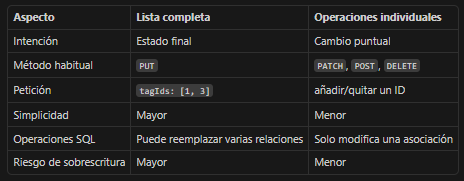
<br>
Regla práctica:

```
PUT /tasks/{id} → reemplaza toda la colección
PATCH o endpoints específicos → añade o elimina asociaciones
```

En ambos casos, el Service debe resolver y validar los IDs, y la operación debería ser transaccional. Solo se modifican las filas de task_tag; nunca deben borrarse los registros de tag por quitar una asociación.<br>
<br>
Pregunta:<br>
<br>
¿Por qué los tagIds se resuelven en el Service y no en el Mapper?<br>
<br>
Respuesta:<br>
<br>
Los tagIds se resuelven en el Service porque convertir identificadores en entidades requiere acceso a la base de datos y contiene lógica de negocio.<br>
<br>
Responsabilidades<br>
El Mapper solo copia valores simples:

```
public static Task toEntity(TaskRequestDTO dto) {
    Task task = new Task();
    task.setTitle(dto.getTitle());
    task.setDescription(dto.getDescription());
    task.setStatus(dto.getStatus());
    task.setPriority(dto.getPriority());
    task.setDueDate(dto.getDueDate());
    return task;
}
```

El Service consulta y valida:

```
@Transactional
public TaskResponseDTO create(TaskRequestDTO dto) {
    Task task = TaskMapper.toEntity(dto);

    List<Tag> tags = tagRepository.findAllById(dto.getTagIds());

    if (tags.size() != dto.getTagIds().size()) {
        throw new TagNotFoundException("Algún tag no existe");
    }

    task.setTags(tags);
    return TaskMapper.toResponseDTO(taskRepository.save(task));
}
```

¿Por qué no el Mapper?<br>
Si el Mapper resolviera los tags:<br>
<br>
necesitaría inyectar TagRepository;<br>
quedaría acoplado a la base de datos;<br>
mezclaría conversión con lógica de negocio;<br>
sería más difícil de probar;<br>
no podría decidir claramente qué hacer si falta un tag.<br>
La separación recomendada es:

```
Mapper  → DTO ↔ entidad, sin consultas
Service → consulta, valida y asigna tags
Repository → acceso a datos
```

Así el Service puede garantizar que todos los tagIds existen antes de guardar la tarea y ejecutar la operación dentro de una única transacción.

---
<br>
Paso 5 - Validación en Postman<br>
<br>
Listar etiquetas

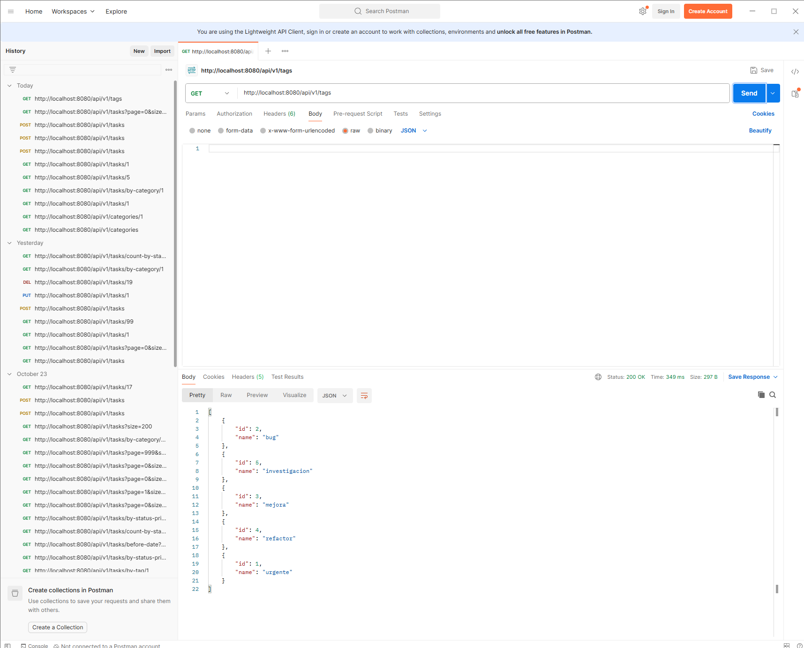

Obtener tarea con tags

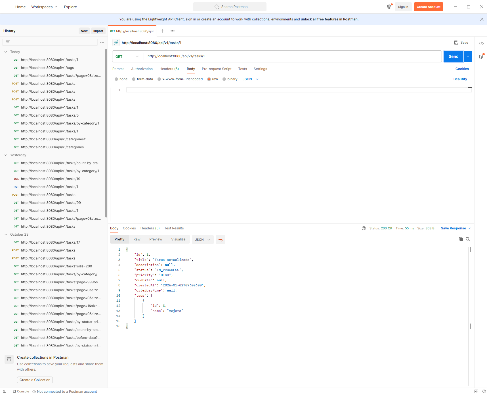

Crear tarea con tags

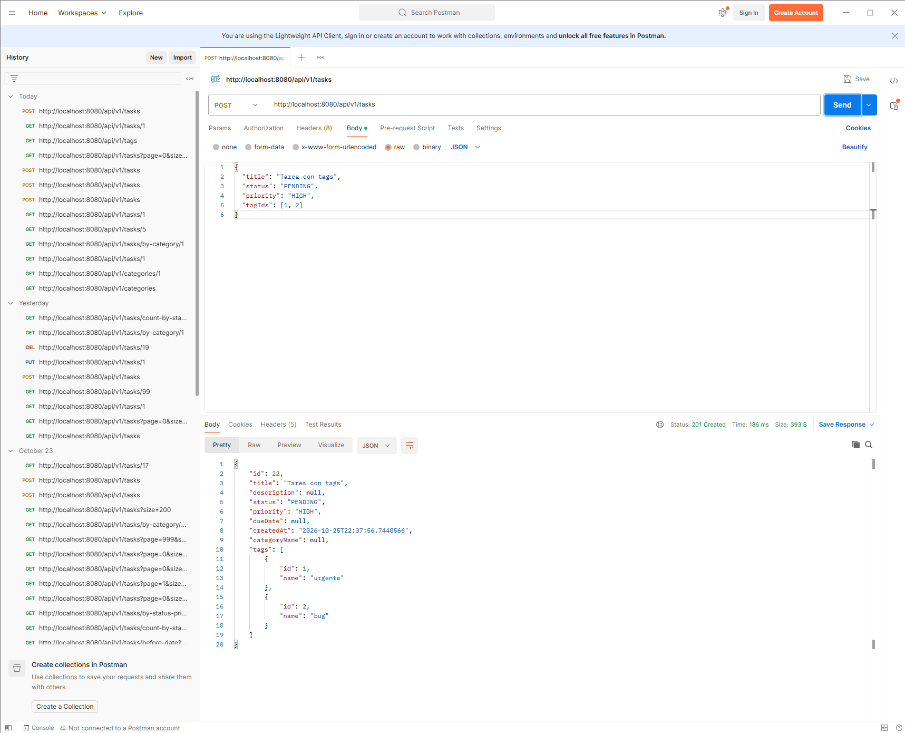

Crear tarea sin tags

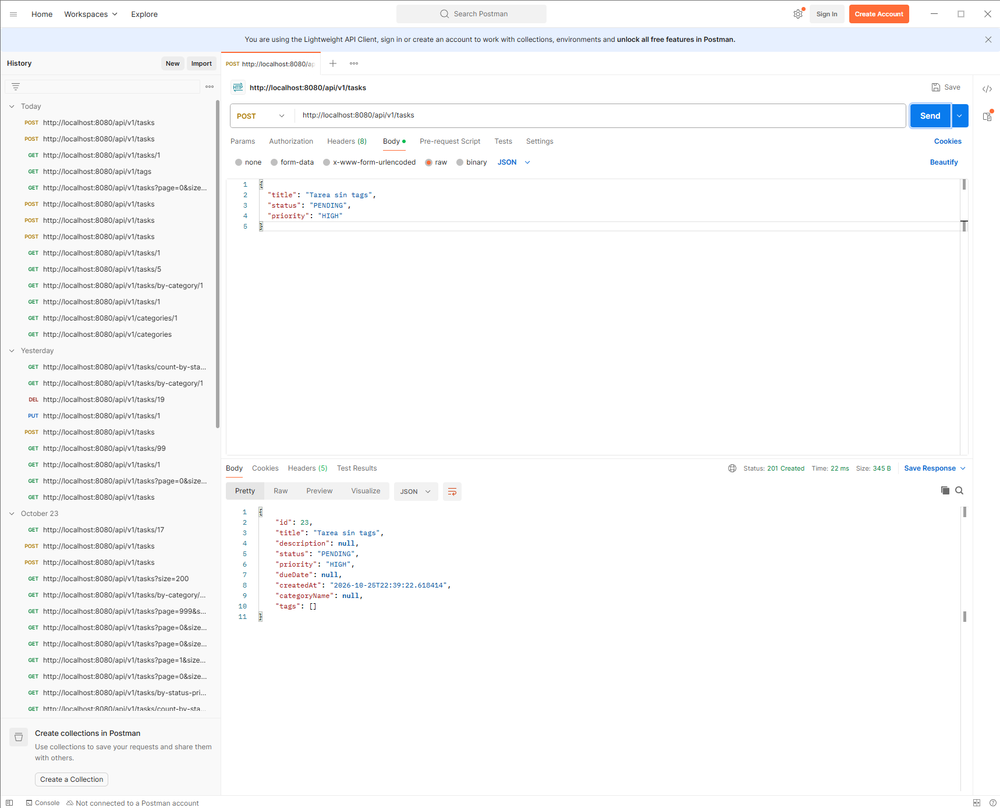

Actualizar tarea con tags

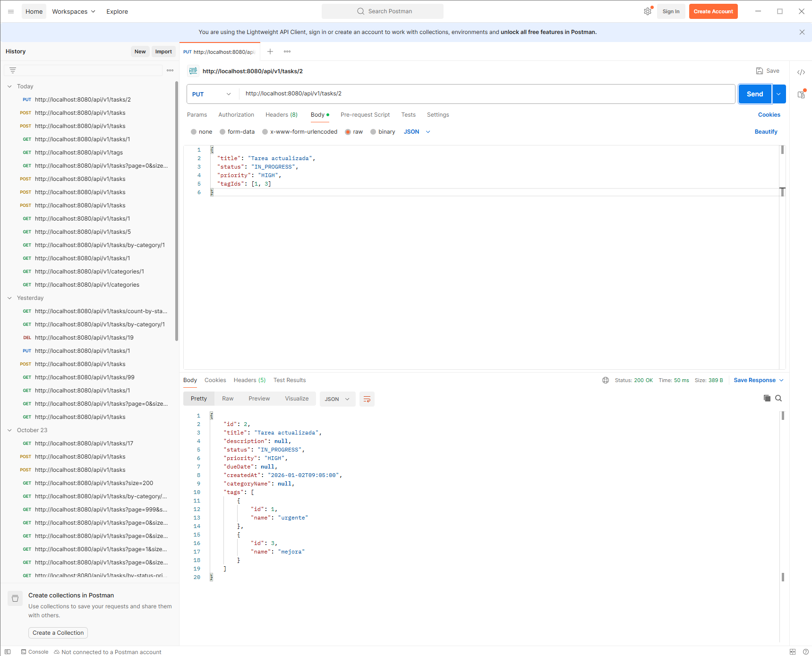

Crear tarea con tag inexistente

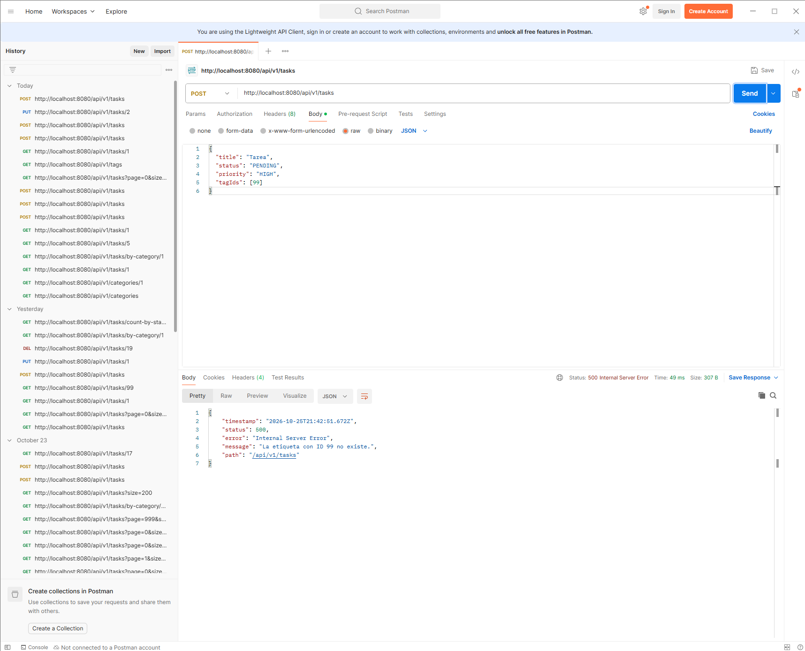

Listar tareas paginadas con tags

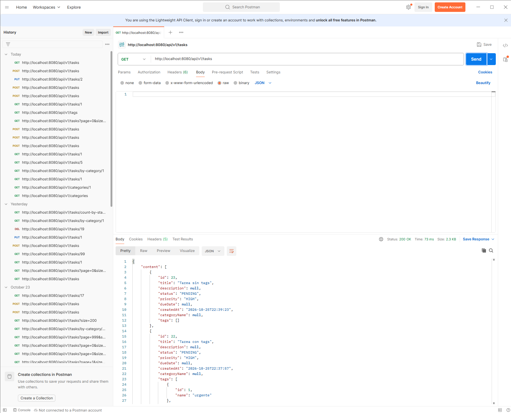

---
<br>
Reflexión:<br>
<br>
Pregunta:<br>
<br>
¿Qué diferencia práctica has notado entre gestionar una relación @ManyToOne de la Parte 2 y una @ManyToMany de esta parte?
<br>
Respuesta:<br>
<br>
En una relación @ManyToOne, una tarea pertenece a una categoría y se gestiona mediante un único categoryId. En una relación @ManyToMany, una tarea puede tener varias etiquetas y una etiqueta puede estar asociada a varias tareas. Por eso utilizamos una lista de identificadores, tagIds, en la petición y una lista de TagResponseDTO en la respuesta.<br>
<br>
Pregunta:<br>
<br>
¿Por qué es importante verificar en la tabla task_tag que los datos se han persistido correctamente?
<br>
Respuesta:<br>
<br>
Porque task_tag es la tabla intermedia que almacena las asociaciones entre tareas y etiquetas. Comprobarla permite verificar que las relaciones se han guardado o actualizado correctamente en la base de datos, y no solo que la API devuelve una respuesta aparentemente correcta.<br>
<br>
Pregunta:<br>
<br>
¿Qué estrategia seguirías para eliminar un tag que está asignado a varias tareas sin borrar esas tareas?
<br>
Respuesta:<br>
<br>
Primero eliminaría las asociaciones de ese tag con las tareas en la tabla intermedia task_tag y después eliminaría el tag. Así se conservan las tareas y el resto de sus etiquetas. También comprobaría que la operación respeta las restricciones de integridad referencial de la base de datos.<br>

---