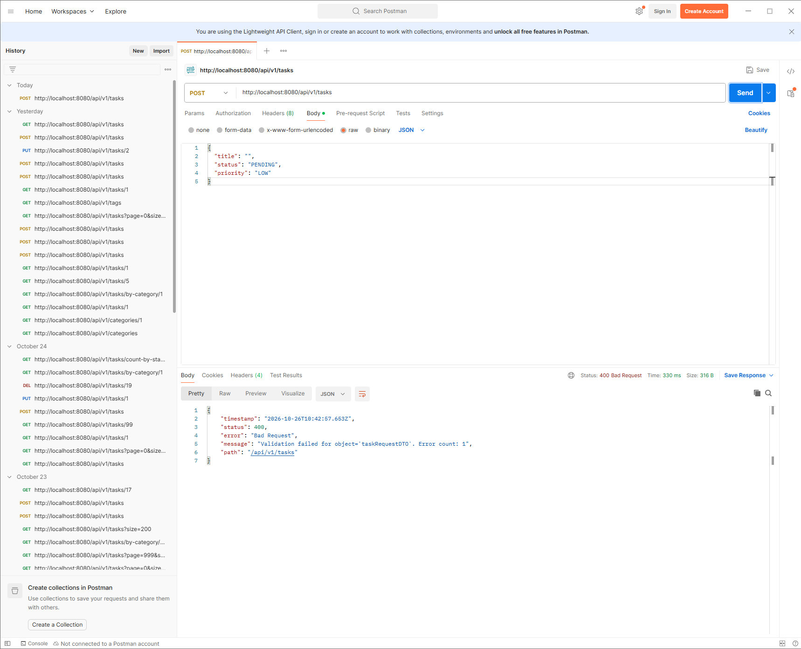
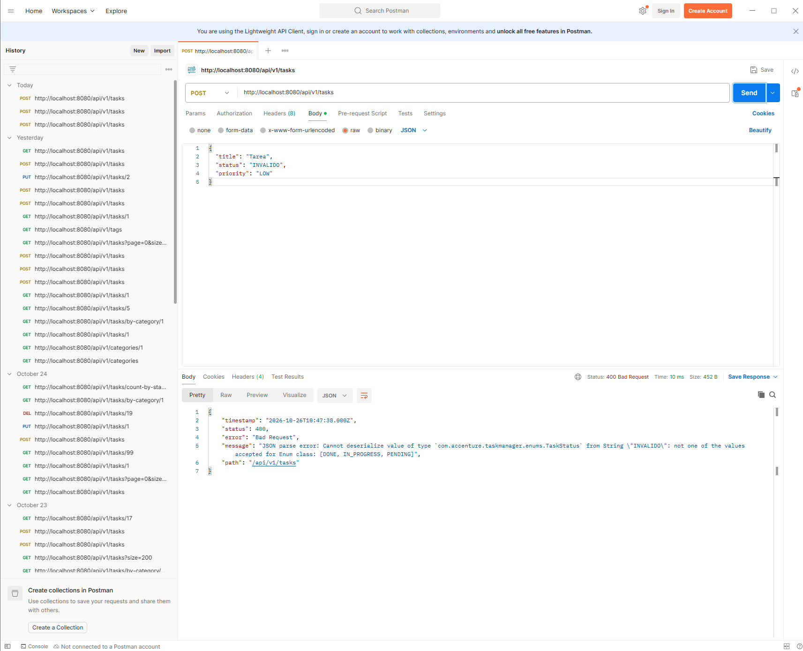
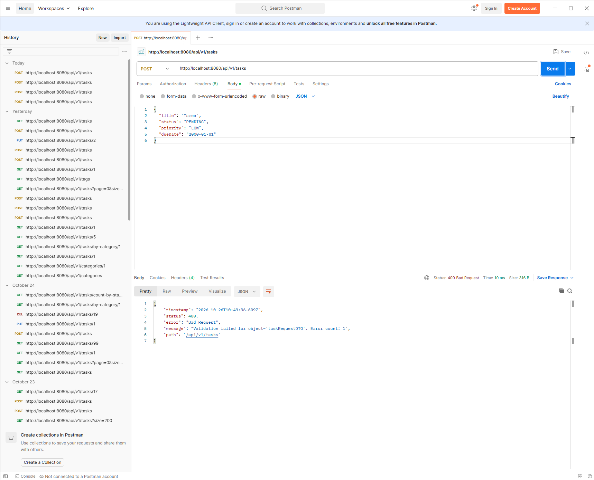
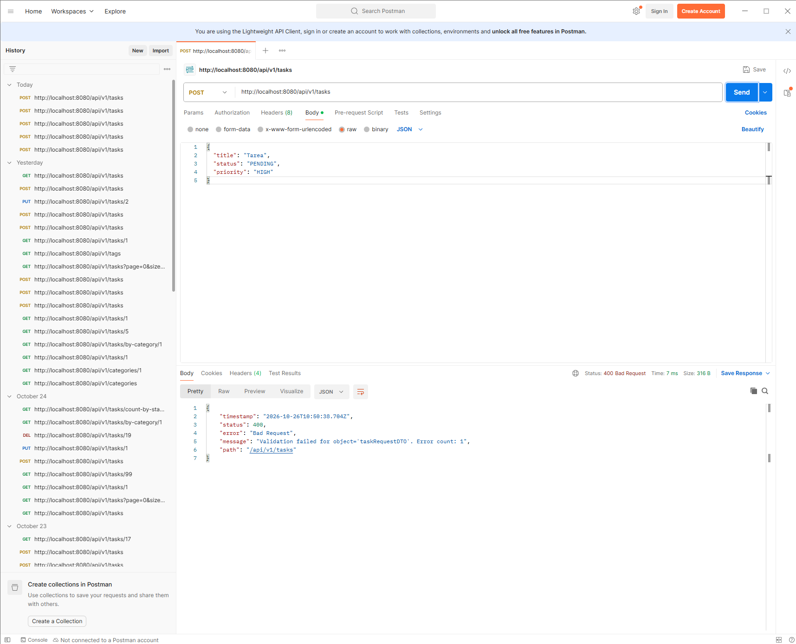
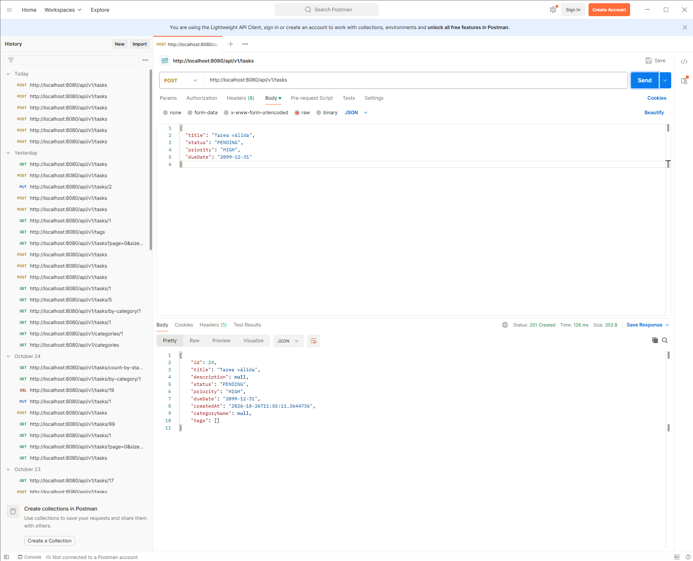

Paso 1 - Preparación (Ask)<br>
<br>
Pregunta:<br>
<br>
¿Qué es Bean Validation en Spring Boot, cómo funciona y qué dependencia necesita el proyecto para utilizar anotaciones como @NotBlank, @NotNull, @Size y @Future? Explica cómo se aplican estas validaciones a los campos de un TaskRequestDTO y qué ocurre cuando un dato no cumple las restricciones.<br>
<br>
Respuesta:<br>
<br>
Bean Validation es el mecanismo estándar para comprobar automáticamente que los datos recibidos cumplen unas restricciones antes de ejecutar la lógica del controlador o del servicio.<br>
<br>
En Spring Boot se utiliza mediante Jakarta Validation, normalmente con esta dependencia en pom.xml:

```
<dependency>
    <groupId>org.springframework.boot</groupId>
    <artifactId>spring-boot-starter-validation</artifactId>
</dependency>
```

Este starter incluye la API de validación y un proveedor, normalmente Hibernate Validator.<br>
<br>
Anotaciones principales<br>
Se importan desde jakarta.validation.constraints:

```
import jakarta.validation.constraints.Future;
import jakarta.validation.constraints.NotBlank;
import jakarta.validation.constraints.NotNull;
import jakarta.validation.constraints.Size;
```

Un TaskRequestDTO podría quedar así:

```
public class TaskRequestDTO {

    @NotBlank(message = "El título es obligatorio")
    @Size(max = 150, message = "El título no puede superar 150 caracteres")
    private String title;

    @Size(max = 2000, message = "La descripción no puede superar 2000 caracteres")
    private String description;

    @NotNull(message = "El estado es obligatorio")
    private TaskStatus status;

    @NotNull(message = "La prioridad es obligatoria")
    private TaskPriority priority;

    @Future(message = "La fecha debe ser futura")
    private LocalDate dueDate;

    // getters y setters
}
```

Qué comprueba cada anotación<br>
@NotBlank: que un texto no sea null, vacío ni contenga solo espacios.<br>
@NotNull: que el valor exista.<br>
@Size: longitud mínima o máxima de textos o tamaño de colecciones.<br>
@Future: que una fecha sea posterior al momento actual.<br>
@Future permite null; si la fecha es obligatoria, se combinaría con:

```
@NotNull
@Future
private LocalDate dueDate;
```


Activar la validación en el Controller<br>
En los métodos de TaskController.java hay que añadir @Valid al cuerpo de la petición:

```
import jakarta.validation.Valid;

@PostMapping
public ResponseEntity<TaskResponseDTO> createTask(
        @Valid @RequestBody TaskRequestDTO task) {

    TaskResponseDTO createdTask = taskService.create(task);
    return new ResponseEntity<>(createdTask, HttpStatus.CREATED);
}
```

Y también en la actualización:

```
@PutMapping("/{id}")
public ResponseEntity<TaskResponseDTO> updateTask(
        @PathVariable Long id,
        @Valid @RequestBody TaskRequestDTO task) {

    TaskResponseDTO updatedTask = taskService.update(id, task);
    return new ResponseEntity<>(updatedTask, HttpStatus.OK);
}
```

El flujo es:

```
JSON
  ↓
TaskRequestDTO
  ↓
@Valid ejecuta Bean Validation
  ↓
si es válido → Service
si es inválido → error 400
```

¿Qué ocurre si un dato no cumple?<br>
Por ejemplo, si el cliente envía:

```
{
  "title": "   ",
  "status": null,
  "priority": "HIGH",
  "dueDate": "2020-01-01"
}
```

Spring detectará errores en:<br>
<br>
title, por @NotBlank;<br>
status, por @NotNull;<br>
dueDate, por @Future.<br>
El método del controlador no se ejecutará y Spring lanzará normalmente MethodArgumentNotValidException, que se traduce en una respuesta 400 Bad Request.<br>
<br>
La respuesta exacta depende de la versión y configuración de Spring Boot. Para ofrecer un formato estable, se puede crear un @RestControllerAdvice que devuelva, por ejemplo:

```
{
  "status": 400,
  "errors": {
    "title": "El título es obligatorio",
    "status": "El estado es obligatorio",
    "dueDate": "La fecha debe ser futura"
  }
}
```

Validación de categoryId y tagIds<br>
Si el DTO incluye las relaciones:

```
@NotNull(message = "La categoría es obligatoria")
private Long categoryId;

@Size(max = 10, message = "No se pueden asociar más de 10 etiquetas")
private List<Long> tagIds;
```

Bean Validation comprueba que los datos tienen el formato esperado, pero no que la categoría o las etiquetas existan en la base de datos. Esa comprobación corresponde al Service:

```
Bean Validation → formato y restricciones básicas
Service          → existencia de Category y Tag
Base de datos    → integridad referencial
```

Por ejemplo, un categoryId numéricamente válido pero inexistente debe provocar un error de negocio al resolverlo mediante CategoryRepository.<br>
<br>
Las anotaciones deben colocarse en TaskRequestDTO.java, no necesariamente en la entidad Task, porque validan específicamente el contrato de entrada de la API. Esto permite tener reglas diferentes para crear, actualizar o modificar parcialmente una tarea.<br>
<br>
Finalmente, si el JSON tiene un formato inválido —por ejemplo, un texto donde se espera una fecha o un valor de enum inexistente— el error ocurre durante la deserialización, antes de Bean Validation, y también debe tratarse como 400 Bad Request.<br>
<br>
Pregunta:<br>
<br>
¿Qué función tiene la anotación @Valid en los parámetros de un método POST o PUT de un TaskController? Explica el recorrido de una petición desde que llega al Controller hasta que se validan los campos del DTO, qué ocurre si falla una validación y qué excepción se produce.<br>
<br>
Respuesta:<br>
<br>
@Valid activa la validación de Bean Validation sobre el objeto recibido en el cuerpo de la petición.<br>
<br>
Por ejemplo, en TaskController.java:

```
@PostMapping
public ResponseEntity<TaskResponseDTO> createTask(
        @Valid @RequestBody TaskRequestDTO request) {
    return ResponseEntity.status(HttpStatus.CREATED)
            .body(taskService.create(request));
}
```

Y también en PUT:

```
@PutMapping("/{id}")
public ResponseEntity<TaskResponseDTO> updateTask(
        @PathVariable Long id,
        @Valid @RequestBody TaskRequestDTO request) {
    return ResponseEntity.ok(taskService.update(id, request));
}
```

Recorrido de la petición

```
JSON HTTP
   ↓
@RequestBody deserializa el JSON
   ↓
Spring crea un TaskRequestDTO
   ↓
@Valid ejecuta sus restricciones
   ↓
si es válido → se llama al Service
si es inválido → se detiene la petición
```

Por ejemplo, si el DTO contiene:

```
@NotBlank
@Size(max = 100)
private String title;

@NotNull
private TaskStatus status;

@Future
private LocalDate dueDate;
```

Spring comprueba esas restricciones antes de ejecutar:

```
taskService.create(request);
```

Si falla una validación<br>
Si el cliente envía datos inválidos, el Controller no continúa hacia el Service. Spring lanza:

```
MethodArgumentNotValidException
```

Esta es la excepción habitual cuando falla la validación de un parámetro @RequestBody anotado con @Valid.<br>
<br>
La API debería responder normalmente con:

```
400 Bad Request
```

La excepción contiene los errores de cada campo:

```
title  → no puede estar vacío
status → no puede ser null
dueDate → debe ser una fecha futura
```

Mediante un @RestControllerAdvice se puede convertir en un JSON claro:

```
{
  "status": 400,
  "errors": {
    "title": "El título es obligatorio",
    "status": "El estado es obligatorio",
    "dueDate": "La fecha debe ser futura"
  }
}
```

Importante<br>
@Valid valida la forma y las restricciones del DTO, pero no comprueba por sí sola que existan relaciones en la base de datos. Por ejemplo:

```
@NotNull
private Long categoryId;
```

comprueba que se haya enviado un ID, pero el Service debe comprobar que esa categoría existe.<br>
<br>
Además, si el JSON no puede convertirse al DTO —por ejemplo, una fecha mal formada o un enum inexistente— el error ocurre durante la deserialización y no durante Bean Validation. También debe tratarse como 400 Bad Request.<br>
<br>
En resumen, @Valid actúa como frontera de entrada: rechaza el TaskRequestDTO inválido antes de ejecutar la lógica de negocio y produce normalmente MethodArgumentNotValidException, que se traduce en una respuesta HTTP 400.<br>
<br>
Pregunta:<br>
<br>
¿Cómo se implementa una validación personalizada con @Constraint y ConstraintValidator cuando una regla depende de varios campos de un DTO? En nuestro caso, ¿cómo podemos exigir que una tarea con prioridad HIGH tenga obligatoriamente dueDate informado? Explica por qué esta regla no se resuelve adecuadamente con una anotación estándar aplicada a un único campo.<br>
<br>
Respuesta:<br>
<br>
Cuando una regla depende de varios campos, la validación debe aplicarse al DTO completo, no a un único atributo.<br>
<br>
En este caso, la regla es:

```
Si priority == HIGH, entonces dueDate no puede ser null.
```

1. Crear la anotación personalizada<br>
Por ejemplo, @ValidTaskRequest:

```
package com.accenture.taskmanager.validation;

import jakarta.validation.Constraint;
import jakarta.validation.Payload;

import java.lang.annotation.Documented;
import java.lang.annotation.Retention;
import java.lang.annotation.Target;

import static java.lang.annotation.ElementType.TYPE;
import static java.lang.annotation.RetentionPolicy.RUNTIME;

@Documented
@Constraint(validatedBy = HighPriorityDueDateValidator.class)
@Target(TYPE)
@Retention(RUNTIME)
public @interface ValidTaskRequest {

    String message() default
            "Las tareas con prioridad HIGH deben tener dueDate informado";

    Class<?>[] groups() default {};

    Class<? extends Payload>[] payload() default {};
}
```

Lo importante es:

```
@Target(TYPE)
```

porque la regla se aplica a la clase completa, y:

```
@Constraint(validatedBy = HighPriorityDueDateValidator.class)
```

que indica qué validador debe ejecutar Bean Validation.<br>
<br>
2. Crear el ConstraintValidator

```
package com.accenture.taskmanager.validation;

import com.accenture.taskmanager.dto.TaskRequestDTO;
import com.accenture.taskmanager.enums.TaskPriority;

import jakarta.validation.ConstraintValidator;
import jakarta.validation.ConstraintValidatorContext;

public class HighPriorityDueDateValidator
        implements ConstraintValidator<ValidTaskRequest, TaskRequestDTO> {

    @Override
    public boolean isValid(
            TaskRequestDTO dto,
            ConstraintValidatorContext context) {

        if (dto == null) {
            return true;
        }

        if (dto.getPriority() == TaskPriority.HIGH) {
            return dto.getDueDate() != null;
        }

        return true;
    }
}
```

El null del DTO completo suele considerarse válido aquí, porque la obligatoriedad del cuerpo puede controlarse aparte. Si el cuerpo no puede ser nulo, podría añadirse una validación específica en el controlador o en el DTO.<br>
<br>
3. Aplicar la anotación al DTO<br>
En TaskRequestDTO.java:

```
@ValidTaskRequest
public class TaskRequestDTO {
    // campos, constructores, getters y setters
}
```

Por ejemplo:

```
@ValidTaskRequest
public class TaskRequestDTO {

    private String title;
    private String description;
    private TaskStatus status;
    private TaskPriority priority;
    private LocalDate dueDate;

    // ...
}
```

4. Activar la validación en el Controller<br>
El parámetro debe llevar @Valid:

```
@PostMapping
public ResponseEntity<TaskResponseDTO> createTask(
        @Valid @RequestBody TaskRequestDTO request) {
    return ResponseEntity
            .status(HttpStatus.CREATED)
            .body(taskService.create(request));
}
```

Lo mismo para PUT:

```
@PutMapping("/{id}")
public ResponseEntity<TaskResponseDTO> updateTask(
        @PathVariable Long id,
        @Valid @RequestBody TaskRequestDTO request) {
    return ResponseEntity.ok(taskService.update(id, request));
}
```

Resultado<br>
Esta petición es válida:

```
{
  "priority": "HIGH",
  "dueDate": "2026-11-01"
}
```

Esta no:

```
{
  "priority": "HIGH",
  "dueDate": null
}
```

Spring detiene la ejecución antes de llegar al Service y lanza normalmente:

```
MethodArgumentNotValidException
```

La respuesta debería ser 400 Bad Request, gestionada por un @RestControllerAdvice.<br>
<br>
¿Por qué no basta una anotación estándar?<br>
Si se escribe:

```
@NotNull
private LocalDate dueDate;
```

se exige una fecha para todas las tareas, incluidas las de prioridad LOW o MEDIUM.<br>
<br>
Y si se coloca @NotNull solo en priority, no se comprueba la relación entre priority y dueDate.<br>
<br>
La regla depende de dos propiedades:

```
priority + dueDate
```

Por eso debe validarse a nivel de clase mediante @Constraint y ConstraintValidator. Las anotaciones estándar siguen siendo útiles para reglas individuales, como @NotBlank en title o @NotNull en priority.

---
<br>
Paso 2 - Diseño previoz<br>
<br>
Validaciones por campo de TaskRequestDTO<br>
<br>
Campo           Vallidación                     Motivo<br>
title           @NotBlank y @Size(max=150)      Obligatorio, no puede estar vacío ni superar 150 caracteres<br>
description     @size(max=150)                  Opcional, pero limitado a 500 caracteres<br>
status          @NotNull                        Obligatorio, debe ser uno de los valores permitidos<br>
priority        @NotNull                        Obligatorio, debe ser uno de los valores permitidos<br>
dueDate         @Future                         Si se indica, debe ser una fecha futura<br>
<br>
Validación personalizada a nivel de clase<br>
<br>
Regla de negocio: una tarea con prioridad HIGH debe tener obligatoriamente dueDate informado.<br>
<br>
Diseño propuesto:<br>
- Crear la anotación personalizada @RequiereFechaLimite.<br>
- Crear la clase RequiereFechaLimiteValidator, que implementará ConstraintValidator.<br>
- Aplicar la validación a nivel de clase sobre TaskRequestDTO, ya que la regla depende de dos campos.<br>
- Mantener la validación de fecha futura mediante @Future, independiente de la regla personalizada.<br>
- Los mensajes de error estarán en español.<br>
<br>
Comentarios:<br>
<br>
Anotaciones de TaskRequestDTO<br>
<br>
// Añade las anotaciones de Bean Validation definidas en el diseño previo a los campos de TaskRequestDTO, con mensajes de error en español. Conserva los campos, tipos, métodos y lógica existentes. — generado por IA<br>
<br>
Anotación RequiereFechaLimite<br>
<br>
// Crea la anotación personalizada de validación RequiereFechaLimite a nivel de clase, utilizando @Constraint y vinculándola a RequiereFechaLimiteValidator. Incluye los elementos obligatorios de una anotación de Bean Validation y mensajes en español. — generado por IA<br>
<br>
Validador RequiereFechaLimiteValidator<br>
<br>
// Implementa ConstraintValidator para validar el TaskRequestDTO completo: si la prioridad es HIGH, la fecha límite debe estar informada; para las demás prioridades, esta regla no debe exigirla. Ten en cuenta que la fecha futura se valida por separado con @Future. — generado por IA<br>
<br>
Activación en TaskController<br>
<br>
// Añade @Valid a los parámetros TaskRequestDTO de los métodos POST y PUT para activar las validaciones antes de ejecutar el servicio. No modifiques la lógica de los métodos ni los endpoints existentes. — generado por IA<br>
<br>

---
Paso 3 - Implementación (autocompletado)<br>
<br>
Se añade la dependencia en el POM:<br>
<br>
```
<!-- Dependencia para validar los datos de entrada mediante Bean Validation -->
		<dependency>
			<groupId>org.springframework.boot</groupId>
			<artifactId>spring-boot-starter-validation</artifactId>
		</dependency>
```

TaskRequestDTO<br>
<br>
Comentario:<br>
<br>
// Añade las anotaciones de Bean Validation definidas en el diseño previo a los campos de TaskRequestDTO, con mensajes de error en español. Conserva los campos, tipos, métodos y lógica existentes. — generado por IA<br>
<br>
Resultado:

```
//pon la anotación @RequiereFechaLimite
@RequiereFechaLimite 
public class TaskRequestDTO {

    // Añade las anotaciones de Bean Validation definidas en el diseño previo a los campos de TaskRequestDTO, con mensajes de error en español. Conserva los campos, tipos, métodos y lógica existentes. — generado por IA
    @NotBlank(message = "El título no puede estar vacío")
    @Size(max = 150, message = "El título no puede superar los 150 caracteres")
    private String title;

    @Size(max = 500, message = "La descripción no puede superar los 500 caracteres")
    private String description;

    @NotNull(message = "El estado es obligatorio")
    private TaskStatus status;

    @NotNull(message = "La prioridad es obligatoria")
    private TaskPriority priority;

    @Future(message = "La fecha límite debe ser futura")
    private LocalDate dueDate;
```

RequiereFechaLimite<br>
<br>
Comentario:<br>
<br>
// Crea la anotación personalizada de validación RequiereFechaLimite a nivel de clase, utilizando @Constraint y vinculándola a RequiereFechaLimiteValidator. Incluye los elementos obligatorios de una anotación de Bean Validation y mensajes en español. — generado por IA<br>
<br>
Resultado:

```
package com.accenture.taskmanager.validation;

import java.lang.annotation.ElementType;
import java.lang.annotation.Retention;
import java.lang.annotation.RetentionPolicy;
import java.lang.annotation.Target;

import jakarta.validation.Constraint;
import jakarta.validation.Payload;

// Crea la anotación personalizada de validación RequiereFechaLimite a nivel de clase, utilizando @Constraint y vinculándola a RequiereFechaLimiteValidator. Incluye los elementos obligatorios de una anotación de Bean Validation y mensajes en español. — generado por IA
@Target(ElementType.TYPE)
@Retention(RetentionPolicy.RUNTIME)
@Constraint(validatedBy = RequiereFechaLimiteValidator.class)
public @interface RequiereFechaLimite {

    String message() default "La fecha límite es obligatoria cuando la prioridad es ALTA";

    Class<?>[] groups() default {};

    Class<? extends Payload>[] payload() default {};
}
```

RequiereFechaLimiteValidator<br>
<br>
Comentario:<br>
<br>
// Implementa ConstraintValidator para validar el TaskRequestDTO completo: si la prioridad es HIGH, la fecha límite debe estar informada; para las demás prioridades, esta regla no debe exigirla. Ten en cuenta que la fecha futura se valida por separado con @Future. — generado por IA<br>
<br>
Resultado:

```
package com.accenture.taskmanager.validation;

import com.accenture.taskmanager.dto.TaskRequestDTO;
import com.accenture.taskmanager.enums.TaskPriority;

import jakarta.validation.ConstraintValidator;
import jakarta.validation.ConstraintValidatorContext;

// Implementa ConstraintValidator para validar el TaskRequestDTO completo: si la prioridad es HIGH, la fecha límite debe estar informada; para las demás prioridades, esta regla no debe exigirla. Ten en cuenta que la fecha futura se valida por separado con @Future. — generado por IA
public class RequiereFechaLimiteValidator implements ConstraintValidator<RequiereFechaLimite, TaskRequestDTO> {

    @Override
    public boolean isValid(TaskRequestDTO value, ConstraintValidatorContext context) {
        if (value == null) {
            return true;
        }

        if (value.getPriority() == TaskPriority.HIGH && value.getDueDate() == null) {
            return false;
        }

        return true;
    }

}
```

TaskController<br>
<br>
Comentario:<br>
<br>
// Añade @Valid al parámetro TaskRequestDTO del método POST para activar las validaciones antes de ejecutar el servicio. No modifiques la lógica del método ni el endpoint existente. — generado por IA<br>
<br>
Resultado:

```
    // Añade @Valid al parámetro TaskRequestDTO del método POST para activar las validaciones antes de ejecutar el servicio. No modifiques la lógica del método ni el endpoint existente. — generado por IA
    @PostMapping
    public ResponseEntity<TaskResponseDTO> createTask(@RequestBody @Valid TaskRequestDTO task) {
        TaskResponseDTO createdTask = taskService.create(task);
        return new ResponseEntity<>(createdTask, HttpStatus.CREATED);
    }
```

Comentario:<br>
<br>
// Añade @Valid al parámetro TaskRequestDTO del método PUT para activar las validaciones antes de ejecutar el servicio. No modifiques la lógica del método ni el endpoint existente. — generado por IA<br>
<br>
Resultado:

```
    // Añade @Valid al parámetro TaskRequestDTO del método PUT para activar las validaciones antes de ejecutar el servicio. No modifiques la lógica del método ni el endpoint existente. — generado por IA
    @PutMapping("/{id}")
    public ResponseEntity<TaskResponseDTO> updateTask(
            @PathVariable Long id,
            @RequestBody @Valid TaskRequestDTO task) {

        TaskResponseDTO updatedTask = taskService.update(id, task);
        return new ResponseEntity<>(updatedTask, HttpStatus.OK);
    }
```

---
<br>
Paso 4 - Comprensión del código (Ask)<br>
<br>
Pregunta:<br>
<br>
¿Qué ocurre internamente cuando Spring encuentra @Valid en un parámetro del Controller?
<br>
Respuesta:<br>
<br>
Cuando Spring encuentra @Valid en un parámetro del Controller, activa Bean Validation para ese objeto antes de ejecutar el método.<br>
<br>
Por ejemplo:

```
@PostMapping
public ResponseEntity<TaskResponseDTO> create(
        @Valid @RequestBody TaskRequestDTO request) {
    return ResponseEntity.ok(taskService.create(request));
}
```

El flujo interno es:<br>
<br>
@RequestBody deserializa el JSON<br>
Jackson convierte el cuerpo HTTP en un TaskRequestDTO.<br>
<br>
Spring detecta @Valid<br>
El resolvedor de argumentos de Spring MVC solicita al proveedor de validación que valide el DTO.<br>
<br>
Se ejecutan las restricciones<br>
Hibernate Validator revisa anotaciones como:

```
@NotBlank
@NotNull
@Size
@Future
```

y también restricciones personalizadas con @Constraint.<br>
<br>
Se construye un BindingResult<br>
Los errores se recopilan con información como:<br>
<br>
nombre del campo;<br>
valor rechazado;<br>
código de la restricción;<br>
mensaje de error.<br>
Si no hay errores<br>
El método del Controller continúa y llama al Service:

```
taskService.create(request);
```

Si hay errores<br>
Spring no ejecuta el cuerpo del método y lanza normalmente:

```
MethodArgumentNotValidException
```

La respuesta habitual es:

```
400 Bad Request
```

El @RestControllerAdvice puede capturar esa excepción y devolver un JSON controlado:

```
{
  "status": 400,
  "errors": {
    "title": "El título es obligatorio",
    "dueDate": "Debe ser una fecha futura"
  }
}
```

La secuencia completa es:

```
Petición HTTP
    ↓
@RequestBody + Jackson
    ↓
TaskRequestDTO
    ↓
@Valid
    ↓
Bean Validation
    ├── válido   → Controller → Service
    └── inválido → MethodArgumentNotValidException → 400
```

@Valid no valida automáticamente que categoryId o tagIds existan en la base de datos. Solo comprueba las restricciones declaradas en el DTO. La existencia de esas entidades debe comprobarla después el Service.<br>
<br>
Pregunta:<br>
¿Qué excepción lanza Spring cuando falla una validación? ¿Dónde se captura ahora mismo?<br>
<br>
Respuesta:<br>
<br>
Cuando falla la validación de un objeto recibido con @RequestBody @Valid, Spring lanza normalmente:

```
MethodArgumentNotValidException
```

La excepción contiene los errores de validación de cada campo y de las validaciones a nivel de clase, como la regla personalizada de prioridad HIGH y dueDate.<br>
<br>
En este proyecto se lanza desde los métodos POST y PUT de TaskController.java, antes de llamar al Service.<br>
<br>
Actualmente no se captura todavía en GlobalExceptionHandler.java. Ese @RestControllerAdvice solo maneja:

```
@ExceptionHandler(TaskNotFoundException.class)
public ResponseEntity<String> handleTaskNotFound(
        TaskNotFoundException e) {
    return new ResponseEntity<>("Task not found", HttpStatus.NOT_FOUND);
}
```

Por tanto, los errores de validación los gestiona el mecanismo general de Spring Boot y normalmente se devuelve:

```
400 Bad Request
```

Para controlar el formato de la respuesta habría que añadir un manejador específico:

```
@ExceptionHandler(MethodArgumentNotValidException.class)
public ResponseEntity<Map<String, String>> handleValidation(
        MethodArgumentNotValidException exception) {

    Map<String, String> errors = new HashMap<>();

    exception.getBindingResult()
        .getFieldErrors()
        .forEach(error ->
            errors.put(error.getField(), error.getDefaultMessage()));

    exception.getBindingResult()
        .getGlobalErrors()
        .forEach(error ->
            errors.put(error.getObjectName(), error.getDefaultMessage()));

    return ResponseEntity.badRequest().body(errors);
}
```

Así la API podría responder, por ejemplo:

```
{
  "title": "El título es obligatorio",
  "dueDate": "Las tareas HIGH requieren una fecha límite"
}
```

En resumen: la excepción es MethodArgumentNotValidException, se produce antes del Service y actualmente no tiene un manejador específico en el GlobalExceptionHandler.<br>
<br>
Pregunta:<br>
<br>
¿Qué hace el método isValid() en RequiereFechaLimiteValidator y cuándo se ejecuta? ¿Por qué recibe TaskRequestDTO en vez de un solo campo?<br>
<br>
Respuesta:<br>
<br>
isValid() contiene la lógica de la validación personalizada. En RequiereFechaLimiteValidator.java comprueba la regla:

```
Si la prioridad es HIGH, debe existir dueDate.
```

Su lógica es conceptualmente:

```
@Override
public boolean isValid(
        TaskRequestDTO value,
        ConstraintValidatorContext context) {

    if (value == null) {
        return true;
    }

    if (value.getPriority() == TaskPriority.HIGH) {
        return value.getDueDate() != null;
    }

    return true;
}
```

¿Cuándo se ejecuta?<br>
Se ejecuta automáticamente cuando:<br>
<br>
llega una petición POST o PUT;<br>
Jackson convierte el JSON en TaskRequestDTO;<br>
el parámetro del Controller tiene @Valid;<br>
Bean Validation detecta la anotación personalizada @RequiereFechaLimite en el DTO.<br>
Por ejemplo:

```
@PostMapping
public ResponseEntity<TaskResponseDTO> create(
        @RequestBody @Valid TaskRequestDTO request) {
    // isValid() ya se ha ejecutado antes de llegar aquí
}
```

Si devuelve false, Spring detiene la petición y lanza normalmente:

```
MethodArgumentNotValidException
```

La respuesta habitual es 400 Bad Request.<br>
<br>
¿Por qué recibe TaskRequestDTO?<br>
Porque la regla depende de dos campos:

```
priority + dueDate
```

El validador necesita leer ambos:

```
value.getPriority();
value.getDueDate();
```

Por eso la anotación se aplica a nivel de clase:

```
@RequiereFechaLimite
public class TaskRequestDTO {
}
```

Si se aplicara a un solo campo, por ejemplo:

```
@RequiereFechaLimite
private LocalDate dueDate;
```

el validador solo recibiría el valor de dueDate y no tendría acceso directo a priority para decidir si la fecha es obligatoria.<br>
<br>
Las anotaciones estándar siguen siendo adecuadas para reglas de un solo campo:

```
@NotBlank
private String title;

@NotNull
private TaskPriority priority;

@Future
private LocalDate dueDate;
```

Pero la relación condicional HIGH → dueDate obligatorio necesita el DTO completo.<br>
<br>
Pregunta:<br>
<br>
¿Qué pasaría si añades @Valid en un método GET? ¿Tiene sentido hacerlo?<br>
<br>
Respuesta:<br>
<br>
Depende de dónde se coloque @Valid, pero normalmente no tiene sentido añadirlo directamente a un GET que solo consulta datos.<br>
<br>
En un GET con @RequestBody

```
@GetMapping
public List<TaskResponseDTO> search(
        @Valid @RequestBody TaskRequestDTO request) {
    // ...
}
```

No es recomendable porque los GET normalmente no deberían recibir un cuerpo JSON. Muchos clientes, proxies y servidores pueden ignorarlo o tratarlo de forma inconsistente.<br>
<br>
Para filtros, es preferible usar parámetros:

```
GET /tasks?status=HIGH&page=0&size=10
```

En parámetros de URL

```
@GetMapping("/{id}")
public TaskResponseDTO getTask(
        @Valid @PathVariable Long id) {
    // ...
}
```

@Valid por sí solo no suele ser suficiente para validar un Long o un String individual. Para validar parámetros simples se utiliza normalmente:

```
@Validated
@RestController
public class TaskController {

    @GetMapping("/{id}")
    public TaskResponseDTO getTask(
            @PathVariable
            @Positive(message = "El id debe ser positivo")
            Long id) {
        // ...
    }
}
```

Según la versión de Spring, los errores de validación de métodos pueden producir ConstraintViolationException o HandlerMethodValidationException, y deben gestionarse globalmente.<br>
<br>
En un objeto de filtros<br>
Sí puede tener sentido validar un objeto recibido mediante parámetros:

```
@GetMapping
public Page<TaskResponseDTO> search(
        @Valid TaskFilterDTO filter) {
    // ...
}
```

Por ejemplo:

```
public class TaskFilterDTO {

    @Size(max = 100)
    private String title;

    private TaskStatus status;
}
```

En este caso, Spring construye el DTO a partir de los parámetros de la URL y valida sus campos. Para que funcione correctamente puede ser necesario utilizar @ModelAttribute explícitamente:

```
public Page<TaskResponseDTO> search(
        @Valid @ModelAttribute TaskFilterDTO filter) {
    // ...
}
```

Conclusión<br>
Para POST y PUT, @Valid @RequestBody es habitual y apropiado.<br>
En un GET, no conviene validar un cuerpo JSON.<br>
Para @PathVariable o @RequestParam, usa restricciones como @Positive, @Min o @Size, junto con la validación de métodos.<br>
Para varios filtros, un FilterDTO con @Valid puede ser útil.<br>
En resumen, @Valid no depende del verbo HTTP, pero debe aplicarse al objeto correcto. En un GET normalmente se validan parámetros de consulta, no un TaskRequestDTO pensado para crear o actualizar tareas.<br>
<br>
Pregunta:<br>
<br>
¿Por qué los mensajes de error personalizados van en el atributo message de cada anotación?<br>
<br>
Respuesta:<br>
<br>
Los mensajes personalizados se ponen en message para indicar qué debe corregir el cliente cuando una validación falla.<br>
<br>
Ejemplo:

```
@NotBlank(message = "El título es obligatorio")
private String title;

@Size(
    max = 100,
    message = "El título no puede superar los 100 caracteres"
)
private String title;
```

Si no se especifica message, Bean Validation utiliza un mensaje genérico, que puede ser menos claro o estar en otro idioma.<br>
<br>
Cuando falla la validación, el mensaje queda disponible en el error:

```
error.getDefaultMessage();
```

y el GlobalExceptionHandler puede devolverlo:

```
{
  "title": "El título es obligatorio"
}
```

Esto permite:<br>
<br>
mensajes claros para el consumidor de la API;<br>
distinguir qué regla se incumplió;<br>
evitar exponer detalles técnicos;<br>
centralizar después la respuesta mediante @RestControllerAdvice;<br>
preparar la internacionalización usando claves como:

```
@NotBlank(message = "{task.title.required}")
```

El mensaje no cambia la validación; solo cambia la información asociada al error. La regla sigue estando definida por la anotación, por ejemplo @NotBlank, @Size o @Future.

---
<br>
Paso 5 - Validación en Postman<br>
<br>
01 — Título vacío

<br>

02 — Título obligatorio ausente

<br>

03 — Estado no válido

<br>

04 — Fecha límite en el pasado

<br>

05 — Prioridad HIGH sin fecha límite

<br>

06 — Crear tarea válida con prioridad HIGH



---
<br>
Reflexión:<br>
<br>
Pregunta:<br>
<br>
¿Qué ventaja tiene validar en el Controller antes de llegar al Service?<br>
<br>
Respuesta:<br>
<br>
Validar en el Controller permite rechazar los datos incorrectos antes de ejecutar la lógica de negocio del Service. Así se evita procesar o guardar información que no cumple las restricciones, se separan responsabilidades y se ahorran operaciones innecesarias.<br>
<br>
Pregunta:<br>
<br>
¿La respuesta de error que devuelve Spring por defecto es útil para el cliente de la API? ¿Qué mejorarías?<br>
<br>
Respuesta:<br>
<br>
La respuesta por defecto permite saber que la petición ha fallado, pero no siempre indica claramente qué campo es incorrecto ni qué regla ha incumplido. Mejoraría la respuesta mediante un manejo global de excepciones con @RestControllerAdvice, devolviendo un JSON estructurado con el código HTTP, el mensaje de error y los campos que han fallado, con mensajes en español.<br>
<br>
Pregunta:<br>
<br>
¿Qué pasaría si un campo tiene varias anotaciones de validación y falla más de una a la vez?<br>
<br>
Respuesta:<br>
<br>
Podrían fallar varias restricciones del mismo campo y producirse varios errores de validación en una misma petición. Por ejemplo, un título vacío podría incumplir @NotBlank y, dependiendo de las restricciones aplicadas, otras validaciones. La respuesta de error por defecto no necesariamente muestra todos esos errores de una forma clara para el cliente.<br>
<br>
Pregunta:<br>
<br>
Si durante las pruebas has encontrado algún error adicional que no aparece en este enunciado, ¿cuál era y cómo lo has resuelto?<br>
<br>
Respuesta:<br>
<br>
Durante las pruebas, al enviar el valor INVALIDO en el campo status, Spring devolvió 400 Bad Request porque ese valor no pertenece al enum TaskStatus. La respuesta indicó que los valores permitidos son DONE, IN_PROGRESS y PENDING. Se comprobó que el comportamiento era correcto y que la petición se rechazaba antes de crear la tarea.

---