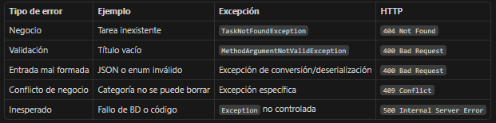
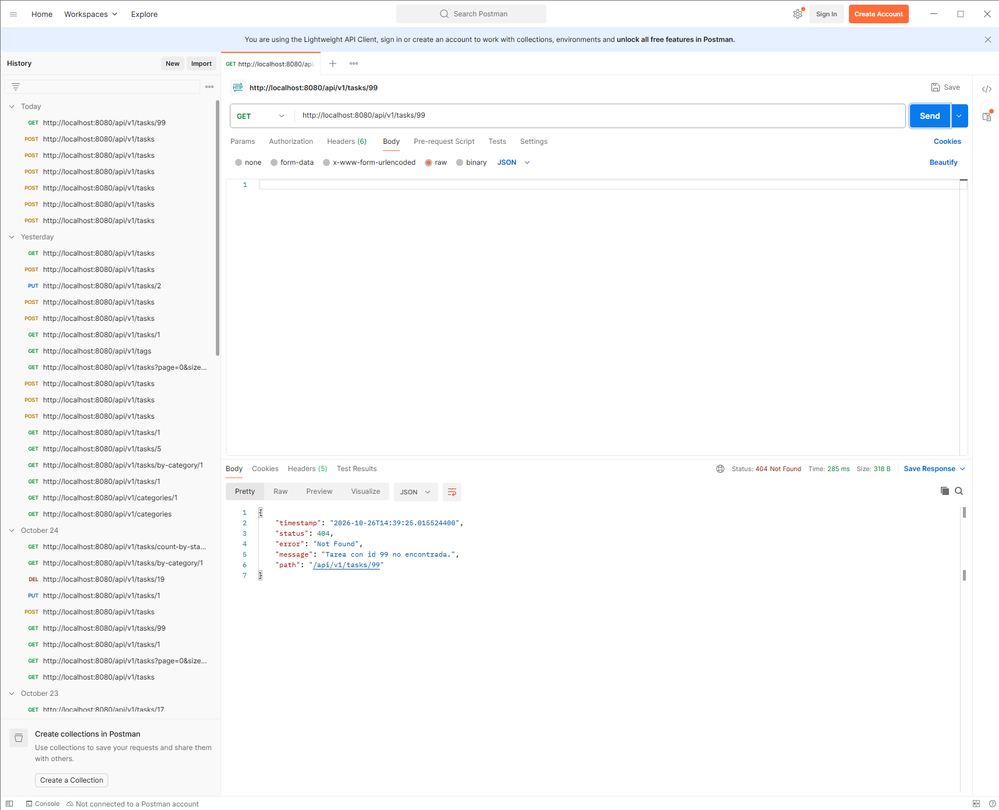
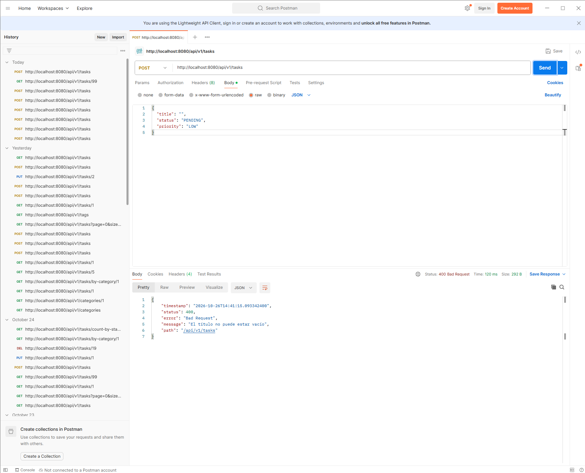
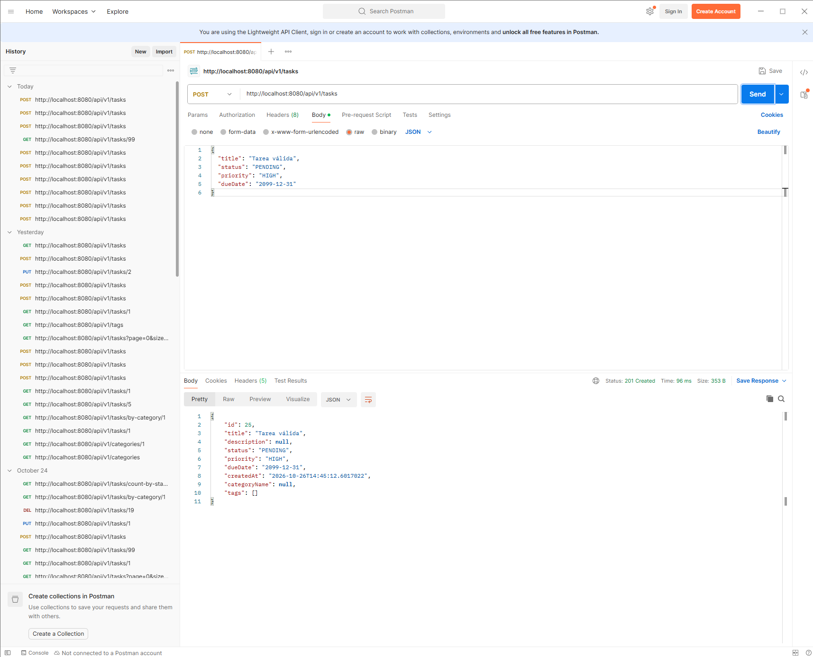
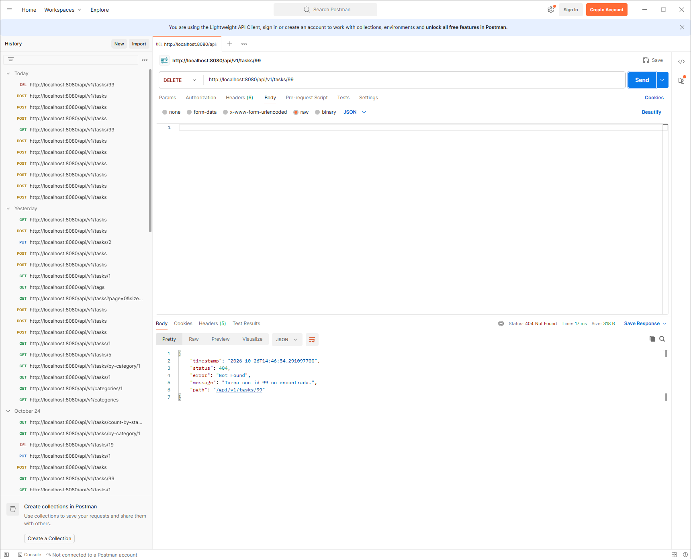
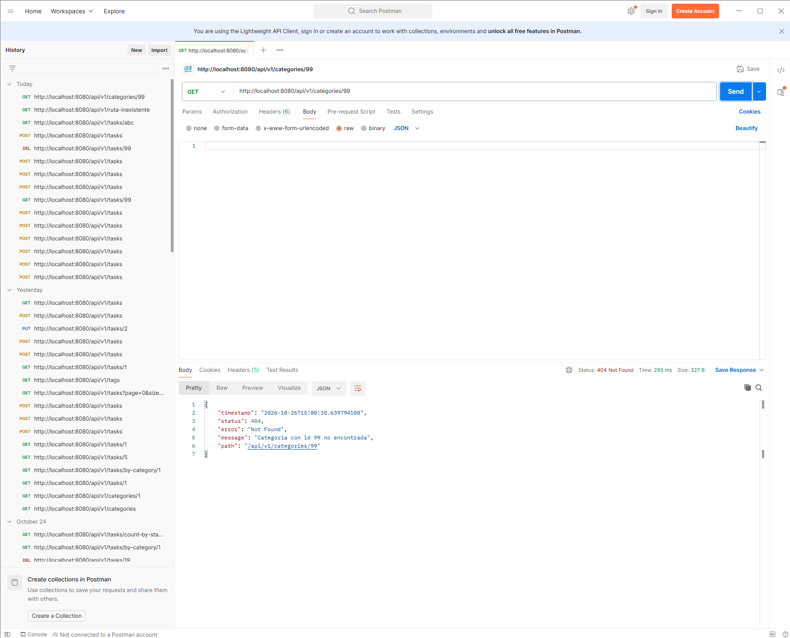
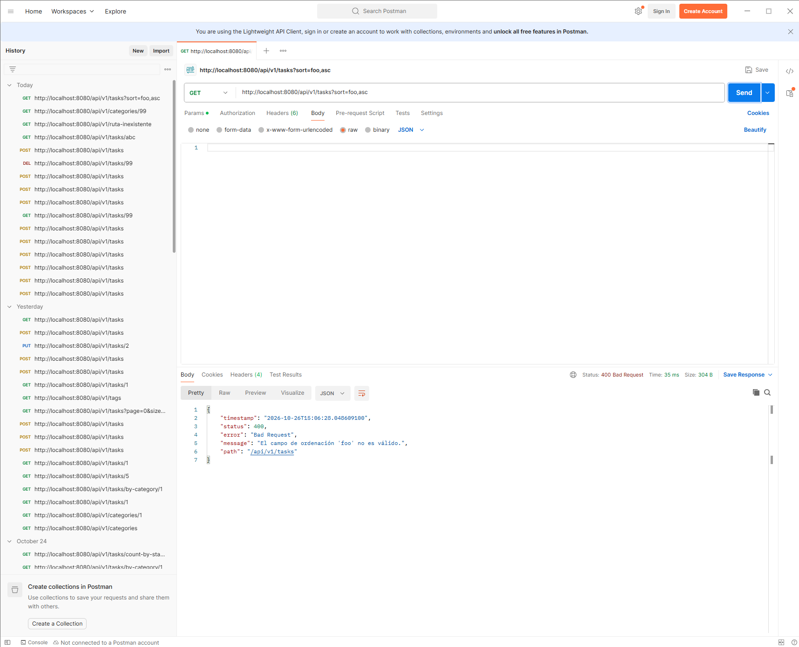

INCIDENCIA:<br>
<br>
Se ha adelantÓ la creación del manejador de excepciones en el ejercicio de uso de spring data debido a la restricción de que no se puedía tocar el controlador el TaskController no capturaría la excepción en el Get ni el Put y devolvería un 500 en vez de un 404 por lo que en este ejercicio solo se adaptará.<br>
<br>
Paso 1 - Preparación (Ask)<br>
<br>
Pregunta:<br>
<br>
¿Cómo funcionan conjuntamente `@RestControllerAdvice` y `@ExceptionHandler` en Spring Boot para centralizar el manejo de errores? Explica cómo se identifica la excepción y cómo se selecciona el método que la gestiona.
<br>
Respuesta:<br>
<br>
@RestControllerAdvice y @ExceptionHandler permiten centralizar el tratamiento de excepciones de todos los controladores REST.<br>
<br>
@RestControllerAdvice<br>
@RestControllerAdvice marca una clase como manejador global:

```
@RestControllerAdvice
public class GlobalExceptionHandler {
}
```

Spring detecta esa clase y la aplica a las excepciones lanzadas desde los métodos de los @RestController. Es equivalente a combinar:

```
@ControllerAdvice
@ResponseBody
```

Por eso los métodos del advice devuelven directamente JSON u otros cuerpos HTTP, sin necesitar @ResponseBody.<br>
<br>
@ExceptionHandler<br>
@ExceptionHandler indica qué método gestiona una excepción concreta:

```
@ExceptionHandler(TaskNotFoundException.class)
public ResponseEntity<String> handleTaskNotFound(
        TaskNotFoundException exception) {

    return ResponseEntity
            .status(HttpStatus.NOT_FOUND)
            .body("Task not found");
}
```

La clase actual del proyecto es GlobalExceptionHandler.java.<br>
<br>
Cómo se identifica la excepción<br>
Cuando una petición provoca una excepción:

```
throw new TaskNotFoundException(
    "La tarea no existe"
);
```

Spring examina el tipo real de la excepción:

```
TaskNotFoundException
```

Después busca métodos @ExceptionHandler compatibles en:<br>
<br>
el propio Controller;<br>
las clases @ControllerAdvice o @RestControllerAdvice.<br>
La anotación puede indicar la excepción:

```
@ExceptionHandler(TaskNotFoundException.class)
```

También puede inferirla del parámetro:

```
@ExceptionHandler
public ResponseEntity<String> handleTaskNotFound(
        TaskNotFoundException exception) {
    // ...
}
```

Cómo selecciona el método<br>
Spring elige el handler cuya excepción sea compatible con la lanzada.<br>
<br>
Por ejemplo:

```
@ExceptionHandler(TaskNotFoundException.class)
public ResponseEntity<?> handleNotFound(TaskNotFoundException ex) {
    // ...
}

@ExceptionHandler(MethodArgumentNotValidException.class)
public ResponseEntity<?> handleValidation(
        MethodArgumentNotValidException ex) {
    // ...
}

@ExceptionHandler(RuntimeException.class)
public ResponseEntity<?> handleRuntime(RuntimeException ex) {
    // ...
}
```

Si se lanza TaskNotFoundException, Spring usa el primer método porque es el tipo más específico. Si no existe un handler específico, puede utilizar uno para una superclase compatible, como RuntimeException.<br>
<br>
Una excepción de validación producida por @Valid se dirigiría al método que gestione:

```
MethodArgumentNotValidException
```

Flujo completo

```
Petición HTTP
    ↓
Controller
    ↓
se lanza una excepción
    ↓
Spring busca un @ExceptionHandler compatible
    ↓
selecciona el tipo más específico
    ↓
ejecuta el método del @RestControllerAdvice
    ↓
devuelve la respuesta HTTP
```

Por ejemplo:

```
@ExceptionHandler(TaskNotFoundException.class)
public ResponseEntity<String> handleTaskNotFound(
        TaskNotFoundException exception) {

    return new ResponseEntity<>(
        exception.getMessage(),
        HttpStatus.NOT_FOUND
    );
}
```

Resultado:

```
HTTP/1.1 404 Not Found
```
```
La tarea con ID 10 no existe
```

Ventajas<br>
evita repetir try/catch en cada Controller;<br>
centraliza los códigos HTTP;<br>
unifica el formato de los errores;<br>
facilita añadir nuevos tipos de excepción;<br>
separa la lógica de error de la lógica normal de los endpoints.<br>
En resumen, @RestControllerAdvice registra un manejador global y cada @ExceptionHandler declara qué tipo de excepción sabe tratar. Spring identifica la excepción real, busca el método compatible más específico y utiliza su resultado como respuesta HTTP.<br>
<br>
Pregunta:<br>
<br>
¿Qué diferencias hay entre manejar una excepción de negocio, como una tarea no encontrada, un error de validación de Bean Validation y una excepción inesperada? ¿Qué códigos HTTP debería devolver cada caso?<br>
<br>
Son errores de naturaleza distinta y no deberían devolver la misma respuesta.<br>
<br>
1. Excepción de negocio: tarea no encontrada<br>
Ocurre cuando la petición tiene un formato válido, pero el recurso solicitado no existe:

```
GET /api/v1/tasks/999
```

El Service lanza:

```
throw new TaskNotFoundException(
    "La tarea con ID 999 no existe"
);
```

Debe devolverse:

```
404 Not Found
```

Actualmente este caso sí se gestiona en GlobalExceptionHandler.java.<br>
<br>
2. Error de validación<br>
Ocurre cuando el cliente envía datos que no cumplen las restricciones del DTO:

```
{
  "title": "",
  "priority": "HIGH",
  "dueDate": null
}
```

Al usar @Valid, Spring lanza normalmente:

```
MethodArgumentNotValidException
```

Debe devolverse:

```
400 Bad Request
```

La respuesta debería indicar los campos incorrectos:

```
{
  "status": 400,
  "errors": {
    "title": "El título es obligatorio",
    "dueDate": "Las tareas HIGH requieren una fecha límite"
  }
}
```

Este error se produce antes de llegar al Service. Actualmente habría que añadir un @ExceptionHandler específico en GlobalExceptionHandler.java.<br>
<br>
3. Excepción inesperada<br>
Es un fallo no previsto, por ejemplo:<br>
<br>
error de conexión con la base de datos;<br>
NullPointerException;<br>
error de configuración;<br>
fallo inesperado de Hibernate.<br>
Debe devolverse:

```
500 Internal Server Error
```

La respuesta pública no debería incluir el stack trace ni detalles internos:

```
{
  "status": 500,
  "message": "Se ha producido un error interno"
}
```

El detalle técnico debe registrarse en los logs para diagnosticarlo.<br>
<br>
Comparación



La idea es que @RestControllerAdvice centralice estas respuestas, usando un @ExceptionHandler específico para cada excepción y un handler general como último recurso. No conviene convertir todos los errores en 500, ni devolver 200 cuando la operación ha fallado.<br>
<br>
Respuesta:<br>
<br>

Pregunta:<br>
<br>
¿Cómo puedo definir una respuesta JSON de error común para toda mi API que incluya la fecha y hora, el código HTTP, la descripción del error, un mensaje en español y la ruta solicitada? ¿Cómo se extraen los mensajes de las validaciones fallidas?<br>
<br>

Respuesta:<br>
<br>
Puedes definir un DTO común para todos los errores:

```
public record ApiErrorResponse(
        Instant timestamp,
        int status,
        String error,
        String message,
        String path,
        Map<String, String> validationErrors) {
}
```

Por ejemplo, en un @RestControllerAdvice:

```
@RestControllerAdvice
public class GlobalExceptionHandler {

    @ExceptionHandler(TaskNotFoundException.class)
    public ResponseEntity<ApiErrorResponse> handleTaskNotFound(
            TaskNotFoundException exception,
            HttpServletRequest request) {

        HttpStatus status = HttpStatus.NOT_FOUND;

        ApiErrorResponse response = new ApiErrorResponse(
                Instant.now(),
                status.value(),
                status.getReasonPhrase(),
                exception.getMessage(),
                request.getRequestURI(),
                Map.of()
        );

        return ResponseEntity.status(status).body(response);
    }
}
```

La respuesta sería:

```
{
  "timestamp": "2026-10-26T12:54:01Z",
  "status": 404,
  "error": "Not Found",
  "message": "La tarea con ID 10 no existe",
  "path": "/api/v1/tasks/10",
  "validationErrors": {}
}
```

Validaciones con @Valid<br>
Cuando falla un @Valid @RequestBody, Spring lanza normalmente:

```
MethodArgumentNotValidException
```

Los errores de campos se extraen mediante:

```
exception.getBindingResult().getFieldErrors()
```

Cada FieldError proporciona, entre otros datos:

```
error.getField();
error.getDefaultMessage();
```

El handler podría ser:

```
@ExceptionHandler(MethodArgumentNotValidException.class)
public ResponseEntity<ApiErrorResponse> handleValidation(
        MethodArgumentNotValidException exception,
        HttpServletRequest request) {

    Map<String, String> errors = exception.getBindingResult()
            .getFieldErrors()
            .stream()
            .collect(Collectors.toMap(
                    FieldError::getField,
                    error -> error.getDefaultMessage() != null
                            ? error.getDefaultMessage()
                            : "Valor no válido",
                    (first, second) -> first,
                    LinkedHashMap::new
            ));

    HttpStatus status = HttpStatus.BAD_REQUEST;

    ApiErrorResponse response = new ApiErrorResponse(
            Instant.now(),
            status.value(),
            status.getReasonPhrase(),
            "La petición contiene datos no válidos",
            request.getRequestURI(),
            errors
    );

    return ResponseEntity.badRequest().body(response);
}
```

Para una petición como:

```
{
  "title": "",
  "priority": "HIGH",
  "dueDate": null
}
```

podría devolverse:

```
{
  "timestamp": "2026-10-26T12:54:01Z",
  "status": 400,
  "error": "Bad Request",
  "message": "La petición contiene datos no válidos",
  "path": "/api/v1/tasks",
  "validationErrors": {
    "title": "El título es obligatorio",
    "dueDate": "Las tareas HIGH requieren una fecha límite"
  }
}
```

Errores globales<br>
Las validaciones a nivel de clase, como @RequiereFechaLimite, aparecen en:

```
exception.getBindingResult().getGlobalErrors()
```

Se pueden añadir al mismo mapa:

```
exception.getBindingResult()
        .getGlobalErrors()
        .forEach(error ->
                errors.put(
                        error.getObjectName(),
                        error.getDefaultMessage() != null
                                ? error.getDefaultMessage()
                                : "El objeto no es válido"
                ));
```

getFieldErrors() obtiene errores asociados a un campo concreto.<br>
getGlobalErrors() obtiene errores del DTO completo.<br>
Excepción inesperada<br>
Como último recurso, puedes definir un handler general:

```
@ExceptionHandler(Exception.class)
public ResponseEntity<ApiErrorResponse> handleUnexpected(
        Exception exception,
        HttpServletRequest request) {

    log.error("Error inesperado en {}", request.getRequestURI(), exception);

    HttpStatus status = HttpStatus.INTERNAL_SERVER_ERROR;

    ApiErrorResponse response = new ApiErrorResponse(
            Instant.now(),
            status.value(),
            status.getReasonPhrase(),
            "Se ha producido un error interno",
            request.getRequestURI(),
            Map.of()
    );

    return ResponseEntity.internalServerError().body(response);
}
```

El mensaje técnico se registra en los logs, pero no se devuelve al cliente.<br>
<br>
En tu proyecto, esta lógica debería centralizarse en GlobalExceptionHandler.java. Así todos los errores mantienen el mismo formato y las validaciones devuelven los mensajes definidos en los atributos message de TaskRequestDTO.

---
<br>
Paso 2 - Diseño previo<br>
<br>
¿Qué estructura tendrá la respuesta de error?

```
{
  "timestamp": "2026-10-26T10:30:00",
  "status": 404,
  "error": "Not Found",
  "message": "Tarea con id 99 no encontrada",
  "path": "/api/v1/tasks/99"
}
```

timestamp: fecha y hora del error.<br>
status: código HTTP.<br>
error: descripción breve del error.<br>
message: mensaje explicativo en español.<br>
path: ruta solicitada.<br>
<br>
Pregunta:<br>
<br>
¿Qué excepciones vas a capturar y con qué código HTTP responderá cada una?<br>
<br>
Excepción	                            HTTP	Cuándo se produce<br>
TaskNotFoundException	                404	    No existe una tarea con ese ID.<br>
NoSuchElementException	                404 	No existe una categoría o etiqueta consultada por ID.<br>
MethodArgumentNotValidException	        400	    Fallan las validaciones de Bean Validation.<br>
HttpMessageNotReadableException	        400	    JSON mal formado o valor no válido, como un estado inexistente.<br>
IllegalArgumentException	            400	    categoryId o algún tagId del cuerpo de la tarea no existe.<br>
MethodArgumentTypeMismatchException 	400	    Un parámetro tiene un tipo o valor incorrecto, como id=abc.<br>
MissingServletRequestParameterException	400	    Falta un parámetro obligatorio.<br>
PropertyReferenceException	            400	    El campo de ordenación no existe, como sort=foo,asc.<br>
NoResourceFoundException	            404	    Se solicita una ruta inexistente.<br>
Exception	                            500	    Error inesperado no controlado; debe ser el último recurso.<br>
<br>
Pregunta:<br>
<br>
¿Qué comentario exacto escribirás para que el autocompletado lo genere?<br>
<br>
//añade la anotación @RestControllerAdvice para que sea un manejador global de excepciones -> generado por IA<br>
<br>
GET /api/v1/categories/99 → 404, porque el recurso solicitado no existe.<br>
Enviar categoryId: 99 al crear una tarea → 400, porque el dato enviado en el cuerpo de la petición no es válido.

---
Paso 3 - Implementación (autocompletado)<br>
<br>
GlobalExceptionHandler<br>
<br>
INCIDENCIA:<br>
<br>
Se ha adelantÓ la creación del manejador de excepciones en el ejercicio de uso de spring data debido a la restricción de que no se puedía tocar el controlador el TaskController no capturaría la excepción en el Get ni el Put y devolvería un 500 en vez de un 404 por lo que en este ejercicio solo se adaptará.<br>
<br>
Comentario que se usó:<br>
<br>
// Crear un manejador global de excepciones con @RestControllerAdvice que capture TaskNotFoundException y devuelva HTTP 404 NOT_FOUND. -> generado por IA<br>
<br>
Resultado:

```
package com.accenture.taskmanager.exceptions;

import org.springframework.http.HttpStatus;
import org.springframework.http.ResponseEntity;
import org.springframework.web.bind.annotation.ExceptionHandler;
import org.springframework.web.bind.annotation.RestControllerAdvice;

//añade la anotación @RestControllerAdvice para que sea un manejador global de excepciones -> generado por IA
/**
 * Global exception handler for the Task Manager application.
 * This class is annotated with @RestControllerAdvice to handle exceptions
 * globally across all controllers.
 * It captures specific exceptions and returns appropriate HTTP responses.
 * 
 * @author Javier Roldán
 * 
 * @version 1.0
 */
@RestControllerAdvice
public class GlobalExceptionHandler {
    // Crear un manejador global de excepciones con @RestControllerAdvice que
    // capture TaskNotFoundException y devuelva HTTP 404 NOT_FOUND. -> generado por
    // IA
    /**
     * Handles TaskNotFoundException and returns a 404 NOT_FOUND response.
     *
     * @param e the TaskNotFoundException thrown when a task is not found
     * @return ResponseEntity with a message indicating the task was not found and
     *         HTTP status 404
     */
    @ExceptionHandler(TaskNotFoundException.class)
    public ResponseEntity<String> handleTaskNotFound(TaskNotFoundException e) {
        return new ResponseEntity<>("Task not found", HttpStatus.NOT_FOUND);
    }
}

```

TaskNotFoundException:<br>
<br>
INCIDENCIA:<br>
<br>
TaskNotFoundException ya existía también de ejercicios anteriores porque fue necesaria su creación para pasar un 404 en el método del delete al controlador<br>
<br>
Comentario que se usó:<br>
<br>
// Crear una excepción personalizada TaskNotFoundException para indicar que una tarea no existe -> generado con IA<br>
<br>
Resultado:

```
package com.accenture.taskmanager.exceptions;

/**
 * Excepción que indica que una tarea no ha sido encontrada.
 *
 * @author Javier Roldán
 * @version 1.0
 */
// Crear una excepción personalizada TaskNotFoundException para indicar que una
// tarea no existe -> generado con IA
public class TaskNotFoundException extends RuntimeException {

    /**
     * Crea una nueva excepción indicando que una tarea no existe.
     *
     * @param message mensaje descriptivo de la excepción.
     */
    public TaskNotFoundException(String message) {
        super(message);
    }

}
```

ErrorResponse<br>
<br>
Comentario:<br>
<br>
// Crear una clase ErrorResponse para estandarizar las respuestas de error de la API con los campos timestamp (fecha y hora), status (código HTTP), error (descripción HTTP), message (mensaje en español) y path (ruta solicitada). Añadir Javadoc a nivel de clase y a todos sus métodos. — generado por IA<br>
<br>
Resultado:

```
package com.accenture.taskmanager.exceptions;

/**
 * Clase que representa la respuesta de error de la API.
 * Contiene información sobre el error ocurrido, incluyendo la fecha y hora,
 * el código HTTP, la descripción del error, el mensaje en español y la ruta solicitada.
 */
// Crear una clase ErrorResponse para estandarizar las respuestas de error de la API con los campos timestamp (fecha y hora), status (código HTTP), error (descripción HTTP), message (mensaje en español) y path (ruta solicitada). Añadir Javadoc a nivel de clase y a todos sus métodos. — generado por IA
public class ErrorResponse {

    private String timestamp;
    private int status;
    private String error;
    private String message;
    private String path;

    /**
     * Constructor de la clase ErrorResponse.
     *
     * @param timestamp Fecha y hora del error.
     * @param status Código HTTP del error.
     * @param error Descripción del error HTTP.
     * @param message Mensaje de error en español.
     * @param path Ruta solicitada que causó el error.
     */
    public ErrorResponse(String timestamp, int status, String error, String message, String path) {
        this.timestamp = timestamp;
        this.status = status;
        this.error = error;
        this.message = message;
        this.path = path;
    }

    /**
     * Obtiene la fecha y hora del error.
     *
     * @return Fecha y hora del error.
     */
    public String getTimestamp() {
        return timestamp;
    }

    /**
     * Establece la fecha y hora del error.
     *
     * @param timestamp Fecha y hora del error.
     */
    public void setTimestamp(String timestamp) {
        this.timestamp = timestamp;
    }

    /**
     * Obtiene el código HTTP del error.
     *
     * @return Código HTTP del error.
     */
    public int getStatus() {
        return status;
    }

    /**
     * Establece el código HTTP del error.
     *
     * @param status Código HTTP del error.
     */
    public void setStatus(int status) {
        this.status = status;
    }

    /**
     * Obtiene la descripción del error HTTP.
     *
     * @return Descripción del error HTTP.
     */
    public String getError() {
        return error;
    }

    /**
     * Establece la descripción del error HTTP.
     *
     * @param error Descripción del error HTTP.
     */
    public void setError(String error) {
        this.error = error;
    }

    /**
     * Obtiene el mensaje de error en español.
     *
     * @return Mensaje de error en español.
     */
    public String getMessage() {
        return message;
    }

    /**
     * Establece el mensaje de error en español.
     *
     * @param message Mensaje de error en español.
     */
    public void setMessage(String message) {
        this.message = message;
    }

    /**
     * Obtiene la ruta solicitada que causó el error.
     *
     * @return Ruta solicitada que causó el error.
     */
    public String getPath() {
        return path;
    }

    /**
     * Establece la ruta solicitada que causó el error.
     *
     * @param path Ruta solicitada que causó el error.
     */
    public void setPath(String path) {
        this.path = path;
    }
}

```

Se adapta handleTaskNotFound para devolver ErrorResponse en vez de String<br>
<br>
Comentario:<br>
<br>
// Adaptar el manejador de TaskNotFoundException para devolver ErrorResponse con la fecha y hora actual, el código HTTP 404, la descripción del error, el mensaje de la excepción y la ruta real de la petición obtenida mediante HttpServletRequest. Mantener el Javadoc. — generado por IA<br>
<br>
Resultado:

```
    // Adaptar el manejador de TaskNotFoundException para devolver ErrorResponse con la fecha y hora actual, el código HTTP 404, la descripción del error, el mensaje de la excepción y la ruta real de la petición obtenida mediante HttpServletRequest. Mantener el Javadoc. — generado por IA
    @ExceptionHandler(TaskNotFoundException.class)
    public ResponseEntity<ErrorResponse> handleTaskNotFound(TaskNotFoundException e, HttpServletRequest request) {
        ErrorResponse errorResponse = new ErrorResponse(
            LocalDateTime.now().toString(),
            HttpStatus.NOT_FOUND.value(),
            HttpStatus.NOT_FOUND.getReasonPhrase(),
            e.getMessage(),
            request.getRequestURI()
        );
        return new ResponseEntity<>(errorResponse, HttpStatus.NOT_FOUND);
    }
```

NoSuchElementException<br>
<br>
Comentario:<br>
<br>
// Crear un manejador para NoSuchElementException que devuelva HTTP 404 y un ErrorResponse con timestamp, código HTTP, descripción, mensaje de la excepción y ruta solicitada. Añadir Javadoc. — generado por IA<br>
<br>
Resultado:

```
    // Crear un manejador para NoSuchElementException que devuelva HTTP 404 y un ErrorResponse con timestamp, código HTTP, descripción, mensaje de la excepción y ruta solicitada. Añadir Javadoc. — generado por IA
    /**
     * Handles NoSuchElementException and returns a standardized error response.
     * This method captures the NoSuchElementException, constructs an ErrorResponse
     * with the current timestamp, HTTP status 404, error description, exception message,
     * and the requested URI.
     *
     * @param e the NoSuchElementException thrown when an element is not found
     * @param request the HttpServletRequest containing the details of the request
     * @return ResponseEntity with an ErrorResponse and HTTP status 404
     */
    @ExceptionHandler(NoSuchElementException.class)
    public ResponseEntity<ErrorResponse> handleNoSuchElementException(NoSuchElementException e, HttpServletRequest request) {
        ErrorResponse errorResponse = new ErrorResponse(
            LocalDateTime.now().toString(),
            HttpStatus.NOT_FOUND.value(),
            HttpStatus.NOT_FOUND.getReasonPhrase(),
            e.getMessage(),
            request.getRequestURI()
        );
        return new ResponseEntity<>(errorResponse, HttpStatus.NOT_FOUND);
    }
```

MethodArgumentNotValidException<br>
<br>
Comentario:<br>
<br>
// Crear un manejador para MethodArgumentNotValidException que devuelva HTTP 400 y un ErrorResponse. Extraer todos los mensajes de error de validación, incluidos los errores de campo y los errores globales del DTO, y construir un mensaje en español. Incluir timestamp, código HTTP, descripción, mensaje y ruta solicitada. Añadir Javadoc. — generado por IA<br>
<br>
Resultado:

```
    /**
     * Handles MethodArgumentNotValidException and returns a standardized error response.
     * This method captures the MethodArgumentNotValidException, extracts all validation error messages,
     * constructs an ErrorResponse with the current timestamp, HTTP status 400, error description,
     * concatenated validation messages, and the requested URI.
     *
     * @param e the MethodArgumentNotValidException thrown when validation fails
     * @param request the HttpServletRequest containing the details of the request
     * @return ResponseEntity with an ErrorResponse and HTTP status 400
     */
    // Crear un manejador para MethodArgumentNotValidException que devuelva HTTP 400 y un ErrorResponse. Extraer todos los mensajes de error de validación, incluidos los errores de campo y los errores globales del DTO, y construir un mensaje en español. Incluir timestamp, código HTTP, descripción, mensaje y ruta solicitada. Añadir Javadoc. — generado por IA
    @ExceptionHandler(MethodArgumentNotValidException.class)
    public ResponseEntity<ErrorResponse> handleMethodArgumentNotValidException(MethodArgumentNotValidException e, HttpServletRequest request) {
        StringBuilder message = new StringBuilder();
        for (ObjectError error : e.getBindingResult().getAllErrors()) {
            message.append(error.getDefaultMessage()).append(" ");
        }
        ErrorResponse errorResponse = new ErrorResponse(
            LocalDateTime.now().toString(),
            HttpStatus.BAD_REQUEST.value(),
            HttpStatus.BAD_REQUEST.getReasonPhrase(),
            message.toString().trim(),
            request.getRequestURI()
        );
        return new ResponseEntity<>(errorResponse, HttpStatus.BAD_REQUEST);
    }
```

HttpMessageNotReadableException<br>
<br>
Comentario:<br>
<br>
// Crear un manejador para HttpMessageNotReadableException que devuelva HTTP 400 y un ErrorResponse con timestamp, código HTTP, descripción del error, mensaje en español y ruta solicitada. Si la excepción contiene una InvalidFormatException de tools.jackson.databind.exc, identificar el campo que contiene el valor incorrecto y devolver un mensaje indicando qué campo tiene un valor no válido. Para el resto de errores de lectura, devolver un mensaje genérico en español. Utilizar LocalDateTime para la fecha y hora, obtener la ruta mediante HttpServletRequest y mantener el formato ErrorResponse. Añadir Javadoc al método. — generado por IA<br>
<br>
Resultado:

```
    /**
     * Manejador para excepciones de tipo HttpMessageNotReadableException.
     * Devuelve una respuesta HTTP 400 con un ErrorResponse que contiene
     * el timestamp, código HTTP, descripción del error, mensaje en español
     * y la ruta solicitada.
     *
     * @param e La excepción de tipo HttpMessageNotReadableException.
     * @param request La solicitud HTTP.
     * @return Una ResponseEntity con el ErrorResponse y el código HTTP 400.
     */
    // Crear un manejador para HttpMessageNotReadableException que devuelva HTTP 400 y un ErrorResponse con timestamp, código HTTP, descripción del error, mensaje en español y ruta solicitada. Si la excepción contiene una InvalidFormatException de tools.jackson.databind.exc, identificar el campo que contiene el valor incorrecto y devolver un mensaje indicando qué campo tiene un valor no válido. Para el resto de errores de lectura, devolver un mensaje genérico en español. Utilizar LocalDateTime para la fecha y hora, obtener la ruta mediante HttpServletRequest y mantener el formato ErrorResponse. Añadir Javadoc al método. — generado por IA
    @ExceptionHandler(HttpMessageNotReadableException.class)
    public ResponseEntity<ErrorResponse> handleHttpMessageNotReadableException(
            HttpMessageNotReadableException e, HttpServletRequest request) {

        String message = "El cuerpo de la solicitud no se puede leer. Revise el formato del JSON.";
        Throwable cause = e;

        while (cause != null) {
            if (cause instanceof InvalidFormatException invalidFormat) {
                if (!invalidFormat.getPath().isEmpty()) {
                    String fieldName = invalidFormat.getPath()
                            .get(invalidFormat.getPath().size() - 1)
                            .getPropertyName();
                    message = "El campo '" + fieldName + "' contiene un valor no válido.";
                }
                break;
            }
            cause = cause.getCause();
        }

        ErrorResponse errorResponse = new ErrorResponse(
                LocalDateTime.now().toString(),
                HttpStatus.BAD_REQUEST.value(),
                HttpStatus.BAD_REQUEST.getReasonPhrase(),
                message,
                request.getRequestURI()
        );

        return new ResponseEntity<>(errorResponse, HttpStatus.BAD_REQUEST);
    }
```

IllegalArgumentException<br>
<br>
Comentario:<br>
<br>
// Crear un manejador para IllegalArgumentException que devuelva HTTP 400 y un ErrorResponse con timestamp, código HTTP, descripción, mensaje de la excepción en español y ruta solicitada. Añadir Javadoc completo. — generado por IA<br>
<br>
Resultado:

```
    // Crear un manejador para IllegalArgumentException que devuelva HTTP 400 y un ErrorResponse con timestamp, código HTTP, descripción, mensaje de la excepción en español y ruta solicitada. Añadir Javadoc completo. — generado por IA
    /**
     * Manejador para excepciones de tipo IllegalArgumentException.
     * Devuelve una respuesta HTTP 400 con un ErrorResponse que contiene
     * el timestamp, código HTTP, descripción del error, mensaje en español
     * y la ruta solicitada.
     *
     * @param e La excepción de tipo IllegalArgumentException.
     * @param request La solicitud HTTP.
     * @return Una ResponseEntity con el ErrorResponse y el código HTTP 400.
     */
    @ExceptionHandler(IllegalArgumentException.class)
    public ResponseEntity<ErrorResponse> handleIllegalArgumentException(
            IllegalArgumentException e, HttpServletRequest request) {

        ErrorResponse errorResponse = new ErrorResponse(
                LocalDateTime.now().toString(),
                HttpStatus.BAD_REQUEST.value(),
                HttpStatus.BAD_REQUEST.getReasonPhrase(),
                e.getMessage(),
                request.getRequestURI()
        );

        return new ResponseEntity<>(errorResponse, HttpStatus.BAD_REQUEST);
    }
```

MethodArgumentTypeMismatchException<br>
<br>
Comentario:<br>
<br>
// Crear un manejador para MethodArgumentTypeMismatchException que devuelva HTTP 400 y un ErrorResponse con timestamp, código HTTP, descripción del error y un mensaje en español que identifique el parámetro y el valor incorrectos, además de la ruta solicitada. Añadir Javadoc completo. — generado por IA<br>
<br>
Resultado:

```
    // Crear un manejador para MethodArgumentTypeMismatchException que devuelva HTTP 400 y un ErrorResponse con timestamp, código HTTP, descripción del error y un mensaje en español que identifique el parámetro y el valor incorrectos, además de la ruta solicitada. Añadir Javadoc completo. — generado por IA
    /**
     * Manejador para excepciones de tipo MethodArgumentTypeMismatchException.
     * Devuelve una respuesta HTTP 400 con un ErrorResponse que contiene
     * el timestamp, código HTTP, descripción del error, mensaje en español
     * y la ruta solicitada.
     *
     * @param e La excepción de tipo MethodArgumentTypeMismatchException.
     * @param request La solicitud HTTP.
     * @return Una ResponseEntity con el ErrorResponse y el código HTTP 400.
     */
    @ExceptionHandler(MethodArgumentTypeMismatchException.class)
    public ResponseEntity<ErrorResponse> handleMethodArgumentTypeMismatchException(
            MethodArgumentTypeMismatchException e, HttpServletRequest request) {

        String message = "El parámetro '" + e.getName() + "' tiene un valor no válido: '" + e.getValue() + "'.";

        ErrorResponse errorResponse = new ErrorResponse(
                LocalDateTime.now().toString(),
                HttpStatus.BAD_REQUEST.value(),
                HttpStatus.BAD_REQUEST.getReasonPhrase(),
                message,
                request.getRequestURI()
        );

        return new ResponseEntity<>(errorResponse, HttpStatus.BAD_REQUEST);
    }
```

MissingServletRequestParameterException<br>
<br>
Comentario:<br>
<br>
// Crear un manejador para MissingServletRequestParameterException que devuelva HTTP 400 y un ErrorResponse con timestamp, código HTTP, descripción del error, un mensaje en español que identifique el parámetro obligatorio ausente y la ruta solicitada. Añadir Javadoc completo. — generado por IA<br>
<br>
Resultado:

```
    // Crear un manejador para MissingServletRequestParameterException que devuelva HTTP 400 y un ErrorResponse con timestamp, código HTTP, descripción del error, un mensaje en español que identifique el parámetro obligatorio ausente y la ruta solicitada. Añadir Javadoc completo. — generado por IA
    /**
     * Manejador para excepciones de tipo MissingServletRequestParameterException.
     * Devuelve una respuesta HTTP 400 con un ErrorResponse que contiene
     * el timestamp, código HTTP, descripción del error, mensaje en español
     * y la ruta solicitada.
     *
     * @param e La excepción de tipo MissingServletRequestParameterException.
     * @param request La solicitud HTTP.
     * @return Una ResponseEntity con el ErrorResponse y el código HTTP 400.
     */
    @ExceptionHandler(MissingServletRequestParameterException.class)
    public ResponseEntity<ErrorResponse> handleMissingServletRequestParameterException(
            MissingServletRequestParameterException e, HttpServletRequest request) {

        String message = "El parámetro obligatorio '" + e.getParameterName() + "' está ausente.";

        ErrorResponse errorResponse = new ErrorResponse(
                LocalDateTime.now().toString(),
                HttpStatus.BAD_REQUEST.value(),
                HttpStatus.BAD_REQUEST.getReasonPhrase(),
                message,
                request.getRequestURI()
        );

        return new ResponseEntity<>(errorResponse, HttpStatus.BAD_REQUEST);
    }
```

PropertyReferenceException<br>
<br>
Comentario:<br>
<br>
// Crear un manejador para PropertyReferenceException que devuelva HTTP 400 y un ErrorResponse con timestamp, código HTTP, descripción del error, un mensaje en español que indique que el campo de ordenación no es válido y la ruta solicitada. Añadir Javadoc completo. — generado por IA<br>
<br>
Resultado:

```
    // Crear un manejador para PropertyReferenceException que devuelva HTTP 400 y un ErrorResponse con timestamp, código HTTP, descripción del error, un mensaje en español que indique que el campo de ordenación no es válido y la ruta solicitada. Añadir Javadoc completo. — generado por IA
    /**
     * Manejador para excepciones de tipo PropertyReferenceException.
     * Devuelve una respuesta HTTP 400 con un ErrorResponse que contiene
     * el timestamp, código HTTP, descripción del error, mensaje en español
     * y la ruta solicitada.
     *
     * @param e La excepción de tipo PropertyReferenceException.
     * @param request La solicitud HTTP.
     * @return Una ResponseEntity con el ErrorResponse y el código HTTP 400.
     */
    @ExceptionHandler(PropertyReferenceException.class)
    public ResponseEntity<ErrorResponse> handlePropertyReferenceException(
            PropertyReferenceException e, HttpServletRequest request) {

        String message = "El campo de ordenación '" + e.getPropertyName() + "' no es válido.";

        ErrorResponse errorResponse = new ErrorResponse(
                LocalDateTime.now().toString(),
                HttpStatus.BAD_REQUEST.value(),
                HttpStatus.BAD_REQUEST.getReasonPhrase(),
                message,
                request.getRequestURI()
        );

        return new ResponseEntity<>(errorResponse, HttpStatus.BAD_REQUEST);
    }
```

NoResourceFoundException<br>
<br>
Comentario:<br>
<br>
// Crear un manejador para NoResourceFoundException que devuelva HTTP 404 y un ErrorResponse con timestamp, código HTTP, descripción del error, un mensaje en español indicando que la ruta solicitada no existe y la ruta de la petición. Añadir Javadoc completo. — generado por IA<br>
<br>
Resultado:

```
   // Crear un manejador para NoResourceFoundException que devuelva HTTP 404 y un ErrorResponse con timestamp, código HTTP, descripción del error, un mensaje en español indicando que la ruta solicitada no existe y la ruta de la petición. Añadir Javadoc completo. — generado por IA
    /**
     * Manejador para excepciones de tipo NoResourceFoundException.
     * Devuelve una respuesta HTTP 404 con un ErrorResponse que contiene
     * el timestamp, código HTTP, descripción del error, mensaje en español
     * y la ruta solicitada.
     *
     * @param e La excepción de tipo NoResourceFoundException.
     * @param request La solicitud HTTP.
     * @return Una ResponseEntity con el ErrorResponse y el código HTTP 404.
     */
    @ExceptionHandler(NoResourceFoundException.class)
    public ResponseEntity<ErrorResponse> handleNoResourceFoundException(
            NoResourceFoundException e, HttpServletRequest request) {

        String message = "La ruta solicitada no existe.";

        ErrorResponse errorResponse = new ErrorResponse(
                LocalDateTime.now().toString(),
                HttpStatus.NOT_FOUND.value(),
                HttpStatus.NOT_FOUND.getReasonPhrase(),
                message,
                request.getRequestURI()
        );

        return new ResponseEntity<>(errorResponse, HttpStatus.NOT_FOUND);
    }
```

Exception<br>
<br>
Comentario:<br>
<br>
// Crear un manejador genérico para Exception que devuelva HTTP 500 y un ErrorResponse con timestamp, código HTTP, descripción del error, un mensaje genérico en español que no exponga detalles internos y la ruta solicitada. Añadir Javadoc completo. — generado por IA<br>
<br>
Resultado:

```
    // Crear un manejador genérico para Exception que devuelva HTTP 500 y un ErrorResponse con timestamp, código HTTP, descripción del error, un mensaje genérico en español que no exponga detalles internos y la ruta solicitada. Añadir Javadoc completo. — generado por IA
    /**
     * Manejador genérico para excepciones de tipo Exception.
     * Devuelve una respuesta HTTP 500 con un ErrorResponse que contiene
     * el timestamp, código HTTP, descripción del error, mensaje genérico en español
     * y la ruta solicitada.
     *
     * @param e La excepción de tipo Exception.
     * @param request La solicitud HTTP.
     * @return Una ResponseEntity con el ErrorResponse y el código HTTP 500.
     */
    @ExceptionHandler(Exception.class)
    public ResponseEntity<ErrorResponse> handleException(
            Exception e, HttpServletRequest request) {

        String message = "Ocurrió un error interno en el servidor.";

        ErrorResponse errorResponse = new ErrorResponse(
                LocalDateTime.now().toString(),
                HttpStatus.INTERNAL_SERVER_ERROR.value(),
                HttpStatus.INTERNAL_SERVER_ERROR.getReasonPhrase(),
                message,
                request.getRequestURI()
        );

        return new ResponseEntity<>(errorResponse, HttpStatus.INTERNAL_SERVER_ERROR);
    }
```


Adaptar las excepciones de TaskServiceImpl<br>
<br>
Comentario en findById, update y delete para tareas inexistentes:<br>
<br>
// Actualizar el mensaje de TaskNotFoundException para que siga exactamente el formato "Tarea con id X no encontrada", manteniendo la lógica existente. — generado por IA<br>
<br>
Comentario en create y update para categoría inexistente:<br>
<br>
// Si el categoryId recibido en el DTO no existe, lanzar IllegalArgumentException con el mensaje "Categoría con id X no encontrada". Mantener el resto de la lógica existente. — generado por IA<br>
<br>
Comentario en create y update para etiquetas inexistentes:<br>
<br>
// Cambiar el mensaje de IllegalArgumentException para etiquetas inexistentes al formato "Etiqueta con id X no encontrada", conservando la comprobación existente. — generado por IA<br>
<br>
Resultado:

```
package com.accenture.taskmanager.service;

import org.springframework.stereotype.Service;

import java.util.List;

import com.accenture.taskmanager.model.Tag;

import com.accenture.taskmanager.model.Category;

import org.springframework.data.domain.Page;
import org.springframework.data.domain.Pageable;

import com.accenture.taskmanager.dto.PagedResponseDTO;
import com.accenture.taskmanager.dto.TaskRequestDTO;
import com.accenture.taskmanager.dto.TaskResponseDTO;
import com.accenture.taskmanager.enums.TaskPriority;
import com.accenture.taskmanager.enums.TaskStatus;
import com.accenture.taskmanager.exceptions.CategoryNotFoundException;
import com.accenture.taskmanager.exceptions.TaskNotFoundException;
import com.accenture.taskmanager.mapper.TaskMapper;
import com.accenture.taskmanager.model.Task;
import com.accenture.taskmanager.repository.TaskRepository;
import com.accenture.taskmanager.service.interfaces.TaskService;

import com.accenture.taskmanager.repository.CategoryRepository;
import com.accenture.taskmanager.repository.TagRepository;

import jakarta.transaction.Transactional;

/**
 * Implementación del servicio encargado de gestionar la lógica de negocio
 * relacionada con las tareas.
 *
 * <p>
 * Esta clase implementa las operaciones definidas en la interfaz
 * {@link TaskService} y utiliza {@link TaskRepository} para acceder
 * a las tareas almacenadas en la base de datos.
 * </p>
 *
 * @author Javier Roldán
 * @version 1.0
 */
@Service
public class TaskServiceImpl implements TaskService {

    // Crea una lista igual que en el controlador para simular la persistencia de
    // datos y añade 2 tareas de ejemplo
    // al ArrayList usando el constructor de la clase Task para poder probar los
    // endpoints -> generado con IA
    // Actualiza las tareas de ejemplo para adaptarlas al nuevo constructor de Task,
    // Para los valores de status, consulta directamente el archivo
    // src/main/java/com/accenture/taskmanager/enums/TaskStatus.java y utiliza
    // exactamente
    // los nombres de los enums declarados allí, sin traducirlos ni inventarlos.
    // Para los valores de priority, consulta directamente el archivo
    // src/main/java/com/accenture/taskmanager/enums/TaskPriority.java y utiliza
    // exactamente
    // los nombres de los enums declarados allí, sin traducirlos ni inventarlos.
    // Añade también los valores correspondientes a createdAt y categoryId, no
    // pongas PENDIENTE, ni ALTA, ni EN_PROGRESO ni MEDIA.
    // —> generado con IA (sería el comentario genérico para que actualizara pero
    // con los null en campos nuevos ya no aplica)
    // Sustituir la lista estática por una dependencia de TaskRepository inyectada
    // mediante constructor. -> generado por IA
    /**
     * Repositorio de tareas utilizado para acceder a los datos almacenados en la
     * base de datos.
     */
    private final TaskRepository taskRepository;
    // private static final List<Task> tasks = new ArrayList<>();
    /**
     * Repositorio de categorías utilizado para acceder a los datos de categorías
     * almacenados en la base de datos.
     */ 
    private final TagRepository tagRepository;

    // Añadir TagRepository como dependencia mediante inyección por constructor,
    // manteniendo TaskRepository y CategoryRepository. Actualizar el constructor
    // para recibir e inicializar los tres repositorios. Añadir los imports
    // necesarios y conservar el código existente. — generado por IA
    /**
     * Crea un nuevo servicio de tareas con los repositorios proporcionados.
     * 
     * @param taskRepository     repositorio de tareas a utilizar.
     * @param categoryRepository repositorio de categorías a utilizar.
     * @param tagRepository      repositorio de etiquetas a utilizar.
     */
    public TaskServiceImpl(TaskRepository taskRepository, CategoryRepository categoryRepository,
            TagRepository tagRepository) {
        this.taskRepository = taskRepository;
        this.categoryRepository = categoryRepository;
        this.tagRepository = tagRepository;
    }

    // Crear el constructor que reciba TaskRepository y lo asigne al atributo
    // taskRepository. -> generado por IA
    /**
     * Crea un nuevo servicio de tareas con el repositorio proporcionado.
     * 
     * @param taskRepository repositorio de tareas a utilizar.
     */
    // Actualizar el constructor para recibir TaskRepository y CategoryRepository e
    // inicializar ambos atributos con this. Mantener la inyección por constructor y
    // añadir el parámetro de cada repositorio. — generado por IA

    // Añadir CategoryRepository como dependencia mediante inyección por
    // constructor, manteniendo TaskRepository. Actualizar el constructor para
    // recibir e inicializar ambos repositorios. Añadir los imports necesarios y
    // conservar el estilo existente. — generado por IA
    private final CategoryRepository categoryRepository;

    // static {
    // tasks.add(new Task(1L, "Tarea 1", "Descripción de la tarea 1",
    // // esto no lo he sacado a constantes porque has dicho que no toquemos nada de
    // aquí pero sí que me acuerdo eh?
    // TaskStatus.PENDING, TaskPriority.LOW,
    // java.time.LocalDate.of(2024, 6, 30), null, null));

    // tasks.add(new Task(2L, "Tarea 2", "Descripción de la tarea 2",
    // TaskStatus.IN_PROGRESS, TaskPriority.HIGH,
    // java.time.LocalDate.of(2024, 7, 15), null, null));
    // }

    /**
     * Obtiene todas las tareas con paginación.
     *
     * @param pageable información de paginación y ordenación.
     * @return página de tareas.
     */
    // Adapta findAll para devolver PagedResponseDTO<TaskResponseDTO>, transformando
    // manualmente cada Task de la página con TaskMapper.toResponseDTO y conservando
    // los metadatos de paginación. — generado por IA
    @Override
    public PagedResponseDTO<TaskResponseDTO> findAll(Pageable pageable) {
        Page<Task> tasks = taskRepository.findAll(pageable);
        return new PagedResponseDTO<>(
                tasks.getContent().stream()
                        .map(TaskMapper::toResponseDTO)
                        .toList(),
                tasks.getNumber(),
                tasks.getSize(),
                tasks.getTotalElements(),
                tasks.getTotalPages(),
                tasks.isLast());
    }

    // actualiza el javadoc
    /**
     * Busca una tarea por su identificador.
     * 
     * @param id identificador de la tarea que se desea buscar.
     * @return la tarea encontrada.
     * @throws TaskNotFoundException si no existe una tarea con el identificador
     *                               indicado.
     */
    // Adapta findById para devolver TaskResponseDTO, buscando la tarea por id y
    // transformándola con TaskMapper.toResponseDTO. Conserva TaskNotFoundException
    // si no existe. — generado por IA
    // Actualizar el mensaje de TaskNotFoundException para que siga exactamente el formato "Tarea con id X no encontrada", manteniendo la lógica existente. — generado por IA
    @Override
    public TaskResponseDTO findById(Long id) {
        Task task = taskRepository.findById(id)
                .orElseThrow(() -> new TaskNotFoundException(
                        "Tarea con id " + id + " no encontrada."));
        return TaskMapper.toResponseDTO(task);
    }

    // Añadir @Transactional a este método de escritura del Service para garantizar
    // que sus operaciones sobre la base de datos se ejecuten dentro de una
    // transacción. — generado por IA
    // actualiza el javadoc
    /**
     * Crea una nueva tarea con los datos proporcionados.
     *
     * @param dto objeto TaskRequestDTO con los datos de la tarea que se desea
     *            crear.
     * @return la tarea creada.
     */
    // Adapta create para recibir TaskRequestDTO, convertirlo a Task con
    // TaskMapper.toEntity, guardarlo con taskRepository y devolver el resultado
    // como TaskResponseDTO. — generado por IA
    // Modificar create para resolver dto.getCategoryId() mediante
    // CategoryRepository. Si categoryId es null, crear la tarea sin categoría. Si
    // contiene un ID, buscar la categoría y asignarla a la tarea. Si no existe,
    // lanzar CategoryNotFoundException indicando el ID. Mantener el guardado y la
    // respuesta mediante TaskMapper. — generado por IA
    // Resolver dto.getTagIds() mediante TagRepository y asignar las etiquetas
    // encontradas a task. Si tagIds es null o está vacío, la tarea no tendrá
    // etiquetas. Si algún ID no existe, lanzar una excepción que indique el ID
    // ausente. Mantener intactos el tratamiento de la categoría, el guardado y la
    // respuesta mediante TaskMapper. Añadir los imports necesarios. — generado por
    // IA
    @Transactional
    @Override
    public TaskResponseDTO create(TaskRequestDTO dto) {
        Task task = TaskMapper.toEntity(dto);
        // Si el categoryId recibido en el DTO no existe, lanzar IllegalArgumentException con el mensaje "Categoría con id X no encontrada". Mantener el resto de la lógica existente. — generado por IA
        if (dto.getCategoryId() != null) {
            Category category = categoryRepository.findById(dto.getCategoryId())
                    .orElseThrow(() -> new IllegalArgumentException(
                            "Categoría con id " + dto.getCategoryId() + " no encontrada."));
            task.setCategory(category);
        }
        // Cambiar el mensaje de IllegalArgumentException para etiquetas inexistentes al formato "Etiqueta con id X no encontrada", conservando la comprobación existente. — generado por IA
        if (dto.getTagIds() != null && !dto.getTagIds().isEmpty()) {
            List<Tag> tags = tagRepository.findAllById(dto.getTagIds());
            for (Long tagId : dto.getTagIds()) {
                if (tags.stream().noneMatch(tag -> tag.getId().equals(tagId))) {
                    throw new IllegalArgumentException(
                            "Etiqueta con id " + tagId + " no encontrada.");
                }
            }
            task.setTags(tags);
        }
        Task savedTask = taskRepository.save(task);
        return TaskMapper.toResponseDTO(savedTask);
    }

    // Añadir @Transactional a este método de escritura del Service para garantizar
    // que sus operaciones sobre la base de datos se ejecuten dentro de una
    // transacción. — generado por IA
    // actualiza el javadoc
    /**
     * Actualiza una tarea existente con los datos proporcionados.
     *
     * @param id  identificador de la tarea que se desea actualizar.
     * @param dto objeto TaskRequestDTO con los datos de la tarea que se desea
     *            actualizar.
     * @return la tarea actualizada.
     * @throws TaskNotFoundException si no existe una tarea con el identificador
     *                               indicado.
     */
    // Lógica para actualizar una tarea existente
    // Buscar la tarea en la lista de tareas por su ID y actualizar sus campos con
    // los valores del objeto task -> generado con IA
    // Actualizar una tarea existente utilizando taskRepository: buscarla por ID y,
    // si existe, actualizar title, description, status, priority, dueDate y
    // categoryId con los valores recibidos en task, conservando createdAt. Guardar
    // y devolver la tarea actualizada. Si no existe, lanzar TaskNotFoundException.
    // -> generado por IA
    // Adapta update para recibir el id y TaskRequestDTO, buscar la tarea existente,
    // actualizar title, description, status, priority y dueDate, conservar
    // createdAt, guardar y devolver TaskResponseDTO mediante TaskMapper. — generado
    // por IA
    // Actualizar la categoría de la tarea usando dto.getCategoryId() y
    // CategoryRepository. Si categoryId es null, dejar la tarea sin categoría. Si
    // contiene un ID, buscar la categoría y asignarla a existingTask. Si no existe,
    // lanzar CategoryNotFoundException indicando el ID. Mantener el resto de campos
    // y el guardado existentes. — generado por IA
    // Resolver dto.getTagIds() mediante TagRepository y reemplazar la lista de
    // etiquetas de existingTask. Si tagIds es null o está vacío, dejar la tarea sin
    // etiquetas. Si algún ID no existe, lanzar una excepción indicando el ID
    // ausente. Mantener el resto de la lógica de actualización, el guardado y la
    // respuesta mediante TaskMapper. Añadir los imports necesarios y conservar el
    // código existente. — generado por IA
    // Actualizar el mensaje de TaskNotFoundException para que siga exactamente el formato "Tarea con id X no encontrada", manteniendo la lógica existente. — generado por IA
    @Transactional
    @Override
    public TaskResponseDTO update(Long id, TaskRequestDTO dto) {
        Task existingTask = taskRepository.findById(id)
                .orElseThrow(() -> new TaskNotFoundException(
                        "Tarea con id " + id + " no encontrada."));

        existingTask.setTitle(dto.getTitle());
        existingTask.setDescription(dto.getDescription());
        existingTask.setStatus(dto.getStatus());
        existingTask.setPriority(dto.getPriority());
        existingTask.setDueDate(dto.getDueDate());

        // Si el categoryId recibido en el DTO no existe, lanzar IllegalArgumentException con el mensaje "Categoría con id X no encontrada". Mantener el resto de la lógica existente. — generado por IA
        if (dto.getCategoryId() != null) {
            Category category = categoryRepository.findById(dto.getCategoryId())
                    .orElseThrow(() -> new IllegalArgumentException(
                            "Categoría con id " + dto.getCategoryId() + " no encontrada."));
            existingTask.setCategory(category);
        } else {
            existingTask.setCategory(null);
        }

        if (dto.getTagIds() != null && !dto.getTagIds().isEmpty()) {
            List<Tag> tags = tagRepository.findAllById(dto.getTagIds());
            // Cambiar el mensaje de IllegalArgumentException para etiquetas inexistentes al formato "Etiqueta con id X no encontrada", conservando la comprobación existente. — generado por IA
            for (Long tagId : dto.getTagIds()) {
                if (tags.stream().noneMatch(tag -> tag.getId().equals(tagId))) {
                    throw new IllegalArgumentException(
                            "Etiqueta con id " + tagId + " no encontrada.");
                }
            }

            existingTask.setTags(tags);
        } else {
            existingTask.setTags(List.of());
        }

        Task updatedTask = taskRepository.save(existingTask);
        return TaskMapper.toResponseDTO(updatedTask);
    }

    // Añadir @Transactional a este método de escritura del Service para garantizar
    // que sus operaciones sobre la base de datos se ejecuten dentro de una
    // transacción. — generado por IA
    // Lógica para eliminar una tarea por su ID
    // Eliminar una tarea de la lista de tareas por su ID, comprobar antes si la
    // tarea existe y si no existe lanzar una excepción -> generado con IA
    // Cambia la excepción lanzada a TaskNotFoundException para indicar que la tarea
    // no existe
    // Eliminar la tarea utilizando taskRepository: buscarla por ID y comprobar que
    // existe mediante findById. Si no existe, lanzar TaskNotFoundException. Si
    // existe, eliminarla utilizando taskRepository.delete(taskToDelete). ->
    // generado por IA
    // actualiza el javadoc
    // Adapta delete para que busque la entidad Task directamente en taskRepository
    // mediante su id, lance TaskNotFoundException si no existe y elimine la entidad
    // encontrada. No utilices findById del servicio porque ahora devuelve
    // TaskResponseDTO. Mantén @Transactional y la firma void delete(Long id). —
    // generado por IA
    // Actualizar el mensaje de TaskNotFoundException para que siga exactamente el formato "Tarea con id X no encontrada", manteniendo la lógica existente. — generado por IA
    /**
     * Elimina una tarea por su identificador.
     * 
     * @param id identificador de la tarea que se desea eliminar.
     * @throws TaskNotFoundException si no existe una tarea con el identificador
     *                               indicado.
     */
    @Transactional
    @Override
    public void delete(Long id) {
        Task taskToDelete = taskRepository.findById(id)
                .orElseThrow(() -> new TaskNotFoundException(
                        "Tarea con id " + id + " no encontrada."));
        taskRepository.delete(taskToDelete);
    }

    // pon los métodos que faltan de la interfaz TaskService, que son findByStatus y
    // findByPriority, implementados con taskRepository. -> generado por IA
    // Corregir la implementación para que coincida con la interfaz TaskService: el
    // método findByStatus debe recibir un String status, devolver Iterable<Task> y
    // utilizar taskRepository.findByStatus(status) para obtener las tareas. ->
    // generado por IA
    // Corregir la implementación para que coincida con la interfaz TaskService: el
    // método findByPriority debe recibir un String priority, devolver
    // Iterable<Task> y utilizar taskRepository.findByPriority(priority) para
    // obtener las tareas. -> generado por IA
    // Corregir findByPriority para que coincida con la firma real de
    // TaskRepository.findByPriority. Revisar el tipo de parámetro que espera el
    // repositorio y adaptar la implementación manteniendo la firma String priority
    // exigida por TaskService. -> generado por IA
    // corrige los métodos para que utilicen los tipos correctos que son enums en
    // status y priority como en la interfaz. -> generado por IA
    // Adaptar los métodos de listado para aceptar Pageable, delegar la paginación
    // al Repository y devolver Page<Task>, conservando la lógica existente. —>
    // generado por IA
    /**
     * Busca tareas por su estado.
     *
     * @param status estado por el que se desea filtrar.
     * @return tareas que coinciden con el estado indicado.
     */
    @Override
    public Iterable<Task> findByStatus(TaskStatus status) {
        return taskRepository.findByStatus(status);
    }

    /**
     * Busca tareas por su prioridad.
     *
     * @param priority prioridad por la que se desea filtrar.
     * @return tareas que coinciden con la prioridad indicada.
     */
    @Override
    public Iterable<Task> findByPriority(TaskPriority priority) {
        return taskRepository.findByPriority(priority);
    }

    /**
     * Busca tareas por el identificador de su categoría, con paginación.
     *
     * @param categoryId identificador de la categoría.
     * @param pageable   información de paginación y ordenación.
     * @return respuesta paginada con los DTO de las tareas de la categoría.
     */
    // Adapta findByCategoryId para devolver PagedResponseDTO<TaskResponseDTO>,
    // usando TaskMapper para convertir las tareas y conservando los metadatos
    // de paginación. — generado por IA
    @Override
    public PagedResponseDTO<TaskResponseDTO> findByCategoryId(Long categoryId, Pageable pageable) {
        Page<Task> tasks = taskRepository.findByCategoryId(categoryId, pageable);

        List<TaskResponseDTO> content = tasks.getContent()
                .stream()
                .map(TaskMapper::toResponseDTO)
                .toList();

        return new PagedResponseDTO<>(
                content,
                tasks.getNumber(),
                tasks.getSize(),
                tasks.getTotalElements(),
                tasks.getTotalPages(),
                tasks.isLast());
    }

    /**
     * Busca tareas por el identificador de su etiqueta, con paginación.
     *
     * @param tagId    identificador de la etiqueta.
     * @param pageable información de paginación y ordenación.
     * @return página de tareas que contienen la etiqueta indicada.
     */
    @Override
    public Page<Task> findByTagId(Long tagId, Pageable pageable) {
        return taskRepository.findByTagId(tagId, pageable);
    }

    // Implementar findByStatusAndPriority convirtiendo los parámetros String a sus
    // enums TaskStatus y TaskPriority y delegando la búsqueda en TaskRepository. —
    // generado por IA
    // Añadir los métodos de servicio para las cinco consultas, delegando en
    // TaskRepository y devolviendo los resultados correspondientes, sin añadir
    // lógica de negocio innecesaria. — generado por IA
    /**
     * Busca tareas por su estado y prioridad, con paginación.
     *
     * @param status   estado por el que se desea filtrar.
     * @param priority prioridad por el que se desea filtrar.
     * @param pageable información de paginación y ordenación.
     * @return página de tareas que coinciden con el estado y prioridad indicados.
     */
    @Override
    public Page<Task> findByStatusAndPriority(
            String status, String priority, Pageable pageable) {
        TaskStatus taskStatus = TaskStatus.valueOf(status);
        TaskPriority taskPriority = TaskPriority.valueOf(priority);
        return taskRepository.findByStatusAndPriority(
                taskStatus, taskPriority, pageable);
    }

    /**
     * Busca tareas cuya fecha de vencimiento sea anterior a la fecha indicada.
     *
     * @param date fecha límite para filtrar las tareas.
     * @return tareas cuya fecha de vencimiento es anterior a la fecha indicada.
     */
    @Override
    public Iterable<Task> findByDueDateBefore(java.time.LocalDate date) {
        return taskRepository.findByDueDateBefore(date);
    }

    /**
     * Obtiene el conteo de tareas por su estado.
     *
     * @param status estado por el que se desea contar las tareas.
     * @return número de tareas que coinciden con el estado indicado.
     */
    @Override
    public long getCountByStatus(TaskStatus status) {
        return taskRepository.countByStatus(status);
    }

}
```

Se elimina: spring.web.error.include-message=always de application.properties<br>
<br>
eliminiar try catch:<br>
<br>
Comentario:<br>
<br>
// Eliminar el try/catch de deleteTask y dejar que TaskNotFoundException sea gestionada por GlobalExceptionHandler. Mantener la respuesta HTTP 204 cuando la eliminación tenga éxito y conservar el Javadoc. — generado por IA<br>
<br>
Resultado:

```
    // Eliminar el try/catch de deleteTask y dejar que TaskNotFoundException sea gestionada por GlobalExceptionHandler. Mantener la respuesta HTTP 204 cuando la eliminación tenga éxito y conservar el Javadoc. — generado por IA
    @DeleteMapping("/{id}")
    public ResponseEntity<Void> deleteTask(@PathVariable Long id) {
        taskService.delete(id);
        return new ResponseEntity<>(HttpStatus.NO_CONTENT);
    }
```

---
<br>
Paso 4 - Comprensión del código (Ask)<br>
<br>
Pregunta:<br>
<br>
¿Por qué TaskNotFoundException extiende RuntimeException y no Exception?<br>
<br>
Respuesta:<br>
<br>
TaskNotFoundException extiende RuntimeException porque representa un error de negocio que puede producirse durante una operación normal de la aplicación y no necesita ser declarado en cada método.<br>
<br>
Por ejemplo:

```
public class TaskNotFoundException extends RuntimeException {

    public TaskNotFoundException(String message) {
        super(message);
    }
}
```

Diferencia con Exception<br>
Si extendiera directamente Exception, sería una excepción comprobada (checked exception):

```
public class TaskNotFoundException extends Exception {
}
```

Entonces habría que declarar o capturarla continuamente:

```
public TaskResponseDTO findById(Long id)
        throws TaskNotFoundException {
    // ...
}
```

Esto añadiría ruido al código, especialmente porque el GlobalExceptionHandler ya centraliza su tratamiento.<br>
<br>
Al extender RuntimeException, es una excepción no comprobada (unchecked exception):<br>
<br>
no obliga a usar throws;<br>
puede propagarse hasta @RestControllerAdvice;<br>
permite separar la lógica normal de la gestión global de errores;<br>
por defecto provoca rollback si se lanza dentro de una transacción.<br>
Aplicado al proyecto<br>
En TaskServiceImpl.java, el servicio puede escribir:

```
return taskRepository.findById(id)
        .orElseThrow(() ->
            new TaskNotFoundException(
                "La tarea con ID " + id + " no existe"
            ));
```

Sin añadir:

```
throws TaskNotFoundException
```

Después, GlobalExceptionHandler.java la intercepta:

```
@ExceptionHandler(TaskNotFoundException.class)
public ResponseEntity<?> handleTaskNotFound(
        TaskNotFoundException exception) {
    // devolver 404
}
```

¿Cuándo usaría Exception?<br>
Una excepción comprobada puede tener sentido cuando el llamador debe estar obligado a gestionar una situación recuperable y esperable, o cuando forma parte explícita del contrato de una API interna.<br>
<br>
Pero para errores de negocio en aplicaciones Spring, como:<br>
<br>
recurso no encontrado;<br>
estado inválido;<br>
conflicto de negocio;<br>
operación no permitida;<br>
es habitual utilizar excepciones específicas que extienden RuntimeException y centralizar su conversión a HTTP mediante @RestControllerAdvice.<br>
<br>
En resumen, TaskNotFoundException usa RuntimeException para evitar declaraciones obligatorias, permitir su propagación hasta el manejador global y mantener limpio el código del servicio.<br>
<br>
Preguntas:<br>
<br>
¿Qué hace Spring internamente cuando una excepción llega al GlobalExceptionHandler? ¿Cómo sabe qué método @ExceptionHandler ejecutar?<br>
<br>
Respuestas:<br>
<br>
Cuando una excepción sale de un Controller, Spring MVC no la deja llegar directamente al servidor. La procesa mediante una cadena de resolvers, principalmente ExceptionHandlerExceptionResolver.<br>
<br>
Recorrido interno

```
Controller
   ↓
se lanza una excepción
   ↓
Spring busca un método @ExceptionHandler
   ↓
ejecuta el método compatible
   ↓
convierte su resultado en una respuesta HTTP
```

Al iniciar la aplicación, Spring detecta:

```
@RestControllerAdvice
public class GlobalExceptionHandler {
}
```

y registra sus métodos anotados con @ExceptionHandler como manejadores globales.<br>
<br>
Por ejemplo:

```
@ExceptionHandler(TaskNotFoundException.class)
public ResponseEntity<ApiErrorResponse> handleTaskNotFound(
        TaskNotFoundException exception) {
    // ...
}
```

¿Cómo elige el método?<br>
Spring compara el tipo real de la excepción con los tipos declarados en @ExceptionHandler.<br>
<br>
Si se lanza:

```
throw new TaskNotFoundException("La tarea no existe");
```

busca un método compatible con:

```
TaskNotFoundException.class
```

y ejecuta handleTaskNotFound.<br>
<br>
También puede inferir el tipo desde el parámetro:

```
@ExceptionHandler
public ResponseEntity<?> handle(TaskNotFoundException exception) {
    // ...
}
```

Para una TaskNotFoundException, se selecciona el primero porque es más específico que RuntimeException.<br>
<br>
El orden habitual de búsqueda es:<br>
<br>
un @ExceptionHandler definido en el propio Controller;<br>
un handler compatible en un @ControllerAdvice o @RestControllerAdvice;<br>
un handler para una superclase, si no existe uno más específico;<br>
el tratamiento general de Spring Boot si no hay ninguno aplicable.<br>
¿Cómo se construye la respuesta?<br>
El método manejador devuelve, por ejemplo:

```
return ResponseEntity
        .status(HttpStatus.NOT_FOUND)
        .body(errorResponse);
```

Spring toma:<br>
<br>
el código HTTP;<br>
las cabeceras;<br>
el cuerpo devuelto;<br>
y utiliza sus HttpMessageConverter, normalmente Jackson, para convertir el objeto a JSON:

```
{
  "status": 404,
  "message": "La tarea no existe"
}
```

Como GlobalExceptionHandler usa @RestControllerAdvice, el resultado se trata directamente como cuerpo de la respuesta.<br>
<br>
En el proyecto, GlobalExceptionHandler.java tiene actualmente un handler para TaskNotFoundException. Para errores de validación habría que añadir otro para MethodArgumentNotValidException, y para errores no previstos, uno general para Exception.<br>
<br>
Pregunta:<br>
<br>
¿Cómo se extraen todos los mensajes de error de una MethodArgumentNotValidException?<br>
<br>
Respuesta:<br>
<br>
Los mensajes se extraen desde el BindingResult de la excepción.

```
@ExceptionHandler(MethodArgumentNotValidException.class)
public ResponseEntity<Map<String, String>> handleValidation(
        MethodArgumentNotValidException exception) {

    Map<String, String> errors = new LinkedHashMap<>();

    exception.getBindingResult()
            .getFieldErrors()
            .forEach(error ->
                    errors.put(
                            error.getField(),
                            error.getDefaultMessage()
                    ));

    exception.getBindingResult()
            .getGlobalErrors()
            .forEach(error ->
                    errors.put(
                            error.getObjectName(),
                            error.getDefaultMessage()
                    ));

    return ResponseEntity.badRequest().body(errors);
}
```

Errores de campo<br>
getFieldErrors() devuelve errores asociados a propiedades concretas:

```
error.getField();          // "title"
error.getRejectedValue();  // valor recibido
error.getDefaultMessage(); // mensaje personalizado
```

Ejemplo de respuesta:

```
{
  "title": "El título es obligatorio",
  "dueDate": "Debe ser una fecha futura"
}
```

Errores globales<br>
Las validaciones a nivel de clase, como @RequiereFechaLimite, se obtienen con:

```
getGlobalErrors()
```

No están asociadas a un campo individual, porque dependen de varios campos (priority y dueDate).

```
error.getObjectName();      // nombre del DTO
error.getDefaultMessage();  // mensaje de la restricción
```

Cuidado con mensajes repetidos<br>
Si un mismo campo incumple varias reglas, por ejemplo title viola dos restricciones, Map<String, String> solo conservará un mensaje. Para devolverlos todos:

```
Map<String, List<String>> errors = new LinkedHashMap<>();

exception.getBindingResult()
        .getFieldErrors()
        .forEach(error ->
                errors.computeIfAbsent(
                        error.getField(),
                        key -> new ArrayList<>()
                ).add(error.getDefaultMessage())
        );
```

Resultado:

```
{
  "title": [
    "El título es obligatorio",
    "El título no puede superar 150 caracteres"
  ]
}
```

También puedes usar una lista de errores más detallada:

```
List<ValidationError> errors = exception.getBindingResult()
        .getFieldErrors()
        .stream()
        .map(error -> new ValidationError(
                error.getField(),
                error.getDefaultMessage()
        ))
        .toList();
```

Lo importante es usar getFieldErrors() para validaciones de campos y getGlobalErrors() para restricciones aplicadas al DTO completo.<br>
<br>
Pregunta:<br>
<br>
¿Qué pasaría si no capturas Exception como último recurso? ¿Qué devolvería Spring por defecto?<br>
<br>
Si no defines un handler general para Exception, las excepciones no controladas siguen siendo procesadas por Spring Boot mediante su manejo de errores predeterminado.<br>
<br>
Normalmente devolverá:

```
500 Internal Server Error
```

La respuesta puede tener una estructura parecida a:

```
{
  "timestamp": "2026-10-26T14:30:44.473+01:00",
  "status": 500,
  "error": "Internal Server Error",
  "path": "/api/v1/tasks"
}
```

El contenido exacto depende de la versión de Spring Boot y de propiedades como:

```
server.error.include-message
server.error.include-stacktrace
server.error.include-binding-errors
```

Riesgos<br>
El formato no es necesariamente igual al de tus demás errores.<br>
La API puede devolver respuestas inconsistentes.<br>
El cliente no recibe un mensaje en español controlado.<br>
Si habilitas include-message o include-stacktrace, podrías revelar detalles internos.<br>
Los errores inesperados no quedan centralizados en tu GlobalExceptionHandler.<br>
Por eso suele añadirse un último recurso:

```
@ExceptionHandler(Exception.class)
public ResponseEntity<ApiErrorResponse> handleUnexpected(
        Exception exception,
        HttpServletRequest request) {

    log.error("Error inesperado en {}", request.getRequestURI(), exception);

    ApiErrorResponse response = new ApiErrorResponse(
            Instant.now(),
            500,
            "Internal Server Error",
            "Se ha producido un error interno",
            request.getRequestURI(),
            Map.of()
    );

    return ResponseEntity.internalServerError().body(response);
}
```

El cliente recibe un mensaje genérico, mientras que el detalle técnico se conserva en los logs.<br>
<br>
Este handler debe ser el último recurso: no debe sustituir a los handlers específicos de TaskNotFoundException, MethodArgumentNotValidException u otras excepciones conocidas.<br>
<br>
Pregunta:<br>
<br>
¿Por qué es importante que todos los errores devuelvan siempre la misma estructura ErrorResponse?<br>
<br>
Respuesta:<br>
<br>
Es importante para que los clientes de la API puedan tratar todos los errores de forma uniforme, sin tener que conocer una estructura distinta para cada excepción.<br>
<br>
Por ejemplo, todos podrían devolver:

```
{
  "timestamp": "2026-10-26T14:32:46Z",
  "status": 404,
  "error": "Not Found",
  "message": "La tarea no existe",
  "path": "/api/v1/tasks/99"
}
```

Ventajas<br>
Clientes más sencillos: el frontend siempre busca status, message y path.<br>
Respuestas predecibles: validación, recurso inexistente o error interno siguen el mismo formato.<br>
Mejor experiencia de usuario: se puede mostrar el mensaje adecuado sin analizar respuestas diferentes.<br>
Menor acoplamiento: el cliente no depende de excepciones Java ni del formato predeterminado de Spring.<br>
Mejor observabilidad: timestamp y path ayudan a relacionar el error con los logs.<br>
Más fácil de documentar y probar: todos los endpoints comparten un contrato común.<br>
Evolución controlada: se pueden añadir campos como traceId sin rediseñar cada respuesta.<br>
Por ejemplo:

```
public record ErrorResponse(
        Instant timestamp,
        int status,
        String error,
        String message,
        String path) {
}
```

El GlobalExceptionHandler convierte cada excepción a ese formato:

```
TaskNotFoundException              → 404 + ErrorResponse
MethodArgumentNotValidException    → 400 + ErrorResponse
Exception inesperada               → 500 + ErrorResponse
```

La estructura común no significa que todos los errores tengan el mismo código o mensaje. Solo significa que comparten el mismo formato, mientras que el status, error y message describen el caso concreto.

---
<br>
Paso 5 - Validación en Postman<br>
<br>
GET - Tarea inexistente<br>


<br>
POST - Validación de título vacío<br>


<br>
POST - Estado no válido<br>


<br>
POST - Crear tarea válida<br>


<br>
DELETE - Tarea inexistente<br>


<br>
POST - Categoría inexistente<br>


<br>
GET - ID no numérico<br>


<br>
GET - Ruta inexistente<br>


<br>
GET - Categoría inexistente<br>


<br>
GET - Campo de ordenación inválido



---
<br>
Reflexión:<br>
<br>
Pregunta:<br>
<br>
¿Qué problema concreto resuelve tener un GlobalExceptionHandler frente a capturar excepciones en cada Controller?<br>
<br>
Respuesta:<br>
<br>
GlobalExceptionHandler centraliza el tratamiento de las excepciones de todos los controladores REST. Evita duplicar bloques try/catch en cada Controller y permite devolver respuestas de error con una estructura uniforme mediante ErrorResponse. Así se facilita el mantenimiento del código y se separa la lógica de negocio del tratamiento de errores.<br>
<br>
Pregunta:<br>
<br>
¿Qué información incluirías o eliminarías de ErrorResponse pensando en la seguridad de la API?<br>
<br>
Respuesta:<br>
<br>
Mantendría el timestamp, el código HTTP, la descripción del error, un mensaje comprensible y la ruta solicitada. Evitaría incluir trazas completas, consultas SQL, rutas internas del sistema o detalles de configuración que pudieran revelar información sensible. Para los errores internos del servidor, devolvería un mensaje genérico y registraría los detalles técnicos en los logs.<br>
<br>
Pregunta:<br>
<br>
¿Qué ocurriría si en el futuro añades un nuevo Controller? ¿Necesitas tocar el GlobalExceptionHandler?<br>
<br>
Respuesta:<br>
<br>
No sería necesario modificar GlobalExceptionHandler si el nuevo Controller lanza excepciones que ya están contempladas en sus manejadores. Spring aplicará automáticamente el tratamiento global. Solo habría que añadir un nuevo @ExceptionHandler si aparece una excepción que necesite un tratamiento específico diferente.
