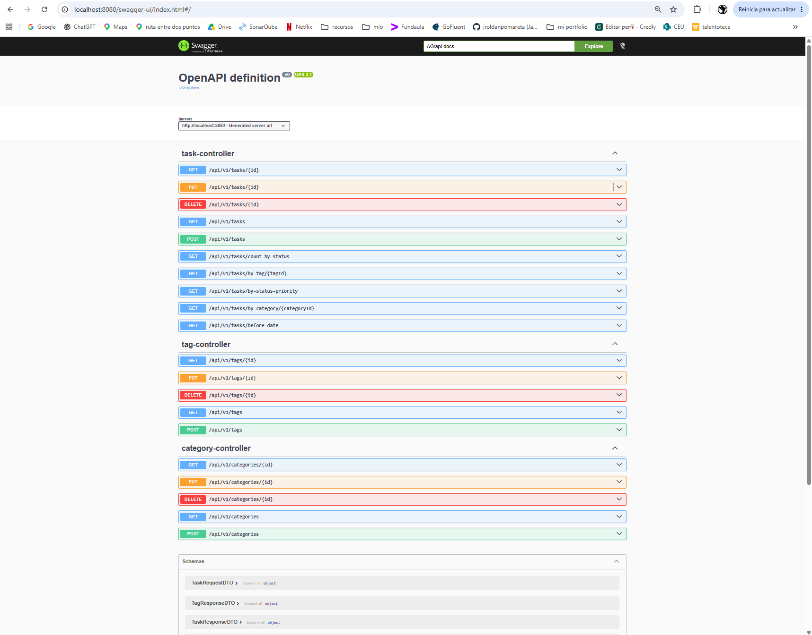
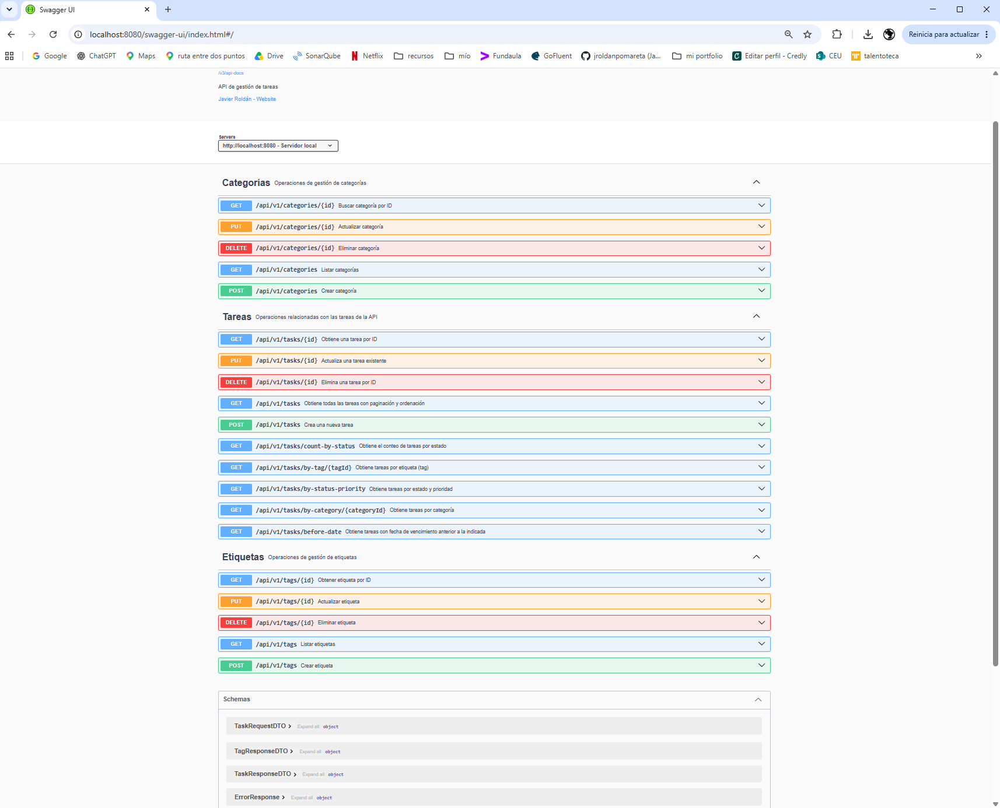
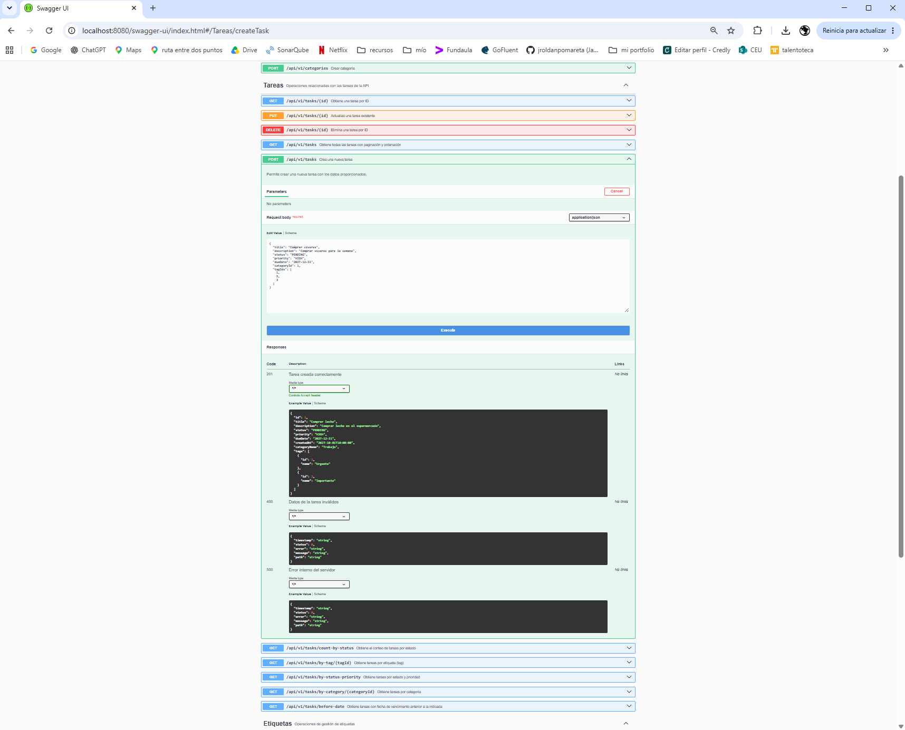
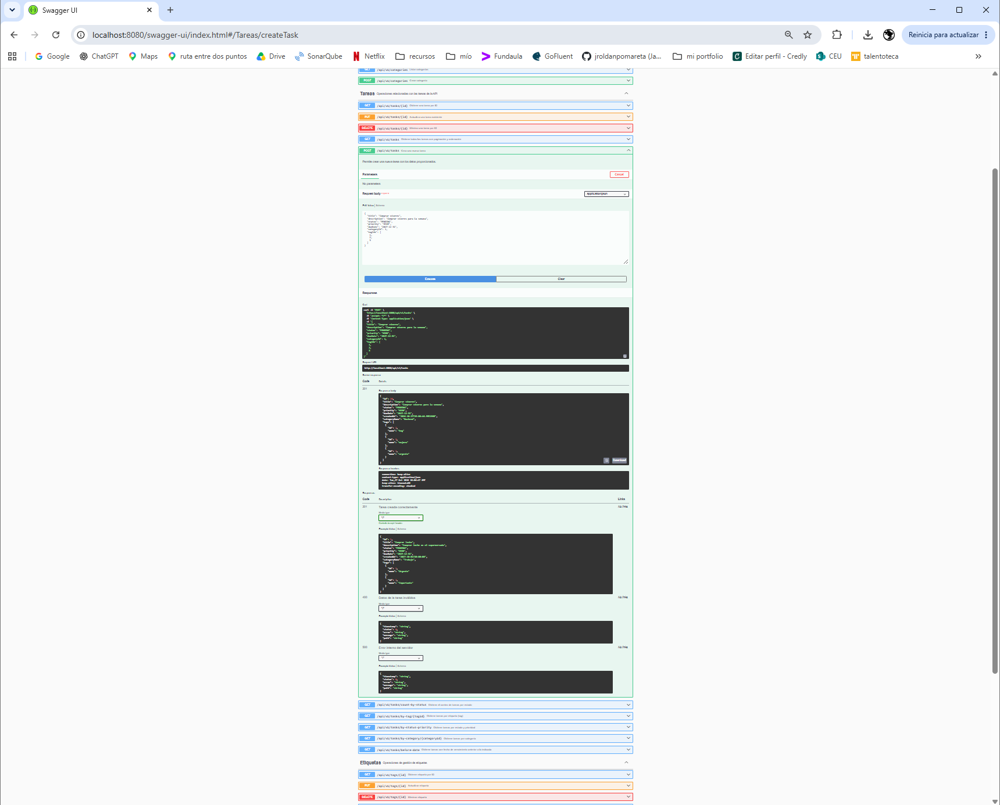
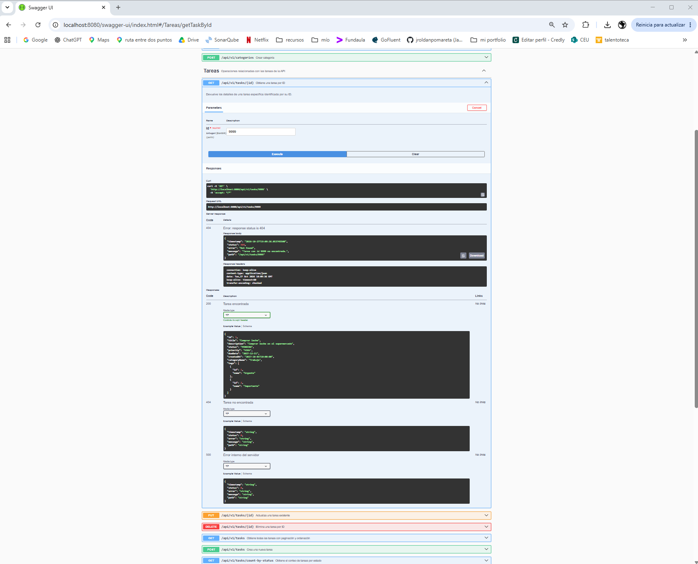

Paso 1 - Preparación (Ask)<br>
<br>
Pregunta:<br>
<br>
En mi proyecto Task Manager con Spring Boot 4.x, ¿qué son OpenAPI y Swagger, en qué se diferencian y qué función cumple springdoc-openapi? Explícalo con ejemplos sencillos aplicados a una API REST de tareas, categorías y tags. No generes código.<br>
<br>
Respuesta:<br>
<br>
OpenAPI<br>
OpenAPI es una especificación estándar para describir una API REST de forma estructurada.<br>
<br>
Define, entre otras cosas:<br>
<br>
rutas disponibles;<br>
métodos HTTP;<br>
parámetros;<br>
cuerpos JSON;<br>
respuestas;<br>
códigos HTTP;<br>
modelos de datos;<br>
requisitos de autenticación.<br>
Por ejemplo, la API de Task Manager podría documentar:

```
GET    /api/v1/tasks
GET    /api/v1/tasks/{id}
POST   /api/v1/tasks
PUT    /api/v1/tasks/{id}
DELETE /api/v1/tasks/{id}

GET    /api/v1/categories
GET    /api/v1/tags
```

OpenAPI también describiría que POST /api/v1/tasks recibe un TaskRequestDTO con:<br>
<br>
title;<br>
description;<br>
status;<br>
priority;<br>
dueDate;<br>
categoryId;<br>
tagIds.<br>
Y que devuelve un TaskResponseDTO, posiblemente con:<br>
<br>
id;<br>
title;<br>
status;<br>
priority;<br>
categoryName;<br>
lista de tags;<br>
createdAt.<br>
El documento OpenAPI suele representarse en formato JSON o YAML. No es la API en sí, sino su contrato descriptivo.<br>
<br>
Swagger<br>
Swagger es el nombre histórico de un conjunto de herramientas relacionadas con la documentación de APIs. Actualmente, la especificación estándar se llama OpenAPI, mientras que Swagger se utiliza principalmente para referirse a herramientas como:<br>
<br>
Swagger UI;<br>
Swagger Editor;<br>
Swagger Codegen.<br>
La diferencia puede resumirse así:<br>
<br>
Concepto	Función<br>
OpenAPI	Especificación y formato del contrato de la API<br>
Swagger	Herramientas que trabajan con esa especificación<br>
Swagger UI	Interfaz web para consultar y probar la API<br>
Por tanto, no son dos alternativas equivalentes. OpenAPI define cómo describir la API y Swagger proporciona herramientas para visualizarla o utilizarla.<br>
<br>
¿Qué hace springdoc-openapi?<br>
springdoc-openapi integra Spring Boot con OpenAPI.<br>
<br>
Analiza automáticamente elementos de la aplicación como:<br>
<br>
controladores @RestController;<br>
rutas @GetMapping, @PostMapping, etc.;<br>
parámetros @PathVariable y @RequestParam;<br>
cuerpos @RequestBody;<br>
DTOs;<br>
tipos de respuesta;<br>
códigos HTTP configurados;<br>
anotaciones de documentación adicionales.<br>
A partir de esa información genera un documento OpenAPI de la aplicación.<br>
<br>
Además, normalmente proporciona una interfaz Swagger UI para consultar la documentación y ejecutar peticiones desde el navegador.<br>
<br>
El flujo sería:

```
Controladores y DTOs de Spring
              ↓
       springdoc-openapi
              ↓
       documento OpenAPI
              ↓
          Swagger UI
```

Ejemplo aplicado a Task<br>
Sin documentación generada, un consumidor tendría que averiguar manualmente cómo usar el endpoint:

```
POST /api/v1/tasks
```

Con OpenAPI podría ver claramente:<br>
<br>
qué campos son obligatorios;<br>
qué valores acepta TaskStatus;<br>
qué valores acepta TaskPriority;<br>
que categoryId representa una categoría existente;<br>
que tagIds contiene IDs de etiquetas;<br>
qué respuesta se obtiene al crear la tarea;<br>
qué ocurre si la validación falla.<br>
Por ejemplo, la documentación podría indicar conceptualmente:

```
POST /api/v1/tasks

Entrada:
{
  "title": "Estudiar JPA",
  "status": "PENDING",
  "priority": "HIGH",
  "dueDate": "2026-11-01",
  "categoryId": 2,
  "tagIds": [1, 3]
}

Respuesta correcta:
201 Created

Errores posibles:
400 Bad Request  → datos inválidos
404 Not Found    → categoría o tag inexistente
```

Ejemplo aplicado a paginación<br>
Para:

```
GET /api/v1/tasks?page=0&size=10&sort=createdAt,desc
```

OpenAPI puede describir:<br>
<br>
page: número de página;<br>
size: cantidad de elementos;<br>
sort: campo y dirección;<br>
límite máximo de tamaño;<br>
estructura de la respuesta paginada;<br>
metadatos como totalElements y totalPages.<br>
Así el consumidor sabe cómo consultar tareas, categorías o tags sin leer el código fuente.<br>
<br>
¿Genera documentación automáticamente perfecta?<br>
No completamente. springdoc-openapi puede deducir gran parte de la información, pero puede necesitar configuración adicional para documentar con precisión:<br>
<br>
descripciones funcionales;<br>
ejemplos JSON;<br>
respuestas de error;<br>
códigos 404, 400 o 500;<br>
autenticación;<br>
restricciones particulares;<br>
diferencias entre TaskRequestDTO y TaskResponseDTO.<br>
Por ejemplo, Bean Validation puede ayudar a reflejar restricciones como:<br>
<br>
@NotBlank;<br>
@NotNull;<br>
@Size;<br>
@Future.<br>
Pero las reglas de negocio personalizadas, como “una tarea HIGH debe tener dueDate”, pueden necesitar documentación explícita.<br>
<br>
Consideración para Spring Boot 4.x<br>
En Spring Boot 4.x hay que utilizar una versión de springdoc-openapi compatible con esa versión de Spring Boot y con Spring Framework 7. No basta con copiar una versión antigua utilizada en proyectos con Spring Boot 2 o 3.<br>
<br>
La dependencia concreta debe comprobarse en la documentación oficial de springdoc-openapi y en su matriz de compatibilidad. Conceptualmente, su función no cambia: conectar la aplicación Spring con el estándar OpenAPI y exponer la documentación, normalmente mediante Swagger UI.<br>
<br>
En resumen:<br>

```
OpenAPI       → contrato estándar de la API
Swagger       → herramientas para trabajar con ese contrato
springdoc     → integración automática con Spring Boot
Swagger UI    → página web para consultar y probar Task Manager
```

Esto permite que la API de tareas, categorías y tags sea más fácil de entender, probar, integrar y mantener.<br>
<br>
Pregunta:<br>
<br>
En un proyecto Spring Boot 4.x con springdoc-openapi, ¿qué información de los controllers, endpoints, parámetros, DTOs y validaciones se documenta automáticamente sin anotaciones? ¿Qué información adicional merece la pena documentar explícitamente y por qué? No generes código.<br>
<br>
Con springdoc-openapi, gran parte de la documentación se genera inspeccionando el código de Spring MVC, los DTOs y sus anotaciones de validación.<br>
<br>
Información que suele documentarse automáticamente<br>
Controllers y endpoints<br>
Springdoc detecta:<br>
<br>
clases anotadas con @RestController;<br>
rutas base definidas con @RequestMapping;<br>
métodos HTTP: GET, POST, PUT, DELETE, etc.;<br>
rutas completas y variables como {id};<br>
parámetros @PathVariable, @RequestParam y @RequestHeader;<br>
cuerpos marcados con @RequestBody;<br>
tipos de retorno del método;<br>
parámetros opcionales y valores predeterminados que Spring pueda deducir.<br>
Por ejemplo, puede identificar automáticamente endpoints como:

```
GET    /api/v1/tasks
GET    /api/v1/tasks/{id}
POST   /api/v1/tasks
PUT    /api/v1/tasks/{id}
DELETE /api/v1/tasks/{id}
```

DTOs<br>
A partir de TaskRequestDTO y TaskResponseDTO, normalmente genera esquemas con:<br>
<br>
nombres de las propiedades;<br>
tipos Java traducidos a OpenAPI;<br>
fechas como date o date-time;<br>
enumeraciones como TaskStatus y TaskPriority;<br>
listas y objetos anidados;<br>
campos requeridos cuando puede deducirlo.<br>
También puede distinguir entre el DTO de entrada y el de salida, mostrando que TaskRequestDTO y TaskResponseDTO no tienen necesariamente los mismos campos.<br>
<br>
Validaciones estándar<br>
Las anotaciones de Bean Validation suelen reflejarse en el esquema:<br>
<br>
@NotNull: campo requerido;<br>
@NotBlank: campo de texto obligatorio;<br>
@Size: límites de longitud o tamaño;<br>
@Future: restricción temporal;<br>
@Min, @Max, @Positive, etc.<br>
Por ejemplo, puede indicar que title es obligatorio y que tagIds tiene un tamaño máximo.<br>
<br>
La precisión depende de la versión compatible de springdoc-openapi, del tipo de anotación y de cómo esté configurado el proyecto.<br>
<br>
Información que no suele quedar suficientemente documentada<br>
La generación automática no conoce por completo la intención funcional de la API. Merece la pena documentar explícitamente:<br>
<br>
Descripciones funcionales<br>
El nombre findByStatus no explica necesariamente qué representa un estado ni qué valores acepta. Conviene describir:<br>
<br>
el propósito del endpoint;<br>
el significado de cada parámetro;<br>
el comportamiento esperado;<br>
ejemplos de uso.<br>
Códigos HTTP posibles<br>
Springdoc puede deducir el tipo de respuesta principal, pero no siempre conoce todos los resultados posibles. Conviene documentar expresamente:<br>
<br>
200 OK;<br>
201 Created;<br>
204 No Content;<br>
400 Bad Request;<br>
404 Not Found;<br>
409 Conflict;<br>
500 Internal Server Error.<br>
Por ejemplo, en una creación de tarea es importante explicar que puede devolver 404 si categoryId o algún tagId no existe.<br>
<br>
Respuestas de error<br>
Las excepciones gestionadas por GlobalExceptionHandler, como:<br>
<br>
TaskNotFoundException;<br>
MethodArgumentNotValidException;<br>
errores inesperados;<br>
deberían documentarse con su estructura ErrorResponse:<br>
<br>
fecha y hora;<br>
código HTTP;<br>
descripción;<br>
mensaje;<br>
ruta;<br>
errores por campo.<br>
Springdoc no siempre puede inferir automáticamente la relación entre cada excepción y el JSON final.<br>
<br>
Reglas de negocio<br>
Las validaciones estándar pueden aparecer en el esquema, pero una regla personalizada como:

```
Una tarea con prioridad HIGH debe tener dueDate.
```

no siempre queda explicada de forma útil. También deben documentarse reglas como:<br>
<br>
una categoría debe existir;<br>
todos los tagIds deben corresponder a tags existentes;<br>
una etiqueta no se elimina al quitar una asociación;<br>
una categoría con tareas puede no poder eliminarse.<br>
Paginación y ordenación<br>
Springdoc puede detectar Pageable, page, size y sort, pero conviene explicar:<br>
<br>
que la numeración empieza en cero;<br>
el tamaño predeterminado;<br>
el tamaño máximo;<br>
los campos permitidos para ordenar;<br>
el formato de sort;<br>
la estructura real de PagedResponseDTO;<br>
qué sucede si se solicita una página vacía.<br>
Ejemplos<br>
Los ejemplos son especialmente útiles para:<br>
<br>
crear una tarea;<br>
actualizar una tarea;<br>
asociar categorías y tags;<br>
representar enums;<br>
mostrar respuestas paginadas;<br>
mostrar errores de validación.<br>
Un esquema indica tipos, pero un ejemplo aclara cómo debe usarse realmente la API.<br>
<br>
Autenticación y permisos<br>
Si posteriormente se añade seguridad, debe documentarse:<br>
<br>
cómo enviar el token;<br>
qué endpoints requieren autenticación;<br>
qué roles pueden crear, modificar o borrar;<br>
qué respuesta se devuelve ante 401 o 403.<br>
Relaciones y DTOs<br>
Conviene aclarar que:<br>
<br>
TaskRequestDTO recibe categoryId y tagIds;<br>
TaskResponseDTO devuelve categoryName y datos resumidos de tags;<br>
no se aceptan entidades Category o Tag completas;<br>
las relaciones no se serializan recursivamente.<br>
Resumen<br>
Información	¿Se genera normalmente?<br>
Rutas y métodos HTTP	Sí<br>
Path variables y query parameters	Sí<br>
Tipos de DTO	Sí<br>
Enumeraciones	Sí<br>
Restricciones estándar	Generalmente sí<br>
Descripciones de negocio	No suficientemente<br>
Reglas condicionales personalizadas	No siempre<br>
Errores y sus códigos	Parcialmente<br>
Formato de ErrorResponse	Conviene declararlo<br>
Ejemplos de peticiones y respuestas	Conviene añadirlos<br>
Paginación detallada	Conviene explicarla<br>
Autorización y permisos	Debe documentarse explícitamente<br>
En resumen, springdoc-openapi describe bastante bien la estructura técnica de la API, pero las anotaciones explícitas son necesarias para comunicar su significado funcional, los errores posibles, las reglas de negocio y los ejemplos que necesitan los consumidores.<br>
<br>
Pregunta:<br>
<br>
Explica la función y las diferencias entre @OpenAPIDefinition, @Tag, @Operation, @ApiResponse y @Schema en springdoc-openapi. ¿Dónde conviene utilizar cada una en una API REST de tareas, categorías y tags, y qué ventajas aporta documentar los códigos HTTP y los ejemplos de los DTOs? No generes código.<br>
<br>
Respuesta:<br>
<br>
Estas anotaciones pertenecen a io.swagger.v3.oas.annotations y permiten complementar la documentación automática de springdoc-openapi.<br>
<br>
@OpenAPIDefinition<br>
Describe la API completa a nivel global.<br>
<br>
Se utiliza para definir:<br>
<br>
título;<br>
descripción;<br>
versión;<br>
información de contacto;<br>
licencia;<br>
servidores;<br>
etiquetas globales.<br>
En Task Manager serviría para documentar que la API gestiona tareas, categorías y tags, indicar su versión, por ejemplo v1, y explicar brevemente su propósito.<br>
<br>
Es una anotación de configuración general, no de un endpoint concreto.<br>
<br>
@Tag<br>
Agrupa y clasifica endpoints relacionados.<br>
<br>
Conviene utilizarla en los controllers:<br>
<br>
TaskController: operaciones sobre tareas;<br>
CategoryController: operaciones sobre categorías;<br>
TagController: operaciones sobre etiquetas.<br>
En Swagger UI los endpoints aparecen agrupados bajo esas categorías, lo que facilita navegar por la documentación.<br>
<br>
La diferencia con @OpenAPIDefinition es el alcance:<br>
<br>
@OpenAPIDefinition: información global de toda la API.<br>
@Tag: clasificación de un grupo de operaciones.<br>
@Operation<br>
Documenta una operación concreta de un controller.<br>
<br>
Permite indicar:<br>
<br>
resumen;<br>
descripción;<br>
identificador de operación;<br>
etiquetas;<br>
posibles respuestas;<br>
parámetros relacionados;<br>
si la operación está obsoleta.<br>
En Task Manager se aplicaría, por ejemplo, a:<br>
<br>
listar tareas;<br>
obtener una tarea por ID;<br>
crear una tarea;<br>
actualizarla;<br>
eliminarla;<br>
buscar por categoría o por tag.<br>
Es especialmente útil cuando el nombre del método Java no explica completamente el comportamiento del endpoint. Por ejemplo, una descripción puede aclarar que tagIds reemplaza la colección completa de etiquetas o que categoryId debe referirse a una categoría existente.<br>
<br>
@ApiResponse<br>
Documenta una respuesta HTTP concreta de una operación.<br>
<br>
Se utiliza normalmente asociada a @Operation para explicar:<br>
<br>
código HTTP;<br>
descripción;<br>
contenido de la respuesta;<br>
esquema devuelto;<br>
casos de error.<br>
En una API de tareas convendría documentar, según cada endpoint:<br>
<br>
200 OK: consulta o actualización correcta;<br>
201 Created: tarea creada;<br>
204 No Content: eliminación correcta;<br>
400 Bad Request: JSON o datos de validación incorrectos;<br>
404 Not Found: tarea, categoría o tag inexistente;<br>
409 Conflict: conflicto de negocio, por ejemplo una categoría que no puede eliminarse;<br>
500 Internal Server Error: error inesperado.<br>
Documentar estos códigos evita que los consumidores tengan que deducir el comportamiento observando errores reales o leyendo el código fuente.<br>
<br>
@Schema<br>
Describe un modelo o una propiedad dentro del modelo OpenAPI.<br>
<br>
Puede aplicarse a:<br>
<br>
DTOs;<br>
campos;<br>
propiedades;<br>
enumeraciones;<br>
modelos de error.<br>
Permite documentar:<br>
<br>
descripción de un campo;<br>
ejemplo;<br>
valor por defecto;<br>
formato;<br>
longitud mínima o máxima;<br>
si es obligatorio;<br>
valores permitidos;<br>
nombre público del campo.<br>
En este proyecto sería útil para:<br>
<br>
TaskRequestDTO;<br>
TaskResponseDTO;<br>
TagRequestDTO;<br>
TagResponseDTO;<br>
PagedResponseDTO;<br>
ErrorResponse;<br>
TaskStatus y TaskPriority.<br>
Por ejemplo, podría explicar que:<br>
<br>
categoryId es el identificador de una categoría existente;<br>
tagIds contiene IDs de etiquetas;<br>
createdAt lo genera el servidor;<br>
priority acepta valores como LOW, MEDIUM y HIGH;<br>
dueDate es obligatoria cuando la prioridad es HIGH.<br>
Diferencias resumidas<br>
Anotación	Alcance	Función principal<br>
@OpenAPIDefinition	API completa	Metadatos globales<br>
@Tag	Controller o grupo	Agrupar operaciones<br>
@Operation	Endpoint	Describir una operación<br>
@ApiResponse	Respuesta de endpoint	Documentar códigos y cuerpos HTTP<br>
@Schema	DTO, modelo o campo	Describir estructuras y propiedades<br>
Aplicación por capas documentales<br>
Una organización habitual sería:<br>

```
API completa
└── @OpenAPIDefinition

Controllers
└── @Tag

Métodos de endpoints
└── @Operation

Respuestas de cada endpoint
└── @ApiResponse

DTOs y sus campos
└── @Schema
```

Ventajas de documentar ejemplos de DTOs<br>
Los tipos Java indican la estructura, pero los ejemplos muestran cómo debe utilizarse realmente la API.<br>
<br>
Un ejemplo de TaskRequestDTO puede aclarar:

```
status: PENDING
priority: HIGH
categoryId: 2
tagIds: [1, 3]
dueDate: fecha futura
```

Un ejemplo de TaskResponseDTO puede mostrar que la API devuelve:

```
categoryName
tags resumidos
createdAt generado por el servidor
```

Esto ayuda a:<br>
<br>
reducir errores de integración;<br>
aclarar el formato de fechas;<br>
mostrar los valores válidos de los enums;<br>
diferenciar campos de entrada y salida;<br>
explicar relaciones sin exponer entidades JPA;<br>
permitir probar rápidamente los endpoints desde Swagger UI.<br>
Ventajas de documentar códigos HTTP<br>
Los consumidores necesitan saber no solo qué ocurre cuando todo funciona, sino también cómo interpretar los errores.<br>
<br>
Por ejemplo:

```
POST /tasks
201 → tarea creada
400 → datos inválidos
404 → categoría o tag inexistente
```

Esto permite que un frontend, cliente móvil o servicio externo:<br>
<br>
muestre mensajes adecuados;<br>
distinga errores corregibles de errores del servidor;<br>
implemente reintentos solo cuando tenga sentido;<br>
trate correctamente una respuesta vacía;<br>
conozca el formato esperado de ErrorResponse.<br>
En resumen, springdoc-openapi puede descubrir la estructura técnica automáticamente, pero estas anotaciones aportan contexto funcional, respuestas completas, ejemplos claros y un contrato mucho más útil para quienes consumen la API.

---
Paso 2 - Añadir dependencia:<br>
<br>
Pregunta al modo Ask:<br>
<br>
<dependency> <groupId>org.springdoc</groupId> <artifactId>springdoc-openapi-starter-webmvc-ui</artifactId> <version>3.1.x</version> </dependency>dame la version mas reciente de esta dependencia<br>
<br>
Resultado:

```
<dependency>
    <groupId>org.springdoc</groupId>
    <artifactId>springdoc-openapi-starter-webmvc-ui</artifactId>
    <version>3.2.0</version>
</dependency>
```

Comprobación de que swagger muestra los endpoints



---
<br>
Paso 3 - Diseño previo<br>
<br>
Pregunta:<br>
<br>
¿Qué controllers y endpoints anotarás con @Operation y @ApiResponse?<br>
<br>
Respuesta:<br>
<br>
Documentaré los tres controllers de la aplicación: TaskController, CategoryController y TagController.<br>
<br>
Añadiré @Tag a cada controller para agrupar sus endpoints en Swagger UI. En cada método del controller utilizaré @Operation para describir la operación y @ApiResponse para documentar los códigos HTTP y el resultado esperado.<br>
<br>
Incluiré las respuestas que correspondan al comportamiento real de cada endpoint, como 200, 201, 204, 400 y 404 cuando proceda. También documentaré los parámetros de paginación, filtros y ordenación que existan.<br>
<br>
Pregunta:<br>
<br>
¿Qué campos de los DTOs enriquecerás con @Schema?<br>
<br>
Respuesta:<br>
<br>
Revisaré los DTOs de entrada (Request) y salida (Response) de tareas, categorías y tags.<br>
<br>
Utilizaré @Schema únicamente en los campos cuya finalidad, significado o formato necesite aclaración, indicando description y example. No duplicaré las restricciones de validación que springdoc obtiene de las anotaciones existentes.<br>
<br>
Pregunta:<br>
<br>
¿Qué comentario exacto escribirás para que el autocompletado lo genere?<br>
<br>
Respuesta:<br>
<br>
//Añade documentación OpenAPI a esta clase con @Tag y a cada método con @Operation y @ApiResponse, documentando en español el propósito de cada endpoint y sus códigos HTTP reales. Para las respuestas 400 y 404, incluye el esquema ErrorResponse mediante @Content y @Schema(implementation = ErrorResponse.class). No modifiques la lógica existente. — generado por IA

---
Paso 4 - Implementación (autocompletado)<br>
<br>
Comentario en TaskController:<br>
<br>
// Documenta este controller con @Tag, indicando que agrupa las operaciones relacionadas con las tareas de la API. Utiliza un nombre y una descripción en español. No modifiques la lógica existente. — generado por IA<br>
<br>
Resultado:

```
// Documenta este controller con @Tag, indicando que agrupa las operaciones relacionadas con las tareas de la API. Utiliza un nombre y una descripción en español. No modifiques la lógica existente. — generado por IA
@Tag(name = "Tareas", description = "Operaciones relacionadas con las tareas de la API")
@RestController
@RequestMapping("/api/v1/tasks")
public class TaskController {
```

Comentario en getAllTasks:<br>
<br>
// Añade tres anotaciones @ApiResponse: una para el código 200 con la respuesta paginada, otra para el 400 y otra para el 500. En las respuestas de error utiliza @Content(schema = @Schema(implementation = ErrorResponse.class)). No modifiques el método. — generado por IA<br>
<br>
Resultado:

```
    // Añade tres anotaciones @ApiResponse: una para el código 200 con la respuesta paginada, otra para el 400 y otra para el 500. En las respuestas de error utiliza @Content(schema = @Schema(implementation = ErrorResponse.class)). No modifiques el método. — generado por IA
    @Operation(summary = "Obtiene todas las tareas con paginación y ordenación", 
               description = "Devuelve una lista paginada de tareas, con opciones de ordenación y tamaño de página.")
    @ApiResponse(responseCode = "200", description = "Tareas encontradas", content = @Content(schema = @Schema(implementation = PagedResponseDTO.class)))
    @ApiResponse(responseCode = "400", description = "Solicitud inválida", content = @Content(schema = @Schema(implementation = ErrorResponse.class)))
    @ApiResponse(responseCode = "500", description = "Error interno del servidor", content = @Content(schema = @Schema(implementation = ErrorResponse.class)))
    @GetMapping
    public ResponseEntity<PagedResponseDTO<TaskResponseDTO>> getAllTasks(
            @RequestParam(defaultValue = "0") int page,
            @RequestParam(defaultValue = "10") int size,
            @RequestParam(defaultValue = "createdAt,desc") String sort) {

        size = Math.min(size, 100);
        String[] sortParams = sort.split(",");
        Pageable pageable = PageRequest.of(
                page,
                size,
                Sort.by(Sort.Direction.fromString(sortParams[1]), sortParams[0]));

        PagedResponseDTO<TaskResponseDTO> tasks = taskService.findAll(pageable);
        return new ResponseEntity<>(tasks, HttpStatus.OK);
    }
```

Comentario en getTaskById:<br>
<br>
// Añade @Operation y @ApiResponse para documentar en español la consulta de una tarea por ID, incluyendo las respuestas 200, 404 y 500 que correspondan al comportamiento real; en los errores 404 y 500 utiliza ErrorResponse mediante @Content y @Schema(implementation = ErrorResponse.class), sin modificar la lógica existente. — generado por IA<br>
<br>
Resultado:


```
    // Añade @Operation y @ApiResponse para documentar en español la consulta de una tarea por ID, incluyendo las respuestas 200, 404 y 500 que correspondan al comportamiento real; en los errores 404 y 500 utiliza ErrorResponse mediante @Content y @Schema(implementation = ErrorResponse.class), sin modificar la lógica existente. — generado por IA
    @Operation(
            summary = "Obtiene una tarea por ID",
            description = "Devuelve los detalles de una tarea específica identificada por su ID."
    )
    @ApiResponse(responseCode = "200", description = "Tarea encontrada", content = @Content(schema = @Schema(implementation = TaskResponseDTO.class)))
    @ApiResponse(responseCode = "404", description = "Tarea no encontrada", content = @Content(schema = @Schema(implementation = ErrorResponse.class)))
    @ApiResponse(responseCode = "500", description = "Error interno del servidor", content = @Content(schema = @Schema(implementation = ErrorResponse.class))) 
    @GetMapping("/{id}")
    public ResponseEntity<TaskResponseDTO> getTaskById(@PathVariable Long id) {
        TaskResponseDTO task = taskService.findById(id);
        return new ResponseEntity<>(task, HttpStatus.OK);
    }
```

Comentario en createTask:<br>
<br>
// Añade @Operation y @ApiResponse para documentar en español la creación de una tarea, incluyendo las respuestas HTTP 201 y los errores que realmente pueda producir; para los errores 400 y 500 utiliza ErrorResponse mediante @Content y @Schema(implementation = ErrorResponse.class), sin modificar la lógica existente. — generado por IA<br>
<br>
Resultado:

```
    // Añade @Operation y @ApiResponse para documentar en español la creación de una tarea, incluyendo las respuestas HTTP 201 y los errores que realmente pueda producir; para los errores 400 y 500 utiliza ErrorResponse mediante @Content y @Schema(implementation = ErrorResponse.class), sin modificar la lógica existente. — generado por IA
    
    @Operation(
            summary = "Crea una nueva tarea",
            description = "Permite crear una nueva tarea con los datos proporcionados."
    )
    @ApiResponse(responseCode = "201", description = "Tarea creada correctamente", content = @Content(schema = @Schema(implementation = TaskResponseDTO.class)))
    @ApiResponse(responseCode = "400", description = "Datos de la tarea inválidos", content = @Content(schema = @Schema(implementation = ErrorResponse.class)))
    @ApiResponse(responseCode = "500", description = "Error interno del servidor", content = @Content(schema = @Schema(implementation = ErrorResponse.class)))
    @PostMapping
    public ResponseEntity<TaskResponseDTO> createTask(@RequestBody @Valid TaskRequestDTO task) {
        TaskResponseDTO createdTask = taskService.create(task);
        return new ResponseEntity<>(createdTask, HttpStatus.CREATED);
    }
```

Comentario en updateTask:<br>
<br>
// Documenta este endpoint de actualización de tareas con @Operation y @ApiResponse. Describe en español su propósito, el parámetro id, el cuerpo TaskRequestDTO y la respuesta HTTP 200 con TaskResponseDTO. Documenta también las respuestas HTTP 400, 404 y 500 cuando correspondan al comportamiento real, utilizando ErrorResponse mediante @Content(schema = @Schema(implementation = ErrorResponse.class)) para los errores. No modifiques la lógica existente ni las validaciones. — generado por IA<br>
<br>
Resultado:

```
    // Documenta este endpoint de actualización de tareas con @Operation y @ApiResponse. Describe en español su propósito, el parámetro id, el cuerpo TaskRequestDTO y la respuesta HTTP 200 con TaskResponseDTO. Documenta también las respuestas HTTP 400, 404 y 500 cuando correspondan al comportamiento real, utilizando ErrorResponse mediante @Content(schema = @Schema(implementation = ErrorResponse.class)) para los errores. No modifiques la lógica existente ni las validaciones. — generado por IA
    @Operation(
            summary = "Actualiza una tarea existente",
            description = "Permite actualizar los datos de una tarea específica identificada por su ID."
    )
    @ApiResponse(responseCode = "200", description = "Tarea actualizada correctamente", content = @Content(schema = @Schema(implementation = TaskResponseDTO.class)))
    @ApiResponse(responseCode = "400", description = "Solicitud inválida", content = @Content(schema = @Schema(implementation = ErrorResponse.class)))
    @ApiResponse(responseCode = "404", description = "Tarea no encontrada", content = @Content(schema = @Schema(implementation = ErrorResponse.class)))
    @ApiResponse(responseCode = "500", description = "Error interno del servidor", content = @Content(schema = @Schema(implementation = ErrorResponse.class)))
    @PutMapping("/{id}")
    public ResponseEntity<TaskResponseDTO> updateTask(
            @PathVariable Long id,
            @RequestBody @Valid TaskRequestDTO task) {

        TaskResponseDTO updatedTask = taskService.update(id, task);
        return new ResponseEntity<>(updatedTask, HttpStatus.OK);
    }
```

Comentario en deleteTask:<br>
<br>
// Documenta este endpoint de eliminación de tareas con @Operation y @ApiResponse. Describe en español su propósito, el parámetro id y la respuesta HTTP 204 sin cuerpo. Documenta también las respuestas HTTP 404 y 500 cuando correspondan al comportamiento real, utilizando ErrorResponse mediante @Content(schema = @Schema(implementation = ErrorResponse.class)) para los errores. No modifiques la lógica existente. — generado por IA<br>
<br>
Resultado:

```
    // Documenta este endpoint de eliminación de tareas con @Operation y @ApiResponse. Describe en español su propósito, el parámetro id y la respuesta HTTP 204 sin cuerpo. Documenta también las respuestas HTTP 404 y 500 cuando correspondan al comportamiento real, utilizando ErrorResponse mediante @Content(schema = @Schema(implementation = ErrorResponse.class)) para los errores. No modifiques la lógica existente. — generado por IA
    @Operation(
            summary = "Elimina una tarea por ID",
            description = "Permite eliminar una tarea específica identificada por su ID."
    )
    @ApiResponse(responseCode = "204", description = "Tarea eliminada correctamente", content = @Content)
    @ApiResponse(responseCode = "404", description = "Tarea no encontrada", content = @Content(schema = @Schema(implementation = ErrorResponse.class)))
    @ApiResponse(responseCode = "500", description = "Error interno del servidor", content = @Content(schema = @Schema(implementation = ErrorResponse.class)))
    @DeleteMapping("/{id}")
    public ResponseEntity<Void> deleteTask(@PathVariable Long id) {
        taskService.delete(id);
        return new ResponseEntity<>(HttpStatus.NO_CONTENT);
    }
```

Comentario en getTasksByCategoryId:<br>
<br>
// Documenta este endpoint con @Operation y @ApiResponse. Describe en español la consulta paginada de tareas por categoría, el parámetro categoryId y los parámetros page, size y sort, incluyendo la respuesta HTTP 200 y los errores 400, 404 y 500 cuando correspondan al comportamiento real; utiliza ErrorResponse mediante @Content(schema = @Schema(implementation = ErrorResponse.class)) para los errores. No modifiques la lógica existente. — generado por IA<br>
<br>
Resultado:

```
    // Documenta este endpoint con @Operation y @ApiResponse. Describe en español la consulta paginada de tareas por categoría, el parámetro categoryId y los parámetros page, size y sort, incluyendo la respuesta HTTP 200 y los errores 400, 404 y 500 cuando correspondan al comportamiento real; utiliza ErrorResponse mediante @Content(schema = @Schema(implementation = ErrorResponse.class)) para los errores. No modifiques la lógica existente. — generado por IA
    @Operation(
            summary = "Obtiene tareas por categoría",
            description = "Devuelve una lista paginada de tareas filtradas por la categoría especificada."
    )
    @ApiResponse(responseCode = "200", description = "Tareas obtenidas correctamente", content = @Content(schema = @Schema(implementation = PagedResponseDTO.class)))
    @ApiResponse(responseCode = "400", description = "Solicitud inválida", content = @Content(schema = @Schema(implementation = ErrorResponse.class)))
    @ApiResponse(responseCode = "404", description = "Categoría no encontrada", content = @Content(schema = @Schema(implementation = ErrorResponse.class)))
    @ApiResponse(responseCode = "500", description = "Error interno del servidor", content = @Content(schema = @Schema(implementation = ErrorResponse.class)))
    @GetMapping("/by-category/{categoryId}")
    public ResponseEntity<PagedResponseDTO<TaskResponseDTO>> getTasksByCategoryId(
            @PathVariable Long categoryId,
            @RequestParam(defaultValue = "0") int page,
            @RequestParam(defaultValue = "10") int size,
            @RequestParam(defaultValue = "createdAt,desc") String sort) {

        size = Math.min(size, 100);
        String[] sortParams = sort.split(",");
        Pageable pageable = PageRequest.of(
                page,
                size,
                Sort.by(Sort.Direction.fromString(sortParams[1]), sortParams[0]));

        PagedResponseDTO<TaskResponseDTO> tasks =
        taskService.findByCategoryId(categoryId, pageable);
        return ResponseEntity.ok(tasks);
    }
```

Comentario en getTasksByTagId:<br>
<br>
// Documenta este endpoint con @Operation y @ApiResponse. Describe en español la consulta paginada de tareas por tag, el parámetro tagId y los parámetros page, size y sort, incluyendo la respuesta HTTP 200 y los errores 400, 404 y 500 cuando correspondan al comportamiento real; utiliza ErrorResponse mediante @Content(schema = @Schema(implementation = ErrorResponse.class)) para los errores. No modifiques la lógica existente. — generado por IA<br>
<br>
Resultado:

```
    // Documenta este endpoint con @Operation y @ApiResponse. Describe en español la consulta paginada de tareas por tag, el parámetro tagId y los parámetros page, size y sort, incluyendo la respuesta HTTP 200 y los errores 400, 404 y 500 cuando correspondan al comportamiento real; utiliza ErrorResponse mediante @Content(schema = @Schema(implementation = ErrorResponse.class)) para los errores. No modifiques la lógica existente. — generado por IA
    @Operation(
            summary = "Obtiene tareas por etiqueta (tag)",
            description = "Devuelve una lista paginada de tareas filtradas por la etiqueta especificada."
    )
    @ApiResponse(responseCode = "200", description = "Tareas obtenidas correctamente", content = @Content(schema = @Schema(implementation = Page.class)))
    @ApiResponse(responseCode = "400", description = "Solicitud inválida", content = @Content(schema = @Schema(implementation = ErrorResponse.class)))
    @ApiResponse(responseCode = "404", description = "Etiqueta no encontrada", content = @Content(schema = @Schema(implementation = ErrorResponse.class)))
    @ApiResponse(responseCode = "500", description = "Error interno del servidor", content = @Content(schema = @Schema(implementation = ErrorResponse.class)))
    @GetMapping("/by-tag/{tagId}")
    public ResponseEntity<Page<Task>> getTasksByTagId(
            @PathVariable Long tagId,
            @RequestParam(defaultValue = "0") int page,
            @RequestParam(defaultValue = "10") int size,
            @RequestParam(defaultValue = "createdAt,desc") String sort) {

        size = Math.min(size, 100);
        String[] sortParams = sort.split(",");
        Pageable pageable = PageRequest.of(
                page,
                size,
                Sort.by(Sort.Direction.fromString(sortParams[1]), sortParams[0]));

        Page<Task> tasks = taskService.findByTagId(tagId, pageable);
        return new ResponseEntity<>(tasks, HttpStatus.OK);
    }
```

Comentario en getTasksByStatusAndPriority:<br>
<br>
// Documenta este endpoint con @Operation y @ApiResponse. Describe en español la consulta paginada de tareas por estado y prioridad, los parámetros status, priority, page, size y sort, la respuesta HTTP 200 y los errores 400 y 500 cuando correspondan al comportamiento real; utiliza ErrorResponse mediante @Content(schema = @Schema(implementation = ErrorResponse.class)) para los errores. No modifiques la lógica existente. — generado por IA<br>
<br>
Resultado:

```
    // Documenta este endpoint con @Operation y @ApiResponse. Describe en español la consulta paginada de tareas por estado y prioridad, los parámetros status, priority, page, size y sort, la respuesta HTTP 200 y los errores 400 y 500 cuando correspondan al comportamiento real; utiliza ErrorResponse mediante @Content(schema = @Schema(implementation = ErrorResponse.class)) para los errores. No modifiques la lógica existente. — generado por IA
    @Operation(
            summary = "Obtiene tareas por estado y prioridad",
            description = "Devuelve una lista paginada de tareas filtradas por el estado y la prioridad especificados."
    )
    @ApiResponse(responseCode = "200", description = "Tareas obtenidas correctamente", content = @Content(schema = @Schema(implementation = Page.class)))
    @ApiResponse(responseCode = "400", description = "Solicitud inválida", content = @Content(schema = @Schema(implementation = ErrorResponse.class)))
    @ApiResponse(responseCode = "500", description = "Error interno del servidor", content = @Content(schema = @Schema(implementation = ErrorResponse.class)))
    @GetMapping("/by-status-priority")
    public ResponseEntity<Page<Task>> getTasksByStatusAndPriority(
            @RequestParam TaskStatus status,
            @RequestParam TaskPriority priority,
            @RequestParam(defaultValue = "0") int page,
            @RequestParam(defaultValue = "10") int size,
            @RequestParam(defaultValue = "createdAt,desc") String sort) {

        size = Math.min(size, 100);
        String[] sortParams = sort.split(",");
        Pageable pageable = PageRequest.of(
                page,
                size,
                Sort.by(Sort.Direction.fromString(sortParams[1]), sortParams[0]));

        Page<Task> tasks = taskService.findByStatusAndPriority(
                status.name(), priority.name(), pageable);
        return new ResponseEntity<>(tasks, HttpStatus.OK);
    }
```

Comentario en getTasksByDueDateBefore:<br>
<br>
// Documenta este endpoint con @Operation y @ApiResponse. Describe en español la consulta de tareas cuya fecha de vencimiento es anterior a la fecha indicada, el parámetro date y la respuesta HTTP 200; documenta también los errores 400 y 500 cuando correspondan al comportamiento real, utilizando ErrorResponse mediante @Content(schema = @Schema(implementation = ErrorResponse.class)) para los errores. No modifiques la lógica existente. — generado por IA<br>
<br>
Resultado:

```
    // Documenta este endpoint con @Operation y @ApiResponse. Describe en español la consulta de tareas cuya fecha de vencimiento es anterior a la fecha indicada, el parámetro date y la respuesta HTTP 200; documenta también los errores 400 y 500 cuando correspondan al comportamiento real, utilizando ErrorResponse mediante @Content(schema = @Schema(implementation = ErrorResponse.class)) para los errores. No modifiques la lógica existente. — generado por IA
    @Operation(
            summary = "Obtiene tareas con fecha de vencimiento anterior a la indicada",
            description = "Devuelve una lista de tareas cuya fecha de vencimiento es anterior a la fecha especificada."
    )
    @ApiResponse(responseCode = "200", description = "Tareas obtenidas correctamente", content = @Content(schema = @Schema(implementation = Iterable.class)))
    @ApiResponse(responseCode = "400", description = "Solicitud inválida", content = @Content(schema = @Schema(implementation = ErrorResponse.class)))
    @ApiResponse(responseCode = "500", description = "Error interno del servidor", content = @Content(schema = @Schema(implementation = ErrorResponse.class)))
    @GetMapping("/before-date")
    public ResponseEntity<Iterable<Task>> getTasksByDueDateBefore(@RequestParam java.time.LocalDate date) {
        Iterable<Task> tasks = taskService.findByDueDateBefore(date);
        return new ResponseEntity<>(tasks, HttpStatus.OK);
    }
```

Comentario en getTaskCountByStatus:<br>
<br>
// Documenta este endpoint con @Operation y @ApiResponse. Describe en español el recuento de tareas por estado, el parámetro status y la respuesta HTTP 200 con el número obtenido; documenta también los errores 400 y 500 cuando correspondan al comportamiento real, utilizando ErrorResponse mediante @Content(schema = @Schema(implementation = ErrorResponse.class)) para los errores. No modifiques la lógica existente. — generado por IA<br>
<br>
Resultado:

```
    // Documenta este endpoint con @Operation y @ApiResponse. Describe en español el recuento de tareas por estado, el parámetro status y la respuesta HTTP 200 con el número obtenido; documenta también los errores 400 y 500 cuando correspondan al comportamiento real, utilizando ErrorResponse mediante @Content(schema = @Schema(implementation = ErrorResponse.class)) para los errores. No modifiques la lógica existente. — generado por IA
    @Operation(
            summary = "Obtiene el conteo de tareas por estado",
            description = "Devuelve el número total de tareas que tienen el estado especificado."
    )
    @ApiResponse(responseCode = "200", description = "Conteo de tareas obtenido correctamente", content = @Content(schema = @Schema(implementation = Long.class)))
    @ApiResponse(responseCode = "400", description = "Solicitud inválida", content = @Content(schema = @Schema(implementation = ErrorResponse.class)))
    @ApiResponse(responseCode = "500", description = "Error interno del servidor", content = @Content(schema = @Schema(implementation = ErrorResponse.class)))
    @GetMapping("/count-by-status")
    public ResponseEntity<Long> getTaskCountByStatus(@RequestParam TaskStatus status) {
        long count = taskService.getCountByStatus(status);
        return new ResponseEntity<>(count, HttpStatus.OK);
    }
```

Comentario en CategoryController:<br>
<br>
// Documenta este controller con @Tag, indicando en español que agrupa las operaciones de gestión de categorías de la API. No modifiques la lógica existente. — generado por IA<br>
<br>
Resultado:

```
// Documenta este controller con @Tag, indicando en español que agrupa las operaciones de gestión de categorías de la API. No modifiques la lógica existente. — generado por IA
@Tag(name = "Categorías", description = "Operaciones de gestión de categorías")
@RestController 
@RequestMapping ("/api/v1/categories")
public class CategoryController {
```

Comentario en listCategories:<br>
<br>
// Documenta este endpoint con @Operation y @ApiResponse. Describe en español el listado de categorías y la respuesta HTTP 200 con una lista de CategoryResponseDTO. Documenta también los errores 500 cuando correspondan al comportamiento real, utilizando ErrorResponse mediante @Content(schema = @Schema(implementation = ErrorResponse.class)). No modifiques la lógica existente. — generado por IA<br>
<br>
Resultado:

```
    // Documenta este endpoint con @Operation y @ApiResponse. Describe en español el listado de categorías y la respuesta HTTP 200 con una lista de CategoryResponseDTO. Documenta también los errores 500 cuando correspondan al comportamiento real, utilizando ErrorResponse mediante @Content(schema = @Schema(implementation = ErrorResponse.class)). No modifiques la lógica existente. — generado por IA
    @Operation(summary = "Listar categorías", description = "Obtiene una lista de todas las categorías disponibles.")
    @ApiResponses(value = {
        @ApiResponse(responseCode = "200", description = "Lista de categorías obtenida correctamente", 
            content = @Content(array = @ArraySchema(schema = @Schema(implementation = CategoryResponseDTO.class)))),
        @ApiResponse(responseCode = "500", description = "Error interno del servidor", 
            content = @Content(schema = @Schema(implementation = ErrorResponse.class)))
    })
    @GetMapping
    public List<CategoryResponseDTO> listCategories() {
        return categoryService.listCategories();
    }
```

Comentario en findCategoryById:<br>
<br>
// Documenta este endpoint con @Operation y @ApiResponse. Describe en español la búsqueda de una categoría por su ID, el parámetro id y la respuesta HTTP 200 con CategoryResponseDTO. Documenta también las respuestas 404 y 500 cuando correspondan al comportamiento real, utilizando ErrorResponse mediante @Content(schema = @Schema(implementation = ErrorResponse.class)) para los errores. No modifiques la lógica existente. — generado por IA<br>
<br>
Resultado:

```
    // Documenta este endpoint con @Operation y @ApiResponse. Describe en español la búsqueda de una categoría por su ID, el parámetro id y la respuesta HTTP 200 con CategoryResponseDTO. Documenta también las respuestas 404 y 500 cuando correspondan al comportamiento real, utilizando ErrorResponse mediante @Content(schema = @Schema(implementation = ErrorResponse.class)) para los errores. No modifiques la lógica existente. — generado por IA
    @Operation(summary = "Buscar categoría por ID", description = "Obtiene una categoría específica mediante su ID.")
    @ApiResponses(value = {
        @ApiResponse(responseCode = "200", description = "Categoría encontrada correctamente", 
            content = @Content(schema = @Schema(implementation = CategoryResponseDTO.class))),
        @ApiResponse(responseCode = "404", description = "Categoría no encontrada", 
            content = @Content(schema = @Schema(implementation = ErrorResponse.class))),
        @ApiResponse(responseCode = "500", description = "Error interno del servidor", 
            content = @Content(schema = @Schema(implementation = ErrorResponse.class)))
    })
    @GetMapping("/{id}")
    public CategoryResponseDTO findCategoryById(@PathVariable Long id) {
        return categoryService.findCategoryById(id);
    }
```

Comentario en createCategory:<br>
<br>
// Documenta este endpoint con @Operation y @ApiResponse. Describe en español la creación de una categoría, el cuerpo CategoryRequestDTO y la respuesta HTTP 201 con CategoryResponseDTO. Documenta también el error 500 cuando corresponda al comportamiento real. No añadas una respuesta 400 si el endpoint no valida los datos, y no modifiques la lógica existente. — generado por IA<br>
<br>
Resultado:

```
    // Documenta este endpoint con @Operation y @ApiResponse. Describe en español la creación de una categoría, el cuerpo CategoryRequestDTO y la respuesta HTTP 201 con CategoryResponseDTO. Documenta también el error 500 cuando corresponda al comportamiento real. No añadas una respuesta 400 si el endpoint no valida los datos, y no modifiques la lógica existente. — generado por IA
    @Operation(summary = "Crear categoría", description = "Crea una nueva categoría con los datos proporcionados.")
    @ApiResponses(value = {
        @ApiResponse(responseCode = "201", description = "Categoría creada correctamente", 
            content = @Content(schema = @Schema(implementation = CategoryResponseDTO.class))),
        @ApiResponse(responseCode = "500", description = "Error interno del servidor", 
            content = @Content(schema = @Schema(implementation = ErrorResponse.class)))
    })
    @ResponseStatus(HttpStatus.CREATED)
    @PostMapping
    public CategoryResponseDTO createCategory(@RequestBody CategoryRequestDTO categoryRequestDTO) {
        return categoryService.createCategory(categoryRequestDTO);
    }
```

Comentario en updateCategory:<br>
<br>
// Documenta este endpoint con @Operation y @ApiResponse. Describe en español la actualización de una categoría por ID, los parámetros id y CategoryRequestDTO, y la respuesta HTTP 200 con CategoryResponseDTO. Documenta también el error 500 cuando corresponda al comportamiento real. No añadas una respuesta 400 si el endpoint no valida los datos, y no modifiques la lógica existente. — generado por IA<br>
<br>
Resultado:

```
    // Documenta este endpoint con @Operation y @ApiResponse. Describe en español la actualización de una categoría por ID, los parámetros id y CategoryRequestDTO, y la respuesta HTTP 200 con CategoryResponseDTO. Documenta también el error 500 cuando corresponda al comportamiento real. No añadas una respuesta 400 si el endpoint no valida los datos, y no modifiques la lógica existente. — generado por IA
    @Operation(summary = "Actualizar categoría", description = "Actualiza una categoría existente mediante su ID con los datos proporcionados.")
    @ApiResponses(value = {
        @ApiResponse(responseCode = "200", description = "Categoría actualizada correctamente", 
            content = @Content(schema = @Schema(implementation = CategoryResponseDTO.class))),
        @ApiResponse(responseCode = "404", description = "Categoría no encontrada", 
            content = @Content(schema = @Schema(implementation = ErrorResponse.class))),
        @ApiResponse(responseCode = "500", description = "Error interno del servidor", 
            content = @Content(schema = @Schema(implementation = ErrorResponse.class)))
    })
    @PutMapping("/{id}")
    public CategoryResponseDTO updateCategory(@PathVariable Long id, @RequestBody CategoryRequestDTO categoryRequestDTO) {
        return categoryService.updateCategory(id, categoryRequestDTO);
    }
```

Comentario en deleteCategory:<br>
<br>
// Documenta este endpoint con @Operation y @ApiResponse. Describe en español la eliminación de una categoría por ID, el parámetro id y la respuesta HTTP 204 sin cuerpo. Documenta también las respuestas 404 y 500 cuando correspondan al comportamiento real, utilizando ErrorResponse mediante @Content(schema = @Schema(implementation = ErrorResponse.class)) para los errores. No modifiques la lógica existente. — generado por IA<br>
<br>
Resultado:

```
    // Documenta este endpoint con @Operation y @ApiResponse. Describe en español la eliminación de una categoría por ID, el parámetro id y la respuesta HTTP 204 sin cuerpo. Documenta también las respuestas 404 y 500 cuando correspondan al comportamiento real, utilizando ErrorResponse mediante @Content(schema = @Schema(implementation = ErrorResponse.class)) para los errores. No modifiques la lógica existente. — generado por IA
    @Operation(summary = "Eliminar categoría", description = "Elimina una categoría existente mediante su ID.")
    @ApiResponses(value = {
        @ApiResponse(responseCode = "204", description = "Categoría eliminada correctamente"),
        @ApiResponse(responseCode = "404", description = "Categoría no encontrada", 
            content = @Content(schema = @Schema(implementation = ErrorResponse.class))),
        @ApiResponse(responseCode = "500", description = "Error interno del servidor", 
            content = @Content(schema = @Schema(implementation = ErrorResponse.class)))
    })
    @ResponseStatus(HttpStatus.NO_CONTENT)
    @DeleteMapping("/{id}")
    public void deleteCategory(@PathVariable Long id) {
        categoryService.deleteCategory(id);
    }
```

Comentario en TagController:<br>
<br>
// Documenta este controller con @Tag, indicando en español que agrupa las operaciones de gestión de etiquetas (tags) de la API. No modifiques la lógica existente. — generado por IA<br>
<br>
Resultado:

```
// Documenta este controller con @Tag, indicando en español que agrupa las operaciones de gestión de etiquetas (tags) de la API. No modifiques la lógica existente. — generado por IA
@Tag(name = "Etiquetas", description = "Operaciones de gestión de etiquetas")
@RestController
@RequestMapping("/api/v1/tags")
public class TagController {
```

Comentario en getAllTags:<br>
<br>
// Documenta este endpoint con @Operation y @ApiResponse. Describe en español el listado de etiquetas y la respuesta HTTP 200 con una lista de TagResponseDTO. Documenta también el error 500 cuando corresponda al comportamiento real, utilizando ErrorResponse mediante @Content(schema = @Schema(implementation = ErrorResponse.class)). No modifiques la lógica existente. — generado por IA<br>
<br>
Resultado:

```
    // Documenta este endpoint con @Operation y @ApiResponse. Describe en español el listado de etiquetas y la respuesta HTTP 200 con una lista de TagResponseDTO. Documenta también el error 500 cuando corresponda al comportamiento real, utilizando ErrorResponse mediante @Content(schema = @Schema(implementation = ErrorResponse.class)). No modifiques la lógica existente. — generado por IA
    @Operation(summary = "Listar etiquetas", description = "Obtiene una lista de todas las etiquetas.")
    @ApiResponses(value = {
        @ApiResponse(responseCode = "200", description = "Lista de etiquetas obtenida correctamente",
            content = @Content(schema = @Schema(implementation = TagResponseDTO.class))),
        @ApiResponse(responseCode = "500", description = "Error interno del servidor",
            content = @Content(schema = @Schema(implementation = ErrorResponse.class)))
    })
    @GetMapping
    public ResponseEntity<List<TagResponseDTO>> getAllTags() {
        return ResponseEntity.ok(tagService.getAllTags());
    }
```

Comentario en getTagById:<br>
<br>
// Documenta este endpoint con @Operation y @ApiResponse. Describe en español la consulta de una etiqueta por ID, la respuesta HTTP 200 con TagResponseDTO y los errores HTTP 404 y 500 con ErrorResponse cuando correspondan. No modifiques la lógica existente. — generado por IA<br>
<br>
Resultado:

```
    // Documenta este endpoint con @Operation y @ApiResponse. Describe en español la consulta de una etiqueta por ID, la respuesta HTTP 200 con TagResponseDTO y los errores HTTP 404 y 500 con ErrorResponse cuando correspondan. No modifiques la lógica existente. — generado por IA
    @Operation(summary = "Obtener etiqueta por ID", description = "Obtiene una etiqueta específica por su identificador.")
    @ApiResponses(value = {
        @ApiResponse(responseCode = "200", description = "Etiqueta obtenida correctamente",
            content = @Content(schema = @Schema(implementation = TagResponseDTO.class))),
        @ApiResponse(responseCode = "404", description = "Etiqueta no encontrada",
            content = @Content(schema = @Schema(implementation = ErrorResponse.class))),
        @ApiResponse(responseCode = "500", description = "Error interno del servidor",
            content = @Content(schema = @Schema(implementation = ErrorResponse.class)))
    })
    @GetMapping("/{id}")
    public ResponseEntity<TagResponseDTO> getTagById(@PathVariable Long id) {
        return ResponseEntity.ok(tagService.getTagById(id));
    }
```

Comentario en createTag:<br>
<br>
// Documenta este endpoint con @Operation y @ApiResponse. Describe en español la creación de una etiqueta y la respuesta HTTP 201 con TagResponseDTO. Incluye el error 500 con ErrorResponse cuando corresponda. No documentes un 400 de validación porque el parámetro no utiliza @Valid. No modifiques la lógica existente. — generado por IA<br>
<br>
Resultado:

```
    // Documenta este endpoint con @Operation y @ApiResponse. Describe en español la creación de una etiqueta y la respuesta HTTP 201 con TagResponseDTO. Incluye el error 500 con ErrorResponse cuando corresponda. No documentes un 400 de validación porque el parámetro no utiliza @Valid. No modifiques la lógica existente. — generado por IA
    @Operation(summary = "Crear etiqueta", description = "Crea una nueva etiqueta con los datos proporcionados.")
    @ApiResponses(value = {
        @ApiResponse(responseCode = "201", description = "Etiqueta creada correctamente",
            content = @Content(schema = @Schema(implementation = TagResponseDTO.class))),
        @ApiResponse(responseCode = "500", description = "Error interno del servidor",
            content = @Content(schema = @Schema(implementation = ErrorResponse.class)))
    })
    @PostMapping
    public ResponseEntity<TagResponseDTO> createTag(@RequestBody TagRequestDTO tagRequestDTO) {
        TagResponseDTO createdTag = tagService.createTag(tagRequestDTO);
        return new ResponseEntity<>(createdTag, HttpStatus.CREATED);
    }
```

Comentario en updateTag:<br>
<br>
// Documenta este endpoint con @Operation y @ApiResponse. Describe en español la actualización de una etiqueta por ID, la respuesta HTTP 200 con TagResponseDTO y los errores HTTP 404 y 500 con ErrorResponse cuando correspondan. No documentes un 400 de validación porque el parámetro no utiliza @Valid. No modifiques la lógica existente. — generado por IA<br>
<br>
Resultado:

```
    // Documenta este endpoint con @Operation y @ApiResponse. Describe en español la actualización de una etiqueta por ID, la respuesta HTTP 200 con TagResponseDTO y los errores HTTP 404 y 500 con ErrorResponse cuando correspondan. No documentes un 400 de validación porque el parámetro no utiliza @Valid. No modifiques la lógica existente. — generado por IA
    @Operation(summary = "Actualizar etiqueta", description = "Actualiza una etiqueta existente con los datos proporcionados.")
    @ApiResponses(value = {
        @ApiResponse(responseCode = "200", description = "Etiqueta actualizada correctamente",
            content = @Content(schema = @Schema(implementation = TagResponseDTO.class))),
        @ApiResponse(responseCode = "404", description = "Etiqueta no encontrada",
            content = @Content(schema = @Schema(implementation = ErrorResponse.class))),
        @ApiResponse(responseCode = "500", description = "Error interno del servidor",
            content = @Content(schema = @Schema(implementation = ErrorResponse.class)))
    })
    @PutMapping("/{id}")
    public ResponseEntity<TagResponseDTO> updateTag(
            @PathVariable Long id,
            @RequestBody TagRequestDTO tagRequestDTO) {
        return ResponseEntity.ok(tagService.updateTag(id, tagRequestDTO));
    }
```

Comentario en deleteTag:<br>
<br>
// Documenta este endpoint con @Operation y @ApiResponse. Describe en español la eliminación de una etiqueta por ID, la respuesta HTTP 204 sin contenido y los errores HTTP 404 y 500 con ErrorResponse cuando correspondan. No modifiques la lógica existente. — generado por IA<br>
<br>
Resultado:

```
    // Documenta este endpoint con @Operation y @ApiResponse. Describe en español la eliminación de una etiqueta por ID, la respuesta HTTP 204 sin contenido y los errores HTTP 404 y 500 con ErrorResponse cuando correspondan. No modifiques la lógica existente. — generado por IA
    @Operation(summary = "Eliminar etiqueta", description = "Elimina una etiqueta específica por su identificador.")
    @ApiResponses(value = {
        @ApiResponse(responseCode = "204", description = "Etiqueta eliminada correctamente"),
        @ApiResponse(responseCode = "404", description = "Etiqueta no encontrada",
            content = @Content(schema = @Schema(implementation = ErrorResponse.class))),
        @ApiResponse(responseCode = "500", description = "Error interno del servidor",
            content = @Content(schema = @Schema(implementation = ErrorResponse.class)))
    })
    @DeleteMapping("/{id}")
    public ResponseEntity<Void> deleteTag(@PathVariable Long id) {
        tagService.deleteTag(id);
        return ResponseEntity.noContent().build();
    }
```

Comentario en TagRequestDTO:<br>
<br>
// Documenta el campo name con @Schema, indicando en español que es el nombre de la etiqueta e incluyendo un ejemplo representativo. Utiliza únicamente los atributos description y example. No modifiques la lógica existente. — generado por IA<br>
<br>
Resultado:

```
    // Documenta el campo name con @Schema, indicando en español que es el nombre de la etiqueta e incluyendo un ejemplo representativo. Utiliza únicamente los atributos description y example. No modifiques la lógica existente. — generado por IA
    @io.swagger.v3.oas.annotations.media.Schema(description = "Nombre de la etiqueta", example = "Urgente")
    private String name;
```

Comentarios en TagResponseDTO:<br>
<br>
// Documenta el campo id con @Schema, indicando en español que es el identificador único de la etiqueta e incluyendo un ejemplo numérico representativo. Utiliza únicamente los atributos description y example. No modifiques la lógica existente. — generado por IA<br>
<br>
// Documenta el campo name con @Schema, indicando en español que es el nombre de la etiqueta e incluyendo un ejemplo representativo. Utiliza únicamente los atributos description y example. No modifiques la lógica existente. — generado por IA<br>
<br>
Resultado:

```
    // Documenta el campo id con @Schema, indicando en español que es el identificador único de la etiqueta e incluyendo un ejemplo numérico representativo. Utiliza únicamente los atributos description y example. No modifiques la lógica existente. — generado por IA
    @io.swagger.v3.oas.annotations.media.Schema(description = "Identificador único de la etiqueta", example = "1")
    private Long id;
    // Documenta el campo name con @Schema, indicando en español que es el nombre de la etiqueta e incluyendo un ejemplo representativo. Utiliza únicamente los atributos description y example. No modifiques la lógica existente. — generado por IA
    @io.swagger.v3.oas.annotations.media.Schema(description = "Nombre de la etiqueta", example = "Urgente")
    private String name;
```

Comentarios en CategoryRequestDTO:<br>
<br>
// Documenta el campo name con @Schema, indicando en español que es el nombre de la categoría e incluyendo un ejemplo representativo. Utiliza únicamente los atributos description y example. No modifiques la lógica existente. — generado por IA<br>
<br>
// Documenta el campo description con @Schema, indicando en español que es la descripción de la categoría e incluyendo un ejemplo representativo. Utiliza únicamente los atributos description y example. No modifiques la lógica existente. — generado por IA<br>
<br>
Resultado:

```
    // Documenta el campo name con @Schema, indicando en español que es el nombre de la categoría e incluyendo un ejemplo representativo. Utiliza únicamente los atributos description y example. No modifiques la lógica existente. — generado por IA
    @io.swagger.v3.oas.annotations.media.Schema(description = "Nombre de la categoría", example = "Trabajo")
    private String name;
    // Documenta el campo description con @Schema, indicando en español que es la descripción de la categoría e incluyendo un ejemplo representativo. Utiliza únicamente los atributos description y example. No modifiques la lógica existente. — generado por IA
    @io.swagger.v3.oas.annotations.media.Schema(description = "Descripción de la categoría", example = "Tareas relacionadas con el trabajo")
    private String description;
```

Comentariao en CategoryResponseDTO:<br>
<br>
// Documenta el campo id con @Schema, indicando en español que es el identificador único de la categoría e incluyendo un ejemplo numérico representativo. Utiliza únicamente los atributos description y example. No modifiques la lógica existente. — generado por IA<br>
<br>
// Documenta el campo name con @Schema, indicando en español que es el nombre de la categoría e incluyendo un ejemplo representativo. Utiliza únicamente los atributos description y example. No modifiques la lógica existente. — generado por IA<br>
<br>
// Documenta el campo description con @Schema, indicando en español que es la descripción de la categoría e incluyendo un ejemplo representativo. Utiliza únicamente los atributos description y example. No modifiques la lógica existente. — generado por IA<br>
<br>
Resultado:

```
    // Documenta el campo id con @Schema, indicando en español que es el identificador único de la categoría e incluyendo un ejemplo numérico representativo. Utiliza únicamente los atributos description y example. No modifiques la lógica existente. — generado por IA
    @io.swagger.v3.oas.annotations.media.Schema(description = "Identificador único de la categoría", example = "1")
    private Long id;
    // Documenta el campo name con @Schema, indicando en español que es el nombre de la categoría e incluyendo un ejemplo representativo. Utiliza únicamente los atributos description y example. No modifiques la lógica existente. — generado por IA
    @io.swagger.v3.oas.annotations.media.Schema(description = "Nombre de la categoría", example = "Trabajo")
    private String name;
    // Documenta el campo description con @Schema, indicando en español que es la descripción de la categoría e incluyendo un ejemplo representativo. Utiliza únicamente los atributos description y example. No modifiques la lógica existente. — generado por IA
    @io.swagger.v3.oas.annotations.media.Schema(description = "Descripción de la categoría", example = "Tareas relacionadas con el trabajo")
    private String description;
```

Comentarios en TaskRequestDTO:<br>
<br>
// Documenta el campo title con @Schema, indicando en español que es el título de la tarea e incluyendo un ejemplo representativo. Utiliza únicamente los atributos description y example. Conserva las validaciones existentes y no modifiques la lógica. — generado por IA<br>
<br>
// Documenta el campo description con @Schema, indicando en español que es la descripción de la tarea e incluyendo un ejemplo representativo. Utiliza únicamente los atributos description y example. Conserva las validaciones existentes y no modifiques la lógica. — generado por IA<br>
<br>
// Documenta el campo status con @Schema, indicando en español que representa el estado actual de la tarea e incluyendo un ejemplo válido del enum TaskStatus existente en el proyecto. Utiliza únicamente los atributos description y example. Conserva las validaciones existentes y no modifiques la lógica. — generado por IA<br>
<br>
// Documenta el campo priority con @Schema, indicando en español que representa la prioridad de la tarea e incluyendo un ejemplo válido del enum TaskPriority existente en el proyecto. Utiliza únicamente los atributos description y example. Conserva las validaciones existentes y no modifiques la lógica. — generado por IA<br>
<br>
// Documenta el campo dueDate con @Schema, indicando en español que representa la fecha límite de la tarea e incluyendo un ejemplo representativo. Utiliza únicamente los atributos description y example. Conserva las validaciones existentes y no modifiques la lógica. — generado por IA<br>
<br>
Resultado:

```
    // Documenta el campo title con @Schema, indicando en español que es el título de la tarea e incluyendo un ejemplo representativo. Utiliza únicamente los atributos description y example. Conserva las validaciones existentes y no modifiques la lógica. — generado por IA
    @io.swagger.v3.oas.annotations.media.Schema(description = "Título de la tarea", example = "Comprar víveres")
    @NotBlank(message = "El título no puede estar vacío")
    @Size(max = 150, message = "El título no puede superar los 150 caracteres")
    private String title;

    // Documenta el campo description con @Schema, indicando en español que es la descripción de la tarea e incluyendo un ejemplo representativo. Utiliza únicamente los atributos description y example. Conserva las validaciones existentes y no modifiques la lógica. — generado por IA
    @io.swagger.v3.oas.annotations.media.Schema(description = "Descripción de la tarea", example = "Comprar víveres para la semana")
    @Size(max = 500, message = "La descripción no puede superar los 500 caracteres")
    private String description;

    // Documenta el campo status con @Schema, indicando en español que representa el estado actual de la tarea e incluyendo un ejemplo válido del enum TaskStatus existente en el proyecto. Utiliza únicamente los atributos description y example. Conserva las validaciones existentes y no modifiques la lógica. — generado por IA
    @io.swagger.v3.oas.annotations.media.Schema(description = "Estado actual de la tarea", example = "PENDING")
    @NotNull(message = "El estado es obligatorio")
    private TaskStatus status;

    // Documenta el campo priority con @Schema, indicando en español que representa la prioridad de la tarea e incluyendo un ejemplo válido del enum TaskPriority existente en el proyecto. Utiliza únicamente los atributos description y example. Conserva las validaciones existentes y no modifiques la lógica. — generado por IA
    @io.swagger.v3.oas.annotations.media.Schema(description = "Prioridad de la tarea", example = "HIGH")
    @NotNull(message = "La prioridad es obligatoria")
    private TaskPriority priority;

    // Documenta el campo dueDate con @Schema, indicando en español que representa la fecha límite de la tarea e incluyendo un ejemplo representativo. Utiliza únicamente los atributos description y example. Conserva las validaciones existentes y no modifiques la lógica. — generado por IA
    @io.swagger.v3.oas.annotations.media.Schema(description = "Fecha límite de la tarea", example = "2027-12-31")
    @Future(message = "La fecha límite debe ser futura")
    private LocalDate dueDate;
```

Comentario en categoryId:<br>
<br>
// Documenta el campo categoryId con @Schema, indicando en español que es el identificador opcional de la categoría asociada a la tarea e incluyendo un ejemplo numérico representativo. Utiliza únicamente los atributos description y example. No modifiques la lógica existente. — generado por IA<br>
<br>
Resultado:

```
    // Documenta el campo categoryId con @Schema, indicando en español que es el identificador opcional de la categoría asociada a la tarea e incluyendo un ejemplo numérico representativo. Utiliza únicamente los atributos description y example. No modifiques la lógica existente. — generado por IA
    @io.swagger.v3.oas.annotations.media.Schema(description = "Identificador opcional de la categoría asociada a la tarea", example = "1")
    private Long categoryId;
```

Comentario en tagIds:<br>
<br>
// Documenta el campo tagIds con @Schema, indicando en español que es la lista de identificadores de las etiquetas asociadas a la tarea e incluyendo un ejemplo representativo de una lista de IDs. Utiliza únicamente los atributos description y example. No modifiques la lógica existente. — generado por IA<br>
<br>
Resultado:

```
    // Documenta el campo tagIds con @Schema, indicando en español que es la lista de identificadores de las etiquetas asociadas a la tarea e incluyendo un ejemplo representativo de una lista de IDs. Utiliza únicamente los atributos description y example. No modifiques la lógica existente. — generado por IA
    @io.swagger.v3.oas.annotations.media.Schema(description = "Lista de identificadores de las etiquetas asociadas a la tarea", example = "[1, 2, 3]")
    private List<Long> tagIds;
```

Comentarios en TaskResponseDTO:<br>
<br>
// Documenta el campo id con @Schema, indicando en español que es el identificador único de la tarea e incluyendo un ejemplo numérico representativo. Utiliza únicamente los atributos description y example. No modifiques la lógica existente. — generado por IA<br>
<br>
// Documenta el campo title con @Schema, indicando en español que es el título de la tarea e incluyendo un ejemplo representativo. Utiliza únicamente los atributos description y example. No modifiques la lógica existente. — generado por IA<br>
<br>
// Documenta el campo description con @Schema, indicando en español que es la descripción de la tarea e incluyendo un ejemplo representativo. Utiliza únicamente los atributos description y example. No modifiques la lógica existente. — generado por IA<br>
<br>
// Documenta el campo status con @Schema, indicando en español que es el estado de la tarea e incluyendo un ejemplo representativo. Utiliza únicamente los atributos description y example. No modifiques la lógica existente. — generado por IA<br>
<br>
// Documenta el campo priority con @Schema, indicando en español que es la prioridad de la tarea e incluyendo un ejemplo representativo. Utiliza únicamente los atributos description y example. No modifiques la lógica existente. — generado por IA<br>
<br>
// Documenta el campo dueDate con @Schema, indicando en español que es la fecha de vencimiento de la tarea e incluyendo un ejemplo representativo. Utiliza únicamente los atributos description y example. No modifiques la lógica existente. — generado por IA<br>
<br>
// Documenta el campo createdAt con @Schema, indicando en español que es la fecha y hora de creación de la tarea e incluyendo un ejemplo representativo. Utiliza únicamente los atributos description y example. No modifiques la lógica existente. — generado por IA<br>
<br>
Resultado:

```
    // Documenta el campo id con @Schema, indicando en español que es el identificador único de la tarea e incluyendo un ejemplo numérico representativo. Utiliza únicamente los atributos description y example. No modifiques la lógica existente. — generado por IA
    @io.swagger.v3.oas.annotations.media.Schema(description = "Identificador único de la tarea", example = "1")
    private Long id;
    // Documenta el campo title con @Schema, indicando en español que es el título de la tarea e incluyendo un ejemplo representativo. Utiliza únicamente los atributos description y example. No modifiques la lógica existente. — generado por IA
    @io.swagger.v3.oas.annotations.media.Schema(description = "Título de la tarea", example = "Comprar leche")
    private String title;
    // Documenta el campo description con @Schema, indicando en español que es la descripción de la tarea e incluyendo un ejemplo representativo. Utiliza únicamente los atributos description y example. No modifiques la lógica existente. — generado por IA
    @io.swagger.v3.oas.annotations.media.Schema(description = "Descripción de la tarea", example = "Comprar leche en el supermercado")
    private String description;
    // Documenta el campo status con @Schema, indicando en español que es el estado de la tarea e incluyendo un ejemplo representativo. Utiliza únicamente los atributos description y example. No modifiques la lógica existente. — generado por IA
    @io.swagger.v3.oas.annotations.media.Schema(description = "Estado de la tarea", example = "PENDING")
    private TaskStatus status;
    // Documenta el campo priority con @Schema, indicando en español que es la prioridad de la tarea e incluyendo un ejemplo representativo. Utiliza únicamente los atributos description y example. No modifiques la lógica existente. — generado por IA
    @io.swagger.v3.oas.annotations.media.Schema(description = "Prioridad de la tarea", example = "HIGH")
    private TaskPriority priority;
    // Documenta el campo dueDate con @Schema, indicando en español que es la fecha de vencimiento de la tarea e incluyendo un ejemplo representativo. Utiliza únicamente los atributos description y example. No modifiques la lógica existente. — generado por IA
    @io.swagger.v3.oas.annotations.media.Schema(description = "Fecha de vencimiento de la tarea", example = "2027-12-31")
    private LocalDate dueDate;
    // Documenta el campo createdAt con @Schema, indicando en español que es la fecha y hora de creación de la tarea e incluyendo un ejemplo representativo. Utiliza únicamente los atributos description y example. No modifiques la lógica existente. — generado por IA
    @io.swagger.v3.oas.annotations.media.Schema(description = "Fecha y hora de creación de la tarea", example = "2027-10-01T10:00:00")
    private LocalDateTime createdAt;
```

Comentario en categoryName:<br>
<br>
// Documenta el campo categoryName con @Schema, indicando en español que es el nombre de la categoría asociada a la tarea y que puede ser null si no tiene categoría. Incluye un ejemplo representativo. Utiliza únicamente los atributos description y example. No modifiques la lógica existente. — generado por IA<br>
<br>
Resultado:

```
    // Documenta el campo categoryName con @Schema, indicando en español que es el nombre de la categoría asociada a la tarea y que puede ser null si no tiene categoría. Incluye un ejemplo representativo. Utiliza únicamente los atributos description y example. No modifiques la lógica existente. — generado por IA
    @io.swagger.v3.oas.annotations.media.Schema(description = "Nombre de la categoría asociada a la tarea (puede ser null si no tiene categoría)", example = "Trabajo")
    private String categoryName;
```

Comentario en :<br>
<br>
// Documenta el campo tags con @Schema, indicando en español que es la lista de etiquetas asociadas a la tarea e incluyendo un ejemplo representativo. Utiliza únicamente los atributos description y example. No modifiques la lógica existente. — generado por IA<br>
<br>
Resultado:

```
    // Documenta el campo tags con @Schema, indicando en español que es la lista de etiquetas asociadas a la tarea e incluyendo un ejemplo representativo. Utiliza únicamente los atributos description y example. No modifiques la lógica existente. — generado por IA
    @io.swagger.v3.oas.annotations.media.Schema(description = "Lista de etiquetas asociadas a la tarea", example = "[{\"id\":1,\"name\":\"Urgente\"},{\"id\":2,\"name\":\"Importante\"}]")
    private List<TagResponseDTO> tags;
```

---
<br>
Se crea la clase OpenApiConfig dentro del paquete config<br>
<br>
Comentario:<br>
<br>
// Crea la configuración general de OpenAPI con @OpenAPIDefinition. Define el título "Task Manager API", una descripción en español de la API de gestión de tareas, la versión "1.0", un contacto con el nombre "Javier Roldán" y la URL "http://localhost:8080" mediante @Server. Utiliza las anotaciones de io.swagger.v3.oas.annotations. No modifiques ninguna otra clase. — generado por IA<br>
<br>
Resultado:

```
package com.accenture.taskmanager.config;

import io.swagger.v3.oas.annotations.OpenAPIDefinition;
import io.swagger.v3.oas.annotations.info.Contact;
import io.swagger.v3.oas.annotations.info.Info;
import io.swagger.v3.oas.annotations.servers.Server;

// Crea la configuración general de OpenAPI con @OpenAPIDefinition. Define el título "Task Manager API", una descripción en español de la API de gestión de tareas, la versión "1.0", un contacto con el nombre "Javier Roldán" y la URL "http://localhost:8080" mediante @Server. Utiliza las anotaciones de io.swagger.v3.oas.annotations. No modifiques ninguna otra clase. — generado por IA
@OpenAPIDefinition(
    info = @Info(
        title = "Task Manager API",
        description = "API de gestión de tareas",
        version = "1.0",
        contact = @Contact(
            name = "Javier Roldán",
            url = "http://localhost:8080"
        )
    ),
    servers = {
        @Server(
            url = "http://localhost:8080",
            description = "Servidor local"
        )
    }
)
public class OpenApiConfig {

}
```

---
Paso 5 - Comprensión del código (Ask)<br>
<br>
Pregunta:<br>
<br>
¿Qué diferencia hay entre @Operation y @ApiResponse? ¿Qué documenta cada una?<br>
<br>
Respuesta:<br>
<br>
@Operation documenta el endpoint completo: qué hace, su resumen, descripción, parámetros y respuestas posibles.<br>
<br>
@ApiResponse documenta una respuesta HTTP concreta de ese endpoint: código, descripción y cuerpo devuelto.<br>
<br>
Ejemplo conceptual:

```
@Operation
└── Crear una nueva tarea

@ApiResponse
├── 201 Created → tarea creada correctamente
├── 400 Bad Request → datos inválidos
└── 404 Not Found → categoría o tag inexistente
```

En una API de tareas:<br>
<br>
@Operation: explica la operación POST /api/v1/tasks.<br>
@ApiResponse: explica qué significa cada resultado HTTP de esa operación.<br>
Pueden usarse varias @ApiResponse para un mismo @Operation, una por cada respuesta posible.<br>
<br>
Pregunta:<br>
<br>
¿Qué hace @Schema(example="...") y dónde aparece en Swagger UI?<br>
<br>
Respuesta:<br>
<br>
@Schema(example = "...") proporciona un valor de ejemplo para un modelo o una propiedad documentada con OpenAPI.<br>
<br>
Por ejemplo, en un DTO podría indicar:

```
title → example: "Estudiar JPA"
```

En Swagger UI aparece principalmente en:<br>
<br>
el esquema del modelo, dentro de Schemas;<br>
el cuerpo de una petición, en Request body, como valor de ejemplo;<br>
el cuerpo de una respuesta, en Responses, si se ha documentado ese esquema.<br>
El ejemplo ayuda a entender el formato esperado, pero no valida ni establece el valor real. Solo mejora la documentación y los valores que Swagger UI puede mostrar al probar el endpoint.<br>
<br>
Pregunta:<br>
<br>
¿Qué pasaría si no añadieras ninguna anotación? ¿Seguiría funcionando Swagger UI?<br>
<br>
Respuesta:<br>
<br>
Sí, Swagger UI seguiría funcionando si springdoc-openapi está correctamente configurado.<br>
<br>
Sin anotaciones adicionales, springdoc detectaría automáticamente:<br>
<br>
los controllers y sus rutas;<br>
los métodos HTTP;<br>
los parámetros;<br>
los DTOs;<br>
los tipos de respuesta;<br>
algunas validaciones estándar;<br>
las enumeraciones;<br>
los códigos básicos que pueda deducir.<br>
Pero la documentación sería menos completa:<br>
<br>
no habría descripciones funcionales detalladas;<br>
faltarían ejemplos personalizados;<br>
no se explicarían claramente las reglas de negocio;<br>
podrían faltar respuestas de error como 404, 409 o 500;<br>
los nombres y agrupaciones serían menos claros.<br>
Por tanto:

```
Sin anotaciones → Swagger UI funciona, pero muestra documentación básica.
Con anotaciones → documentación más clara, precisa y útil.
```

---
<br>
Paso 6 - Validación en Swagger UI<br>
<br>
Comprueba que todos los endpoints aparecen agrupados correctamente:


<br>
Ejecuta desde Swagger UI tus endpoints como por ejemplo:<br>
<br>
GET/api/v1/tasks?page=0&size=3


<br>
POST/api/v1/tasksconunbodyválido


<br>
GET/api/v1/tasks/{id}conunidquenoexiste.



---
<br>
Reflexión:<br>
<br>
Pregunta:<br>
<br>
¿Qué ventaja tiene Swagger UI frente a Postman para documentar y probar una API?<br>
<br>
Respuesta:<br>
<br>
Swagger UI genera automáticamente una documentación interactiva a partir del código y las anotaciones de OpenAPI. Permite consultar los endpoints, sus parámetros, los códigos HTTP y los modelos de datos, además de ejecutar peticiones desde el navegador. Su principal ventaja es que la documentación está integrada con la API y facilita que otros desarrolladores la comprendan sin tener que configurar previamente una colección de Postman.<br>
<br>
Pregunta:<br>
<br>
¿Qué información añadirías o eliminarías de la documentación actual pensando en un equipo externo que va a consumir esta API?<br>
<br>
Respuesta:<br>
<br>
Añadiría ejemplos de peticiones y respuestas para todos los endpoints, una descripción detallada de los parámetros, los posibles errores y sus causas, y las instrucciones de autenticación si fuera necesaria. También incluiría información sobre la paginación y los formatos de fecha. Eliminaría las descripciones redundantes o demasiado técnicas para el consumidor externo, manteniendo únicamente la información útil para integrar la API.<br>
<br>
Pregunta:<br>
<br>
Mirando atrás desde el ejercicio 0 hasta aquí, ¿qué decisión de diseño cambiarías en la aplicación?<br>
<br>
Respuesta:<br>
<br>
Desde el ejercicio 0, habría definido antes una estructura más clara de responsabilidades, separando los controladores, los servicios, las entidades y los DTO. También habría establecido desde el principio una estrategia uniforme para gestionar errores y validar las entradas, además de documentar los endpoints a medida que se desarrollaban. Esto habría reducido las modificaciones posteriores y facilitado el mantenimiento y las pruebas de la aplicación.