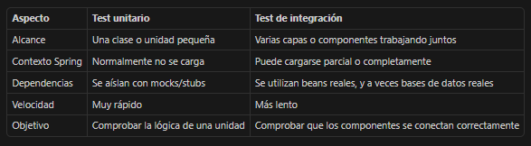
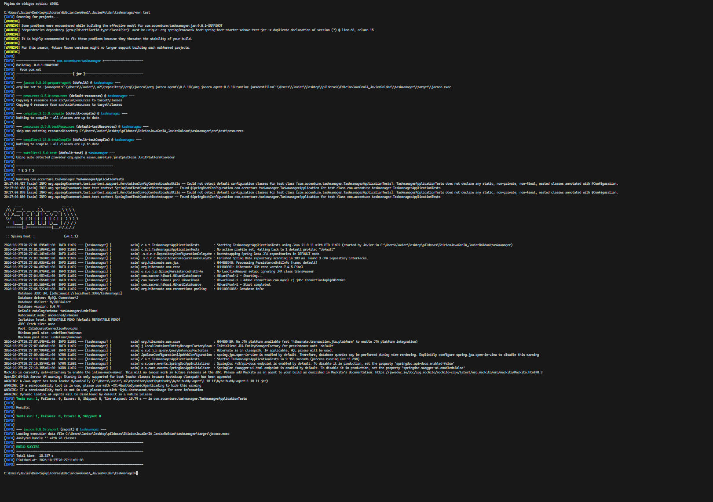
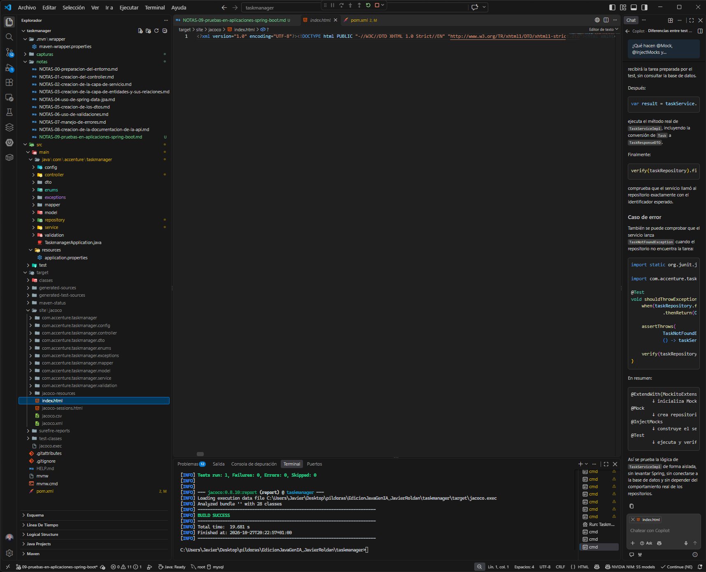

Paso 1 - Preparación (Ask)<br>
<br>
Pregunta:<br>
<br>
¿Qué diferencia hay entre un test unitario y un test de integración en Spring Boot? ¿Qué dependencias se aíslan en cada caso y qué ventajas tiene cada enfoque?<br>
<br>
Respuesta:<br>
<br>
Voy a contrastar la explicación con las notas del proyecto para adaptar la respuesta al contexto de Spring Boot que estás trabajando.<br>
<br>
NOTAS-09-pruebas-en-aplicaciones-spring-boot.md<br>
En Spring Boot, la diferencia principal es qué parte de la aplicación se prueba y qué dependencias se sustituyen por simulaciones.


<br>
Test unitario<br>
Prueba una clase de forma aislada. Por ejemplo, un servicio:

```
@ExtendWith(MockitoExtension.class)
class TaskServiceTest {

    @Mock
    private TaskRepository taskRepository;

    @InjectMocks
    private TaskService taskService;

    @Test
    void shouldFindTaskById() {
        // Se comprueba solo la lógica de TaskService
    }
}
```

En este caso:<br>
<br>
TaskService es la unidad bajo prueba.<br>
TaskRepository se sustituye por un mock de Mockito.<br>
No se conecta a una base de datos.<br>
No se carga el contexto de Spring.<br>
No se prueban realmente el controlador, JPA ni la configuración de Spring.<br>
¿Qué dependencias se aíslan?<br>
Se aíslan las dependencias externas a la clase que se está probando, por ejemplo:<br>
<br>
Repositorios.<br>
Otros servicios.<br>
Clientes HTTP.<br>
Sistemas de mensajería.<br>
Relojes, generadores de identificadores o servicios de almacenamiento.<br>
El test controla las respuestas de esas dependencias:

```
when(taskRepository.findById(1L))
    .thenReturn(Optional.of(task));
```

Ventajas<br>
Son muy rápidos.<br>
Detectan errores concretos de lógica.<br>
Son fáciles de mantener cuando la clase está bien diseñada.<br>
Permiten probar muchos casos límite.<br>
No dependen de una base de datos ni de servicios externos.<br>
El error suele indicar claramente qué clase ha fallado.<br>
Limitación<br>
Un test unitario puede pasar aunque exista un problema real entre componentes. Por ejemplo, el servicio puede funcionar con un mock, pero la consulta real del repositorio puede estar mal escrita.<br>
<br>
Test de integración<br>
Comprueba que varias partes funcionan juntas. Por ejemplo, un controlador, un servicio y un repositorio usando una base de datos de prueba.<br>
<br>
Un test completo podría utilizar:

```
@SpringBootTest
@AutoConfigureMockMvc
class TaskControllerIntegrationTest {

    @Autowired
    private MockMvc mockMvc;

    @Test
    void shouldReturnTasks() throws Exception {
        mockMvc.perform(get("/tasks"))
               .andExpect(status().isOk());
    }
}
```

Aquí Spring puede:<br>
<br>
Crear el contexto de la aplicación.<br>
Registrar los controladores, servicios y repositorios reales.<br>
Resolver la inyección de dependencias.<br>
Aplicar validaciones, transacciones y configuración.<br>
Ejecutar peticiones HTTP simuladas mediante MockMvc.<br>
Si además se utiliza una base de datos de prueba, también se verifica la integración con la persistencia.<br>
<br>
¿Qué dependencias se aíslan?<br>
En un test de integración normalmente no se aíslan las capas internas que queremos probar juntas:<br>
<br>
El controlador puede usar el servicio real.<br>
El servicio puede usar el repositorio real.<br>
El repositorio puede comunicarse con una base de datos de prueba.<br>
Sin embargo, sí se suelen aislar los sistemas externos difíciles de controlar:<br>
<br>
APIs de terceros mediante WireMock o mocks.<br>
Bases de datos externas mediante Testcontainers o una base embebida.<br>
Servicios de correo.<br>
Sistemas de colas.<br>
Servicios de pago o almacenamiento remoto.<br>
Por tanto, “integración” no significa necesariamente conectarse a todos los sistemas reales de producción. Significa probar la colaboración entre varios componentes, utilizando dependencias reales o sustitutos cercanos a la realidad.<br>
<br>
Tipos habituales de pruebas en Spring Boot<br>
@WebMvcTest<br>
Prueba principalmente la capa web:

```
@WebMvcTest(TaskController.class)
class TaskControllerTest {
}
```

Se cargan los componentes MVC y el controlador, pero normalmente los servicios se simulan con @MockBean o mecanismos equivalentes.<br>
<br>
Sirve para comprobar:<br>
<br>
Rutas HTTP.<br>
Códigos de estado.<br>
Serialización JSON.<br>
Validación de entrada.<br>
Conversión de excepciones en respuestas HTTP.<br>
Es una prueba de contexto parcial o “slice test”, situada entre una prueba unitaria pura y una integración completa.<br>
<br>
@DataJpaTest<br>
Prueba la capa JPA y los repositorios:

```
@DataJpaTest
class TaskRepositoryTest {
}
```

Suele cargar una configuración reducida y una base de datos de prueba. Sirve para comprobar:<br>
<br>
Consultas derivadas.<br>
Consultas JPQL o SQL.<br>
Mapeos entre entidades y tablas.<br>
Restricciones y relaciones.<br>
@SpringBootTest<br>
Carga prácticamente toda la aplicación:

```
@SpringBootTest
class ApplicationIntegrationTest {
}
```

Es apropiado para verificar:<br>
<br>
Configuración de Spring.<br>
Inyección de dependencias.<br>
Integración entre capas.<br>
Configuración de seguridad.<br>
Transacciones.<br>
Funcionamiento global de la aplicación.<br>
Es más completo, pero también más lento y más sensible a problemas de configuración.<br>
<br>
Ejemplo práctico<br>
Para un método crearTarea:<br>
<br>
Test unitario<br>
Se prueba el servicio con el repositorio simulado:<br>
<br>
¿Valida correctamente la categoría?<br>
¿Lanza una excepción si la categoría no existe?<br>
¿Guarda la tarea cuando los datos son válidos?<br>
¿Llama al repositorio con los valores adecuados?<br>
Test de integración<br>
Se prueba el flujo completo:<br>
<br>
Se envía un POST /tasks.<br>
El controlador recibe y valida el JSON.<br>
El servicio aplica las reglas de negocio.<br>
El repositorio guarda la entidad.<br>
La base de datos devuelve el resultado.<br>
La respuesta HTTP contiene el código y el JSON esperados.<br>
Resumen<br>
Test unitario: prueba una clase aislada y simula sus dependencias. Es rápido y preciso.<br>
Test de integración: prueba la colaboración entre varias partes reales de la aplicación. Es más lento, pero detecta errores de configuración, persistencia y comunicación entre capas.<br>
Una estrategia equilibrada combina ambos:<br>
Muchos tests unitarios para la lógica de negocio.<br>
Tests de integración para los puntos importantes entre capas.<br>
Algunos tests completos para validar los flujos principales de la aplicación.<br>
<br>
Pregunta:<br>
<br>
¿Qué hacen @Mock, @InjectMocks y @ExtendWith(MockitoExtension.class) en un test unitario con JUnit 5 y Mockito? Explica cómo colaboran entre sí y pon un ejemplo aplicado a TaskServiceImpl.<br>
<br>
Respuesta:<br>
<br>
En un test unitario con JUnit 5 y Mockito, estas tres anotaciones tienen responsabilidades distintas:<br>
<br>
@Mock: crea una dependencia simulada.<br>
@InjectMocks: crea la instancia real que se quiere probar e introduce en ella los mocks.<br>
@ExtendWith(MockitoExtension.class): inicializa y gestiona las anotaciones de Mockito dentro de JUnit 5.<br>
En el proyecto, la clase bajo prueba es TaskServiceImpl, que recibe tres repositorios por constructor:

```
public TaskServiceImpl(
        TaskRepository taskRepository,
        CategoryRepository categoryRepository,
        TagRepository tagRepository) {
    // ...
}
```

@Mock<br>
Crea un objeto simulado de Mockito. El mock tiene el mismo tipo que la dependencia, pero no ejecuta su comportamiento real.

```
@Mock
private TaskRepository taskRepository;
```

En este caso, taskRepository no accede a la base de datos. El test decide qué debe devolver:

```
when(taskRepository.findById(1L))
        .thenReturn(Optional.of(task));
```

También permite verificar cómo se ha utilizado:

```
verify(taskRepository).findById(1L);
```

Es importante no confundirlo con @MockBean:<br>
<br>
@Mock pertenece a Mockito y se usa normalmente en tests unitarios sin arrancar Spring.<br>
@MockBean —o el mecanismo equivalente de sustitución de beans en versiones recientes— se utiliza en un contexto de Spring, por ejemplo con @WebMvcTest.<br>
@InjectMocks<br>
Indica cuál es la clase real que se quiere probar:

```
@InjectMocks
private TaskServiceImpl taskService;
```

Mockito crea una instancia real de TaskServiceImpl e intenta inyectarle los objetos marcados con @Mock.<br>
<br>
Como TaskServiceImpl utiliza inyección por constructor, Mockito encuentra el constructor y realiza conceptualmente algo equivalente a:

```
taskService = new TaskServiceImpl(
        taskRepository,
        categoryRepository,
        tagRepository);
```

@InjectMocks no convierte TaskServiceImpl en un mock. Sus métodos se ejecutan realmente. Solo se simulan sus dependencias.<br>
<br>
@ExtendWith(MockitoExtension.class)<br>
Es la extensión de JUnit 5 que inicializa los mocks antes de cada test:

```
@ExtendWith(MockitoExtension.class)
class TaskServiceImplTest {
}
```

Sin esta extensión, las variables anotadas con @Mock e @InjectMocks no se inicializarían automáticamente y podrían permanecer en null.<br>
<br>
La extensión también integra Mockito con el ciclo de vida de JUnit 5 y ayuda a detectar ciertos usos incorrectos de los mocks.<br>
<br>
Cómo colaboran<br>
El flujo es:<br>
<br>
JUnit 5 ejecuta el test.<br>
MockitoExtension prepara las anotaciones de Mockito.<br>
Mockito crea los tres mocks de los repositorios.<br>
Mockito crea una instancia real de TaskServiceImpl.<br>
@InjectMocks introduce los mocks en esa instancia mediante el constructor.<br>
El test configura el comportamiento de los mocks con when(...).thenReturn(...).<br>
Se llama al método real de TaskServiceImpl.<br>
Se comprueba el resultado y las interacciones con los repositorios.<br>
Ejemplo aplicado a TaskServiceImpl<br>
Este ejemplo prueba findById. El repositorio real TaskRepository no se utiliza: se sustituye por un mock.

```
package com.accenture.taskmanager.service;

import static org.junit.jupiter.api.Assertions.assertEquals;
import static org.mockito.Mockito.verify;
import static org.mockito.Mockito.when;

import java.util.Optional;

import org.junit.jupiter.api.Test;
import org.junit.jupiter.api.extension.ExtendWith;
import org.mockito.InjectMocks;
import org.mockito.Mock;
import org.mockito.junit.jupiter.MockitoExtension;

import com.accenture.taskmanager.model.Task;
import com.accenture.taskmanager.repository.CategoryRepository;
import com.accenture.taskmanager.repository.TagRepository;
import com.accenture.taskmanager.repository.TaskRepository;

@ExtendWith(MockitoExtension.class)
class TaskServiceImplTest {

    @Mock
    private TaskRepository taskRepository;

    @Mock
    private CategoryRepository categoryRepository;

    @Mock
    private TagRepository tagRepository;

    @InjectMocks
    private TaskServiceImpl taskService;

    @Test
    void shouldFindTaskById() {
        Task task = new Task();
        task.setId(1L);
        task.setTitle("Preparar test unitario");

        when(taskRepository.findById(1L))
                .thenReturn(Optional.of(task));

        var result = taskService.findById(1L);

        assertEquals(1L, result.getId());
        assertEquals("Preparar test unitario", result.getTitle());

        verify(taskRepository).findById(1L);
    }
}
```

Qué ocurre en este ejemplo<br>
La línea:

```
when(taskRepository.findById(1L))
        .thenReturn(Optional.of(task));
```

configura el comportamiento del mock. Cuando el servicio ejecute:

```
taskRepository.findById(1L)
```

recibirá la tarea preparada por el test, sin consultar la base de datos.<br>
<br>
Después:

```
var result = taskService.findById(1L);
```

ejecuta el método real de TaskServiceImpl, incluyendo la conversión de Task a TaskResponseDTO.<br>
<br>
Finalmente:

```
verify(taskRepository).findById(1L);
```

comprueba que el servicio llamó al repositorio exactamente con el identificador esperado.<br>
<br>
Caso de error<br>
También se puede comprobar que el servicio lanza TaskNotFoundException cuando el repositorio no encuentra la tarea:

```
import static org.junit.jupiter.api.Assertions.assertThrows;

import com.accenture.taskmanager.exceptions.TaskNotFoundException;

@Test
void shouldThrowExceptionWhenTaskDoesNotExist() {
    when(taskRepository.findById(99L))
            .thenReturn(Optional.empty());

    assertThrows(
            TaskNotFoundException.class,
            () -> taskService.findById(99L));

    verify(taskRepository).findById(99L);
}
```

En resumen:

```
@ExtendWith(MockitoExtension.class)
        ↓ inicializa Mockito
@Mock
        ↓ crea repositorios simulados
@InjectMocks
        ↓ construye el servicio real con esos repositorios
@Test
        ↓ ejecuta y verifica la lógica real del servicio
```

Así se prueba la lógica de TaskServiceImpl de forma aislada, sin levantar Spring, sin conectarse a la base de datos y sin depender del comportamiento real de los repositorios.

---
<br>
Configuración de JaCoCo<br>
<br>
NOTA: el pdf pone que busquemos los pluggins y dependencias en modo Ask pero con poner el comentario te lo da el autocompletado y no se consumen tokens<br>
<br>
Dependencias Test:<br>
<br>
Comentario:

```
		<!-- Dependencia para testing con Mockito, MockMvc y JUnit -->
```

Resultado:

```
		<!-- Dependencia para testing con Mockito, MockMvc y JUnit -->
		<dependency>
			<groupId>org.springframework.boot</groupId>
			<artifactId>spring-boot-starter-webmvc-test</artifactId>
			<scope>test</scope>
		</dependency>
```

Plugin Jacoco:<br>
<br>
Comentario:

```
		<!--plugin para jacoco-->
```

Resultado:

```
		<!--plugin para jacoco-->
		<plugin>
				<groupId>org.jacoco</groupId>
				<artifactId>jacoco-maven-plugin</artifactId>
				<version>0.8.10</version>
				<executions>
					<execution>
						<goals>
							<goal>prepare-agent</goal>
						</goals>
					</execution>
					<execution>
						<id>report</id>
						<phase>test</phase>
						<goals>
							<goal>report</goal>
						</goals>
					</execution>
				</executions>
			</plugin>
```

Se comprueba informe de cobertura



Se comprueba que se genera el informe de JaCoCo



---
<br>
Paso 3 - Diseño previo<br>
<br>
Casos de prueba:<br>
<br>
1	findAll(Pageable)	Devuelve la página de tareas correctamente (PagedResponseDTO).<br>
<br>
Comentario:<br>
// Genera un test unitario que compruebe que findAll(Pageable) devuelve correctamente una página de tareas convertida a PagedResponseDTO, utilizando Mockito para simular las dependencias<br>
<br>
2	findById()	Devuelve la tarea cuando existe.<br>
<br>
Comentario:<br>
<br>
<br>
// Genera un test unitario que compruebe que findById() devuelve la tarea esperada cuando existe, utilizando Mockito para simular las dependencias.<br>
<br>
3	findById()	Lanza TaskNotFoundException cuando no existe.<br>
<br>
Comentario:<br>
<br>
// Genera un test unitario que compruebe que findById() lanza TaskNotFoundException cuando la tarea solicitada no existe.<br>
<br>
4	create()	Crea y devuelve la tarea correctamente.<br>
<br>
Comentario:<br>
<br>
// Genera un test unitario que compruebe que create() crea y devuelve correctamente una tarea, simulando las dependencias con Mockito.<br>
<br>
5	update()	Actualiza y devuelve la tarea cuando existe.<br>
<br>
Comentario:<br>
<br>
// Genera un test unitario que compruebe que update() actualiza y devuelve correctamente una tarea existente.<br>
<br>
6	update()	Lanza TaskNotFoundException cuando no existe.<br>
<br>
Comentario:<br>
<br>
// Genera un test unitario que compruebe que update() lanza TaskNotFoundException cuando la tarea que se quiere actualizar no existe.<br>
<br>
7	delete()	Elimina la tarea cuando existe.<br>
<br>
Comentario:<br>
<br>
// Genera un test unitario que compruebe que delete() elimina correctamente una tarea existente y verifica la interacción con el repositorio.<br>
<br>
8	delete()	Lanza TaskNotFoundException cuando no existe.<br>
<br>
Comentario:<br>
<br>
// Genera un test unitario que compruebe que delete() lanza TaskNotFoundException cuando la tarea que se quiere eliminar no existe.

---
<br>
Paso 4 - Implementación (autocompletado)<br>
<br>
TaskServiceImplTest<br>
<br>
Comentario:<br>
<br>
// Crea el esqueleto de TaskServiceImplTest con JUnit 5 y Mockito. Usa @ExtendWith(MockitoExtension.class), declara @Mock para TaskRepository, CategoryRepository y TagRepository, e inyecta TaskServiceImpl con @InjectMocks. No uses @SpringBootTest ni ninguna anotación de Spring. No accedas a una base de datos real. Genera únicamente la estructura de la clase, sin métodos de test. — generado por IA<br>
<br>
Resultado:

```
package com.accenture.taskmanager;

import org.junit.jupiter.api.extension.ExtendWith;
import org.mockito.InjectMocks;
import org.mockito.Mock;
import org.mockito.junit.jupiter.MockitoExtension;

import com.accenture.taskmanager.repository.CategoryRepository;
import com.accenture.taskmanager.repository.TagRepository;
import com.accenture.taskmanager.repository.TaskRepository;
import com.accenture.taskmanager.service.TaskServiceImpl;

// Crea el esqueleto de TaskServiceImplTest con JUnit 5 y Mockito. Usa @ExtendWith(MockitoExtension.class), declara @Mock para TaskRepository, CategoryRepository y TagRepository, e inyecta TaskServiceImpl con @InjectMocks. No uses @SpringBootTest ni ninguna anotación de Spring. No accedas a una base de datos real. Genera únicamente la estructura de la clase, sin métodos de test. — generado por IA
@ExtendWith(MockitoExtension.class)
public class TaskServiceImplTest {

    @Mock
    private TaskRepository taskRepository;

    @Mock
    private CategoryRepository categoryRepository;

    @Mock
    private TagRepository tagRepository;

    @InjectMocks
    private TaskServiceImpl taskServiceImpl;
}
```

findAll(Pageable)<br>
<br>
Comentario:<br>
<br>
// Genera un test unitario que compruebe que findAll(Pageable) devuelve correctamente una página de tareas convertida a PagedResponseDTO, utilizando Mockito para simular las dependencias — generado por IA<br>
<br>
Resultado:

```
// Genera el test completo de findAll(Pageable): crea un Pageable, prepara una Page<Task> con Mockito, configura taskRepository.findAll(pageable) con when().thenReturn(), llama a taskServiceImpl.findAll(pageable) y verifica que devuelve un PagedResponseDTO con los resultados esperados. Usa JUnit 5 y Mockito, sin base de datos real. — generado por IA
@ExtendWith(MockitoExtension.class)
public class TaskServiceImplTest {

    @Mock
    private TaskRepository taskRepository;

    @Mock
    private CategoryRepository categoryRepository;

    @Mock
    private TagRepository tagRepository;

    @InjectMocks
    private TaskServiceImpl taskServiceImpl;

// Genera el test completo de findAll(Pageable): crea un Pageable, prepara una Page<Task> con Mockito, configura taskRepository.findAll(pageable) con when().thenReturn(), llama a taskServiceImpl.findAll(pageable) y verifica que devuelve un PagedResponseDTO con los resultados esperados. Usa JUnit 5 y Mockito, sin base de datos real. — generado por IA
    @Test
    void testFindAll() {
        // Crea un Pageable
        Pageable pageable = PageRequest.of(0, 10);

        // Prepara una Page<Task> con Mockito
        List<Task> tasks = Arrays.asList(new Task(), new Task());
        Page<Task> taskPage = new PageImpl<>(tasks, pageable, tasks.size());

        // Configura taskRepository.findAll(pageable) con when().thenReturn()
        when(taskRepository.findAll(pageable)).thenReturn(taskPage);

        // Llama a taskServiceImpl.findAll(pageable)
        PagedResponseDTO<TaskResponseDTO> result = taskServiceImpl.findAll(pageable);

        // Verifica que devuelve un PagedResponseDTO con los resultados esperados
        assertEquals(tasks.size(), result.getContent().size());
    }
```

findById() cuando la tarea existe<br>
<br>
Comentario:<br>
<br>
// Genera un test unitario que compruebe que findById() devuelve la tarea esperada cuando existe, utilizando Mockito para simular las dependencias — generado por IA<br>
<br>
Resultado:

```
    // Genera un test unitario que compruebe que findById() devuelve la tarea esperada cuando existe, utilizando Mockito para simular las dependencias — generado por IA
    @Test
    void testFindById() {
        // Prepara un Task con un ID específico
        Long taskId = 1L;
        Task task = new Task();
        task.setId(taskId);

        // Configura taskRepository.findById(taskId) con when().thenReturn()
        when(taskRepository.findById(taskId)).thenReturn(java.util.Optional.of(task));

        // Llama a taskServiceImpl.findById(taskId)
        TaskResponseDTO result = taskServiceImpl.findById(taskId);

        // Verifica que devuelve la tarea esperada
        assertEquals(task.getId(), result.getId());
    }
```

findById() cuando no existe<br>
<br>
Comentario:<br>
<br>
// Genera un test unitario que compruebe que findById() lanza TaskNotFoundException cuando la tarea solicitada no existe — generado por IA<br>
<br>
Resultado:

```
    // Genera un test unitario que compruebe que findById() lanza TaskNotFoundException cuando la tarea solicitada no existe — generado por IA
    @Test
    void testFindByIdNotFound() {
        // Prepara un ID de tarea que no existe
        Long taskId = 1L;

        // Configura taskRepository.findById(taskId) con when().thenReturn()
        when(taskRepository.findById(taskId)).thenReturn(java.util.Optional.empty());

        // Llama a taskServiceImpl.findById(taskId) y verifica que lanza TaskNotFoundException
                assertThrows(TaskNotFoundException.class, () -> {
            taskServiceImpl.findById(taskId);
        });
    }
```

create() crea y devuelve una tarea<br>
<br>
Comentario:<br>
<br>
// Genera un test unitario que compruebe que create() crea y devuelve una tarea, utilizando Mockito para simular las dependencias — generado por IA<br>
<br>
Resultado:

```
    // Genera un test unitario que compruebe que create() crea y devuelve una tarea, utilizando Mockito para simular las dependencias — generado por IA
    @Test
    void testCreate() {
        TaskRequestDTO request = new TaskRequestDTO();
        request.setTitle("New Task");

        Task task = new Task();
        task.setId(1L);
        task.setTitle("New Task");

        when(taskRepository.save(org.mockito.ArgumentMatchers.any(Task.class)))
                .thenReturn(task);

        TaskResponseDTO result = taskServiceImpl.create(request);

        assertEquals(task.getId(), result.getId());
        assertEquals(task.getTitle(), result.getTitle());
    }
```

update()<br>
<br>
Comentario:<br>
<br>
// Genera un test unitario que compruebe que update() actualiza y devuelve una tarea cuando existe, utilizando Mockito para simular las dependencias — generado por IA<br>
<br>
Resultado:

```
    // Genera un test unitario que compruebe que update() actualiza y devuelve una tarea cuando existe, utilizando Mockito para simular las dependencias — generado por IA
    @Test
    void testUpdate() {
        Long taskId = 1L;
        TaskRequestDTO request = new TaskRequestDTO();
        request.setTitle("Updated Task");

        Task existingTask = new Task();
        existingTask.setId(taskId);
        existingTask.setTitle("Old Task");

        Task updatedTask = new Task();
        updatedTask.setId(taskId);
        updatedTask.setTitle("Updated Task");

        when(taskRepository.findById(taskId)).thenReturn(java.util.Optional.of(existingTask));
        when(taskRepository.save(org.mockito.ArgumentMatchers.any(Task.class))).thenReturn(updatedTask);

        TaskResponseDTO result = taskServiceImpl.update(taskId, request);

        assertEquals(updatedTask.getId(), result.getId());
        assertEquals(updatedTask.getTitle(), result.getTitle());
    }
```

update() cuando la tarea no existe<br>
<br>
Comentario:<br>
<br>
// Genera un test unitario que compruebe que update() lanza TaskNotFoundException cuando la tarea no existe, utilizando Mockito y assertThrows — generado por IA<br>
<br>
Resultado:

```
    // Genera un test unitario que compruebe que update() lanza TaskNotFoundException cuando la tarea no existe, utilizando Mockito y assertThrows — generado por IA
    @Test
    void testUpdateNotFound() {
        Long taskId = 1L;
        TaskRequestDTO request = new TaskRequestDTO();
        request.setTitle("Updated Task");

        when(taskRepository.findById(taskId)).thenReturn(java.util.Optional.empty());

        assertThrows(TaskNotFoundException.class, () -> {
            taskServiceImpl.update(taskId, request);
        });
    }
```

delete() cuando la tarea existe<br>
<br>
Comentario:<br>
<br>
// Genera un test unitario que compruebe que delete() elimina una tarea cuando existe, utilizando Mockito para simular las dependencias — generado por IA<br>
<br>
Resultado:

```
    // Genera un test unitario que compruebe que delete() elimina una tarea cuando existe, utilizando Mockito para simular las dependencias — generado por IA
    @Test
    void testDelete() {
        Long taskId = 1L;

        Task existingTask = new Task();
        existingTask.setId(taskId);

        when(taskRepository.findById(taskId)).thenReturn(java.util.Optional.of(existingTask));

        taskServiceImpl.delete(taskId);

        // Verifica que taskRepository.delete() fue llamado con la tarea existente
        org.mockito.Mockito.verify(taskRepository).delete(existingTask);
    }
```

delete() cuando la tarea no existe<br>
<br>
Comentario:<br>
<br>
// Genera un test unitario que compruebe que delete() lanza TaskNotFoundException cuando la tarea no existe, utilizando Mockito y assertThrows — generado por IA<br>
<br>
Resultado:

```
    // Genera un test unitario que compruebe que delete() lanza TaskNotFoundException cuando la tarea no existe, utilizando Mockito y assertThrows — generado por IA
    @Test
    void testDeleteNotFound() {
        Long taskId = 1L;

        when(taskRepository.findById(taskId)).thenReturn(java.util.Optional.empty());

        assertThrows(TaskNotFoundException.class, () -> {
            taskServiceImpl.delete(taskId);
        });
    }
```

---
<br>
Paso 5 – Comprensión del código (Ask)<br>
<br>
Pregunta:<br>
<br>
¿Qué hace @ExtendWith(MockitoExtension.class) y por qué es necesario?
<br>
Respuesta:<br>
<br>
@ExtendWith(MockitoExtension.class) conecta Mockito con el ciclo de vida de JUnit 5.

```
@ExtendWith(MockitoExtension.class)
class TaskServiceImplTest {
    // tests
}
```

¿Qué hace?<br>
La extensión MockitoExtension se ejecuta antes de cada test y:<br>
<br>
Inicializa los campos anotados con @Mock.<br>
Crea la instancia indicada con @InjectMocks.<br>
Inyecta los mocks en esa instancia, normalmente mediante el constructor.<br>
Gestiona el ciclo de vida de Mockito para cada prueba.<br>
Puede detectar usos incorrectos, como ciertos stubbings innecesarios.<br>
Por ejemplo:

```
@ExtendWith(MockitoExtension.class)
class TaskServiceImplTest {

    @Mock
    private TaskRepository taskRepository;

    @Mock
    private CategoryRepository categoryRepository;

    @Mock
    private TagRepository tagRepository;

    @InjectMocks
    private TaskServiceImpl taskServiceImpl;
}
```

Mockito prepara conceptualmente una instancia equivalente a:

```
taskServiceImpl = new TaskServiceImpl(
        taskRepository,
        categoryRepository,
        tagRepository);
```

La clase TaskServiceImpl real se ejecuta, pero sus repositorios son simulados.<br>
<br>
¿Por qué es necesaria?<br>
Porque JUnit 5, por sí solo, no sabe qué significan las anotaciones @Mock e @InjectMocks.<br>
<br>
Sin la extensión, Mockito no inicializaría automáticamente esos campos:

```
@Mock
private TaskRepository taskRepository;
```

Por tanto, podrían permanecer en null y el test fallaría al intentar utilizarlos.<br>
<br>
La extensión permite escribir:

```
when(taskRepository.findById(1L))
        .thenReturn(Optional.of(task));
```

en lugar de crear e inicializar manualmente los mocks.<br>
<br>
Ejemplo aplicado

```
@ExtendWith(MockitoExtension.class)
class TaskServiceImplTest {

    @Mock
    private TaskRepository taskRepository;

    @Mock
    private CategoryRepository categoryRepository;

    @Mock
    private TagRepository tagRepository;

    @InjectMocks
    private TaskServiceImpl taskServiceImpl;

    @Test
    void shouldFindTaskById() {
        Task task = new Task();
        task.setId(1L);
        task.setTitle("Preparar pruebas");

        when(taskRepository.findById(1L))
                .thenReturn(Optional.of(task));

        TaskResponseDTO result = taskServiceImpl.findById(1L);

        assertEquals(1L, result.getId());
        assertEquals("Preparar pruebas", result.getTitle());

        verify(taskRepository).findById(1L);
    }
}
```

En este ejemplo, @ExtendWith(MockitoExtension.class) hace posible que:<br>
<br>
taskRepository sea un mock válido.<br>
categoryRepository y tagRepository también se creen como mocks.<br>
taskServiceImpl se construya como objeto real.<br>
Los tres repositorios se inyecten en TaskServiceImpl.<br>
Alternativas<br>
No es estrictamente la única forma de inicializar Mockito. También se podría hacer manualmente:

```
class TaskServiceImplTest {

    @BeforeEach
    void setUp() {
        MockitoAnnotations.openMocks(this);
    }
}
```

Sin embargo, con JUnit 5 se recomienda normalmente:

```
@ExtendWith(MockitoExtension.class)
```

porque es más limpio y gestiona automáticamente la inicialización y liberación de recursos.<br>
<br>
Esta anotación no carga el contexto de Spring. Para un test unitario con Mockito es suficiente; no se necesita @SpringBootTest. El apartado correspondiente está en NOTAS-09-pruebas-en-aplicaciones-spring-boot.md.<br>
<br>
Pregunta:<br>
<br>
¿Qué diferencia hay entre assertEquals() y assertThrows()? ¿Cuándo usas cada uno?<br>
<br>
Respueta:<br>
<br>
Voy a revisar el ejemplo de las notas alrededor de esa pregunta para relacionar assertEquals() y assertThrows() con los tests reales del servicio.<br>
<br>
NOTAS-09-pruebas-en-aplicaciones-spring-boot.md<br>
assertEquals() y assertThrows() son aserciones de JUnit 5, pero comprueban comportamientos diferentes.<br>
<br>
assertEquals()<br>
Comprueba que un valor obtenido coincide con el valor esperado:

```
assertEquals(valorEsperado, valorObtenido);
```

Se utiliza cuando el método debe devolver un resultado concreto.<br>
<br>
Ejemplo con TaskServiceImpl

```
@Test
void shouldFindTaskById() {
    Task task = new Task();
    task.setId(1L);
    task.setTitle("Preparar pruebas");

    when(taskRepository.findById(1L))
            .thenReturn(Optional.of(task));

    TaskResponseDTO result = taskServiceImpl.findById(1L);

    assertEquals(1L, result.getId());
    assertEquals("Preparar pruebas", result.getTitle());
}
```

Aquí se comprueba que:<br>
<br>
El identificador devuelto es 1L.<br>
El título devuelto es "Preparar pruebas".<br>
Si el valor real no coincide con el esperado, el test falla.<br>
<br>
La firma habitual es:

```
assertEquals(expected, actual);
```

Es recomendable mantener ese orden para que el mensaje de error sea más claro.<br>
<br>
assertThrows()<br>
Comprueba que al ejecutar una operación se lanza una excepción de un tipo concreto:

```
assertThrows(TipoDeExcepcion.class, () -> {
    // código que debe lanzar la excepción
});
```

Se utiliza cuando el comportamiento esperado no es devolver un valor, sino rechazar la operación mediante una excepción.<br>
<br>
Ejemplo con una tarea inexistente<br>
En TaskServiceImpl, si el repositorio no encuentra una tarea, se lanza TaskNotFoundException.

```
@Test
void shouldThrowExceptionWhenTaskDoesNotExist() {
    when(taskRepository.findById(99L))
            .thenReturn(Optional.empty());

    assertThrows(
            TaskNotFoundException.class,
            () -> taskServiceImpl.findById(99L));
}
```

Este test pasa si findById(99L) lanza exactamente una excepción compatible con TaskNotFoundException.<br>
<br>
Falla si:<br>
<br>
No se lanza ninguna excepción.<br>
Se lanza una excepción de otro tipo.<br>
La excepción se produce fuera del código que se está comprobando.<br>
También se puede inspeccionar la excepción<br>
assertThrows() devuelve la excepción capturada, por lo que se puede comprobar su mensaje:

```
@Test
void shouldReportMissingTaskId() {
    when(taskRepository.findById(99L))
            .thenReturn(Optional.empty());

    TaskNotFoundException exception = assertThrows(
            TaskNotFoundException.class,
            () -> taskServiceImpl.findById(99L));

    assertEquals(
            "Tarea con id 99 no encontrada.",
            exception.getMessage());
}
```

Aquí se usan ambas aserciones con objetivos distintos:<br>
<br>
assertThrows() comprueba el tipo de excepción.<br>
assertEquals() comprueba el mensaje de esa excepción.<br>
Comparación rápida<br>
Aserción	Comprueba	Uso típico<br>
assertEquals()	Que dos valores sean iguales	Resultado, identificador, título o mensaje<br>
assertThrows()	Que se lance una excepción	Datos inválidos, entidad inexistente o regla de negocio incumplida<br>
En resumen:

```
assertEquals("resultado esperado", resultado);
```

se usa cuando la operación debe terminar correctamente con un valor determinado.

```
assertThrows(MiExcepcion.class, () -> servicio.ejecutar());
```

se usa cuando la operación debe fallar de una forma concreta y controlada.<br>
<br>
Pregunta:<br>
<br>
¿Qué pasaría si no añadieras verify() en un test de escritura? ¿Seguiría siendo un test válido?<br>
<br>
Respuesta:<br>
<br>
Voy a consultar el ejemplo de escritura de las notas para explicar qué garantiza verify() en TaskServiceImpl y qué dejaría de comprobarse sin él.<br>
<br>
NOTAS-09-pruebas-en-aplicaciones-spring-boot.md<br>
Sí, podría seguir siendo un test válido, pero dependería de qué se esté comprobando.<br>
<br>
En un test de escritura, normalmente se prueba que el servicio:<br>
<br>
Valida los datos.<br>
Construye o modifica correctamente la entidad.<br>
Llama al método de escritura del repositorio, como save() o delete().<br>
verify() comprueba específicamente el tercer punto: que la operación se ha enviado al repositorio.<br>
<br>
Ejemplo sin verify()

```
@Test
void shouldCreateTask() {
    Task task = new Task();

    when(taskRepository.save(any(Task.class)))
            .thenReturn(task);

    TaskResponseDTO result = taskServiceImpl.create(taskRequest);

    assertNotNull(result);
}
```

Este test puede pasar aunque TaskServiceImpl no llame nunca a:

```
taskRepository.save(task);
```

Por ejemplo, podría devolver un DTO creado directamente y el test no detectaría que la tarea nunca se guardó.<br>
<br>
Por tanto, el test sería válido para comprobar únicamente el resultado devuelto, pero estaría incompleto como test de persistencia o de interacción con el repositorio.<br>
<br>
Ejemplo con verify()

```
@Test
void shouldCreateTaskAndSaveIt() {
    Task savedTask = new Task();
    savedTask.setId(1L);
    savedTask.setTitle("Nueva tarea");

    when(taskRepository.save(any(Task.class)))
            .thenReturn(savedTask);

    TaskResponseDTO result = taskServiceImpl.create(taskRequest);

    assertEquals(1L, result.getId());

    verify(taskRepository).save(any(Task.class));
}
```

Esta línea:

```
verify(taskRepository).save(any(Task.class));
```

comprueba que:<br>
<br>
Se llamó a save().<br>
Se llamó exactamente una vez.<br>
Se pasó una entidad Task.<br>
También se puede comprobar el objeto concreto enviado:

```
verify(taskRepository).save(argThat(task ->
        "Nueva tarea".equals(task.getTitle())));
```

O exigir que no se realicen otras interacciones:

```
verifyNoMoreInteractions(taskRepository);
```

En un método de borrado<br>
Por ejemplo, para un delete() de TaskServiceImpl:

```
@Test
void shouldDeleteExistingTask() {
    Long taskId = 1L;
    Task existingTask = new Task();
    existingTask.setId(taskId);

    when(taskRepository.findById(taskId))
            .thenReturn(Optional.of(existingTask));

    taskServiceImpl.delete(taskId);

    verify(taskRepository).findById(taskId);
    verify(taskRepository).delete(existingTask);
}
```

El primer verify() comprueba la búsqueda y el segundo confirma que realmente se solicitó el borrado.<br>
<br>
Sin el segundo:

```
verify(taskRepository).delete(existingTask);
```

el test podría pasar aunque el servicio encontrase la tarea, pero nunca la eliminase.<br>
<br>
¿Cuándo puede no ser necesario?<br>
No siempre hay que añadir verify():<br>
<br>
Si se prueba una función pura y basta con comprobar su resultado.<br>
Si la operación del mock se refleja de forma fiable en el resultado que se está validando.<br>
Si se quiere evitar un test demasiado acoplado a la implementación interna.<br>
Por ejemplo, si el test comprueba un resultado final mediante una base de datos real, no sería imprescindible verificar internamente que se llamó a save(): la consulta posterior demostraría que los datos se persistieron.<br>
<br>
Conclusión<br>
Sin verify(), el test puede seguir siendo válido, pero puede no comprobar el efecto lateral principal de una operación de escritura.<br>
<br>
assertEquals() comprueba qué devuelve el método.<br>
verify() comprueba qué interacción realizó con el repositorio.<br>
En servicios como TaskServiceImpl, lo habitual es combinar ambos:

```
assertEquals(1L, result.getId());
verify(taskRepository).save(any(Task.class));
```

Así se valida tanto el resultado como la llamada de persistencia esperada.<br>
<br>
Pregunta:<br>
<br>
¿Qué ocurre si el autocompletado genera un mock que nunca se usa en el test? ¿Es un problema?<br>
<br>
Respuesta:<br>
<br>
Normalmente no provoca un error inmediato, pero sí indica que el test puede tener código innecesario o una configuración incompleta.<br>
<br>
Por ejemplo:

```
@Mock
private TaskRepository taskRepository;

@Mock
private CategoryRepository categoryRepository;

@Mock
private TagRepository tagRepository;

@InjectMocks
private TaskServiceImpl taskServiceImpl;
```

Si el test solo prueba un método que utiliza taskRepository, es posible que categoryRepository y tagRepository no se usen en ese caso concreto.<br>
<br>
¿Qué ocurre técnicamente?<br>
MockitoExtension crea los tres mocks e @InjectMocks los introduce en TaskServiceImpl.<br>
<br>
El hecho de que uno de ellos no se utilice:<br>
<br>
No llama a la base de datos.<br>
No ejecuta lógica real.<br>
No hace que el test falle por sí mismo.<br>
Apenas tiene impacto de rendimiento.<br>
No significa necesariamente que el test sea incorrecto.<br>
Por ejemplo, al probar findById(), el servicio solo necesita taskRepository:

```
@Test
void shouldFindTaskById() {
    when(taskRepository.findById(1L))
            .thenReturn(Optional.of(task));

    TaskResponseDTO result = taskServiceImpl.findById(1L);

    assertEquals(1L, result.getId());
    verify(taskRepository).findById(1L);
}
```

En este test, categoryRepository y tagRepository pueden no intervenir.<br>
<br>
¿Cuándo puede ser un problema?<br>
1. Puede ocultar dependencias innecesarias<br>
Si una clase tiene muchos mocks, puede indicar que tiene demasiadas responsabilidades o un diseño difícil de probar.

```
@Mock private TaskRepository taskRepository;
@Mock private CategoryRepository categoryRepository;
@Mock private TagRepository tagRepository;
@Mock private EmailService emailService;
@Mock private AuditService auditService;
```

Esto no es necesariamente incorrecto, pero conviene revisar si la clase debería dividirse.<br>
<br>
2. Puede ocultar un test incompleto<br>
Si el método debería usar categoryRepository, pero el test nunca verifica esa llamada, podría pasar aunque la lógica de categorías se haya eliminado accidentalmente.<br>
<br>
En ese caso convendría configurar y verificar la interacción esperada:

```
when(categoryRepository.findById(categoryId))
        .thenReturn(Optional.of(category));

verify(categoryRepository).findById(categoryId);
```

3. Puede indicar código generado automáticamente que sobra<br>
El autocompletado puede añadir mocks por costumbre, aunque solo sean necesarios para otros métodos. Mantenerlos no rompe el test, pero reduce su claridad.<br>
<br>
La solución puede ser eliminarlos si no son necesarios para ningún test de la clase:

```
@Mock
private TaskRepository taskRepository;

@InjectMocks
private TaskServiceImpl taskServiceImpl;
```

Sin embargo, en este proyecto TaskServiceImpl tiene un constructor que requiere TaskRepository, CategoryRepository y TagRepository, por lo que todos pueden ser necesarios para crear la instancia mediante @InjectMocks, aunque un test concreto solo utilice uno.<br>
<br>
Diferencia entre mock no usado y stub innecesario<br>
No es exactamente lo mismo:<br>
<br>
Mock no usado<br>
El objeto simulado se ha creado, pero ningún método se invoca sobre él:

```
@Mock
private TagRepository tagRepository;
```

Esto normalmente no es grave.<br>
<br>
Stub no usado<br>
Se ha configurado un comportamiento que el test no utiliza:

```
when(tagRepository.findById(1L))
        .thenReturn(Optional.of(tag));
```

Si el método probado nunca llama a tagRepository.findById(1L), ese when(...) sobra. Además, Mockito puede configurarse para detectar stubbings innecesarios y hacer fallar el test.<br>
<br>
Recomendación<br>
Elimina mocks que no sean necesarios para construir la clase o para los tests de la clase.<br>
Elimina los when(...) que no se utilizan.<br>
Mantén el mock si @InjectMocks lo necesita para el constructor.<br>
Usa verify() cuando sea importante comprobar que una dependencia se utilizó.<br>
No añadas verificaciones de todas las dependencias por rutina; verifica solo el comportamiento relevante.<br>
En resumen: un mock no utilizado no suele ser un problema funcional, pero puede ser una señal de ruido, diseño complejo o una prueba incompleta. Lo importante es distinguir entre una dependencia no utilizada legítimamente y una interacción que el test debería haber comprobado.

---
<br>
Paso 6 - Ejecutar los tests y revisar cobertura<br>
<br>
Test correctos:


<br>
JaCoCo general:


<br>
JaCoCo TaskServiceImpl:


<br>
Captura Sonar:


Reflexión<br>
<br>
Pregunta:<br>
<br>
¿Qué ventaja tiene testear el Service con mocks frente a usar la base de dato sreal?<br>
<br>
Respuesta:<br>
<br>
Los mocks permiten probar la lógica del Service de forma aislada, sin depender de una base de datos real. Las pruebas son más rápidas, controladas y fáciles de repetir, y permiten simular distintos resultados del repositorio.<br>
Pregunta:<br>
<br>
¿Qué partes de TaskServiceImpl han quedado sin cubrir en el reporte de JaCoCo? ¿Por qué?<br>
<br>
Respuesta:<br>
<br>
La cobertura de instrucciones de TaskServiceImpl es del 43 %. Los métodos findByCategoryId, findByStatusAndPriority, findByTagId, findByStatus, findByPriority, findByDueDateBefore y getCountByStatus aparecen sin cubrir. Además, create y update tienen cobertura parcial. Esto se debe a que los ocho tests implementados se centran en los casos previstos para findAll, findById, create, update y delete, sin probar todos los métodos ni todas las posibles ramas de ejecución.<br>
Pregunta:<br>
<br>
¿Qué ocurriría si cambias la lógica de findById() en el Service? ¿Cómo te avisarían los tests?<br>
<br>
Respuesta:<br>
<br>
Si un cambio introduce un error en findById(), los tests pueden detectarlo al ejecutarse. El test del caso correcto comprueba que se devuelve la tarea esperada, y el test del caso inexistente verifica que se lanza TaskNotFoundException. Si alguno de esos comportamientos deja de cumplirse, el test fallará y mostrará el problema.

---
<br>
Parte 2<br>
<br>
Ejercicio para la creación del Test de la capa Repository<br>
<br>
Paso 1 - Preparación (Ask)<br>
<br>
Pregunta:<br>
<br>
¿Qué hace exactamente @DataJpaTest y qué componentes de Spring carga para probar un TaskRepository?<br>
<br>
Respuesta:<br>
<br>
@DataJpaTest es una prueba de slice de Spring Boot especializada en la capa de persistencia. Sirve para probar TaskRepository usando JPA y una base de datos de prueba, sin arrancar toda la aplicación.

```
@DataJpaTest
class TaskRepositoryTest {
    
    @Autowired
    private TaskRepository taskRepository;
}
```

¿Qué componentes carga?<br>
Para probar TaskRepository, Spring Boot carga principalmente:<br>
<br>
Los repositorios Spring Data JPA.<br>
Las entidades JPA, como Task, Category y Tag.<br>
La configuración de JPA.<br>
Hibernate, como proveedor JPA.<br>
Un DataSource.<br>
El EntityManagerFactory.<br>
El gestor de transacciones.<br>
La configuración de las relaciones, mapeos y consultas JPA.<br>
Opcionalmente, TestEntityManager, si se necesita trabajar directamente con entidades en el test.<br>
La configuración de bases de datos embebidas o de scripts SQL de prueba.<br>
Por ejemplo, permite probar las consultas definidas en TaskRepository:

```
@DataJpaTest
class TaskRepositoryTest {

    @Autowired
    private TaskRepository taskRepository;

    @Test
    void shouldFindTasksByStatus() {
        List<Task> result =
                taskRepository.findByStatus(TaskStatus.PENDING);

        assertEquals(1, result.size());
    }
}
```

En este caso se prueba la interacción real entre:

```
TaskRepository
        ↓
Spring Data JPA
        ↓
Hibernate
        ↓
EntityManager
        ↓
Base de datos de prueba
```

No se utiliza un mock de TaskRepository, porque precisamente el objetivo es probar su comportamiento real.<br>
<br>
¿Qué no carga normalmente?<br>
@DataJpaTest no está pensado para cargar toda la aplicación. Normalmente no incluye:<br>
<br>
Controladores.<br>
Servicios como TaskServiceImpl.<br>
Configuración MVC.<br>
MockMvc.<br>
Filtros HTTP.<br>
Controladores REST.<br>
Clientes HTTP externos.<br>
La lógica de negocio completa.<br>
Por eso es diferente de:

```
@SpringBootTest
```

@SpringBootTest intenta cargar prácticamente todo el contexto de la aplicación, mientras que @DataJpaTest carga solo lo necesario para la persistencia.<br>
<br>
Transacciones y rollback<br>
Los tests con @DataJpaTest se ejecutan normalmente dentro de una transacción que se revierte al terminar cada test.

```
@Test
void shouldSaveTask() {
    Task task = new Task();
    task.setTitle("Tarea de prueba");

    Task saved = taskRepository.save(task);

    assertNotNull(saved.getId());
}
```

Aunque el test guarde la entidad, los cambios suelen deshacerse automáticamente al finalizar. Esto proporciona aislamiento entre pruebas y evita llenar permanentemente la base de datos con datos de test.<br>
<br>
Si fuese necesario confirmar explícitamente los cambios en la base de datos durante el test, se puede utilizar:

```
@Commit
```

o:

```
@Rollback(false)
```

aunque normalmente no es lo recomendable para tests unitarios de repositorio.<br>
<br>
Base de datos embebida<br>
Por defecto, Spring Boot intenta sustituir la base de datos configurada por una base embebida, como H2, HSQLDB o Derby.<br>
<br>
La ventaja es que los tests:<br>
<br>
No dependen de un servidor MySQL iniciado.<br>
Son más rápidos.<br>
Son repetibles.<br>
No modifican datos reales.<br>
Pueden crear y eliminar el esquema automáticamente.<br>
En el proyecto, pom.xml contiene el conector de MySQL, pero no se observa una dependencia de H2. Por tanto, para usar normalmente @DataJpaTest con una base embebida habría que añadir H2 como dependencia de test:

```
<dependency>
    <groupId>com.h2database</groupId>
    <artifactId>h2</artifactId>
    <scope>test</scope>
</dependency>
```

Y se podría configurar, por ejemplo, en src/test/resources/application.properties:

```
spring.datasource.url=jdbc:h2:mem:taskmanager-test
spring.datasource.driver-class-name=org.h2.Driver
spring.datasource.username=sa
spring.datasource.password=
spring.jpa.hibernate.ddl-auto=create-drop
```

Con create-drop, Hibernate crea el esquema al iniciar los tests y lo elimina al finalizar.<br>
<br>
Ejemplo más completo

```
@DataJpaTest
class TaskRepositoryTest {

    @Autowired
    private TaskRepository taskRepository;

    @Test
    void shouldFindTasksByPriority() {
        Task task = new Task();
        task.setTitle("Tarea urgente");
        task.setPriority(TaskPriority.HIGH);
        task.setStatus(TaskStatus.PENDING);

        taskRepository.save(task);

        List<Task> result =
                taskRepository.findByPriority(TaskPriority.HIGH);

        assertEquals(1, result.size());
        assertEquals("Tarea urgente", result.get(0).getTitle());
    }
}
```

Este test comprueba realmente:<br>
<br>
Que Task se puede persistir.<br>
Que el mapeo de priority funciona.<br>
Que Hibernate convierte correctamente el enum.<br>
Que la consulta derivada findByPriority funciona.<br>
Que el repositorio devuelve la entidad esperada.<br>
Importante: @DataJpaTest no prueba toda la lógica del servicio<br>
Para TaskServiceImpl, el test unitario con Mockito sería apropiado:

```
@ExtendWith(MockitoExtension.class)
```

Para TaskRepository, @DataJpaTest es más adecuado porque interesa probar la consulta y el mapeo real:

```
@DataJpaTest
```

En resumen:<br>
<br>
@DataJpaTest carga una porción especializada de Spring centrada en JPA.<br>
Usa repositorios, entidades, Hibernate, EntityManager y transacciones reales.<br>
Normalmente reemplaza la base de datos por una embebida.<br>
Revierte los cambios después de cada test.<br>
No carga controladores ni servicios de la aplicación.<br>
Es ideal para comprobar consultas, relaciones, mapeos y persistencia de TaskRepository.<br>
<br>
¿Por qué se utiliza una base de datos H2 para las pruebas en lugar de conectarse a MySQL? ¿Cómo se configura para que Hibernate cree y elimine el esquema durante los tests?<br>
<br>
Respuesta:<br>
<br>
H2 se utiliza habitualmente en los tests de persistencia porque proporciona una base de datos embebida, rápida y aislada. Se ejecuta dentro del proceso de pruebas, normalmente en memoria, y no requiere iniciar ni configurar un servidor MySQL.<br>
<br>
Ventajas de H2 frente a MySQL<br>
1. No depende de servicios externos<br>
Con MySQL habría que tener:<br>
<br>
El servidor iniciado.<br>
La base de datos taskmanager creada.<br>
Un usuario y una contraseña válidos.<br>
Los permisos configurados.<br>
El puerto disponible.<br>
El esquema preparado.<br>
Con H2, la base de datos puede crearse automáticamente al arrancar el test.<br>
<br>
2. Evita modificar datos reales<br>
Los tests pueden insertar, actualizar o borrar registros sin afectar a la base de datos de desarrollo o producción.<br>
<br>
Una URL como esta crea una base en memoria:

```
spring.datasource.url=jdbc:h2:mem:taskmanager-test
```

Cuando termina la ejecución, los datos desaparecen.<br>
<br>
3. Es rápida y repetible<br>
H2 suele ser más rápida que una conexión de red a MySQL. Además, cada ejecución puede comenzar con un esquema limpio, lo que evita que los tests dependan de datos antiguos.<br>
<br>
4. Facilita la automatización<br>
Es adecuada para ejecutar tests:<br>
<br>
En Maven o Gradle.<br>
En integración continua.<br>
En un equipo donde no todos tengan MySQL instalado.<br>
En contenedores limpios.<br>
Añadir H2 como dependencia de test<br>
En este proyecto se utiliza MySQL en tiempo de ejecución, pero para @DataJpaTest se puede añadir H2 con alcance test en pom.xml:

```
<dependency>
    <groupId>com.h2database</groupId>
    <artifactId>h2</artifactId>
    <scope>test</scope>
</dependency>
```

El alcance test significa que H2 solo se utiliza al ejecutar las pruebas y no forma parte de la aplicación desplegada.<br>
<br>
Configuración de H2<br>
Se puede crear el archivo:

```
src/test/resources/application.properties
```

con esta configuración:

```
spring.datasource.url=jdbc:h2:mem:taskmanager-test
spring.datasource.driver-class-name=org.h2.Driver
spring.datasource.username=sa
spring.datasource.password=

spring.jpa.hibernate.ddl-auto=create-drop
spring.jpa.database-platform=org.hibernate.dialect.H2Dialect
```

Significado de las propiedades

```
spring.datasource.url=jdbc:h2:mem:taskmanager-test
```

Crea una base de datos H2 en memoria llamada taskmanager-test.

```
spring.datasource.driver-class-name=org.h2.Driver
```

Indica el driver JDBC de H2.

```
spring.datasource.username=sa
spring.datasource.password=
```

Configura las credenciales habituales de una base H2 de pruebas.

```
spring.jpa.hibernate.ddl-auto=create-drop
```

Indica a Hibernate que:<br>
<br>
Cree las tablas a partir de las entidades JPA al iniciar el contexto.<br>
Elimine el esquema al cerrar el contexto.

```
spring.jpa.database-platform=org.hibernate.dialect.H2Dialect
```

Indica el dialecto SQL de H2. En muchas versiones modernas de Hibernate puede detectarse automáticamente, pero especificarlo hace la configuración explícita.<br>
<br>
Cómo se utiliza con @DataJpaTest

```
@DataJpaTest
class TaskRepositoryTest {

    @Autowired
    private TaskRepository taskRepository;

    @Test
    void shouldSaveTask() {
        Task task = new Task();
        task.setTitle("Tarea de prueba");

        Task savedTask = taskRepository.save(task);

        assertNotNull(savedTask.getId());
    }
}
```

Al iniciar el test:

```
@DataJpaTest
    ↓
Spring Boot configura JPA
    ↓
H2 crea la base de datos en memoria
    ↓
Hibernate crea las tablas
    ↓
Se ejecuta el test
    ↓
La transacción se revierte
    ↓
El esquema se elimina al cerrar el contexto
```

¿Por qué no basta con ddl-auto=create?<br>
También existe:

```
spring.jpa.hibernate.ddl-auto=create
```

Pero create crea el esquema al iniciar y no garantiza que se elimine al cerrar el contexto. Para una base de datos temporal de tests, create-drop expresa mejor la intención:

```
spring.jpa.hibernate.ddl-auto=create-drop
```

No debe utilizarse esta configuración contra una base de datos con datos importantes.<br>
<br>
Aislamiento adicional entre tests<br>
@DataJpaTest ejecuta normalmente cada prueba dentro de una transacción y realiza rollback al terminarla. Por tanto, aunque un test guarde una entidad, los cambios no suelen quedar disponibles para el siguiente.<br>
<br>
Para limpiar completamente la base antes de cada test también se puede utilizar:

```
@DirtiesContext
```

pero no suele ser necesario y puede hacer que la suite sea más lenta.<br>
<br>
Otra opción es usar una base H2 en disco:

```
spring.datasource.url=jdbc:h2:file:./target/taskmanager-test
```

Sin embargo, para la mayoría de los tests de repositorio es preferible mem, porque proporciona un aislamiento y una limpieza más sencillos.<br>
<br>
Diferencia con probar MySQL directamente<br>
H2 comprueba muy bien:<br>
<br>
Mapeos JPA.<br>
Relaciones entre entidades.<br>
Consultas sencillas.<br>
Persistencia y recuperación.<br>
Conversión de enums.<br>
Restricciones básicas.<br>
Pero H2 no siempre tiene exactamente el mismo comportamiento que MySQL. Puede haber diferencias en:<br>
<br>
Sintaxis SQL específica.<br>
Funciones propias de MySQL.<br>
Comparación de cadenas y ordenación.<br>
Tipos de datos.<br>
Índices y restricciones.<br>
Comportamiento de transacciones.<br>
Modos de compatibilidad.<br>
Por eso una estrategia habitual es:<br>
<br>
Ejecutar la mayoría de los tests de repositorio con H2.<br>
Ejecutar algunos tests de integración con MySQL real o mediante Testcontainers.<br>
No asumir que pasar en H2 garantiza una compatibilidad completa con MySQL.<br>
Para usar el modo de compatibilidad de H2 se puede probar:

```
spring.datasource.url=jdbc:h2:mem:taskmanager-test;MODE=MySQL
```

Pero MODE=MySQL no convierte H2 en MySQL ni reproduce todas sus particularidades.<br>
<br>
Resumen<br>
H2 es rápida, embebida y no necesita un servidor externo.<br>
La dependencia debe tener alcance test.<br>
jdbc:h2:mem:... crea una base temporal en memoria.<br>
spring.jpa.hibernate.ddl-auto=create-drop crea el esquema al iniciar y lo elimina al cerrar.<br>
@DataJpaTest configura la capa JPA y suele aplicar rollback por test.<br>
H2 es muy útil para pruebas rápidas, pero conviene validar con MySQL real los casos que dependan de su comportamiento específico.<br>
<br>
Pregunta:<br>
<br>
¿Para qué sirve @Sql en una clase de pruebas con @DataJpaTest y cómo permite cargar datos de prueba de forma independiente para cada test?<br>
<br>
Respuesta:<br>
<br>
@Sql permite ejecutar uno o varios scripts SQL automáticamente durante una prueba. En combinación con @DataJpaTest, sirve para preparar datos conocidos en la base de datos antes de probar un TaskRepository.<br>
<br>
Por ejemplo:

```
@DataJpaTest
@Sql("/sql/tasks-data.sql")
class TaskRepositoryTest {

    @Autowired
    private TaskRepository taskRepository;

    @Test
    void shouldFindPendingTasks() {
        List<Task> tasks =
                taskRepository.findByStatus(TaskStatus.PENDING);

        assertEquals(2, tasks.size());
    }
}
```

El archivo estaría situado en:

```
src/test/resources/sql/tasks-data.sql
```

Por ejemplo:

```
INSERT INTO category (id, name)
VALUES (1, 'Trabajo');

INSERT INTO task (
    id, title, description, status, priority,
    due_date, created_at, category_id
)
VALUES (
    1, 'Preparar informe', 'Informe mensual',
    'PENDING', 'HIGH',
    '2026-12-01', CURRENT_TIMESTAMP, 1
);
```

¿Cuándo se ejecuta?<br>
Por defecto, @Sql ejecuta el script antes de cada método de test:

```
@Sql("/sql/tasks-data.sql")
```

Es equivalente conceptualmente a:

```
@Sql(
    scripts = "/sql/tasks-data.sql",
    executionPhase = Sql.ExecutionPhase.BEFORE_TEST_METHOD
)
```

También se puede ejecutar después:

```
@Sql(
    scripts = "/sql/cleanup.sql",
    executionPhase = Sql.ExecutionPhase.AFTER_TEST_METHOD
)
```

O combinar un script de preparación y otro de limpieza:

```
@Sql(
    scripts = "/sql/tasks-data.sql",
    executionPhase = Sql.ExecutionPhase.BEFORE_TEST_METHOD
)
@Sql(
    scripts = "/sql/cleanup.sql",
    executionPhase = Sql.ExecutionPhase.AFTER_TEST_METHOD
)
```

¿Cómo proporciona independencia entre tests?<br>
@DataJpaTest ejecuta normalmente cada test dentro de una transacción y realiza rollback al terminar:

```
Inicio del test
    ↓
Se ejecuta tasks-data.sql
    ↓
El test consulta o modifica datos
    ↓
Rollback de la transacción
    ↓
Los datos desaparecen
```

Por tanto, el siguiente test vuelve a recibir el mismo conjunto inicial de datos. No depende de lo que haya hecho el test anterior.<br>
<br>
Por ejemplo:

```
@DataJpaTest
@Sql("/sql/tasks-data.sql")
class TaskRepositoryTest {

    @Autowired
    private TaskRepository taskRepository;

    @Test
    void shouldFindPendingTasks() {
        List<Task> tasks =
                taskRepository.findByStatus(TaskStatus.PENDING);

        assertEquals(2, tasks.size());
    }

    @Test
    void shouldFindHighPriorityTasks() {
        List<Task> tasks =
                taskRepository.findByPriority(TaskPriority.HIGH);

        assertEquals(1, tasks.size());
    }
}
```

En ambos métodos se carga de nuevo tasks-data.sql. Si el primer test modifica o elimina registros, esas modificaciones se revierten al finalizar y no afectan al segundo.<br>
<br>
Aplicar @Sql solo a un test<br>
También se puede colocar la anotación sobre un método concreto:

```
@Test
@Sql("/sql/one-task.sql")
void shouldFindOneTask() {
    // Solo este test utiliza one-task.sql
}
```

Esto resulta útil cuando cada prueba necesita un conjunto de datos diferente:

```
@Test
@Sql("/sql/tasks-pending.sql")
void shouldFindPendingTasks() {
    // Datos específicos para este caso
}

@Test
@Sql("/sql/tasks-completed.sql")
void shouldFindCompletedTasks() {
    // Otros datos específicos
}
```

Script de limpieza<br>
Si se desea limpiar explícitamente las tablas, se puede utilizar un segundo script:

```
@Sql(
    scripts = "/sql/cleanup.sql",
    executionPhase = Sql.ExecutionPhase.AFTER_TEST_METHOD
)
```

El archivo podría contener:

```
DELETE FROM task_tag;
DELETE FROM task;
DELETE FROM category;
```

Hay que respetar el orden de las relaciones para no infringir restricciones de claves foráneas.<br>
<br>
Sin embargo, con @DataJpaTest normalmente el rollback ya proporciona la limpieza necesaria. Un script AFTER_TEST_METHOD es útil cuando:<br>
<br>
Se ha desactivado el rollback.<br>
Los scripts se ejecutan en una transacción independiente.<br>
Se quiere dejar la base explícitamente limpia.<br>
Se están probando operaciones que hacen commit.<br>
Diferencia respecto a guardar entidades desde Java<br>
También se podrían crear los datos con el repositorio:

```
Task task = new Task();
task.setTitle("Tarea de prueba");
taskRepository.save(task);
```

Pero @Sql puede ser más apropiado cuando:<br>
<br>
Se necesitan muchos registros.<br>
Se quiere controlar exactamente los identificadores.<br>
Hay datos relacionados entre varias tablas.<br>
Se desea que la preparación sea fácilmente visible y reutilizable.<br>
Se quiere probar situaciones concretas de base de datos.<br>
Resumen<br>
@Sql:<br>
<br>
Ejecuta scripts SQL automáticamente en los tests.<br>
Puede aplicarse a toda la clase o a un único método.<br>
Permite preparar datos conocidos antes de cada prueba.<br>
Se integra con las transacciones de @DataJpaTest.<br>
Normalmente los datos se revierten mediante rollback al finalizar cada test.<br>
Evita que una prueba dependa de los datos o modificaciones de otra.<br>
Así, cada prueba de TaskRepository empieza con un estado controlado y repetible.

---
<br>
Paso 2 - Configuración de H2 para tests<br>
<br>
Se añade la dependencia H2 mediante comentario de autocompletado:<br>
<br>
<!-- Dependencia para test con H2 --><br>
<br>
Resultado:

```
				<!-- Dependencia para test con H2 -->
		<dependency>
			<groupId>com.h2database</groupId>
			<artifactId>h2</artifactId>
			<scope>test</scope>
		</dependency>
```

Se añade dependencia para @DataJpaTest mediante comentario dse autocompletado:<br>
<br>
<!-- Dependencia para @DataJpaTest --><br>
<br>
Resultado:

```
		<!-- Dependencia para @DataJpaTest -->
		<dependency>
			<groupId>org.springframework.boot</groupId>
			<artifactId>spring-boot-starter-data-jpa-test</artifactId>
			<scope>test</scope>
		</dependency>
```

Se crea el application-test.properties para configuración:

```
spring.datasource.url=jdbc:h2:mem:testdb;DB_CLOSE_DELAY=-1
spring.datasource.driver-class-name=org.h2.Driver
spring.jpa.hibernate.ddl-auto=create-drop
spring.jpa.show-sql=true
```

Se añade @ActiveProfiles("test") en TaskmanagerApplicationTests:<br>
<br>
Resultado:

````
package com.accenture.taskmanager;

import org.junit.jupiter.api.Test;
import org.springframework.boot.test.context.SpringBootTest;
import org.springframework.test.context.ActiveProfiles;

@ActiveProfiles("test")
@SpringBootTest
class TaskmanagerApplicationTests {

	@Test
	void contextLoads() {
	}

}
````

---
<br>
Paso 3 - Script de datos de prueba para tests<br>
<br>
Se crea el archivo test-data.sql:<br>
<br>
Resultado:

```
INSERT INTO category (id, name, description) VALUES
    (1, 'Backend', 'Tareas de backend'),
    (2, 'Frontend', 'Tareas de frontend');

INSERT INTO task (id, title, description, status, priority, due_date, created_at, category_id) VALUES
    (1, 'Tarea PENDING alta', 'Descripcion', 'PENDING', 'HIGH', '2026-06-01', NOW(), 1),
    (2, 'Tarea IN_PROGRESS media', 'Descripcion', 'IN_PROGRESS', 'MEDIUM', '2026-06-15', NOW(), 1),
    (3, 'Tarea DONE baja', 'Descripcion', 'DONE', 'LOW', '2026-01-01', NOW(), 2);

INSERT INTO tag (id, name) VALUES
    (1, 'urgente'),
    (2, 'bug');

INSERT INTO task_tag (task_id, tag_id) VALUES
    (1, 1),
    (1, 2),
    (2, 1);

-Reinicia el contador de IDs para evitar conflictos con los IDs explícitos
ALTER TABLE task ALTER COLUMN id RESTART WITH 100;
```

---
<br>
Paso 4 - Diseño previo<br>
<br>
Método	                Caso que vamos a probar<br>
findAll()	            Devuelve todas las tareas<br>
findById()	            Devuelve la tarea cuando existe<br>
findById()	            Devuelve Optional.empty() cuando no existe<br>
findByStatus()	        Devuelve solo las tareas del estado indicado<br>
findByCategoryId()	    Devuelve las tareas de la categoría indicada, usando PageRequest.of(0, 10)<br>
findByTagId()	        Devuelve las tareas con la etiqueta indicada, usando PageRequest.of(0, 10)<br>
findByDueDateBefore()	Devuelve tareas con fecha anterior a la indicada<br>
save()	                Persiste correctamente una tarea nueva<br>
deleteById()	        Elimina la tarea y deja de aparecer en findAll()<br>
<br>
Comentario:<br>
<br>
// Genera TaskRepositoryTest.java con @DataJpaTest, @ActiveProfiles("test"), @Sql("/test-data.sql") y @Autowired para TaskRepository. Implementa los tests definidos en el diseño previo, uno por caso, siguiendo Given/When/Then y nombres descriptivos. No uses @SpringBootTest ni mocks; cada test debe ser independiente. — generado por IA<br>
<br>

---
<br>
Paso 5 - Implementación (autocompletado)<br>
<br>
TaskRepositoryTest<br>
<br>
Comentario esqueleto:
<br>
// Genera el esqueleto de TaskRepositoryTest con @DataJpaTest, @ActiveProfiles("test"), @Sql("/test-data.sql") y @Autowired para TaskRepository. No generes todavía los métodos de test. — generado por IA<br>
<br>
Resultado:

```
// Genera el esqueleto de TaskRepositoryTest con @DataJpaTest, @ActiveProfiles("test"), @Sql("/test-data.sql") y @Autowired para TaskRepository. No generes todavía los métodos de test. — generado por IA
@DataJpaTest
@ActiveProfiles("test")
@Sql("/test-data.sql")
public class TaskRepositoryTest {

    @Autowired
    private TaskRepository taskRepository;
}
```

Comentario para findAll_shouldReturnAllTasks():<br>
<br>
// Genera un test findAll_shouldReturnAllTasks que compruebe que taskRepository.findAll() devuelve las 3 tareas de test-data.sql. Sigue Given/When/Then y usa una aserción principal. — generado por IA<br>
<br>
Resultado:

```
    // Genera un test findAll_shouldReturnAllTasks que compruebe que taskRepository.findAll() devuelve las 3 tareas de test-data.sql. Sigue Given/When/Then y usa una aserción principal. — generado por IA
    @org.junit.jupiter.api.Test
    public void findAll_shouldReturnAllTasks() {
        // Given: Se han insertado 3 tareas en la base de datos a través de test-data.sql

        // When: Se llama al método findAll() del repositorio
        var tasks = taskRepository.findAll();

        // Then: Se comprueba que se devuelven exactamente 3 tareas
        org.junit.jupiter.api.Assertions.assertEquals(3, tasks.size(), "Debería devolver 3 tareas");
    }
```

Comentario para findById_shouldReturnTask_whenTaskExists:<br>
<br>
// Genera un test findById_shouldReturnTask_whenTaskExists que busque la tarea con id 1 y compruebe que existe. Sigue Given/When/Then y usa una aserción principal. — generado por IA<br>
<br>
Resultado:

```
    // Genera un test findById_shouldReturnTask_whenTaskExists que busque la tarea con id 1 y compruebe que existe. Sigue Given/When/Then y usa una aserción principal. — generado por IA
    @org.junit.jupiter.api.Test
    public void findById_shouldReturnTask_whenTaskExists() {
        // Given: Se ha insertado una tarea con id 1 en la base de datos a través de test-data.sql

        // When: Se llama al método findById(1) del repositorio
        var taskOptional = taskRepository.findById(1L);

        // Then: Se comprueba que la tarea existe
        org.junit.jupiter.api.Assertions.assertTrue(taskOptional.isPresent(), "La tarea con id 1 debería existir");
    }
```

Comentario para findById_shouldReturnEmpty_whenTaskDoesNotExist:<br>
<br>
// Genera un test findById_shouldReturnEmpty_whenTaskDoesNotExist que busque la tarea con id 999 y compruebe que el Optional está vacío. Sigue Given/When/Then y usa una aserción principal. — generado por IA<br>
<br>
Resultado:

```
    // Genera un test findById_shouldReturnEmpty_whenTaskDoesNotExist que busque la tarea con id 999 y compruebe que el Optional está vacío. Sigue Given/When/Then y usa una aserción principal. — generado por IA
    @org.junit.jupiter.api.Test
    public void findById_shouldReturnEmpty_whenTaskDoesNotExist() {
        // Given: No se ha insertado ninguna tarea con id 999 en la base de datos

        // When: Se llama al método findById(999) del repositorio
        var taskOptional = taskRepository.findById(999L);

        // Then: Se comprueba que el Optional está vacío
        org.junit.jupiter.api.Assertions.assertFalse(taskOptional.isPresent(), "La tarea con id 999 no debería existir");
    }
```

Comentario para findByStatus_shouldReturnOnlyTasksWithRequestedStatus:<br>
<br>
// Genera un test findByStatus_shouldReturnOnlyTasksWithRequestedStatus que compruebe que findByStatus(TaskStatus.PENDING) devuelve únicamente tareas con estado PENDING. Usa el enum TaskStatus del paquete com.accenture.taskmanager.enums, sigue Given/When/Then y utiliza una aserción principal. — generado por IA<br>
<br>
Resultado:

```
// Genera un test findByStatus_shouldReturnOnlyTasksWithRequestedStatus que compruebe que findByStatus(TaskStatus.PENDING) devuelve únicamente tareas con estado PENDING. Usa el enum TaskStatus del paquete com.accenture.taskmanager.enums, sigue Given/When/Then y utiliza una aserción principal. — generado por IA
    @org.junit.jupiter.api.Test
    public void findByStatus_shouldReturnOnlyTasksWithRequestedStatus() {
        // Given: Se han insertado tareas con diferentes estados en la base de datos a través de test-data.sql

        // When: Se llama al método findByStatus(TaskStatus.PENDING) del repositorio
        var pendingTasks = taskRepository.findByStatus(TaskStatus.PENDING);

        // Then: Se comprueba que todas las tareas devueltas tienen estado PENDING
        org.junit.jupiter.api.Assertions.assertTrue(pendingTasks.stream().allMatch(task -> task.getStatus() == TaskStatus.PENDING), "Todas las tareas devueltas deberían tener estado PENDING");
    }
```

Comentario para findByStatus_shouldReturnOnlyTasksWithRequestedStatus:<br>
<br>
// Genera un test findByCategoryId_shouldReturnTasksForCategory que compruebe que findByCategoryId(1L, PageRequest.of(0, 10)) devuelve únicamente tareas de la categoría con id 1. Sigue Given/When/Then y utiliza una aserción principal. — generado por IA<br>
<br>
Resultado:

```
    // Genera un test findByCategoryId_shouldReturnTasksForCategory que compruebe que findByCategoryId(1L, PageRequest.of(0, 10)) devuelve únicamente tareas de la categoría con id 1. Sigue Given/When/Then y utiliza una aserción principal. — generado por IA
    @org.junit.jupiter.api.Test
    public void findByCategoryId_shouldReturnTasksForCategory() {
        // Given: Se han insertado tareas con diferentes categorías en la base de datos a través de test-data.sql

        // When: Se llama al método findByCategoryId(1L, PageRequest.of(0, 10)) del repositorio
        var tasksForCategory = taskRepository.findByCategoryId(1L, org.springframework.data.domain.PageRequest.of(0, 10));

        // Then: Se comprueba que todas las tareas devueltas pertenecen a la categoría con id 1
        org.junit.jupiter.api.Assertions.assertTrue(tasksForCategory.stream().allMatch(task -> task.getCategory().getId() == 1L), "Todas las tareas devueltas deberían pertenecer a la categoría con id 1");
    }
```

Comentario para findByCategoryId_shouldReturnTasksForCategory:<br>
<br>
// Genera un test findByTagId_shouldReturnTasksWithTag que compruebe que findByTagId(1L, PageRequest.of(0, 10)) devuelve únicamente tareas que contienen la etiqueta con id 1. Sigue Given/When/Then y utiliza una aserción principal. — generado por IA<br>
<br>
Resultado:

```
    // Genera un test findByTagId_shouldReturnTasksWithTag que compruebe que findByTagId(1L, PageRequest.of(0, 10)) devuelve únicamente tareas que contienen la etiqueta con id 1. Sigue Given/When/Then y utiliza una aserción principal. — generado por IA
    @org.junit.jupiter.api.Test
    public void findByTagId_shouldReturnTasksWithTag() {   
        // Given: Se han insertado tareas con diferentes etiquetas en la base de datos a través de test-data.sql

        // When: Se llama al método findByTagId(1L, PageRequest.of(0, 10)) del repositorio
        var tasksWithTag = taskRepository.findByTagId(1L, org.springframework.data.domain.PageRequest.of(0, 10));

        // Then: Se comprueba que todas las tareas devueltas contienen la etiqueta con id 1
        org.junit.jupiter.api.Assertions.assertTrue(tasksWithTag.stream().allMatch(task -> task.getTags().stream().anyMatch(tag -> tag.getId() == 1L)), "Todas las tareas devueltas deberían contener la etiqueta con id 1");
    }
```

Comentario para findByTagId_shouldReturnTasksWithTag:<br>
<br>
// Genera un test findByDueDateBefore_shouldReturnTasksWithEarlierDueDate que compruebe que findByDueDateBefore(LocalDate.of(2026, 6, 10)) devuelve únicamente tareas con fecha límite anterior al 10 de junio de 2026. Sigue Given/When/Then y utiliza una aserción principal. — generado por IA<br>
<br>
Resultado:

```
    // Genera un test findByDueDateBefore_shouldReturnTasksWithEarlierDueDate que compruebe que findByDueDateBefore(LocalDate.of(2026, 6, 10)) devuelve únicamente tareas con fecha límite anterior al 10 de junio de 2026. Sigue Given/When/Then y utiliza una aserción principal. — generado por IA
    @org.junit.jupiter.api.Test
    public void findByDueDateBefore_shouldReturnTasksWithEarlierDueDate() {
        // Given: Se han insertado tareas con diferentes fechas límite en la base de datos a través de test-data.sql

        // When: Se llama al método findByDueDateBefore(LocalDate.of(2026, 6, 10)) del repositorio
        var tasksWithEarlierDueDate = taskRepository.findByDueDateBefore(java.time.LocalDate.of(2026, 6, 10));

        // Then: Se comprueba que todas las tareas devueltas tienen fecha límite anterior al 10 de junio de 2026
        org.junit.jupiter.api.Assertions.assertTrue(tasksWithEarlierDueDate.stream().allMatch(task -> task.getDueDate().isBefore(java.time.LocalDate.of(2026, 6, 10))), "Todas las tareas devueltas deberían tener fecha límite anterior al 10 de junio de 2026");
    }
```

Comentario para findByDueDateBefore_shouldReturnTasksWithEarlierDueDate:<br>
<br>
// Genera un test save_shouldPersistNewTask que cree y guarde una tarea nueva con los campos obligatorios, compruebe que se persiste y que tiene un id asignado. Sigue Given/When/Then y utiliza una aserción principal. — generado por IA<br>
<br>
Resultado:

```
    // Genera un test save_shouldPersistNewTask que cree y guarde una tarea nueva con los campos obligatorios, compruebe que se persiste y que tiene un id asignado. Sigue Given/When/Then y utiliza una aserción principal. — generado por IA
    @org.junit.jupiter.api.Test
    public void save_shouldPersistNewTask() {
        // Given: Se crea una nueva tarea con los campos obligatorios
        com.accenture.taskmanager.model.Task newTask = new com.accenture.taskmanager.model.Task();
        newTask.setTitle("Nueva Tarea");
        newTask.setStatus(TaskStatus.PENDING);
        newTask.setDueDate(java.time.LocalDate.of(2026, 6, 15));

        // When: Se guarda la nueva tarea en el repositorio
        com.accenture.taskmanager.model.Task savedTask = taskRepository.save(newTask);

        // Then: Se comprueba que la tarea se ha persistido y tiene un id asignado
        org.junit.jupiter.api.Assertions.assertNotNull(savedTask.getId(), "La tarea guardada debería tener un id asignado");
    }
```

Comentario para save_shouldPersistNewTask:<br>
<br>
// Genera un test deleteById_shouldDeleteTask que elimine la tarea con id 1 y compruebe que ya no existe en el repositorio. Sigue Given/When/Then y utiliza una aserción principal. — generado por IA<br>
<br>
Resultado:

```
    // Genera un test deleteById_shouldDeleteTask que elimine la tarea con id 1 y compruebe que ya no existe en el repositorio. Sigue Given/When/Then y utiliza una aserción principal. — generado por IA
    @org.junit.jupiter.api.Test
    public void deleteById_shouldDeleteTask() {
        // Given: Se ha insertado una tarea con id 1 en la base de datos a través de test-data.sql

        // When: Se elimina la tarea con id 1 del repositorio
        taskRepository.deleteById(1L);

        // Then: Se comprueba que la tarea con id 1 ya no existe en el repositorio
        var taskOptional = taskRepository.findById(1L);
        org.junit.jupiter.api.Assertions.assertFalse(taskOptional.isPresent(), "La tarea con id 1 debería haber sido eliminada");
    }
```

---
<br>
Paso 6 - Comprensión del código (Ask)<br>
<br>
¿Qué diferencia hay entre testear el Repository con @DataJpaTest y testearlo con @SpringBootTest?<br>
<br>
Respuesta:<br>
<br>
Voy a consultar ese apartado de las notas para mantener la comparación alineada con la configuración de TaskRepository del proyecto.<br>
<br>
NOTAS-09-pruebas-en-aplicaciones-spring-boot.md<br>
La diferencia principal está en el alcance del contexto de Spring que se carga.<br>
<br>
@DataJpaTest<br>
Es una prueba especializada para la capa de persistencia:

```
@DataJpaTest
class TaskRepositoryTest {

    @Autowired
    private TaskRepository taskRepository;
}
```

Carga únicamente los componentes relacionados con JPA, entre ellos:<br>
<br>
TaskRepository.<br>
Entidades como Task, Category y Tag.<br>
Hibernate.<br>
EntityManagerFactory.<br>
EntityManager.<br>
Configuración de transacciones.<br>
DataSource.<br>
Una base de datos embebida como H2, si está disponible.<br>
No carga normalmente:<br>
<br>
Controladores.<br>
Servicios.<br>
Configuración MVC.<br>
Filtros HTTP.<br>
Clientes externos.<br>
El contexto completo de la aplicación.<br>
Es la opción adecuada cuando se quiere comprobar el comportamiento real de TaskRepository:

```
@DataJpaTest
class TaskRepositoryTest {

    @Autowired
    private TaskRepository taskRepository;

    @Test
    void shouldFindTasksByPriority() {
        List<Task> tasks =
                taskRepository.findByPriority(TaskPriority.HIGH);

        assertEquals(1, tasks.size());
    }
}
```

Características principales<br>
Arranque más rápido.<br>
Menor consumo de recursos.<br>
Tests más centrados.<br>
Normalmente rollback automático al terminar cada test.<br>
Menor dependencia de configuraciones ajenas a JPA.<br>
@SpringBootTest<br>
Carga prácticamente el contexto completo de Spring Boot:

```
@SpringBootTest
class TaskRepositoryIntegrationTest {

    @Autowired
    private TaskRepository taskRepository;
}
```

Puede incluir:<br>
<br>
Repositorios.<br>
Entidades JPA.<br>
Servicios como TaskServiceImpl.<br>
Controladores.<br>
Configuración web.<br>
Seguridad.<br>
Validación.<br>
Beans personalizados.<br>
Configuración de la aplicación.<br>
Integraciones configuradas en el contexto.<br>
En este caso no solo se comprueba que TaskRepository funciona, sino también que se integra correctamente con el resto de la aplicación.<br>
<br>
Por ejemplo:

```
@SpringBootTest
class TaskServiceIntegrationTest {

    @Autowired
    private TaskService taskService;

    @Test
    void shouldFindTaskByIdThroughService() {
        TaskResponseDTO result = taskService.findById(1L);

        assertEquals(1L, result.getId());
    }
}
```

Aquí se prueba el flujo:

```
TaskServiceImpl
        ↓
TaskRepository real
        ↓
Hibernate
        ↓
Base de datos
```

Comparación


¿Cuál usar para TaskRepository?<br>
Usaría @DataJpaTest cuando quiera comprobar:<br>
<br>
Consultas derivadas como findByStatus.<br>
Consultas JPQL como findByCategoryId.<br>
Mapeos entre Task y sus tablas.<br>
Relaciones con Category y Tag.<br>
Conversión de TaskStatus y TaskPriority.<br>
Operaciones de persistencia y borrado.<br>
Usaría @SpringBootTest cuando quiera comprobar además:<br>
<br>
Que el repositorio se registra correctamente en la aplicación.<br>
Que TaskServiceImpl lo utiliza bien.<br>
Que funcionan las transacciones entre varias capas.<br>
Que la configuración completa de Spring es válida.<br>
Que un flujo de negocio completo funciona.<br>
Diferencia importante sobre los mocks<br>
Con @DataJpaTest:

```
@Autowired
private TaskRepository taskRepository;
```

se obtiene un repositorio real gestionado por Spring.<br>
<br>
Con @SpringBootTest ocurre lo mismo, pero dentro de un contexto mucho más amplio.<br>
<br>
Ninguna de las dos anotaciones convierte automáticamente el repositorio en un mock. Si se usa @Mock, se estaría sustituyendo la dependencia y ya no se probaría el comportamiento real del repositorio.<br>
<br>
Ejemplo práctico<br>
Para probar una consulta del repositorio:>

```
@DataJpaTest
@Sql("/sql/test-data.sql")
class TaskRepositoryTest {

    @Autowired
    private TaskRepository taskRepository;

    @Test
    void shouldFindTasksByCategory() {
        Page<Task> result = taskRepository.findByCategoryId(
                1L,
                PageRequest.of(0, 10));

        assertEquals(1, result.getTotalElements());
    }
}
```

Para probar el flujo completo:

```
@SpringBootTest
class TaskFlowIntegrationTest {

    @Autowired
    private TaskService taskService;

    @Test
    void shouldCreateAndFindTask() {
        TaskResponseDTO created = taskService.create(request);

        TaskResponseDTO found =
                taskService.findById(created.getId());

        assertEquals(created.getId(), found.getId());
    }
}
```

Regla práctica<br>
@DataJpaTest: “¿Funciona correctamente el repositorio y su mapeo JPA?”<br>
@SpringBootTest: “¿Funciona esta parte dentro de toda la aplicación Spring?”<br>
Para una suite equilibrada, lo habitual es utilizar muchos tests rápidos con @DataJpaTest para consultas y persistencia, y unos pocos @SpringBootTest para validar los flujos principales de integración.<br>
<br>
Pregunta:<br>
<br>
¿Por qué cada test debe ser independiente del resto? ¿Qué problema causaría si no lo fueran?<br>
<br>
Respuesta:<br>
<br>
Cada test debe ser independiente para que su resultado dependa solo del código que está probando, no del orden de ejecución ni de otros tests.<br>
<br>
Si no fueran independientes, podrían aparecer:<br>
<br>
Falsos positivos: un test pasa porque otro dejó datos preparados.<br>
Falsos negativos: falla porque otro test modificó o eliminó datos.<br>
Dependencia del orden: funciona al ejecutar toda la clase, pero falla individualmente.<br>
Dificultad para reproducir errores: el resultado puede cambiar entre ejecuciones.<br>
Por ejemplo, si un test crea una tarea y no la elimina, otro que espera una base vacía puede fallar. Por eso se utilizan mecanismos como:<br>
<br>
Rollback automático con @DataJpaTest.<br>
Datos iniciales con @Sql.<br>
Bases H2 en memoria.<br>
Limpieza o preparación antes de cada prueba.<br>
Así cada test comienza en un estado conocido y produce resultados fiables y repetibles.<br>
<br>
Pregunta:<br>
<br>
¿Qué hace @Transactional en el contexto de @DataJpaTest? ¿Por qué los tests hacen rollback automáticamente?<br>
<br>
Respuesta:<br>
<br>
En un test con @DataJpaTest, @Transactional hace que cada prueba se ejecute dentro de una transacción independiente.<br>
<br>
Durante el test se pueden insertar, modificar o eliminar datos normalmente:

```
@Test
void shouldSaveTask() {
    taskRepository.save(task);
}
```

Al finalizar la prueba, Spring hace automáticamente un rollback, es decir, deshace los cambios realizados.<br>
<br>
Esto sirve para que:<br>
<br>
Los datos de un test no afecten a los demás.<br>
Cada prueba empiece con un estado limpio y conocido.<br>
No sea necesario borrar manualmente los registros.<br>
Los tests sean repetibles y no dependan del orden de ejecución.<br>
Por ejemplo, si un test guarda una tarea, esa tarea desaparece al terminar gracias al rollback. El siguiente test no la encontrará, salvo que la cargue expresamente mediante @Sql u otro mecanismo.<br>
<br>
Así se evita contaminar la base de datos de pruebas y se mantiene el aislamiento entre tests.<br>
<br>
Pregunta:<br>
<br>
¿Qué ventaja tiene usar @Sql para cargar datos frente a crear los en el propio test con repository.save()?<br>
<br>
Respuesta:<br>
<br>
@Sql permite cargar datos de prueba de forma rápida y centralizada, sin tener que crear cada entidad en Java:

```
@Sql("/sql/test-data.sql")
```

Sus principales ventajas son:<br>
<br>
Hace los tests más breves y legibles.<br>
Permite preparar muchos registros de una sola vez.<br>
Facilita crear relaciones entre varias tablas.<br>
Permite reutilizar los mismos datos en varios tests.<br>
Controla directamente los identificadores y valores de la base de datos.<br>
Se ejecuta automáticamente antes o después del test.<br>
En cambio, repository.save() resulta más adecuado cuando se necesitan pocos objetos o cuando los datos dependen de la lógica del propio test.

---
<br>
Paso 7 - Ejecutar los tests<br>
<br>
Test pasan:


<br>
Test ejercicio anterior:


Test JaCoCo:


---
<br>
Reflexión:<br>
<br>
Pregunta:<br>
<br>
¿Qué casos del Repository son más importantes testear: los métodos automáticos de JpaRepository o las queries personalizadas con @Query? ¿Por qué?<br>
<br>
Respuesta:<br>
<b>
Es más importante probar las queries personalizadas con @Query y los métodos derivados que contienen lógica específica, porque pueden tener errores en sus condiciones o resultados. Los métodos automáticos de JpaRepository, como save(), findById() o deleteById(), ya están implementados por Spring Data JPA y requieren menos pruebas específicas.<br>
<br>
Pregunta:<br>
<br>
¿Qué riesgo tiene usar H2 para testear queries que en producción usan MySQL?<br>
<br>
Respuesta:<br>
<br>
H2 y MySQL tienen diferencias en su sintaxis SQL, funciones, tipos de datos y comportamiento. Por eso, una consulta puede funcionar en H2 y fallar en MySQL, o al contrario. Conviene validar las consultas críticas también con MySQL.<br>
<br>
Pregunta:<br>
<br>
¿Qué harías si un test del Repository falla en H2 pero funciona en MySQL?<br>
<br>
Respuesta:<br>
<br>
Revisaría el error para identificar si se debe a una diferencia entre H2 y MySQL. Después comprobaría la consulta, los tipos de datos y la configuración de la base de datos. Si es necesario, adaptaría el test para ejecutarlo también contra MySQL, por ejemplo, mediante Testcontainers.

---
<br>
Parte 3 - Ejercicio para la creación del Test de la capa Controller<br>
<br>
Paso 1 - Preparación (Ask)<br>
<br>
Pregunta:<br>
<br>
¿Qué carga exactamente @WebMvcTest y en qué se diferencia de @SpringBootTest y @DataJpaTest?<br>
<br>
Respuesta:<br>
<br>
@WebMvcTest es una prueba de tipo slice centrada en la capa web de Spring MVC.<br>
<br>
¿Qué carga?<br>
Carga principalmente:<br>
<br>
El controlador indicado, por ejemplo TaskController.<br>
Spring MVC y MockMvc.<br>
Serialización y deserialización JSON.<br>
Validación de peticiones.<br>
Conversión de parámetros.<br>
Gestión de excepciones HTTP.<br>
Filtros y configuración MVC relacionada.<br>
Los servicios, repositorios y otras dependencias normalmente se sustituyen por mocks:

```
@WebMvcTest(TaskController.class)
class TaskControllerTest {

    @Autowired
    private MockMvc mockMvc;

    @MockBean
    private TaskService taskService;
}
```

Así se puede probar una petición HTTP sin ejecutar la lógica real del servicio ni acceder a la base de datos.<br>
<br>
Diferencias principales


@WebMvcTest<br>
Comprueba, por ejemplo:<br>
<br>
Rutas.<br>
Códigos HTTP.<br>
JSON.<br>
Validaciones.<br>
Tratamiento de excepciones.<br>
@DataJpaTest<br>
Comprueba:<br>
<br>
Consultas de TaskRepository.<br>
Mapeos de entidades.<br>
Relaciones JPA.<br>
Persistencia con una base de datos de prueba.<br>
@SpringBootTest<br>
Comprueba el funcionamiento conjunto de controladores, servicios, repositorios y configuración completa.<br>
<br>
Es más lento, pero permite probar flujos completos.<br>
<br>
En resumen:<br>
<br>
@WebMvcTest: “¿Responde correctamente la API?”<br>
@DataJpaTest: “¿Funciona correctamente la persistencia?”<br>
@SpringBootTest: “¿Funciona integrada toda la aplicación?”<br>
<br>
Pregunta:<br>
<br>
¿Qué diferencia hay entre @Mock y @MockitoBean, y por qué en los tests de TaskController debemos utilizar @MockitoBean para simular TaskService?<br>
<br>
Respuesta:<br>
<br>
@Mock y @MockitoBean crean simulaciones, pero trabajan en contextos distintos.<br>
<br>
@Mock<br>
Es una anotación de Mockito:

```
@Mock
private TaskService taskService;
```

Crea un mock normal, pero no lo registra en el contexto de Spring. Es apropiado para tests unitarios con:

```
@ExtendWith(MockitoExtension.class)
```

y normalmente se combina con @InjectMocks.<br>
<br>
@MockitoBean<br>
Es una anotación para tests de Spring:

```
@MockitoBean
private TaskService taskService;
```

Crea un mock de Mockito y lo registra como bean dentro del contexto de pruebas. Si ya existe un bean real de TaskService, lo sustituye por el mock.<br>
<br>
¿Por qué usarlo con @WebMvcTest?<br>
En un test de TaskController:

```
@WebMvcTest(TaskController.class)
class TaskControllerTest {

    @Autowired
    private MockMvc mockMvc;

    @MockitoBean
    private TaskService taskService;
}
```

Spring crea el TaskController y necesita resolver su dependencia TaskService. @MockitoBean proporciona ese bean simulado, por lo que el controlador puede utilizarlo sin ejecutar la lógica real del servicio ni acceder a la base de datos.<br>
<br>
Después se configura su comportamiento:

```
when(taskService.findById(1L))
        .thenReturn(taskResponse);
```

Si se utilizara solo @Mock, el mock existiría como campo de la clase de test, pero Spring no lo conocería como bean. El TaskController podría no recibirlo y el contexto fallaría al arrancar.<br>
<br>
Resumen<br>
@Mock: mock de Mockito fuera del contexto de Spring.<br>
@MockitoBean: mock de Mockito registrado dentro del contexto de Spring.<br>
En @WebMvcTest, se utiliza @MockitoBean para reemplazar TaskService y probar únicamente el comportamiento web de TaskController.<br>
En versiones anteriores de Spring Boot era habitual usar @MockBean; @MockitoBean es la alternativa actual para registrar mocks en el contexto de Spring.<br>
<br>
Pregunta:<br>
<br>
¿Qué es MockMvc y cómo permite probar los endpoints HTTP del Controller sin iniciar un servidor real ni acceder a la base de datos?<br>
<br>
Respuesta:<br>
<br>
MockMvc es una herramienta de Spring que permite probar controladores simulando peticiones HTTP, pero sin iniciar un servidor web real.<br>
<br>
Con @WebMvcTest, se puede usar así:

```
@WebMvcTest(TaskController.class)
class TaskControllerTest {

    @Autowired
    private MockMvc mockMvc;

    @MockitoBean
    private TaskService taskService;
}
```

Después se simula una petición:

```
mockMvc.perform(get("/tasks/1"))
       .andExpect(status().isOk());
```

MockMvc ejecuta la petición directamente dentro de la infraestructura de Spring MVC. Comprueba aspectos como:<br>
<br>
Ruta y método HTTP.<br>
Código de estado.<br>
JSON de respuesta.<br>
Parámetros.<br>
Validaciones.<br>
Gestión de excepciones.<br>
El servicio se simula con @MockitoBean:

```
when(taskService.findById(1L))
        .thenReturn(taskResponse);
```

Por tanto:

```
MockMvc → TaskController → TaskService simulado
```

No se accede a:<br>
<br>
Un servidor Tomcat real.<br>
La base de datos.<br>
El repositorio real.<br>
La lógica real de TaskServiceImpl.<br>
Así los tests son rápidos y se centran exclusivamente en el comportamiento HTTP de TaskController. Por ejemplo:

```
mockMvc.perform(get("/tasks/1"))
       .andExpect(status().isOk())
       .andExpect(jsonPath("$.id").value(1));
```

En resumen, MockMvc permite probar los endpoints como si recibieran peticiones HTTP reales, pero ejecutándolas en memoria y con las dependencias externas simuladas.

---
<br>
Paso 2 - Diseño previo<br>
<br>
## Paso 2 – Diseño previo

| Endpoint | Caso a testear | Código esperado |
|---|---|---|
| GET /api/v1/tasks | Devuelve lista paginada correctamente | 200 |
| GET /api/v1/tasks/{id} | Devuelve la tarea cuando existe | 200 |
| GET /api/v1/tasks/{id} | Devuelve 404 cuando no existe | 404 |
| POST /api/v1/tasks | Crea la tarea con body válido | 201 |
| POST /api/v1/tasks | Devuelve 400 con título vacío | 400 |
| POST /api/v1/tasks | Devuelve 400 con status inválido | 400 |
| PUT /api/v1/tasks/{id} | Actualiza la tarea cuando existe | 200 |
| PUT /api/v1/tasks/{id} | Devuelve 404 cuando no existe | 404 |
| DELETE /api/v1/tasks/{id} | Elimina la tarea cuando existe | 204 |
| DELETE /api/v1/tasks/{id} | Devuelve 404 cuando no existe | 404 |
<br>
Comentario:<br>
<br>
//Genera la clase TaskControllerTest con @WebMvcTest(TaskController.class), @MockitoBean para TaskService y @Autowired para MockMvc. Implementa un test independiente para cada uno de los diez casos definidos en el diseño previo. Utiliza when().thenReturn() para configurar el comportamiento del Service, mockMvc.perform() para simular las peticiones HTTP, andExpect() para comprobar los códigos de respuesta y jsonPath() para verificar los campos del JSON. Incluye los casos de éxito, validación y error. — generado por IA

---
<br>
Paso 3 - Implementación (autocompletado)<br>
<br>
Comentario esqueleto:<br>
<br>
//Genera la clase TaskControllerTest con @WebMvcTest(TaskController.class), @MockitoBean para TaskService y @Autowired para MockMvc. Implementa un test independiente para cada uno de los diez casos definidos en el diseño previo. Utiliza when().thenReturn() para configurar el comportamiento del Service, mockMvc.perform() para simular las peticiones HTTP, andExpect() para comprobar los códigos de respuesta y jsonPath() para verificar los campos del JSON. Incluye los casos de éxito, validación y error. — generado por IA<br>
<br>
Resultado:

```
package com.accenture.taskmanager;

import org.springframework.beans.factory.annotation.Autowired;
import org.springframework.boot.webmvc.test.autoconfigure.WebMvcTest;
import org.springframework.test.context.bean.override.mockito.MockitoBean;
import org.springframework.test.web.servlet.MockMvc;

import com.accenture.taskmanager.controller.TaskController;
import com.accenture.taskmanager.service.interfaces.TaskService;

//Genera la clase TaskControllerTest con @WebMvcTest(TaskController.class), @MockitoBean para TaskService y @Autowired para MockMvc. Implementa un test independiente para cada uno de los diez casos definidos en el diseño previo. Utiliza when().thenReturn() para configurar el comportamiento del Service, mockMvc.perform() para simular las peticiones HTTP, andExpect() para comprobar los códigos de respuesta y jsonPath() para verificar los campos del JSON. Incluye los casos de éxito, validación y error. — generado por IA
@WebMvcTest(TaskController.class)
class TaskControllerTest {

    @MockitoBean
    private TaskService taskService;

    @Autowired
    private MockMvc mockMvc;
}
```

Comentario de getTasks_shouldReturnPagedTasks:<br>
<br>
// Comprueba que GET /api/v1/tasks devuelve la lista paginada de tareas con HTTP 200 y una respuesta JSON correcta. — generado por IA<br>
<br>
Resultado:

```
    // Comprueba que GET /api/v1/tasks devuelve la lista paginada de tareas con HTTP 200 y una respuesta JSON correcta. — generado por IA
    @Test
    public void getTasks_shouldReturnPagedTasks() throws Exception {
        // Configura la respuesta paginada simulada del servicio
        when(taskService.findAll(any())).thenReturn(
                new PagedResponseDTO<>(List.of(), 0, 10, 0L, 0, true));

        // Realiza la solicitud GET y verifica la respuesta
        mockMvc.perform(get("/api/v1/tasks")
                .param("page", "0")
                .param("size", "10"))
                .andExpect(status().isOk())
                .andExpect(jsonPath("$.content").isArray());
    }
```

Comentario de getTaskById_shouldReturnTask_whenTaskExists:<br>
<br>
// Comprueba que GET /api/v1/tasks/{id} devuelve una tarea existente con HTTP 200. Usa TaskResponseDTO, que es el DTO real del proyecto, y construye la respuesta respetando su constructor. No uses TaskDTO ni inventes campos como completed. — generado por IA<br>
<br>
Resultado:

```
    // Comprueba que GET /api/v1/tasks/{id} devuelve una tarea existente con HTTP 200. Usa TaskResponseDTO, que es el DTO real del proyecto, y construye la respuesta respetando su constructor. No uses TaskDTO ni inventes campos como completed. — generado por IA
    @Test
    public void getTaskById_shouldReturnTask_whenTaskExists() throws Exception {
        // Configura la respuesta simulada del servicio
        TaskResponseDTO task = new TaskResponseDTO(
                1L,
                "Test Task",
                "Description",
                TaskStatus.PENDING,
                TaskPriority.HIGH,
                LocalDate.of(2027, 12, 31),
                LocalDateTime.of(2027, 10, 1, 10, 0));

        when(taskService.findById(1L)).thenReturn(task);

        // Realiza la solicitud GET y verifica la respuesta
        mockMvc.perform(get("/api/v1/tasks/1"))
                .andExpect(status().isOk())
                .andExpect(jsonPath("$.id").value(1))
                .andExpect(jsonPath("$.title").value("Test Task"))
                .andExpect(jsonPath("$.description").value("Description"))
                .andExpect(jsonPath("$.status").value("PENDING"))
                .andExpect(jsonPath("$.priority").value("HIGH"));
    }
```

Comentario de getTaskById_shouldReturn404_whenTaskNotFound:<br>
<br>
// Comprueba que GET /api/v1/tasks/{id} devuelve HTTP 404 cuando la tarea no existe, verificando la respuesta de error JSON. — generado por IA<br>
<br>
Resultado:

```
    // Comprueba que GET /api/v1/tasks/{id} devuelve HTTP 404 cuando la tarea no existe, verificando la respuesta de error JSON. — generado por IA
    @Test
    public void getTaskById_shouldReturn404_whenTaskDoesNotExist() throws Exception {
        // Configura la respuesta simulada del servicio para lanzar una excepción
        when(taskService.findById(999L))
        .thenThrow(new TaskNotFoundException("Task not found"));

        // Realiza la solicitud GET y verifica la respuesta
        mockMvc.perform(get("/api/v1/tasks/999"))
                .andExpect(status().isNotFound())
                .andExpect(jsonPath("$.message").value("Task not found"));
    }
```

Comentario de createTask_shouldReturnCreated_whenRequestIsValid:<br>
<br>
// Comprueba que POST /api/v1/tasks crea una tarea con datos válidos y devuelve HTTP 201 con los datos de la tarea creada. — generado por IA<br>
<br>
Resultado:

```
    // Comprueba que POST /api/v1/tasks crea una tarea con datos válidos y devuelve HTTP 201 con los datos de la tarea creada. — generado por IA
    @Test
    public void createTask_shouldReturnCreatedTask_whenValidDataIsProvided() throws Exception {
        // Configura la respuesta simulada del servicio
        TaskResponseDTO createdTask = new TaskResponseDTO(
                1L,
                "Test Task",
                "Description",
                TaskStatus.PENDING,
                TaskPriority.HIGH,
                LocalDate.of(2027, 12, 31),
                LocalDateTime.of(2027, 10, 1, 10, 0));

        when(taskService.create(any())).thenReturn(createdTask);

        // Realiza la solicitud POST y verifica la respuesta
        mockMvc.perform(post("/api/v1/tasks")
                .contentType(MediaType.APPLICATION_JSON)
                .content("{ \"title\": \"Test Task\", \"description\": \"Description\", \"status\": \"PENDING\", \"priority\": \"HIGH\", \"dueDate\": \"2027-12-31\", \"createdAt\": \"2027-10-01T10:00:00\" }"))
                .andExpect(status().isCreated())
                .andExpect(jsonPath("$.id").value(1))
                .andExpect(jsonPath("$.title").value("Test Task"))
                .andExpect(jsonPath("$.description").value("Description"))
                .andExpect(jsonPath("$.status").value("PENDING"))
                .andExpect(jsonPath("$.priority").value("HIGH"));
    }
```

Comentario de createTask_shouldReturn400_whenTitleIsEmpty:<br>
<br>
// Comprueba que POST /api/v1/tasks devuelve HTTP 400 cuando se envía una tarea con el título vacío y verifica el mensaje de error en el JSON. — generado por IA<br>
<br>
Resultado:

```
    // Comprueba que POST /api/v1/tasks devuelve HTTP 400 cuando se envía una tarea con el título vacío y verifica el mensaje de error en el JSON. — generado por IA
    @Test
    public void createTask_shouldReturn400_whenTitleIsEmpty() throws Exception {
        // Realiza la solicitud POST con título vacío y verifica la respuesta
        mockMvc.perform(post("/api/v1/tasks")
                .contentType(MediaType.APPLICATION_JSON)
                .content("{ \"title\": \"\", \"description\": \"Description\", \"status\": \"PENDING\", \"priority\": \"HIGH\", \"dueDate\": \"2027-12-31\", \"createdAt\": \"2027-10-01T10:00:00\" }"))
                .andExpect(status().isBadRequest())
                .andExpect(jsonPath("$.message").value("El título no puede estar vacío"));
    }
```

Comentario de createTask_shouldReturn400_whenStatusIsInvalid:<br>
<br>
// Comprueba que POST /api/v1/tasks devuelve HTTP 400 cuando se envía un status inválido y verifica la respuesta de error JSON. — generado por IA<br>
<br>
Resultado:

```
    // Comprueba que POST /api/v1/tasks devuelve HTTP 400 cuando se envía un status inválido y verifica la respuesta de error JSON. — generado por IA
    @Test
    public void createTask_shouldReturn400_whenStatusIsInvalid() throws Exception {
        // Realiza la solicitud POST con status inválido y verifica la respuesta
        mockMvc.perform(post("/api/v1/tasks")
                .contentType(MediaType.APPLICATION_JSON)
                .content("{ \"title\": \"Test Task\", \"description\": \"Description\", \"status\": \"INVALID_STATUS\", \"priority\": \"HIGH\", \"dueDate\": \"2027-12-31\", \"createdAt\": \"2027-10-01T10:00:00\" }"))
                .andExpect(status().isBadRequest())
                .andExpect(jsonPath("$.message").value("El campo 'status' contiene un valor no válido."));
    }
```

Comentario de updateTask_shouldReturnUpdatedTask_whenTaskExists:<br>
<br>
// Comprueba que PUT /api/v1/tasks/{id} actualiza una tarea existente y devuelve HTTP 200 con los datos actualizados en el JSON. — generado por IA<br>
<br>
Resultado:

```
    // Comprueba que PUT /api/v1/tasks/{id} actualiza una tarea existente y devuelve HTTP 200 con los datos actualizados en el JSON. — generado por IA
    @Test
    public void updateTask_shouldReturnUpdatedTask_whenTaskExists() throws Exception {
        // Configura la respuesta simulada del servicio
        TaskResponseDTO updatedTask = new TaskResponseDTO(
                1L,
                "Updated Task",
                "Updated Description",
                TaskStatus.DONE,
                TaskPriority.MEDIUM,
                LocalDate.of(2027, 12, 31),
                LocalDateTime.of(2027, 10, 1, 10, 0));

        when(taskService.update(any(), any())).thenReturn(updatedTask);

        // Realiza la solicitud PUT y verifica la respuesta
        mockMvc.perform(put("/api/v1/tasks/1")
                .contentType(MediaType.APPLICATION_JSON)
                .content("{ \"title\": \"Updated Task\", \"description\": \"Updated Description\", \"status\": \"COMPLDONEETED\", \"priority\": \"MEDIUM\", \"dueDate\": \"2027-12-31\", \"createdAt\": \"2027-10-01T10:00:00\" }"))
                .andExpect(status().isOk())
                .andExpect(jsonPath("$.id").value(1))
                .andExpect(jsonPath("$.title").value("Updated Task"))
                .andExpect(jsonPath("$.description").value("Updated Description"))
                .andExpect(jsonPath("$.status").value("DONE"))
                .andExpect(jsonPath("$.priority").value("MEDIUM"));
    }
```

Comentario de updateTask_shouldReturn404_whenTaskNotFound:<br>
<br>
// Comprueba que PUT /api/v1/tasks/{id} devuelve HTTP 404 cuando se intenta actualizar una tarea inexistente y verifica la respuesta de error JSON. — generado por IA<br>
<br>
Resultado:

```
    // Comprueba que PUT /api/v1/tasks/{id} devuelve HTTP 404 cuando se intenta actualizar una tarea inexistente y verifica la respuesta de error JSON. — generado por IA
    @Test
    public void updateTask_shouldReturn404_whenTaskDoesNotExist() throws Exception {
        // Configura la respuesta simulada del servicio para lanzar una excepción
        when(taskService.update(any(), any()))
                .thenThrow(new TaskNotFoundException("Task not found"));

        // Realiza la solicitud PUT y verifica la respuesta
        mockMvc.perform(put("/api/v1/tasks/999")
                .contentType(MediaType.APPLICATION_JSON)
                .content("{ \"title\": \"Updated Task\", \"description\": \"Updated Description\", \"status\": \"DONE\", \"priority\": \"MEDIUM\", \"dueDate\": \"2027-12-31\", \"createdAt\": \"2027-10-01T10:00:00\" }"))
                .andExpect(status().isNotFound())
                .andExpect(jsonPath("$.message").value("Task not found"));
    }
```

Comentario de deleteTask_shouldReturnNoContent_whenTaskExists:<br>
<br>
// Comprueba que DELETE /api/v1/tasks/{id} elimina una tarea existente y devuelve HTTP 204 No Content. — generado por IA<br>
<br>
Resultado:

```
// Comprueba que DELETE /api/v1/tasks/{id} elimina una tarea existente y devuelve HTTP 204 No Content. — generado por IA
    @Test
    public void deleteTask_shouldReturn204_whenTaskExists() throws Exception {
        // Configura el comportamiento simulado del servicio
        doNothing().when(taskService).delete(1L);

        // Realiza la solicitud DELETE y verifica la respuesta
        mockMvc.perform(delete("/api/v1/tasks/1"))
                .andExpect(status().isNoContent());
    }
```

Comentario de deleteTask_shouldReturn404_whenTaskDoesNotExist:<br>
<br>
// Comprueba que DELETE /api/v1/tasks/{id} devuelve HTTP 404 cuando se intenta eliminar una tarea inexistente y verifica la respuesta de error JSON. — generado por IA<br>
<br>
Resultado:

```

    // Comprueba que DELETE /api/v1/tasks/{id} devuelve HTTP 404 cuando se intenta eliminar una tarea inexistente y verifica la respuesta de error JSON. — generado por IA
    @Test
    public void deleteTask_shouldReturn404_whenTaskDoesNotExist() throws Exception {
        // Configura el comportamiento simulado del servicio para lanzar una excepción
        doThrow(new TaskNotFoundException("Task not found"))
                .when(taskService).delete(999L);

        // Realiza la solicitud DELETE y verifica la respuesta
        mockMvc.perform(delete("/api/v1/tasks/999"))
                .andExpect(status().isNotFound())
                .andExpect(jsonPath("$.message").value("Task not found"));
    }
```

---
<br>
Paso 4 - Comprensicón del código (Ask)<br>
<br>
Pregunta:<br>
<br>
¿Qué hacemo ckMvc.perform(get("/api/v1/tasks/1"))? ¿Qué simula exactamente?<br>
<br>
Respuesta:<br>
<br>

```
mockMvc.perform(get("/api/v1/tasks/1"))
```

simula una petición HTTP:

```
GET /api/v1/tasks/1
```

¿Qué hace cada parte?<br>
get(...) crea una petición HTTP GET.<br>
"/api/v1/tasks/1" es la URL solicitada; el 1 suele ser el identificador de la tarea.<br>
mockMvc.perform(...) ejecuta esa petición dentro de Spring MVC, sin iniciar un servidor real.<br>
Spring busca el método del controlador que corresponda, por ejemplo:

```
@GetMapping("/{id}")
public ResponseEntity<TaskResponseDTO> findById(@PathVariable Long id) {
    return ResponseEntity.ok(taskService.findById(id));
}
```

Durante la prueba:

```
MockMvc
   ↓
TaskController
   ↓
TaskService simulado con @MockitoBean
```

No se realiza una conexión HTTP real ni se accede a la base de datos. Después se pueden comprobar el resultado y la respuesta:

```
mockMvc.perform(get("/api/v1/tasks/1"))
       .andExpect(status().isOk())
       .andExpect(jsonPath("$.id").value(1));
```

Por tanto, se prueba que el endpoint responde correctamente, incluyendo la ruta, el código HTTP y el JSON devuelto.<br>
<br>
Pregunta:<br>
<br>
¿Qué hace jsonPath("$.title").value("Tareadeprueba")? ¿Cómo navega la estructura JSON?<br>
<br>
Respuesta:<br>
<br>

```
jsonPath("$.title").value("Tarea de prueba")
```

comprueba que la respuesta HTTP contiene una propiedad title con ese valor.<br>
<br>
Por ejemplo, si el controlador devuelve:

```
{
  "id": 1,
  "title": "Tarea de prueba",
  "status": "PENDING"
}
```

¿Qué significa $.title?<br>
Es una expresión JSONPath:<br>
<br>
$ representa la raíz del documento JSON.<br>
.title accede a la propiedad title situada directamente dentro de la raíz.<br>
.value(...) compara su valor con el esperado.

```
.andExpect(jsonPath("$.title").value("Tarea de prueba"));
```

El test falla si:<br>
<br>
No existe title.<br>
Está en otro nivel.<br>
Su valor es diferente.<br>
Para objetos anidados:

```
{
  "task": {
    "title": "Tarea de prueba"
  }
}
```

se usaría:

```
jsonPath("$.task.title").value("Tarea de prueba")
```

Para una lista:

```
{
  "content": [
    {
      "title": "Tarea de prueba"
    }
  ]
}
```

se accedería al primer elemento con:

```
jsonPath("$.content[0].title").value("Tarea de prueba")
```

Así, JSONPath permite navegar desde la raíz mediante propiedades y posiciones de arrays.<br>
<br>
Pregunta:<br>
<br>
¿Qué papel juega GlobalExceptionHandler en los tests de validación y de error del controller?<br>
<br>
Respuesta:<br>
<br>
GlobalExceptionHandler centraliza la conversión de excepciones en respuestas HTTP mediante @RestControllerAdvice.<br>
<br>
En los tests de TaskController, permite comprobar que los errores se devuelven con el formato y código esperados.<br>
<br>
Error de validación<br>
Si el controlador recibe un DTO inválido, Spring lanza MethodArgumentNotValidException. El handler la convierte en una respuesta 400 Bad Request:

```
mockMvc.perform(post("/api/v1/tasks")
        .contentType(MediaType.APPLICATION_JSON)
        .content("""
            {"title": ""}
        """))
       .andExpect(status().isBadRequest())
       .andExpect(jsonPath("$.status").value(400));
```

Recurso no encontrado<br>
Si el servicio simulado lanza TaskNotFoundException, el handler devuelve 404 Not Found:

```
when(taskService.findById(1L))
        .thenThrow(new TaskNotFoundException("Tarea no encontrada"));

mockMvc.perform(get("/api/v1/tasks/1"))
       .andExpect(status().isNotFound())
       .andExpect(jsonPath("$.status").value(404))
       .andExpect(jsonPath("$.message")
               .value("Tarea no encontrada"));
```

Por tanto, GlobalExceptionHandler permite probar no solo que el controlador detecta el error, sino también que lo transforma en una respuesta HTTP uniforme con:<br>
<br>
Código de estado.<br>
Mensaje.<br>
Fecha.<br>
Ruta solicitada.<br>
Para que estos tests funcionen con @WebMvcTest, el handler debe estar incluido en el contexto de Spring MVC, normalmente mediante el escaneo automático de @RestControllerAdvice.<br>
<br>
Pregunta:<br>
<br>
¿Qué respuesta obtendrías en un 400 o un 404 si no estuviera en el contexto de @WebMvcTest?<br>
<br>
Respuesta:<br>
<br>
Si GlobalExceptionHandler no estuviera incluido en el contexto de @WebMvcTest, Spring seguiría detectando que la petición es incorrecta, pero no aplicaría el formato personalizado de ErrorResponse.<br>
<br>
Podrías obtener:<br>
<br>
Un 400 Bad Request generado por Spring para errores de validación o JSON inválido.<br>
Un 404 Not Found generado por Spring para rutas inexistentes.<br>
Una respuesta con estructura genérica, vacía o distinta de la esperada.<br>
En algunos casos, una excepción no gestionada durante el test.<br>
Por ejemplo, en lugar de:

```
{
  "status": 404,
  "message": "Tarea con id 1 no encontrada.",
  "path": "/api/v1/tasks/1"
}
```

podrías recibir una respuesta de error estándar de Spring, sin los campos personalizados de ErrorResponse.<br>
<br>
Por eso, si el test comprueba el contrato real de errores de la API, GlobalExceptionHandler debe formar parte del contexto de @WebMvcTest. En caso contrario, el test solo verificaría el código HTTP, no la respuesta de error que realmente ofrece la aplicación.<br>
<br>
Pregunta:<br>
<br>
¿Qué diferencia hay entre andExpect(status().isOk()) y andExpect(status().is(200))?<br>
<br>
Respuesta:<br>
<br>
Ambas expresiones comprueban que la respuesta HTTP tiene código 200 OK:

```
.andExpect(status().isOk())
```
```
.andExpect(status().is(200))
```

La diferencia es de legibilidad y estilo:<br>
<br>
isOk() expresa directamente el significado del código.<br>
is(200) compara con el número del código HTTP.<br>
Normalmente se prefiere:

```
.andExpect(status().isOk());
```

porque es más descriptivo. Para otros códigos también existen métodos específicos:

```
status().isCreated()      // 201
status().isBadRequest()   // 400
status().isNotFound()     // 404
status().isNoContent()    // 204
```

status().is(200) sigue siendo válido y resulta útil cuando se quiere comprobar un código concreto que no tiene un método auxiliar disponible.<br>
<br>
Pregunta:<br>
<br>
¿Qué pasaría si el Service lanza una excepción inesperada en un test? ¿Cómo lo detectarías?<br>
<br>
Respuesta:<br>
<br>
Si el Service lanza una excepción inesperada, el test fallará automáticamente si no se había preparado esa excepción como comportamiento esperado.<br>
<br>
Por ejemplo:

```
when(taskService.findById(1L))
        .thenThrow(new RuntimeException("Error inesperado"));

mockMvc.perform(get("/api/v1/tasks/1"))
       .andExpect(status().isOk());
```

La petición no devolverá 200 OK, por lo que MockMvc producirá un error en el test. Dependiendo de si GlobalExceptionHandler captura esa excepción, podría obtenerse una respuesta 500 Internal Server Error o una excepción propagada.<br>
<br>
Se detecta mediante:<br>
<br>
El fallo del test y su stack trace.<br>
Una aserción sobre el código esperado:

```
.andExpect(status().isInternalServerError());
```

Una aserción sobre el mensaje o el cuerpo de error:

```
.andExpect(jsonPath("$.status").value(500));
```

Si la excepción es el comportamiento esperado, se puede comprobar explícitamente:

```
assertThrows(RuntimeException.class, () -> {
    taskService.findById(1L);
});
```

En resumen, una excepción no esperada hace fallar el test, avisando de que el servicio o el tratamiento global de errores no se comporta como se esperaba.

---
<br>
Paso 5 - Ejecutar los test<br>
<br>
Todos los tests Controller pasan:


<br>
Test anteriores:


Reporte JaCoCo:


<br>
Reflexión<br>
<br>
Pregunta:<br>
<br>
¿Qué responsabilidades del Controller estás verificando en estos tests que no verificabas en el primer ejercicio?<br>
<br>
Respuesta:<br>
<br>
En estos tests verifico que el Controller gestiona correctamente las peticiones HTTP, devuelve los códigos de estado adecuados, procesa los parámetros y cuerpos de las peticiones, valida los datos de entrada y devuelve las respuestas JSON con la estructura esperada. En el primer ejercicio comprobaba principalmente la lógica de negocio del Service de forma aislada.<br>
Pregunta:<br>
<br>
¿Qué ocurriría si cambias el código HTTP de una respuesta en el Controller? ¿Cómo te avisarían los tests?<br>
<br>
Respuesta:<br>
<br>
Si cambiase un código HTTP esperado, por ejemplo de 201 a 200 al crear una tarea, el test fallaría porque la respuesta no coincidiría con la esperada. Las aserciones de MockMvc mostrarían el código esperado y el código recibido, permitiéndome detectar la regresión.<br>
Pregunta:<br>
<br>
¿Qué casos de jsonPath añadirías para hacer los tests más robustos?<br>
<br>
Añadiría comprobaciones para verificar que el identificador y el título tienen los valores esperados, que los campos obligatorios no son nulos, que las listas contienen los elementos esperados y que los mensajes de error aparecen correctamente en las respuestas de validación. Así comprobaría tanto la estructura como el contenido del JSON devuelto.

---
<br>
Parte 4 - Ejercicio para la creación del Test de integración<br>
<br>
Paso 1 - Preparación (Ask)<br>
<br>
Pregunta:<br>
<br>
¿Qué diferencia hay entre utilizar @SpringBootTest para realizar tests de integración y utilizar @WebMvcTest o @DataJpaTest para probar una capa específica? ¿Qué componentes se cargan en cada caso?<br>
<br>
Respuesta:<br>
<br>
La diferencia principal es el alcance del contexto de Spring que se carga.<br>
<br>
@SpringBootTest<br>
Se utiliza para tests de integración amplios. Carga prácticamente toda la aplicación:<br>
<br>
Controladores.<br>
Servicios.<br>
Repositorios.<br>
Entidades JPA.<br>
Configuración de Spring.<br>
Validación, seguridad y otros beans.<br>
Base de datos configurada o una base de pruebas.<br>
Permite probar un flujo completo:

```
Controller → Service → Repository → Base de datos
```

Es más realista, pero también más lento y más difícil de diagnosticar.<br>
<br>
@WebMvcTest<br>
Carga solo la capa web:<br>
<br>
Controlador seleccionado.<br>
Spring MVC.<br>
MockMvc.<br>
Serialización JSON.<br>
Validaciones.<br>
Gestión de excepciones.<br>
Los servicios y repositorios se simulan normalmente con @MockitoBean.<br>
<br>
Sirve para comprobar rutas, códigos HTTP y respuestas JSON sin acceder a la base de datos.<br>
<br>
@DataJpaTest<br>
Carga solo la capa de persistencia:<br>
<br>
Repositorios JPA.<br>
Entidades.<br>
Hibernate.<br>
EntityManager.<br>
Transacciones.<br>
Base de datos de prueba, normalmente H2.<br>
Sirve para probar consultas, relaciones y mapeos de las entidades sin cargar controladores ni servicios.


<br>
En resumen:<br>
<br>
Usa @WebMvcTest para probar la API.<br>
Usa @DataJpaTest para probar JPA y los repositorios.<br>
Usa @SpringBootTest para comprobar que las capas funcionan juntas.<br>
Pregunta:<br>
<br>
¿Qué es TestRestTemplate, cómo se utiliza para realizar peticiones HTTP en los tests de integración y qué diferencia hay respecto a MockMvc?<br>
<br>
Respuesta:<br>
<br>
TestRestTemplate es un cliente HTTP proporcionado por Spring Boot para realizar peticiones contra la aplicación durante un test de integración.<br>
<br>
Se utiliza normalmente con:

```
@SpringBootTest(webEnvironment = SpringBootTest.WebEnvironment.RANDOM_PORT)
class TaskIntegrationTest {

    @Autowired
    private TestRestTemplate restTemplate;

    @Test
    void shouldGetTask() {
        ResponseEntity<TaskResponseDTO> response =
                restTemplate.getForEntity(
                        "/api/v1/tasks/1",
                        TaskResponseDTO.class);

        assertEquals(HttpStatus.OK, response.getStatusCode());
        assertEquals(1L, response.getBody().getId());
    }
}
```

¿Qué ocurre?<br>
@SpringBootTest carga la aplicación completa.<br>
Spring inicia un servidor embebido, normalmente en un puerto aleatorio.<br>
TestRestTemplate realiza una petición HTTP real contra ese servidor.<br>
La petición atraviesa el controlador, el servicio y el repositorio.

```
TestRestTemplate
        ↓ HTTP real
Servidor Spring Boot
        ↓
Controller → Service → Repository → Base de datos
```

Diferencia con MockMvc


<br>
MockMvc:

```
mockMvc.perform(get("/api/v1/tasks/1"))
       .andExpect(status().isOk());
```

simula la petición dentro de Spring MVC, sin abrir un puerto.<br>
<br>
TestRestTemplate:

```
restTemplate.getForEntity(
        "/api/v1/tasks/1",
        TaskResponseDTO.class);
```

envía una petición HTTP al servidor iniciado por Spring Boot.<br>
<br>
¿Cuándo usar cada uno?<br>
MockMvc: para tests rápidos de controladores, rutas, validaciones y respuestas JSON.<br>
TestRestTemplate: para comprobar el funcionamiento completo de la aplicación mediante HTTP real, incluyendo servidor, configuración, controladores, servicios y persistencia.<br>
En resumen, MockMvc prueba la capa web sin servidor real; TestRestTemplate prueba la aplicación desplegada en un servidor embebido.<br>
<br>
Pregunta:<br>
<br>
¿Qué significa configurar @SpringBootTest(webEnvironment = SpringBootTest.WebEnvironment.RANDOM_PORT) y por qué es útil utilizar un puerto aleatorio?<br>
<br>
Respuesta:<br>
<br>

```
@SpringBootTest(
    webEnvironment = SpringBootTest.WebEnvironment.RANDOM_PORT
)
```

indica que Spring Boot debe:<br>
<br>
Cargar el contexto completo de la aplicación.<br>
Iniciar el servidor web embebido, normalmente Tomcat.<br>
Asignarle automáticamente un puerto disponible.<br>
Por ejemplo:

```
@SpringBootTest(
    webEnvironment = SpringBootTest.WebEnvironment.RANDOM_PORT
)
class TaskIntegrationTest {

    @Autowired
    private TestRestTemplate restTemplate;

    @Test
    void shouldReturnTask() {
        ResponseEntity<String> response =
                restTemplate.getForEntity(
                        "/api/v1/tasks/1",
                        String.class);

        assertEquals(HttpStatus.OK, response.getStatusCode());
    }
}
```

¿Por qué usar un puerto aleatorio?<br>
Evita fijar un puerto concreto como 8080, que podría:<br>
<br>
Estar ocupado por otra aplicación.<br>
Provocar conflictos al ejecutar varios tests.<br>
Generar problemas en integración continua.<br>
Impedir ejecuciones paralelas.<br>
Spring selecciona un puerto libre para cada contexto y TestRestTemplate lo utiliza automáticamente.<br>
<br>
Diferencia con DEFINED_PORT<br>
Con:

```
@SpringBootTest(
    webEnvironment = SpringBootTest.WebEnvironment.DEFINED_PORT
)
```

se utiliza el puerto configurado en la aplicación, por ejemplo 8080. Si está ocupado, el test puede fallar.<br>
<br>
Con RANDOM_PORT, el test es más aislado y portable. Es especialmente útil para tests de integración que realizan peticiones HTTP reales con TestRestTemplate.<br>
<br>
Pregunta:<br>
<br>
¿Cómo se comprueba con TestRestTemplate el código HTTP y el cuerpo de una respuesta? ¿Qué papel tienen ResponseEntity y los DTO en estas comprobaciones?<br>
<br>
Respuesta:<br>
<br>
Con TestRestTemplate, la respuesta se obtiene normalmente como un ResponseEntity<T>:

```
ResponseEntity<TaskResponseDTO> response =
        restTemplate.getForEntity(
                "/api/v1/tasks/1",
                TaskResponseDTO.class);
```

ResponseEntity<br>
ResponseEntity contiene toda la respuesta HTTP:<br>
<br>
Código de estado.<br>
Cabeceras.<br>
Cuerpo de la respuesta.<br>
El código se comprueba así:

```
assertEquals(HttpStatus.OK, response.getStatusCode());
```

También se puede comprobar directamente el valor numérico:

```
assertEquals(200, response.getStatusCode().value());
```

DTO<br>
El segundo parámetro indica a Spring cómo convertir el JSON recibido:

```
TaskResponseDTO.class
```

Spring transforma automáticamente el cuerpo JSON en un objeto TaskResponseDTO. Después se comprueban sus propiedades:

```
assertNotNull(response.getBody());
assertEquals(1L, response.getBody().getId());
assertEquals("Tarea de prueba", response.getBody().getTitle());
```

Así no es necesario analizar el JSON manualmente como texto.<br>
<br>
Ejemplo completo

```
@Test
void shouldGetTaskById() {
    ResponseEntity<TaskResponseDTO> response =
            restTemplate.getForEntity(
                    "/api/v1/tasks/1",
                    TaskResponseDTO.class);

    assertEquals(HttpStatus.OK, response.getStatusCode());
    assertNotNull(response.getBody());
    assertEquals(1L, response.getBody().getId());
    assertEquals("Tarea de prueba",
            response.getBody().getTitle());
}
```

Comprobar un error<br>
También se puede comprobar una respuesta de error usando su DTO correspondiente:

```
ResponseEntity<ErrorResponse> response =
        restTemplate.getForEntity(
                "/api/v1/tasks/99",
                ErrorResponse.class);

assertEquals(HttpStatus.NOT_FOUND, response.getStatusCode());
assertNotNull(response.getBody());
assertEquals(404, response.getBody().getStatus());
```

En resumen:<br>
<br>
ResponseEntity permite comprobar el estado, las cabeceras y el cuerpo.<br>
El DTO representa el JSON convertido a un objeto Java.<br>
Juntos permiten verificar tanto el protocolo HTTP como el contenido de la respuesta.<br>
<br>
Paso 2 - Diseño previo<br>
<br>
Caso 1. Ciclo de vida completo de una tarea<br>
Qué voy a probar: crear una tarea, obtenerla, actualizarla, eliminarla e intentar obtenerla de nuevo.<br>
<br>
Resultado esperado: códigos HTTP correctos en cada operación y un 404 al recuperar la tarea eliminada.<br>
<br>
Comentario:<br>
<br>
// Genera un test de integración que cree una tarea válida, la obtenga, la actualice, la elimine y compruebe que al intentar obtenerla de nuevo devuelve HTTP 404. Verifica los códigos HTTP y los datos relevantes de cada operación. — generado por IA<br>
<br>
Caso 2. Validación en flujo real<br>
<br>
Qué voy a probar: crear una tarea con el título vacío.<br>
<br>
Resultado esperado: HTTP 400 con mensaje de error.<br>
<br>
Comentario:<br>
<br>
// Genera un test de integración que intente crear una tarea con el título vacío y compruebe que devuelve HTTP 400 con un mensaje de error. — generado por IA<br>
<br>
Caso 3. Tarea no encontrada en flujo real<br>
<br>
Qué voy a probar: solicitar una tarea con un identificador inexistente.<br>
<br>
Resultado esperado: HTTP 404 con un objeto ErrorResponse.<br>
<br>
Comentario:<br>
<br>
// Genera un test de integración que solicite una tarea con un identificador inexistente y compruebe que devuelve HTTP 404 con un ErrorResponse. — generado por IA<br>
<br>
Caso 4. Filtro por estado y prioridad<br>
<br>
Qué voy a probar: crear tareas con distintos estados y prioridades y consultar el endpoint de filtrado.<br>
<br>
Resultado esperado: devolver únicamente tareas PENDING y HIGH.<br>
<br>
Comentario:<br>
<br>
// Genera un test de integración que cree tareas con distintos estados y prioridades y compruebe que GET /api/v1/tasks/by-status-priority?status=PENDING&priority=HIGH devuelve únicamente tareas con estado PENDING y prioridad HIGH. — generado por IA

---
<br>
Paso 3 - Implementación (autocompletado)<br>
<br>
TaskIntegrationTest<br>
<br>
Comentario primera fase esqueleto:<br>
<br>
// Genera el esqueleto de TaskIntegrationTest con @SpringBootTest(webEnvironment = SpringBootTest.WebEnvironment.RANDOM_PORT), @ActiveProfiles("test"), @AutoConfigureTestRestTemplate si es necesario en Spring Boot 4, la inyección de TestRestTemplate y TaskRepository, y un método @BeforeEach para limpiar la base de datos antes de cada test. No uses mocks. — generado por IA<br>
<br>
Resultado:

```
// Genera el esqueleto de TaskIntegrationTest con @SpringBootTest(webEnvironment = SpringBootTest.WebEnvironment.RANDOM_PORT), @ActiveProfiles("test"), @AutoConfigureTestRestTemplate si es necesario en Spring Boot 4, la inyección de TestRestTemplate y TaskRepository, y un método @BeforeEach para limpiar la base de datos antes de cada test. No uses mocks. — generado por IA
// Crear una clase de prueba de integración para verificar el funcionamiento
// completo de las operaciones CRUD de tareas mediante peticiones HTTP.
// Utilizar @SpringBootTest con un servidor web aleatorio, activar el perfil
// test y configurar TestRestTemplate. Verificar la creación, consulta,
// actualización y eliminación de una tarea. — generado por IA
@SpringBootTest(webEnvironment = SpringBootTest.WebEnvironment.RANDOM_PORT)
@ActiveProfiles("test")
@AutoConfigureTestRestTemplate
public class TaskIntegrationTest {

    }
```

TaskIntegrationTest<br>
<br>
Comentario segunda fase completar esqueleto:<br>
<br>
// Crear una clase de prueba de integración para verificar el funcionamiento completo de las operaciones CRUD de tareas mediante peticiones HTTP. Utilizar @SpringBootTest con un servidor web aleatorio, activar el perfil test y configurar TestRestTemplate. Verificar la creación, consulta, actualización y eliminación de una tarea. — generado por IA<br>
<br>
Resultado:

```
// Crear una clase de prueba de integración para verificar el funcionamiento completo de las operaciones CRUD de tareas mediante peticiones HTTP. Utilizar @SpringBootTest con un servidor web aleatorio, activar el perfil test y configurar TestRestTemplate. Verificar la creación, consulta, actualización y eliminación de una tarea. — generado por IA
@SpringBootTest(webEnvironment = SpringBootTest.WebEnvironment.RANDOM_PORT)
@ActiveProfiles("test")
@AutoConfigureTestRestTemplate
public class TaskIntegrationTest {

    @Autowired
    private TestRestTemplate testRestTemplate;

    @Autowired
    private TaskRepository taskRepository;

    // Inyectar TagRepository para crear una etiqueta válida durante la prueba
    // de actualización. Mantener la lógica de los servicios sin modificaciones.
    // — generado por IA
    @Autowired
    private TagRepository tagRepository;

    // Limpiar los datos de prueba antes de cada ejecución y configurar las
    // peticiones HTTP para enviar contenido JSON. — generado por IA
    @BeforeEach
    public void setUp() {
        testRestTemplate.getRestTemplate().getInterceptors().add(
                (request, body, execution) -> {
                    request.getHeaders().add("Content-Type", "application/json");
                    return execution.execute(request, body);
                });

        taskRepository.deleteAll();
        tagRepository.deleteAll();
    }
```

primer test: ciclo de vida completo de una tarea<br>
<br>
// Crear una prueba de integración que cree una tarea mediante POST, consulte la tarea mediante GET, la actualice mediante PUT y compruebe la actualización, y finalmente la elimine mediante DELETE verificando que una consulta posterior devuelve HTTP 404. — generado por IA<br>
<br>
Resultado:

```
   // Crear un test de integración que envíe una petición POST a /api/v1/tasks con
    // el título vacío y compruebe que el servidor devuelve HTTP 400 y un mensaje de
    // error en la respuesta. Mantener los componentes reales, sin mocks, y seguir
    // la estructura Given / When / Then. — generado por IA
    @Test
    public void testCreateTaskWithEmptyTitle() {
        // Given: Preparar una solicitud de creación de tarea con el título vacío
        TaskRequestDTO taskRequest = new TaskRequestDTO(
                "",
                "Description",
                TaskStatus.PENDING,
                TaskPriority.HIGH,
                LocalDate.of(2027, 12, 31));

        // When: Enviar la solicitud POST al endpoint de creación de tareas
        ResponseEntity<String> response = testRestTemplate.postForEntity(
                "/api/v1/tasks",
                taskRequest,
                String.class);

        // Then: Verificar que el servidor devuelve HTTP 400 y un mensaje de error
        assertEquals(HttpStatus.BAD_REQUEST, response.getStatusCode());
        assertNotNull(response.getBody());
    }
```

segundo test: flujo de validación<br>
<br>
// Crear un test de integración que envíe una petición POST a /api/v1/tasks con el título vacío y compruebe que el servidor devuelve HTTP 400 y un mensaje de error en la respuesta. Mantener los componentes reales, sin mocks, y seguir la estructura Given / When / Then. — generado por IA<br>
<br>
Resultado:

```
    // Crear un test de integración que envíe una petición POST a /api/v1/tasks con
    // el título vacío y compruebe que el servidor devuelve HTTP 400 y un mensaje de
    // error en la respuesta. Mantener los componentes reales, sin mocks, y seguir
    // la estructura Given / When / Then. — generado por IA
    @Test
    public void testCreateTaskWithEmptyTitle() {
        // Given: Preparar una solicitud de creación de tarea con el título vacío
        TaskRequestDTO taskRequest = new TaskRequestDTO(
                "",
                "Description",
                TaskStatus.PENDING,
                TaskPriority.HIGH,
                LocalDate.of(2027, 12, 31));

        // When: Enviar la solicitud POST al endpoint de creación de tareas
        ResponseEntity<String> response = testRestTemplate.postForEntity(
                "/api/v1/tasks",
                taskRequest,
                String.class);

        // Then: Verificar el código HTTP y mostrar la respuesta real
        System.out.println("STATUS: " + response.getStatusCode());
        System.out.println("BODY: " + response.getBody());

        assertEquals(HttpStatus.BAD_REQUEST, response.getStatusCode());
        assertNotNull(response.getBody());
    }
```

tercer test: consultar una tarea inexistente y comprobar que devuelve HTTP 404<br>
<br>
// Crear un test de integración que consulte mediante GET /api/v1/tasks/{id} una tarea con un ID inexistente y compruebe que el servidor devuelve HTTP 404 y un cuerpo con ErrorResponse. Utilizar componentes reales, sin mocks, y seguir la estructura Given / When / Then. — generado por IA<br>
<br>
Resultado:

```
    // Crear un test de integración que consulte mediante GET /api/v1/tasks/{id} una tarea con un ID inexistente y compruebe que el servidor devuelve HTTP 404 y un cuerpo con ErrorResponse. Utilizar componentes reales, sin mocks, y seguir la estructura Given / When / Then. — generado por IA
    @Test
    public void testGetNonExistentTask() {
        // Given: Un ID de tarea que no existe en la base de datos
        Long nonExistentTaskId = 999L;

        // When: Enviar una solicitud GET al endpoint de consulta de tareas con el ID inexistente
        ResponseEntity<String> response = testRestTemplate.getForEntity(
                "/api/v1/tasks/" + nonExistentTaskId,
                String.class);

        // Then: Verificar que el servidor devuelve HTTP 404 y un cuerpo con ErrorResponse
        assertEquals(HttpStatus.NOT_FOUND, response.getStatusCode());
        assertNotNull(response.getBody());
    }
```

cuarto test: filtro por estado y prioridad<br>
<br>
// Crear un test de integración que cree varias tareas con distintos estados y prioridades y consulte el endpoint /api/v1/tasks/by-status-priority?status=PENDING&priority=HIGH. Comprobar que la respuesta HTTP es correcta y que solo aparecen las tareas cuyo estado sea PENDING y cuya prioridad sea HIGH. Utilizar componentes reales, sin mocks, y seguir la estructura Given / When / Then. — generado por IA<br>
<br>
Resultado:

```
    // Crear un test de integración que cree varias tareas con distintos estados y
    // prioridades y consulte el endpoint
    // /api/v1/tasks/by-status-priority?status=PENDING&priority=HIGH. Comprobar que
    // la respuesta HTTP es correcta y que solo aparecen las tareas cuyo estado sea
    // PENDING y cuya prioridad sea HIGH. Utilizar componentes reales, sin mocks, y
    // seguir la estructura Given / When / Then. — generado por IA
    @Test
    public void testGetTasksByStatusAndPriority() {
        // Given: Crear varias tareas con distintos estados y prioridades
        TaskRequestDTO task1 = new TaskRequestDTO(
                "Task 1",
                "Description 1",
                TaskStatus.PENDING,
                TaskPriority.HIGH,
                LocalDate.of(2027, 12, 31));

        TaskRequestDTO task2 = new TaskRequestDTO(
                "Task 2",
                "Description 2",
                TaskStatus.DONE,
                TaskPriority.MEDIUM,
                LocalDate.of(2027, 12, 31));

        TaskRequestDTO task3 = new TaskRequestDTO(
                "Task 3",
                "Description 3",
                TaskStatus.PENDING,
                TaskPriority.HIGH,
                LocalDate.of(2027, 12, 31));

        testRestTemplate.postForEntity("/api/v1/tasks", task1, TaskResponseDTO.class);
        testRestTemplate.postForEntity("/api/v1/tasks", task2, TaskResponseDTO.class);
        testRestTemplate.postForEntity("/api/v1/tasks", task3, TaskResponseDTO.class);

        // When: Consultar el endpoint /api/v1/tasks/by-status-priority con
        // status=PENDING y priority=HIGH
        ResponseEntity<String> response = testRestTemplate.getForEntity(
                "/api/v1/tasks/by-status-priority?status=PENDING&priority=HIGH",
                String.class);

        System.out.println("FILTRO STATUS: " + response.getStatusCode());
        System.out.println("FILTRO BODY: " + response.getBody());

        // Then: Verificar que la respuesta HTTP es correcta y que solo aparecen las
        // tareas cuyo estado sea PENDING y cuya prioridad sea HIGH
        assertEquals(HttpStatus.OK, response.getStatusCode());
        assertNotNull(response.getBody());

        // Comprobar que la respuesta contiene las tareas esperadas
        assertTrue(response.getBody().contains("Task 1"));
        assertTrue(response.getBody().contains("Task 3"));
        assertFalse(response.getBody().contains("Task 2"));
    }
```

---
<br>
Paso 4 - Comprensión del código (Ask)<br>
<br>
¿Por qué se usa RANDOM_PORT en lugar de un puerto fijo? ¿Qué problema evita?<br>
<br>
Respuesta:<br>
<br>
Se usa RANDOM_PORT para que Spring Boot elija automáticamente un puerto disponible al iniciar el servidor de pruebas:

```
@SpringBootTest(
    webEnvironment = SpringBootTest.WebEnvironment.RANDOM_PORT
)
```

Evita conflictos con un puerto fijo, como el 8080, que podría:<br>
<br>
Estar ocupado por otra aplicación.<br>
Estar siendo utilizado por otra prueba.<br>
Impedir la ejecución paralela de tests.<br>
Provocar fallos en integración continua.<br>
Con un puerto aleatorio, cada ejecución puede iniciar su servidor sin depender de la disponibilidad de un puerto concreto. TestRestTemplate recibe automáticamente el puerto asignado y puede realizar las peticiones correctamente.<br>
<br>
¿Por qué es necesario limpiar la base de datos en @BeforeEach? ¿Qué pasaría si no lo hicieras?<br>
<br>
Respuesta:<br>
<br>
Se limpia la base de datos en @BeforeEach para que cada test comience con un estado conocido y no dependa de los datos creados por otras pruebas:

```
@BeforeEach
void cleanDatabase() {
    taskRepository.deleteAll();
}
```

Si no se hiciera, podrían aparecer:<br>
<br>
Resultados incorrectos al contar registros.<br>
Tests que fallan porque ya existe una entidad.<br>
Datos duplicados.<br>
Dependencia del orden de ejecución.<br>
Tests que pasan individualmente, pero fallan al ejecutarlos todos.<br>
Por ejemplo, si un test crea una tarea y el siguiente espera encontrar solo una, podría encontrar dos. La limpieza garantiza que cada prueba sea independiente y repetible.<br>
<br>
En relaciones con claves foráneas, puede ser necesario borrar primero las tablas relacionadas, como task_tag, antes de borrar task. Si se usa @DataJpaTest, el rollback automático suele evitar esta limpieza manual, pero en tests de integración con @SpringBootTest y TestRestTemplate puede ser necesario hacerlo explícitamente.<br>
<br>
¿Qué ventaja tiene un test de integración que verifica un flujo completo frente a tener tests de capa separados para el mismo flujo?<br>
<br>
Respuesta:<br>
<br>
Un test de integración de flujo completo verifica que todas las capas colaboran correctamente:

```
HTTP → Controller → Service → Repository → Base de datos
```

Su principal ventaja es que detecta problemas que los tests separados pueden pasar por alto, como:<br>
<br>
Errores de configuración o inyección de dependencias.<br>
Rutas incorrectas.<br>
DTOs incompatibles entre capas.<br>
Problemas de serialización.<br>
Transacciones mal configuradas.<br>
Consultas o mapeos que no funcionan en conjunto.<br>
Por ejemplo, los tests individuales del controlador y del servicio pueden pasar usando mocks, aunque el servicio no esté correctamente conectado al repositorio real.<br>
<br>
La desventaja es que estos tests son más lentos y difíciles de diagnosticar. Por eso deben complementar, no sustituir, a los tests unitarios y de cada capa.<br>
<br>
¿Por qué los tests de integración deberían ser menos numerosos que los test sunitarios según la pirámide de testing?<br>
<br>
Respuesta:<br>
<br>
Según la pirámide de testing, debe haber muchos tests unitarios y menos tests de integración porque los de integración:<br>
<br>
Son más lentos: cargan Spring, la base de datos o un servidor.<br>
Consumen más recursos.<br>
Son más difíciles de configurar y mantener.<br>
Pueden fallar por factores externos, no solo por un cambio en la lógica.<br>
Son más difíciles de diagnosticar.<br>
Los tests unitarios, en cambio, son rápidos, aislados y permiten probar muchos casos límite.<br>
<br>
Por eso se recomienda:

```
Muchos tests unitarios
        ↓
Algunos tests de integración
        ↓
Pocos tests completos o end-to-end
```

Los tests de integración siguen siendo necesarios para comprobar que las capas funcionan juntas, pero se reservan para los flujos y puntos de conexión más importantes.

---
<br>
Paso 5 - Ejecutar todos los test<br>
<br>
1-Todos los tests pasan en verde


<br>
2-Todos los test anteriores en verde


<br>
3-Reporte JaCoCo final


---
<br>
Reflexión:<br>
<br>
Mirando la pirámide de testing completa: ¿cuántos tests unitarios, de capa y de integración has escrito en total? ¿Se corresponde con la proporción recomendada?<br>
<br>
Respuesta:<br>
<br>
En total, la suite ejecuta 32 tests: 8 unitarios de servicio, 20 de capa y 4 de integración. La proporción se aproxima a la pirámide de testing, ya que hay más tests unitarios y de capa que de integración, que son más complejos y costosos.<br>
<br>
Pregunta:<br>
<br>
¿Qué bugs podrían detectar los tests de integración que los tests unitarios no detectarían?<br>
<br>
Respuesta:<br>
<br>
Podrían detectar errores de comunicación entre las distintas capas, problemas de conexión con la base de datos, fallos en las transacciones, errores en las peticiones HTTP y problemas al serializar o devolver respuestas JSON. Estos errores pueden no aparecer cuando cada componente se prueba de forma aislada.<br>
<br>
Pregunta:<br>
<br>
¿Qué añadirías a la suite de tests si esta aplicación fuera a ponerse en producción?<br>
<br>
Respuesta:<br>
<br>
Añadiría tests de seguridad y permisos, pruebas de concurrencia, tests de rendimiento y carga, más casos de validación y manejo de errores, y pruebas de integración con los servicios externos. También automatizaría la ejecución de todos los tests en un proceso de integración continua.